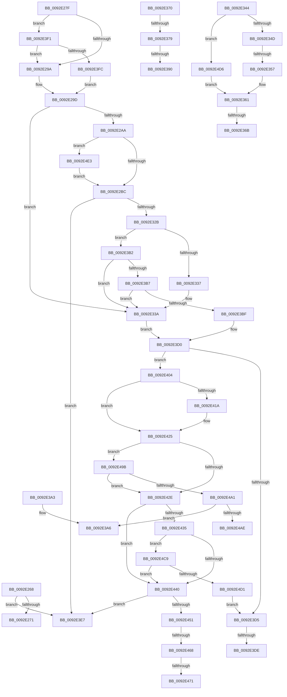

# sub_0092E268

- RVA: `0x0092E268`–`0x0092E4F5` (길이 `653` bytes)
- VA: `0x000000014092E268`
- 실행 섹션: `PAGE`
- PDB 이름 있음: `아니요`; PDB Function 태그: `아니요`
- unwind 정보 RVA: `0x0008DC3C`
- 디코드: `165`개 명령, `653/653` bytes 표시
- 미해석 바이트: `0` (있으면 어셈블리에 `.byte`로 보존)

> 이 문서는 커널 이미지의 기계어와 PDB 기호를 분석해 생성했습니다. 4번과 5번은 함수 원형과 자료형을 바이너리 사용 방식에서 추정한 C 해석이며 원본 소스 복구 결과는 아닙니다.

## 1. Dependencies

- 직접 호출 지점: **3**; 고유 호출 대상: **3**
- 직접 호출자로 확인된 함수: **0**
- RIP 상대 이미지 참조: **0**

### Outgoing calls
- `0x0092E31E` → [RtlpCopyEffectiveAce](RtlpCopyEffectiveAce_function_0092E530.md) (function, `0x0092E530`)
- `0x0092E382` → [RtlFindAceByType](../../text/41/RtlFindAceByType_function_00410AF0.md) (function, `0x00410AF0`)
- `0x0092E478` → [memcpy](../../text/6C/memcpy_function_006C6840.md) (function, `0x006C6840`)

### Direct callers
- 이 함수 시작 RVA로 연결되는 직접 call은 확인되지 않았습니다. 간접 호출은 완전히 역산할 수 없습니다.

### Static image references
- 디코드된 RIP-relative 메모리 참조가 없습니다.

## 2. Other-region calls and transfers

- 다른 실행 섹션으로 향하는 call: **2**
  - `0x0092E382` → [RtlFindAceByType](../../text/41/RtlFindAceByType_function_00410AF0.md) (`PAGE` → `.text`)
  - `0x0092E478` → [memcpy](../../text/6C/memcpy_function_006C6840.md) (`PAGE` → `.text`)
- call이 아닌 외부 분기/꼬리 이동: **15**
  - `0x0092E27A` → [sub_0092E0A2 + 0x27](Unknown_function_0092E0A2.md) (`tail-transfer`)
  - `0x0092E351` → [sub_0092E0A2 + 0x14A](Unknown_function_0092E0A2.md) (`tail-transfer`)
  - `0x0092E365` → [sub_0092E0A2 + 0x7F](Unknown_function_0092E0A2.md) (`tail-transfer`)
  - `0x0092E36B` → [sub_0092E0A2 + 0x14A](Unknown_function_0092E0A2.md) (`tail-transfer`)
  - `0x0092E373` → [sub_0092E0A2 + 0x150](Unknown_function_0092E0A2.md) (`tail-transfer`)
  - `0x0092E38A` → [sub_0092E0A2 + 0x16E](Unknown_function_0092E0A2.md) (`tail-transfer`)
  - `0x0092E39E` → [sub_0092E0A2 + 0x75](Unknown_function_0092E0A2.md) (`tail-transfer`)
  - `0x0092E3AD` → [sub_0092E0A2 + 0x13C](Unknown_function_0092E0A2.md) (`tail-transfer`)
  - `0x0092E3D8` → [sub_0092E4FF + 0x12](Unknown_function_0092E4FF.md) (`tail-transfer`)
  - `0x0092E3E2` → [sub_0092E0A2 + 0x136](Unknown_function_0092E0A2.md) (`tail-transfer`)
  - `0x0092E3EC` → [sub_0092E0A2 + 0x18C](Unknown_function_0092E0A2.md) (`tail-transfer`)
  - `0x0092E462` → [sub_0092E4FF + 0xF](Unknown_function_0092E4FF.md) (`tail-transfer`)
  - `0x0092E46B` → [sub_0092E4FF + 0x12](Unknown_function_0092E4FF.md) (`tail-transfer`)
  - `0x0092E496` → [sub_0092E0A2 + 0x132](Unknown_function_0092E0A2.md) (`tail-transfer`)
  - `0x0092E4C4` → [sub_0092E0A2 + 0x136](Unknown_function_0092E0A2.md) (`tail-transfer`)

## 3. Assembly (complete function range)

```asm
0092E268  48 3B D8                        cmp rbx, rax
0092E26B  0F 83 76 01 00 00               jae 0x14092e3e7
0092E271  0F B7 43 02                     movzx eax, word ptr [rbx + 2]
0092E275  FF C1                           inc ecx
0092E277  48 03 D8                        add rbx, rax
0092E27A  E9 4A FE FF FF                  jmp 0x14092e0c9
0092E27F  80 7D 78 00                     cmp byte ptr [rbp + 0x78], 0
0092E283  41 8B CA                        mov ecx, r10d
0092E286  89 4D 88                        mov dword ptr [rbp - 0x78], ecx
0092E289  45 8B FA                        mov r15d, r10d
0092E28C  C6 45 82 00                     mov byte ptr [rbp - 0x7e], 0
0092E290  48 89 5D 90                     mov qword ptr [rbp - 0x70], rbx
0092E294  0F 85 57 01 00 00               jne 0x14092e3f1
0092E29A  45 32 E4                        xor r12b, r12b
0092E29D  41 0F B6 45 01                  movzx eax, byte ptr [r13 + 1]
0092E2A2  A8 08                           test al, 8
0092E2A4  0F 85 90 00 00 00               jne 0x14092e33a
0092E2AA  32 D2                           xor dl, dl
0092E2AC  C6 45 81 00                     mov byte ptr [rbp - 0x7f], 0
0092E2B0  38 95 80 00 00 00               cmp byte ptr [rbp + 0x80], dl
0092E2B6  0F 85 27 02 00 00               jne 0x14092e4e3
0092E2BC  48 8D 45 81                     lea rax, [rbp - 0x7f]
0092E2C0  4D 8B CB                        mov r9, r11
0092E2C3  48 89 44 24 78                  mov qword ptr [rsp + 0x78], rax
0092E2C8  49 8B CD                        mov rcx, r13
0092E2CB  48 8D 45 82                     lea rax, [rbp - 0x7e]
0092E2CF  48 89 44 24 70                  mov qword ptr [rsp + 0x70], rax
0092E2D4  48 8D 45 88                     lea rax, [rbp - 0x78]
0092E2D8  4C 89 54 24 68                  mov qword ptr [rsp + 0x68], r10
0092E2DD  48 89 7C 24 60                  mov qword ptr [rsp + 0x60], rdi
0092E2E2  48 89 44 24 58                  mov qword ptr [rsp + 0x58], rax
0092E2E7  48 8D 45 90                     lea rax, [rbp - 0x70]
0092E2EB  48 89 44 24 50                  mov qword ptr [rsp + 0x50], rax
0092E2F0  48 8B 45 B0                     mov rax, qword ptr [rbp - 0x50]
0092E2F4  44 89 54 24 48                  mov dword ptr [rsp + 0x48], r10d
0092E2F9  4C 89 54 24 40                  mov qword ptr [rsp + 0x40], r10
0092E2FE  4C 89 44 24 38                  mov qword ptr [rsp + 0x38], r8
0092E303  45 0F B6 C4                     movzx r8d, r12b
0092E307  48 89 44 24 30                  mov qword ptr [rsp + 0x30], rax
0092E30C  48 8B 45 B8                     mov rax, qword ptr [rbp - 0x48]
0092E310  48 89 44 24 28                  mov qword ptr [rsp + 0x28], rax
0092E315  48 8B 45 C0                     mov rax, qword ptr [rbp - 0x40]
0092E319  48 89 44 24 20                  mov qword ptr [rsp + 0x20], rax
0092E31E  E8 0D 02 00 00                  call 0x14092e530
0092E323  84 C0                           test al, al
0092E325  0F 84 BC 00 00 00               je 0x14092e3e7
0092E32B  80 7D 81 00                     cmp byte ptr [rbp - 0x7f], 0
0092E32F  8B 4D 88                        mov ecx, dword ptr [rbp - 0x78]
0092E332  44 8B F9                        mov r15d, ecx
0092E335  74 7B                           je 0x14092e3b2
0092E337  40 B6 01                        mov sil, 1
0092E33A  44 0F B6 45 80                  movzx r8d, byte ptr [rbp - 0x80]
0092E33F  E9 8C 00 00 00                  jmp 0x14092e3d0
0092E344  45 85 FF                        test r15d, r15d
0092E347  0F 84 89 01 00 00               je 0x14092e4d6
0092E34D  41 83 FF 01                     cmp r15d, 1
0092E351  0F 85 95 FE FF FF               jne 0x14092e1ec
0092E357  41 0F B6 45 01                  movzx eax, byte ptr [r13 + 1]
0092E35C  C0 E8 04                        shr al, 4
0092E35F  F6 D0                           not al
0092E361  24 01                           and al, 1
0092E363  84 C0                           test al, al
0092E365  0F 85 B6 FD FF FF               jne 0x14092e121
0092E36B  E9 7C FE FF FF                  jmp 0x14092e1ec
0092E370  83 F9 03                        cmp ecx, 3
0092E373  0F 85 79 FE FF FF               jne 0x14092e1f2
0092E379  8D 51 0E                        lea edx, [rcx + 0xe]
0092E37C  45 33 C0                        xor r8d, r8d
0092E37F  48 8B CF                        mov rcx, rdi
0092E382  E8 69 27 AE FF                  call 0x140410af0
0092E387  48 85 C0                        test rax, rax
0092E38A  0F 85 80 FE FF FF               jne 0x14092e210
0092E390  8B 55 8C                        mov edx, dword ptr [rbp - 0x74]
0092E393  45 33 D2                        xor r10d, r10d
0092E396  4C 8B 45 98                     mov r8, qword ptr [rbp - 0x68]
0092E39A  4C 8B 5D A8                     mov r11, qword ptr [rbp - 0x58]
0092E39E  E9 74 FD FF FF                  jmp 0x14092e117
0092E3A3  40 B6 01                        mov sil, 1
0092E3A6  0F B7 5F 02                     movzx ebx, word ptr [rdi + 2]
0092E3AA  48 03 DF                        add rbx, rdi
0092E3AD  E9 2C FE FF FF                  jmp 0x14092e1de
0092E3B2  40 84 F6                        test sil, sil
0092E3B5  75 83                           jne 0x14092e33a
0092E3B7  85 C9                           test ecx, ecx
0092E3B9  0F 84 7B FF FF FF               je 0x14092e33a
0092E3BF  44 0F B6 45 80                  movzx r8d, byte ptr [rbp - 0x80]
0092E3C4  41 0F B6 C0                     movzx eax, r8b
0092E3C8  F6 D0                           not al
0092E3CA  20 43 01                        and byte ptr [rbx + 1], al
0092E3CD  8B 4D 88                        mov ecx, dword ptr [rbp - 0x78]
0092E3D0  45 84 E4                        test r12b, r12b
0092E3D3  75 2F                           jne 0x14092e404
0092E3D5  40 84 F6                        test sil, sil
0092E3D8  0F 85 33 01 00 00               jne 0x14092e511
0092E3DE  44 8B 65 84                     mov r12d, dword ptr [rbp - 0x7c]
0092E3E2  E9 F1 FD FF FF                  jmp 0x14092e1d8
0092E3E7  B8 7D 00 00 C0                  mov eax, 0xc000007d
0092E3EC  E9 3D FE FF FF                  jmp 0x14092e22e
0092E3F1  41 F6 45 01 03                  test byte ptr [r13 + 1], 3
0092E3F6  0F 84 9E FE FF FF               je 0x14092e29a
0092E3FC  41 B4 01                        mov r12b, 1
0092E3FF  E9 99 FE FF FF                  jmp 0x14092e29d
0092E404  41 8B 55 0A                     mov edx, dword ptr [r13 + 0xa]
0092E408  C7 45 D8 00 00 00 00            mov dword ptr [rbp - 0x28], 0
0092E40F  66 C7 45 DC 00 03               mov word ptr [rbp - 0x24], 0x300
0092E415  2B 55 D8                        sub edx, dword ptr [rbp - 0x28]
0092E418  75 0B                           jne 0x14092e425
0092E41A  41 0F B7 55 0E                  movzx edx, word ptr [r13 + 0xe]
0092E41F  0F B7 45 DC                     movzx eax, word ptr [rbp - 0x24]
0092E423  2B D0                           sub edx, eax
0092E425  85 D2                           test edx, edx
0092E427  0F 94 C0                        sete al
0092E42A  85 C9                           test ecx, ecx
0092E42C  75 6D                           jne 0x14092e49b
0092E42E  41 80 7D 00 08                  cmp byte ptr [r13], 8
0092E433  77 0B                           ja 0x14092e440
0092E435  41 83 7D 04 00                  cmp dword ptr [r13 + 4], 0
0092E43A  0F 84 89 00 00 00               je 0x14092e4c9
0092E440  41 0F B7 45 02                  movzx eax, word ptr [r13 + 2]
0092E445  44 03 F8                        add r15d, eax
0092E448  41 81 FF FF FF 00 00            cmp r15d, 0xffff
0092E44F  77 96                           ja 0x14092e3e7
0092E451  44 8B C0                        mov r8d, eax
0092E454  0F B7 47 02                     movzx eax, word ptr [rdi + 2]
0092E458  48 2B 45 90                     sub rax, qword ptr [rbp - 0x70]
0092E45C  48 03 C7                        add rax, rdi
0092E45F  4C 3B C0                        cmp r8, rax
0092E462  0F 8F A6 00 00 00               jg 0x14092e50e
0092E468  40 84 F6                        test sil, sil
0092E46B  0F 85 A0 00 00 00               jne 0x14092e511
0092E471  48 8B 4D 90                     mov rcx, qword ptr [rbp - 0x70]
0092E475  49 8B D5                        mov rdx, r13
0092E478  E8 C3 83 D9 FF                  call 0x1406c6840
0092E47D  48 8B 45 90                     mov rax, qword ptr [rbp - 0x70]
0092E481  44 8B 65 84                     mov r12d, dword ptr [rbp - 0x7c]
0092E485  80 48 01 08                     or byte ptr [rax + 1], 8
0092E489  48 8B 4D 90                     mov rcx, qword ptr [rbp - 0x70]
0092E48D  0F B6 45 80                     movzx eax, byte ptr [rbp - 0x80]
0092E491  F6 D0                           not al
0092E493  20 41 01                        and byte ptr [rcx + 1], al
0092E496  E9 39 FD FF FF                  jmp 0x14092e1d4
0092E49B  80 7D 82 00                     cmp byte ptr [rbp - 0x7e], 0
0092E49F  75 8D                           jne 0x14092e42e
0092E4A1  44 8B 65 84                     mov r12d, dword ptr [rbp - 0x7c]
0092E4A5  40 84 F6                        test sil, sil
0092E4A8  0F 85 F8 FE FF FF               jne 0x14092e3a6
0092E4AE  41 0F B6 4D 01                  movzx ecx, byte ptr [r13 + 1]
0092E4B3  41 0F B6 C0                     movzx eax, r8b
0092E4B7  80 E1 1F                        and cl, 0x1f
0092E4BA  F6 D0                           not al
0092E4BC  0A 4B 01                        or cl, byte ptr [rbx + 1]
0092E4BF  22 C8                           and cl, al
0092E4C1  88 4B 01                        mov byte ptr [rbx + 1], cl
0092E4C4  E9 0F FD FF FF                  jmp 0x14092e1d8
0092E4C9  84 C0                           test al, al
0092E4CB  0F 85 6F FF FF FF               jne 0x14092e440
0092E4D1  E9 FF FE FF FF                  jmp 0x14092e3d5
0092E4D6  41 0F B6 45 01                  movzx eax, byte ptr [r13 + 1]
0092E4DB  C0 E8 04                        shr al, 4
0092E4DE  E9 7E FE FF FF                  jmp 0x14092e361
0092E4E3  A8 10                           test al, 0x10
0092E4E5  0F B6 D2                        movzx edx, dl
0092E4E8  B8 01 00 00 00                  mov eax, 1
0092E4ED  0F 45 D0                        cmovne edx, eax
0092E4F0  E9 C7 FD FF FF                  jmp 0x14092e2bc
```

## 4. C-style interpretation (structured pseudocode)

```c
__int64 __fastcall sub_0092E268(int a1, unsigned __int8 a2, __int64 a3)
{
    __int64 v_rbx;
    unsigned __int64 v_stack_p20;
    unsigned __int64 v_stack_p28;
    unsigned __int64 v_stack_p30;
    unsigned __int64 v_stack_p38;
    unsigned __int64 v_stack_p40;
    unsigned int v_stack_p48;
    unsigned __int64 v_stack_p50;
    unsigned __int64 v_stack_p58;
    unsigned __int64 v_stack_p60;
    unsigned __int64 v_stack_p68;
    unsigned __int64 v_stack_p70;
    unsigned __int64 v_stack_p78;

    if (v_rbx >= result) goto loc_0092E3E7;
    a1 = (unsigned int)((a1) + 1);
    v_rbx = (v_rbx) + (*(unsigned __int16 *)(v_rbx + 2));
loc_0092E3E7:
}
```

## 5. (Beta) C Style

```c
int64_t sub_0092E268(int32_t Arg1, uint8_t Arg2, int64_t Arg3)
{
    int64_t local_rbx;
    uint64_t v_stack_p20;
    uint64_t v_stack_p28;
    uint64_t v_stack_p30;
    uint64_t v_stack_p38;
    uint64_t v_stack_p40;
    uint32_t v_stack_p48;
    uint64_t v_stack_p50;
    uint64_t v_stack_p58;
    uint64_t v_stack_p60;
    uint64_t v_stack_p68;
    uint64_t v_stack_p70;
    uint64_t v_stack_p78;

    if (local_rbx >= result) goto loc_0092E3E7;
    Arg1 = (uint32_t)((Arg1) + 1);
    local_rbx = (local_rbx) + (*(uint16_t *)(local_rbx + 0x2));
loc_0092E3E7:
}
```

## 6. Execution-region graph

[열기: 2D/3D 그래프와 함수 탐색 컨트롤 패널](../../../control-panel.html?section=page&rva=0x0092E268&view=graph)

- 2D 그래프는 위에서 아래로 흐르고, 3D 그래프는 빈 공간을 드래그해 회전합니다. Shift+드래그는 이동, 휠은 확대·축소, 함수 노드 선택은 대상 보고서 이동입니다.

### Static fallback


