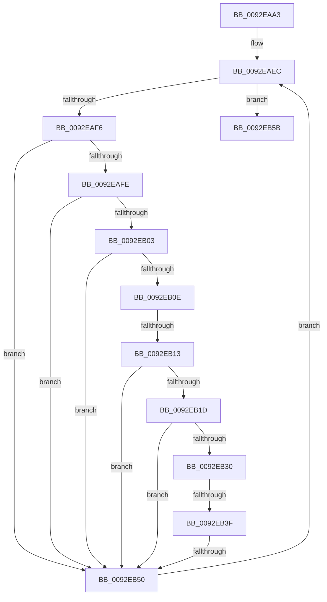

# sub_0092EAA3

- RVA: `0x0092EAA3`–`0x0092EB7B` (길이 `216` bytes)
- VA: `0x000000014092EAA3`
- 실행 섹션: `PAGE`
- PDB 이름 있음: `아니요`; PDB Function 태그: `아니요`
- unwind 정보 RVA: `0x0008DCD0`
- 디코드: `56`개 명령, `216/216` bytes 표시
- 미해석 바이트: `0` (있으면 어셈블리에 `.byte`로 보존)

> 이 문서는 커널 이미지의 기계어와 PDB 기호를 분석해 생성했습니다. 4번과 5번은 함수 원형과 자료형을 바이너리 사용 방식에서 추정한 C 해석이며 원본 소스 복구 결과는 아닙니다.

## 1. Dependencies

- 직접 호출 지점: **1**; 고유 호출 대상: **1**
- 직접 호출자로 확인된 함수: **0**
- RIP 상대 이미지 참조: **1**

### Outgoing calls
- `0x0092EB47` → [RtlEqualSid](../../text/40/RtlEqualSid_function_00400AD0.md) (function, `0x00400AD0`)

### Direct callers
- 이 함수 시작 RVA로 연결되는 직접 call은 확인되지 않았습니다. 간접 호출은 완전히 역산할 수 없습니다.

### Static image references
- `0x0092EAC3` → RVA `0x00000000` (`image boundary/outside`; read)

## 2. Other-region calls and transfers

- 다른 실행 섹션으로 향하는 call: **1**
  - `0x0092EB47` → [RtlEqualSid](../../text/40/RtlEqualSid_function_00400AD0.md) (`PAGE` → `.text`)
- call이 아닌 외부 분기/꼬리 이동: **3**
  - `0x0092EB11` → [sub_0092EB8D](Unknown_function_0092EB8D.md) (`tail-transfer`)
  - `0x0092EB39` → [sub_0092EB8D + 0x4C](Unknown_function_0092EB8D.md) (`tail-transfer`)
  - `0x0092EB4E` → [sub_0092EB8D + 0x18](Unknown_function_0092EB8D.md) (`tail-transfer`)

## 3. Assembly (complete function range)

```asm
0092EAA3  48 89 5C 24 70                  mov qword ptr [rsp + 0x70], rbx
0092EAA8  BB 00 00 00 00                  mov ebx, 0
0092EAAD  48 89 7C 24 40                  mov qword ptr [rsp + 0x40], rdi
0092EAB2  48 8D 7D 08                     lea rdi, [rbp + 8]
0092EAB6  4C 89 64 24 38                  mov qword ptr [rsp + 0x38], r12
0092EABB  44 8B E0                        mov r12d, eax
0092EABE  4C 89 6C 24 30                  mov qword ptr [rsp + 0x30], r13
0092EAC3  4C 8D 2D 36 15 6D FF            lea r13, [rip - 0x92eaca]
0092EACA  4C 89 74 24 28                  mov qword ptr [rsp + 0x28], r14
0092EACF  44 8B F3                        mov r14d, ebx
0092EAD2  4C 89 7C 24 20                  mov qword ptr [rsp + 0x20], r15
0092EAD7  44 8B F8                        mov r15d, eax
0092EADA  44 0F 44 FB                     cmove r15d, ebx
0092EADE  F6 C1 01                        test cl, 1
0092EAE1  44 0F 44 E3                     cmove r12d, ebx
0092EAE5  F6 C1 08                        test cl, 8
0092EAE8  44 0F 44 F0                     cmove r14d, eax
0092EAEC  0F B7 45 04                     movzx eax, word ptr [rbp + 4]
0092EAF0  FF C8                           dec eax
0092EAF2  3B D8                           cmp ebx, eax
0092EAF4  7D 65                           jge 0x14092eb5b
0092EAF6  0F B6 0F                        movzx ecx, byte ptr [rdi]
0092EAF9  80 F9 08                        cmp cl, 8
0092EAFC  77 52                           ja 0x14092eb50
0092EAFE  80 F9 04                        cmp cl, 4
0092EB01  74 4D                           je 0x14092eb50
0092EB03  44 0F B6 4F 01                  movzx r9d, byte ptr [rdi + 1]
0092EB08  41 F6 C1 10                     test r9b, 0x10
0092EB0C  74 42                           je 0x14092eb50
0092EB0E  80 F9 05                        cmp cl, 5
0092EB11  73 7A                           jae 0x14092eb8d
0092EB13  0F B6 16                        movzx edx, byte ptr [rsi]
0092EB16  8D 42 FB                        lea eax, [rdx - 5]
0092EB19  3C 03                           cmp al, 3
0092EB1B  76 33                           jbe 0x14092eb50
0092EB1D  42 0F B6 84 29 38 AD B4 00      movzx eax, byte ptr [rcx + r13 + 0xb4ad38]
0092EB26  42 38 84 2A 38 AD B4 00         cmp byte ptr [rdx + r13 + 0xb4ad38], al
0092EB2E  75 20                           jne 0x14092eb50
0092EB30  42 80 BC 2A 08 B0 B4 00 00      cmp byte ptr [rdx + r13 + 0xb4b008], 0
0092EB39  0F 85 9A 00 00 00               jne 0x14092ebd9
0092EB3F  48 8D 57 08                     lea rdx, [rdi + 8]
0092EB43  48 8D 4E 08                     lea rcx, [rsi + 8]
0092EB47  E8 84 1F AD FF                  call 0x140400ad0
0092EB4C  84 C0                           test al, al
0092EB4E  75 55                           jne 0x14092eba5
0092EB50  0F B7 47 02                     movzx eax, word ptr [rdi + 2]
0092EB54  FF C3                           inc ebx
0092EB56  48 03 F8                        add rdi, rax
0092EB59  EB 91                           jmp 0x14092eaec
0092EB5B  32 C0                           xor al, al
0092EB5D  4C 8B 74 24 28                  mov r14, qword ptr [rsp + 0x28]
0092EB62  4C 8B 6C 24 30                  mov r13, qword ptr [rsp + 0x30]
0092EB67  4C 8B 64 24 38                  mov r12, qword ptr [rsp + 0x38]
0092EB6C  48 8B 7C 24 40                  mov rdi, qword ptr [rsp + 0x40]
0092EB71  48 8B 5C 24 70                  mov rbx, qword ptr [rsp + 0x70]
0092EB76  4C 8B 7C 24 20                  mov r15, qword ptr [rsp + 0x20]
```

## 4. C-style interpretation (structured pseudocode)

```c
__int64 __fastcall sub_0092EAA3(unsigned __int8 a1, __int64 a2, __int64 a3, __int64 a4, __int64 a5, __int64 a6, __int64 a7, __int64 a8, __int64 a9, __int64 a10, __int64 a11, __int64 a12, __int64 a13, __int64 a14)
{
    __int64 result;
    __int64 v_r12;
    __int64 v_r14;
    __int64 v_r15;
    __int64 v_rbx;
    __int64 v_rdi;
    unsigned __int64 v_stack_p20;
    unsigned __int64 v_stack_p28;
    unsigned __int64 v_stack_p30;
    unsigned __int64 v_stack_p38;
    unsigned __int64 v_stack_p40;
    unsigned __int64 v_stack_p70;

    v_stack_p70 = v_rbx;
    v_stack_p40 = v_rdi;
    v_stack_p38 = v_r12;
    v_stack_p30 = v_r13;
    v_stack_p28 = v_r14;
    v_stack_p20 = v_r15;
    v_r15 = (unsigned int)((unsigned int)(result));
    if (condition_is_equal) { v_r15 = 0; }
    v_r12 = (unsigned int)((unsigned int)(result));
    if (((a1) & (1)) == 0) { v_r12 = 0; }
    v_r14 = 0;
    if (((a1) & (8)) == 0) { v_r14 = (unsigned int)(result); }
loc_0092EAEC:
    result = (unsigned int)((*(unsigned __int16 *)(v_rbp + 4)) - 1);
    if (0 >= ((unsigned int)(result))) goto loc_0092EB5B;
    if (((unsigned __int8)(*(unsigned __int8 *)(v_rbp + 8))) > 8) goto loc_0092EB50;
    if (((unsigned __int8)(*(unsigned __int8 *)(v_rbp + 8))) == 4) goto loc_0092EB50;
    if ((((unsigned __int8)(*(unsigned __int8 *)(v_rbp + 8 + 1))) & (16)) == 0) goto loc_0092EB50;
    if (((unsigned __int8)(*(unsigned __int8 *)(v_rsi) - 5)) <= 3) goto loc_0092EB50;
    if ((*(unsigned __int8 *)(*(unsigned __int8 *)(v_rsi) + v_rip - 9628362 * 1 + 11840824)) != ((unsigned __int8)(*(unsigned __int8 *)(*(unsigned __int8 *)(v_rbp + 8) + v_rip - 9628362 * 1 + 11840824)))) goto loc_0092EB50;
    result = RtlEqualSid(v_rsi + 8, v_rbp + 8 + 8, a3, *(unsigned __int8 *)(v_rbp + 8 + 1));
loc_0092EB50:
    v_rbx = (unsigned int)((0) + 1);
    v_rdi = (v_rbp + 8) + (*(unsigned __int16 *)(v_rbp + 8 + 2));
    goto loc_0092EAEC;
loc_0092EB5B:
    result = 0;
    return result;
}
```

## 5. (Beta) C Style

```c
int64_t sub_0092EAA3(uint8_t Arg1, int64_t Arg2, int64_t Arg3, int64_t Arg4, int64_t Arg5, int64_t Arg6, int64_t Arg7, int64_t Arg8, uint64_t Arg9, uint64_t Arg10, uint64_t Arg11, uint64_t Arg12, uint64_t Arg13, int64_t Arg14)
{
    int64_t result;
    int64_t local_r12;
    int64_t local_r14;
    int64_t local_r15;
    int64_t local_rbx;
    int64_t local_rdi;
    uint64_t v_stack_p20;
    uint64_t v_stack_p28;
    uint64_t v_stack_p30;
    uint64_t v_stack_p38;
    uint64_t v_stack_p40;
    uint64_t v_stack_p70;

    v_stack_p70 = local_rbx;
    v_stack_p40 = local_rdi;
    v_stack_p38 = local_r12;
    v_stack_p30 = local_r13;
    v_stack_p28 = local_r14;
    v_stack_p20 = local_r15;
    local_r15 = (uint32_t)((uint32_t)(result));
    if (condition_is_equal) { local_r15 = 0; }
    local_r12 = (uint32_t)((uint32_t)(result));
    if (((Arg1) & (1)) == 0) { local_r12 = 0; }
    local_r14 = 0;
    if (((Arg1) & (8)) == 0) { local_r14 = (uint32_t)(result); }
loc_0092EAEC:
    result = (uint32_t)((*(uint16_t *)(local_rbp + 0x4)) - 1);
    if (0 >= ((uint32_t)(result))) goto loc_0092EB5B;
    if (((uint8_t)(*(uint8_t *)(local_rbp + 0x8))) > 8) goto loc_0092EB50;
    if (((uint8_t)(*(uint8_t *)(local_rbp + 0x8))) == 4) goto loc_0092EB50;
    if ((((uint8_t)(*(uint8_t *)(local_rbp + 0x8 + 0x1))) & (16)) == 0) goto loc_0092EB50;
    if (((uint8_t)(*(uint8_t *)(local_rsi) - 5)) <= 3) goto loc_0092EB50;
    if ((*(uint8_t *)(*(uint8_t *)(local_rsi) + v_rip - 0x92EACA * 1 + 0xB4AD38)) != ((uint8_t)(*(uint8_t *)(*(uint8_t *)(local_rbp + 0x8) + v_rip - 0x92EACA * 1 + 0xB4AD38)))) goto loc_0092EB50;
    result = RtlEqualSid(local_rsi + 8, local_rbp + 8 + 8, Arg3, *(uint8_t *)(local_rbp + 0x8 + 0x1));
loc_0092EB50:
    local_rbx = (uint32_t)((0) + 1);
    local_rdi = (local_rbp + 8) + (*(uint16_t *)(local_rbp + 0x8 + 0x2));
    goto loc_0092EAEC;
loc_0092EB5B:
    result = 0;
    return result;
}
```

## 6. Execution-region graph

[열기: 2D/3D 그래프와 함수 탐색 컨트롤 패널](../../../control-panel.html?section=page&rva=0x0092EAA3&view=graph)

- 2D 그래프는 위에서 아래로 흐르고, 3D 그래프는 빈 공간을 드래그해 회전합니다. Shift+드래그는 이동, 휠은 확대·축소, 함수 노드 선택은 대상 보고서 이동입니다.

### Static fallback


