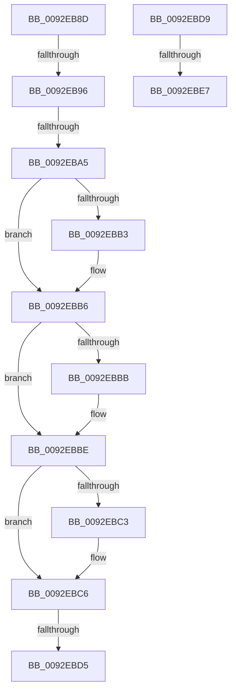

# sub_0092EB8D

- RVA: `0x0092EB8D`–`0x0092EBEC` (길이 `95` bytes)
- VA: `0x000000014092EB8D`
- 실행 섹션: `PAGE`
- PDB 이름 있음: `아니요`; PDB Function 태그: `아니요`
- unwind 정보 RVA: `0x0008DD10`
- 디코드: `31`개 명령, `95/95` bytes 표시
- 미해석 바이트: `0` (있으면 어셈블리에 `.byte`로 보존)

> 이 문서는 커널 이미지의 기계어와 PDB 기호를 분석해 생성했습니다. 4번과 5번은 함수 원형과 자료형을 바이너리 사용 방식에서 추정한 C 해석이며 원본 소스 복구 결과는 아닙니다.

## 1. Dependencies

- 직접 호출 지점: **1**; 고유 호출 대상: **1**
- 직접 호출자로 확인된 함수: **0**
- RIP 상대 이미지 참조: **0**

### Outgoing calls
- `0x0092EB9C` → [RtlpCompareKnownObjectAces](../70/RtlpCompareKnownObjectAces_function_00704670.md) (function, `0x00704670`)

### Direct callers
- 이 함수 시작 RVA로 연결되는 직접 call은 확인되지 않았습니다. 간접 호출은 완전히 역산할 수 없습니다.

### Static image references
- 디코드된 RIP-relative 메모리 참조가 없습니다.

## 2. Other-region calls and transfers

- 다른 실행 섹션으로 향하는 call: **0**
- call이 아닌 외부 분기/꼬리 이동: **6**
  - `0x0092EB94` → [sub_0092EAA3 + 0xAD](Unknown_function_0092EAA3.md) (`tail-transfer`)
  - `0x0092EBA3` → [sub_0092EAA3 + 0xAD](Unknown_function_0092EAA3.md) (`tail-transfer`)
  - `0x0092EBCF` → [sub_0092EAA3 + 0xAD](Unknown_function_0092EAA3.md) (`tail-transfer`)
  - `0x0092EBD7` → [sub_0092EAA3 + 0xBA](Unknown_function_0092EAA3.md) (`tail-transfer`)
  - `0x0092EBE1` → [sub_0092EAA3 + 0x9C](Unknown_function_0092EAA3.md) (`tail-transfer`)
  - `0x0092EBE7` → [sub_0092EAA3 + 0xAD](Unknown_function_0092EAA3.md) (`tail-transfer`)

## 3. Assembly (complete function range)

```asm
0092EB8D  0F B6 06                        movzx eax, byte ptr [rsi]
0092EB90  2C 05                           sub al, 5
0092EB92  3C 03                           cmp al, 3
0092EB94  77 BA                           ja 0x14092eb50
0092EB96  48 8B D6                        mov rdx, rsi
0092EB99  48 8B CF                        mov rcx, rdi
0092EB9C  E8 CF 5A DD FF                  call 0x140704670
0092EBA1  84 C0                           test al, al
0092EBA3  74 AB                           je 0x14092eb50
0092EBA5  0F B6 4F 01                     movzx ecx, byte ptr [rdi + 1]
0092EBA9  8B 47 04                        mov eax, dword ptr [rdi + 4]
0092EBAC  F7 D0                           not eax
0092EBAE  F6 C1 02                        test cl, 2
0092EBB1  74 03                           je 0x14092ebb6
0092EBB3  44 23 F8                        and r15d, eax
0092EBB6  F6 C1 01                        test cl, 1
0092EBB9  74 03                           je 0x14092ebbe
0092EBBB  44 23 E0                        and r12d, eax
0092EBBE  F6 C1 08                        test cl, 8
0092EBC1  75 03                           jne 0x14092ebc6
0092EBC3  44 23 F0                        and r14d, eax
0092EBC6  41 8B C6                        mov eax, r14d
0092EBC9  41 0B C4                        or eax, r12d
0092EBCC  41 0B C7                        or eax, r15d
0092EBCF  0F 85 7B FF FF FF               jne 0x14092eb50
0092EBD5  B0 01                           mov al, 1
0092EBD7  EB 84                           jmp 0x14092eb5d
0092EBD9  44 32 4E 01                     xor r9b, byte ptr [rsi + 1]
0092EBDD  41 F6 C1 C0                     test r9b, 0xc0
0092EBE1  0F 84 58 FF FF FF               je 0x14092eb3f
0092EBE7  E9 64 FF FF FF                  jmp 0x14092eb50
```

## 4. C-style interpretation (structured pseudocode)

```c
__int64 __fastcall sub_0092EB8D(__int64 a1, __int64 a2, __int64 a3, unsigned __int8 a4)
{
    __int64 result;
    __int64 v_r12;
    __int64 v_r14;
    __int64 v_r15;

    result = (unsigned __int8)((*(unsigned __int8 *)(v_rsi)) - (5));
    result = RtlpCompareKnownObjectAces(v_rdi, v_rsi, a3, a4);
    result = (unsigned int)(~((unsigned int)(*(unsigned int *)(v_rdi + 4))));
    if ((((unsigned __int8)(*(unsigned __int8 *)(v_rdi + 1))) & (2)) != 0) {
        v_r15 = (unsigned int)((v_r15) & ((unsigned int)(result)));
    }
    if ((((unsigned __int8)(*(unsigned __int8 *)(v_rdi + 1))) & (1)) != 0) {
        v_r12 = (unsigned int)((v_r12) & ((unsigned int)(result)));
    }
    if ((((unsigned __int8)(*(unsigned __int8 *)(v_rdi + 1))) & (8)) == 0) {
        v_r14 = (unsigned int)((v_r14) & ((unsigned int)(result)));
    }
    result = (unsigned int)(((unsigned int)((unsigned int)(v_r14))) | ((unsigned int)(v_r12)));
    result = (unsigned int)((result) | ((unsigned int)(v_r15)));
}
```

## 5. (Beta) C Style

```c
int64_t sub_0092EB8D(int64_t Arg1, int64_t Arg2, int64_t Arg3, uint8_t Arg4)
{
    int64_t result;
    int64_t local_r12;
    int64_t local_r14;
    int64_t local_r15;

    result = (uint8_t)((*(uint8_t *)(local_rsi)) - (5));
    result = RtlpCompareKnownObjectAces(local_rdi, local_rsi, Arg3, Arg4);
    result = (uint32_t)(~((uint32_t)(*(uint32_t *)(local_rdi + 0x4))));
    if ((((uint8_t)(*(uint8_t *)(local_rdi + 0x1))) & (2)) != 0) {
        local_r15 = (uint32_t)((local_r15) & ((uint32_t)(result)));
    }
    if ((((uint8_t)(*(uint8_t *)(local_rdi + 0x1))) & (1)) != 0) {
        local_r12 = (uint32_t)((local_r12) & ((uint32_t)(result)));
    }
    if ((((uint8_t)(*(uint8_t *)(local_rdi + 0x1))) & (8)) == 0) {
        local_r14 = (uint32_t)((local_r14) & ((uint32_t)(result)));
    }
    result = (uint32_t)(((uint32_t)((uint32_t)(local_r14))) | ((uint32_t)(local_r12)));
    result = (uint32_t)((result) | ((uint32_t)(local_r15)));
}
```

## 6. Execution-region graph

[열기: 2D/3D 그래프와 함수 탐색 컨트롤 패널](../../../control-panel.html?section=page&rva=0x0092EB8D&view=graph)

- 2D 그래프는 위에서 아래로 흐르고, 3D 그래프는 빈 공간을 드래그해 회전합니다. Shift+드래그는 이동, 휠은 확대·축소, 함수 노드 선택은 대상 보고서 이동입니다.

### Static fallback


