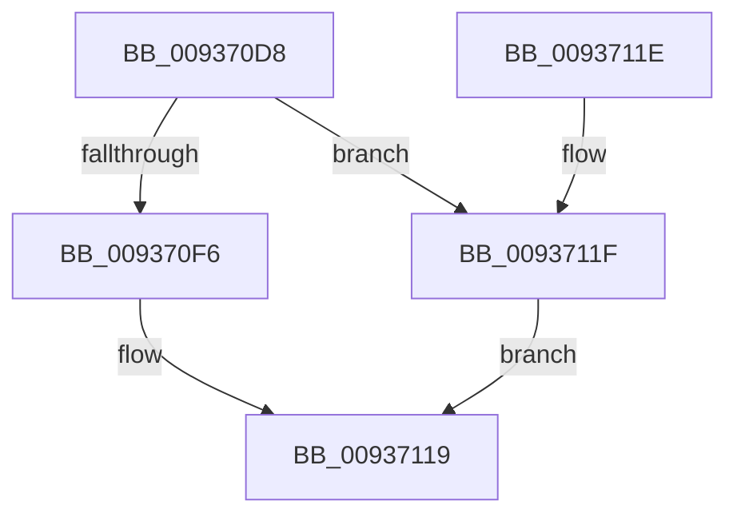

# CmAllocateExtraParameter

- RVA: `0x009370D8`–`0x00937121` (길이 `73` bytes)
- VA: `0x00000001409370D8`
- 실행 섹션: `PAGE`
- PDB 이름 있음: `예`; PDB Function 태그: `아니요`
- unwind 정보 RVA: `0x0005DDFC`
- 디코드: `17`개 명령, `73/73` bytes 표시
- 미해석 바이트: `0` (있으면 어셈블리에 `.byte`로 보존)

> 이 문서는 커널 이미지의 기계어와 PDB 기호를 분석해 생성했습니다. 4번과 5번은 함수 원형과 자료형을 바이너리 사용 방식에서 추정한 C 해석이며 원본 소스 복구 결과는 아닙니다.

## 1. Dependencies

- 직접 호출 지점: **1**; 고유 호출 대상: **1**
- 직접 호출자로 확인된 함수: **2**
- RIP 상대 이미지 참조: **2**

### Outgoing calls
- `0x009370EC` → [CmpAllocatePool](../../text/3C/CmpAllocatePool_function_003CD504.md) (function, `0x003CD504`)

### Direct callers
- [VrpPreOpenOrCreate](VrpPreOpenOrCreate_function_00932B84.md) at `0x00932EFD`
- [VrpPostOpenOrCreate](VrpPostOpenOrCreate_function_00936510.md) at `0x00936646`

### Static image references
- `0x009370F6` → RVA `0x00011F68` (`.rdata`; read)
- `0x009370FD` → RVA `0x00479060` (`VrpOriginalKeyNameParameterCleanup`; read)

## 2. Other-region calls and transfers

- 다른 실행 섹션으로 향하는 call: **1**
  - `0x009370EC` → [CmpAllocatePool](../../text/3C/CmpAllocatePool_function_003CD504.md) (`PAGE` → `.text`)
- 별도 외부 분기/꼬리 이동을 확인하지 못했습니다.

## 3. Assembly (complete function range)

```asm
009370D8  48 83 EC 28                     sub rsp, 0x28
009370DC  BA 50 00 00 00                  mov edx, 0x50
009370E1  41 B8 43 4D 45 50               mov r8d, 0x50454d43
009370E7  B9 00 01 00 00                  mov ecx, 0x100
009370EC  E8 13 64 A9 FF                  call 0x1403cd504
009370F1  48 85 C0                        test rax, rax
009370F4  74 29                           je 0x14093711f
009370F6  0F 10 05 6B AE 6D FF            movups xmm0, xmmword ptr [rip - 0x925195]
009370FD  48 8D 0D 5C 1F B4 FF            lea rcx, [rip - 0x4be0a4]
00937104  48 C7 40 28 20 00 00 00         mov qword ptr [rax + 0x28], 0x20
0093710C  48 89 48 20                     mov qword ptr [rax + 0x20], rcx
00937110  F3 0F 7F 40 10                  movdqu xmmword ptr [rax + 0x10], xmm0
00937115  48 83 C0 30                     add rax, 0x30
00937119  48 83 C4 28                     add rsp, 0x28
0093711D  C3                              ret
0093711E  CC                              int3
0093711F  EB F8                           jmp 0x140937119
```

## 4. C-style interpretation (structured pseudocode)

```c
__int64 __fastcall CmAllocateExtraParameter(void)
{
    __int64 result;
    __int64 v_rsp;

    v_rsp = (v_rsp) - (40);
    result = CmpAllocatePool(256, 80, (unsigned int)(0x50454D43ULL), a4);
    if (result == 0) goto loc_0093711F;
    *(unsigned __int64 *)(result + 40) = 32;
    *(unsigned __int64 *)(result + 32) = v_rip - 4972708;
    *(unsigned __int64 *)(result + 16) = v_xmm0;
    result = (result) + (48);
loc_00937119:
    v_rsp = (v_rsp) + (40);
    return result;
loc_0093711F:
    goto loc_00937119;
}
```

## 5. (Beta) C Style

```c
void CmAllocateExtraParameter(void)
{
    int64_t result;
    int64_t local_rsp;

    local_rsp = (local_rsp) - (40);
    result = CmpAllocatePool(256, 80, (uint32_t)(0x50454D43ULL), a4);
    if (result == 0) goto loc_0093711F;
    *(uint64_t *)(result + 0x28) = 32;
    *(uint64_t *)(result + 0x20) = v_rip - 4972708;
    *(uint64_t *)(result + 0x10) = v_xmm0;
    result = (result) + (48);
loc_00937119:
    local_rsp = (local_rsp) + (40);
    return result;
loc_0093711F:
    goto loc_00937119;
}
```

## 6. Execution-region graph

[열기: 2D/3D 그래프와 함수 탐색 컨트롤 패널](../../../control-panel.html?section=page&rva=0x009370D8&view=graph)

- 2D 그래프는 위에서 아래로 흐르고, 3D 그래프는 빈 공간을 드래그해 회전합니다. Shift+드래그는 이동, 휠은 확대·축소, 함수 노드 선택은 대상 보고서 이동입니다.

### Static fallback


