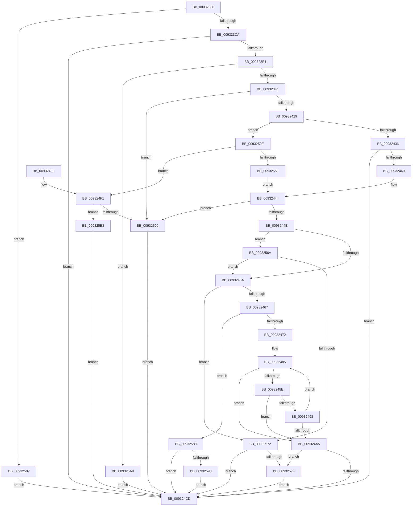

# CmGetDeviceParent

- RVA: `0x00932368`–`0x009325DC` (길이 `628` bytes)
- VA: `0x0000000140932368`
- 실행 섹션: `PAGE`
- PDB 이름 있음: `예`; PDB Function 태그: `아니요`
- unwind 정보 RVA: `0x0008EE30`
- 디코드: `159`개 명령, `628/628` bytes 표시
- 미해석 바이트: `0` (있으면 어셈블리에 `.byte`로 보존)

> 이 문서는 커널 이미지의 기계어와 PDB 기호를 분석해 생성했습니다. 4번과 5번은 함수 원형과 자료형을 바이너리 사용 방식에서 추정한 C 해석이며 원본 소스 복구 결과는 아닙니다.

## 1. Dependencies

- 직접 호출 지점: **6**; 고유 호출 대상: **6**
- 직접 호출자로 확인된 함수: **5**
- RIP 상대 이미지 참조: **3**

### Outgoing calls
- `0x009323BD` → [CmIsRootDevice](CmIsRootDevice_function_009325E4.md) (function, `0x009325E4`)
- `0x009323D2` → [RtlInitUnicodeStringEx](../../text/46/RtlInitUnicodeStringEx_function_00463960.md) (function, `0x00463960`)
- `0x00932419` → [guard_dispatch_icall](../../text/6B/guard_dispatch_icall_function_006BAAD0.md) (function, `0x006BAAD0`)
- `0x009324D9` → [_security_check_cookie](../../text/6A/_security_check_cookie_function_006AC640.md) (function, `0x006AC640`)
- `0x00932556` → [PnpGetObjectProperty](../8E/PnpGetObjectProperty_function_008E2180.md) (function, `0x008E2180`)
- `0x009325D0` → [RtlStringCchCopyExW](../../text/41/RtlStringCchCopyExW_function_0041E1C0.md) (function, `0x0041E1C0`)

### Direct callers
- [sub_008E80AE](../8E/Unknown_function_008E80AE.md) at `0x008E81AE`
- [CmGetDeviceSiblings](../9D/CmGetDeviceSiblings_function_009D0734.md) at `0x009D078D`
- [CmIsDeviceSafeRemovalRequired](../9D/CmIsDeviceSafeRemovalRequired_function_009D1040.md) at `0x009D120E`
- [_CmGetDeviceMappedPropertyFromComposite](../9D/_CmGetDeviceMappedPropertyFromComposite_function_009D1684.md) at `0x009D1C05`
- [CmGetParentDeviceContainerId](../A0/CmGetParentDeviceContainerId_function_00A0AF08.md) at `0x00A0AF69`

### Static image references
- `0x00932382` → RVA `0x00E0A740` (`.data`; read)
- `0x00932545` → RVA `0x00011F50` (`.rdata`; read)
- `0x009325C6` → RVA `0x00AFFD10` (` ?? ::NNGAKEGL::`string'`; read)

## 2. Other-region calls and transfers

- 다른 실행 섹션으로 향하는 call: **4**
  - `0x009323D2` → [RtlInitUnicodeStringEx](../../text/46/RtlInitUnicodeStringEx_function_00463960.md) (`PAGE` → `.text`)
  - `0x00932419` → [guard_dispatch_icall](../../text/6B/guard_dispatch_icall_function_006BAAD0.md) (`PAGE` → `.text`)
  - `0x009324D9` → [_security_check_cookie](../../text/6A/_security_check_cookie_function_006AC640.md) (`PAGE` → `.text`)
  - `0x009325D0` → [RtlStringCchCopyExW](../../text/41/RtlStringCchCopyExW_function_0041E1C0.md) (`PAGE` → `.text`)
- 별도 외부 분기/꼬리 이동을 확인하지 못했습니다.

## 3. Assembly (complete function range)

```asm
00932368  40 55                           push rbp
0093236A  53                              push rbx
0093236B  56                              push rsi
0093236C  57                              push rdi
0093236D  41 54                           push r12
0093236F  41 56                           push r14
00932371  41 57                           push r15
00932373  48 8D AC 24 E0 FE FF FF         lea rbp, [rsp - 0x120]
0093237B  48 81 EC 20 02 00 00            sub rsp, 0x220
00932382  48 8B 05 B7 83 4D 00            mov rax, qword ptr [rip + 0x4d83b7]
00932389  48 33 C4                        xor rax, rsp
0093238C  48 89 85 10 01 00 00            mov qword ptr [rbp + 0x110], rax
00932393  41 8B 39                        mov edi, dword ptr [r9]
00932396  45 33 E4                        xor r12d, r12d
00932399  4C 8B F1                        mov r14, rcx
0093239C  44 89 64 24 60                  mov dword ptr [rsp + 0x60], r12d
009323A1  0F 57 C0                        xorps xmm0, xmm0
009323A4  44 89 64 24 64                  mov dword ptr [rsp + 0x64], r12d
009323A9  48 8B CA                        mov rcx, rdx
009323AC  45 89 21                        mov dword ptr [r9], r12d
009323AF  0F 11 44 24 68                  movups xmmword ptr [rsp + 0x68], xmm0
009323B4  49 8B F1                        mov rsi, r9
009323B7  49 8B D8                        mov rbx, r8
009323BA  4C 8B FA                        mov r15, rdx
009323BD  E8 22 02 00 00                  call 0x1409325e4
009323C2  84 C0                           test al, al
009323C4  0F 85 3D 01 00 00               jne 0x140932507
009323CA  49 8B D7                        mov rdx, r15
009323CD  48 8D 4C 24 68                  lea rcx, [rsp + 0x68]
009323D2  E8 89 15 B3 FF                  call 0x140463960
009323D7  8B C8                           mov ecx, eax
009323D9  85 C0                           test eax, eax
009323DB  0F 88 EC 00 00 00               js 0x1409324cd
009323E1  49 8B 86 10 01 00 00            mov rax, qword ptr [r14 + 0x110]
009323E8  48 85 C0                        test rax, rax
009323EB  0F 84 B8 01 00 00               je 0x1409325a9
009323F1  48 8D 4C 24 60                  lea rcx, [rsp + 0x60]
009323F6  44 89 64 24 30                  mov dword ptr [rsp + 0x30], r12d
009323FB  48 89 4C 24 28                  mov qword ptr [rsp + 0x28], rcx
00932400  4C 8D 4D 80                     lea r9, [rbp - 0x80]
00932404  49 8B CE                        mov rcx, r14
00932407  C7 44 24 20 C8 00 00 00         mov dword ptr [rsp + 0x20], 0xc8
0093240F  45 8D 44 24 01                  lea r8d, [r12 + 1]
00932414  48 8D 54 24 68                  lea rdx, [rsp + 0x68]
00932419  E8 B2 86 D8 FF                  call 0x1406baad0
0093241E  3D 05 00 00 80                  cmp eax, 0x80000005
00932423  0F 84 D7 00 00 00               je 0x140932500
00932429  B9 0E 00 00 C0                  mov ecx, 0xc000000e
0093242E  3B C1                           cmp eax, ecx
00932430  0F 84 D8 00 00 00               je 0x14093250e
00932436  8B C8                           mov ecx, eax
00932438  85 C0                           test eax, eax
0093243A  0F 88 8D 00 00 00               js 0x1409324cd
00932440  8B 44 24 60                     mov eax, dword ptr [rsp + 0x60]
00932444  89 06                           mov dword ptr [rsi], eax
00932446  3B F8                           cmp edi, eax
00932448  0F 82 B2 00 00 00               jb 0x140932500
0093244E  48 8B D7                        mov rdx, rdi
00932451  48 85 DB                        test rbx, rbx
00932454  0F 84 10 01 00 00               je 0x14093256a
0093245A  48 81 FA FF FF FF 7F            cmp rdx, 0x7fffffff
00932461  0F 87 0B 01 00 00               ja 0x140932572
00932467  41 8B CC                        mov ecx, r12d
0093246A  85 FF                           test edi, edi
0093246C  0F 84 16 01 00 00               je 0x140932588
00932472  41 B8 FE FF FF 7F               mov r8d, 0x7ffffffe
00932478  4C 8D 4D 80                     lea r9, [rbp - 0x80]
0093247C  4C 2B C2                        sub r8, rdx
0093247F  48 8B CB                        mov rcx, rbx
00932482  4C 2B CB                        sub r9, rbx
00932485  49 8D 04 10                     lea rax, [r8 + rdx]
00932489  48 85 C0                        test rax, rax
0093248C  74 17                           je 0x1409324a5
0093248E  41 0F B7 04 09                  movzx eax, word ptr [r9 + rcx]
00932493  66 85 C0                        test ax, ax
00932496  74 0D                           je 0x1409324a5
00932498  66 89 01                        mov word ptr [rcx], ax
0093249B  48 83 C1 02                     add rcx, 2
0093249F  48 83 EA 01                     sub rdx, 1
009324A3  75 E0                           jne 0x140932485
009324A5  48 8D 41 FE                     lea rax, [rcx - 2]
009324A9  48 85 D2                        test rdx, rdx
009324AC  48 0F 45 C1                     cmovne rax, rcx
009324B0  66 44 89 20                     mov word ptr [rax], r12w
009324B4  48 8B C2                        mov rax, rdx
009324B7  48 F7 D8                        neg rax
009324BA  1B C9                           sbb ecx, ecx
009324BC  F7 D1                           not ecx
009324BE  81 E1 05 00 00 80               and ecx, 0x80000005
009324C4  48 85 D2                        test rdx, rdx
009324C7  0F 84 B2 00 00 00               je 0x14093257f
009324CD  8B C1                           mov eax, ecx
009324CF  48 8B 8D 10 01 00 00            mov rcx, qword ptr [rbp + 0x110]
009324D6  48 33 CC                        xor rcx, rsp
009324D9  E8 62 A1 D7 FF                  call 0x1406ac640
009324DE  48 81 C4 20 02 00 00            add rsp, 0x220
009324E5  41 5F                           pop r15
009324E7  41 5E                           pop r14
009324E9  41 5C                           pop r12
009324EB  5F                              pop rdi
009324EC  5E                              pop rsi
009324ED  5B                              pop rbx
009324EE  5D                              pop rbp
009324EF  C3                              ret
009324F0  CC                              int3
009324F1  C7 06 0D 00 00 00               mov dword ptr [rsi], 0xd
009324F7  83 FF 0D                        cmp edi, 0xd
009324FA  0F 83 B3 00 00 00               jae 0x1409325b3
00932500  B9 23 00 00 C0                  mov ecx, 0xc0000023
00932505  EB C6                           jmp 0x1409324cd
00932507  B9 0E 00 00 C0                  mov ecx, 0xc000000e
0093250C  EB BF                           jmp 0x1409324cd
0093250E  44 89 64 24 50                  mov dword ptr [rsp + 0x50], r12d
00932513  48 8D 44 24 60                  lea rax, [rsp + 0x60]
00932518  48 89 44 24 48                  mov qword ptr [rsp + 0x48], rax
0093251D  45 33 C9                        xor r9d, r9d
00932520  C7 44 24 40 90 01 00 00         mov dword ptr [rsp + 0x40], 0x190
00932528  48 8D 45 80                     lea rax, [rbp - 0x80]
0093252C  48 89 44 24 38                  mov qword ptr [rsp + 0x38], rax
00932531  49 8B D7                        mov rdx, r15
00932534  48 8D 44 24 64                  lea rax, [rsp + 0x64]
00932539  49 8B CE                        mov rcx, r14
0093253C  48 89 44 24 30                  mov qword ptr [rsp + 0x30], rax
00932541  45 8D 41 01                     lea r8d, [r9 + 1]
00932545  48 8D 05 04 FA 6D FF            lea rax, [rip - 0x9205fc]
0093254C  48 89 44 24 28                  mov qword ptr [rsp + 0x28], rax
00932551  4C 89 64 24 20                  mov qword ptr [rsp + 0x20], r12
00932556  E8 25 FC FA FF                  call 0x1408e2180
0093255B  85 C0                           test eax, eax
0093255D  78 92                           js 0x1409324f1
0093255F  8B 44 24 60                     mov eax, dword ptr [rsp + 0x60]
00932563  D1 E8                           shr eax, 1
00932565  E9 DA FE FF FF                  jmp 0x140932444
0093256A  85 FF                           test edi, edi
0093256C  0F 84 E8 FE FF FF               je 0x14093245a
00932572  B9 0D 00 00 C0                  mov ecx, 0xc000000d
00932577  85 FF                           test edi, edi
00932579  0F 84 4E FF FF FF               je 0x1409324cd
0093257F  66 44 89 23                     mov word ptr [rbx], r12w
00932583  E9 45 FF FF FF                  jmp 0x1409324cd
00932588  66 44 39 65 80                  cmp word ptr [rbp - 0x80], r12w
0093258D  0F 84 3A FF FF FF               je 0x1409324cd
00932593  48 F7 DB                        neg rbx
00932596  B9 0D 00 00 C0                  mov ecx, 0xc000000d
0093259B  1B C0                           sbb eax, eax
0093259D  25 F8 FF FF BF                  and eax, 0xbffffff8
009325A2  03 C8                           add ecx, eax
009325A4  E9 24 FF FF FF                  jmp 0x1409324cd
009325A9  B9 02 00 00 C0                  mov ecx, 0xc0000002
009325AE  E9 1A FF FF FF                  jmp 0x1409324cd
009325B3  48 8B D7                        mov rdx, rdi
009325B6  C7 44 24 28 00 09 00 00         mov dword ptr [rsp + 0x28], 0x900
009325BE  45 33 C9                        xor r9d, r9d
009325C1  4C 89 64 24 20                  mov qword ptr [rsp + 0x20], r12
009325C6  4C 8D 05 43 D7 1C 00            lea r8, [rip + 0x1cd743]
009325CD  48 8B CB                        mov rcx, rbx
009325D0  E8 EB BB AE FF                  call 0x14041e1c0
009325D5  8B C8                           mov ecx, eax
009325D7  E9 F1 FE FF FF                  jmp 0x1409324cd
```

## 4. C-style interpretation (structured pseudocode)

```c
__int64 __fastcall CmGetDeviceParent(__int64 a1, __int64 a2, __int64 a3, __int64 a4)
{
    __int64 result;
    __int64 v_r12;
    __int64 v_rbx;
    __int64 v_rsp;
    unsigned __int64 v_stack_m158;
    unsigned __int64 v_stack_m1D8;
    unsigned __int64 v_stack_m1F0;
    unsigned int v_stack_m1F4;
    unsigned int v_stack_m1F8;
    unsigned int v_stack_m228;
    unsigned __int64 v_stack_m230;
    unsigned int v_stack_m238;
    unsigned __int64 v_stack_m48;
    unsigned __int64 v_stack_p20;
    unsigned __int64 v_stack_p28;
    unsigned __int64 v_stack_p30;
    unsigned __int64 v_stack_p38;
    unsigned int v_stack_p40;
    unsigned __int64 v_stack_p48;
    unsigned int v_stack_p50;
    unsigned __int64 v_stack_p60;
    unsigned __int64 v_stack_p64;

    v_rsp = (v_rsp) - (544);
    result = (*(unsigned __int64 *)(v_rip + 5079991)) ^ (v_rsp);
    v_stack_m48 = result;
    v_r12 = 0;
    v_stack_m1F8 = 0;
    v_stack_m1F4 = 0;
    *(unsigned int *)(a4) = 0;
    v_stack_m1F0 = v_xmm0;
    result = CmIsRootDevice(a2, a2, a3, a4);
    if ((unsigned __int8)(result) != 0) goto loc_00932507;
    result = RtlInitUnicodeStringEx(v_stack_m1F0, a2, a3, a4);
    if (sign_flag) goto loc_009324CD;
    if (*(unsigned __int64 *)(a1 + 272) == 0) goto loc_009325A9;
    v_stack_m228 = 0;
    v_stack_m230 = v_stack_m1F8;
    v_stack_m238 = 200;
    result = guard_dispatch_icall(a1, v_stack_m1F0, v_r12 + 1, v_stack_m1D8);
    if (((unsigned int)(result)) == 0x80000005ULL) goto loc_00932500;
    if (((unsigned int)(result)) == ((unsigned int)((unsigned int)(0xC000000EULL)))) goto loc_0093250E;
    if (sign_flag) goto loc_009324CD;
loc_00932444:
    *(unsigned int *)(a4) = (unsigned int)((unsigned int)(v_stack_m1F8));
    if (((unsigned int)((unsigned int)(*(unsigned int *)(a4)))) < ((unsigned int)((unsigned int)(v_stack_m1F8)))) goto loc_00932500;
    if (a3 == 0) goto loc_0093256A;
loc_0093245A:
    if (((unsigned int)(*(unsigned int *)(a4))) > 0x7FFFFFFFULL) goto loc_00932572;
    if ((unsigned int)((unsigned int)(*(unsigned int *)(a4))) == 0) goto loc_00932588;
    a3 = ((unsigned int)(0x7FFFFFFEULL)) - ((unsigned int)(*(unsigned int *)(a4)));
    a4 = (v_stack_m1D8) - (a3);
loc_00932485:
    if (a3 + (unsigned int)(*(unsigned int *)(a4)) * 1 == 0) goto loc_009324A5;
    if ((unsigned __int16)(*(unsigned __int16 *)(a4 + a3 * 1)) == 0) goto loc_009324A5;
    *(unsigned __int16 *)(a3) = (unsigned __int16)(*(unsigned __int16 *)(a4 + a3 * 1));
    a1 = (a3) + (2);
    a2 = ((unsigned int)(*(unsigned int *)(a4))) - (1);
    if (condition_is_not_equal) goto loc_00932485;
loc_009324A5:
    result = a1 - 2;
    if (a2 != 0) { result = a1; }
    *(unsigned __int16 *)(result) = 0;
    result = -(a2);
    a1 = (unsigned int)(~(a1));
    a1 = (unsigned int)((a1) & (0x80000005ULL));
    if (a2 == 0) goto loc_0093257F;
loc_009324CD:
    a1 = (v_stack_m48) ^ (v_rsp);
    result = _security_check_cookie(a1, a2, a3, a4);
    v_rsp = (v_rsp) + (544);
    return result;
loc_009324F1:
    *(unsigned int *)(a4) = 13;
    if (((unsigned int)((unsigned int)(*(unsigned int *)(a4)))) >= 13) goto loc_009325B3;
loc_00932500:
    goto loc_009324CD;
loc_00932507:
    goto loc_009324CD;
loc_0093250E:
    v_stack_p50 = 0;
    v_stack_p48 = v_stack_p60;
    a4 = 0;
    v_stack_p40 = 400;
    v_stack_p38 = v_stack_m1D8;
    v_stack_p30 = v_stack_p64;
    v_stack_p28 = v_rip - 9569788;
    v_stack_p20 = 0;
    result = PnpGetObjectProperty(a1, a2, a4 + 1, a4);
    if (sign_flag) goto loc_009324F1;
    result = (unsigned int)(((unsigned int)(v_stack_p60)) >> (1));
    goto loc_00932444;
loc_0093256A:
    if ((unsigned int)((unsigned int)(*(unsigned int *)(a4))) == 0) goto loc_0093245A;
loc_00932572:
    if ((unsigned int)((unsigned int)(*(unsigned int *)(a4))) == 0) goto loc_009324CD;
loc_0093257F:
    *(unsigned __int16 *)(a3) = 0;
    goto loc_009324CD;
loc_00932588:
    if (v_stack_m1D8 == 0) goto loc_009324CD;
    v_rbx = -(a3);
    result = (unsigned int)((result) & (0xBFFFFFF8ULL));
    a1 = (unsigned int)(((unsigned int)(0xC000000DULL)) + ((unsigned int)(result)));
    goto loc_009324CD;
loc_009325A9:
    goto loc_009324CD;
loc_009325B3:
    v_stack_p28 = 0x900ULL;
    a4 = 0;
    v_stack_p20 = 0;
    result = RtlStringCchCopyExW(v_rbx, (unsigned int)(*(unsigned int *)(a4)), v_rip + 1890115, a4);
    goto loc_009324CD;
}
```

## 5. (Beta) C Style

```c
int64_t CmGetDeviceParent(void *Arg1, int64_t Arg2, int64_t Arg3, void *Arg4)
{
    uint8_t *arg1 = (uint8_t *)Arg1;
    uint8_t *arg4 = (uint8_t *)Arg4;

    int64_t result;
    int64_t local_r12;
    int64_t local_rbx;
    int64_t local_rsp;
    uint64_t v_stack_m158;
    uint64_t v_stack_m1D8;
    uint64_t v_stack_m1F0;
    uint32_t v_stack_m1F4;
    uint32_t v_stack_m1F8;
    uint32_t v_stack_m228;
    uint64_t v_stack_m230;
    uint32_t v_stack_m238;
    uint64_t v_stack_m48;
    uint64_t v_stack_p20;
    uint64_t v_stack_p28;
    uint64_t v_stack_p30;
    uint64_t v_stack_p38;
    uint32_t v_stack_p40;
    uint64_t v_stack_p48;
    uint32_t v_stack_p50;
    uint64_t v_stack_p60;
    uint64_t v_stack_p64;

    local_rsp = (local_rsp) - (544);
    result = (*(uint64_t *)(v_rip + 0x4D83B7)) ^ (local_rsp);
    v_stack_m48 = result;
    local_r12 = 0;
    v_stack_m1F8 = 0;
    v_stack_m1F4 = 0;
    *(uint32_t *)(arg4) = 0;
    v_stack_m1F0 = v_xmm0;
    result = CmIsRootDevice(Arg2, Arg2, Arg3, Arg4);
    if ((uint8_t)(result) != 0) goto loc_00932507;
    result = RtlInitUnicodeStringEx(v_stack_m1F0, Arg2, Arg3, Arg4);
    if (sign_flag) goto loc_009324CD;
    if (*(uint64_t *)(arg1 + 0x110) == 0) goto loc_009325A9;
    v_stack_m228 = 0;
    v_stack_m230 = v_stack_m1F8;
    v_stack_m238 = 200;
    result = guard_dispatch_icall(Arg1, v_stack_m1F0, local_r12 + 1, v_stack_m1D8);
    if (((uint32_t)(result)) == 0x80000005ULL) goto loc_00932500;
    if (((uint32_t)(result)) == ((uint32_t)((uint32_t)(0xC000000EULL)))) goto loc_0093250E;
    if (sign_flag) goto loc_009324CD;
loc_00932444:
    *(uint32_t *)(arg4) = (uint32_t)((uint32_t)(v_stack_m1F8));
    if (((uint32_t)((uint32_t)(*(uint32_t *)(arg4)))) < ((uint32_t)((uint32_t)(v_stack_m1F8)))) goto loc_00932500;
    if (Arg3 == 0) goto loc_0093256A;
loc_0093245A:
    if (((uint32_t)(*(uint32_t *)(arg4))) > 0x7FFFFFFFULL) goto loc_00932572;
    if ((uint32_t)((uint32_t)(*(uint32_t *)(arg4))) == 0) goto loc_00932588;
    Arg3 = ((uint32_t)(0x7FFFFFFEULL)) - ((uint32_t)(*(uint32_t *)(arg4)));
    Arg4 = (v_stack_m1D8) - (Arg3);
loc_00932485:
    if (Arg3 + (uint32_t)(*(uint32_t *)(arg4)) * 1 == 0) goto loc_009324A5;
    if ((uint16_t)(*(uint16_t *)(arg4 + Arg3 * 1)) == 0) goto loc_009324A5;
    *(uint16_t *)(Arg3) = (uint16_t)(*(uint16_t *)(arg4 + Arg3 * 1));
    Arg1 = (Arg3) + (2);
    Arg2 = ((uint32_t)(*(uint32_t *)(arg4))) - (1);
    if (condition_is_not_equal) goto loc_00932485;
loc_009324A5:
    result = Arg1 - 2;
    if (Arg2 != 0) { result = Arg1; }
    *(uint16_t *)(result) = 0;
    result = -(Arg2);
    Arg1 = (uint32_t)(~(Arg1));
    Arg1 = (uint32_t)((Arg1) & (0x80000005ULL));
    if (Arg2 == 0) goto loc_0093257F;
loc_009324CD:
    Arg1 = (v_stack_m48) ^ (local_rsp);
    result = _security_check_cookie(Arg1, Arg2, Arg3, Arg4);
    local_rsp = (local_rsp) + (544);
    return result;
loc_009324F1:
    *(uint32_t *)(arg4) = 13;
    if (((uint32_t)((uint32_t)(*(uint32_t *)(arg4)))) >= 13) goto loc_009325B3;
loc_00932500:
    goto loc_009324CD;
loc_00932507:
    goto loc_009324CD;
loc_0093250E:
    v_stack_p50 = 0;
    v_stack_p48 = v_stack_p60;
    Arg4 = 0;
    v_stack_p40 = 400;
    v_stack_p38 = v_stack_m1D8;
    v_stack_p30 = v_stack_p64;
    v_stack_p28 = v_rip - 9569788;
    v_stack_p20 = 0;
    result = PnpGetObjectProperty(Arg1, Arg2, Arg4 + 1, Arg4);
    if (sign_flag) goto loc_009324F1;
    result = (uint32_t)(((uint32_t)(v_stack_p60)) >> (1));
    goto loc_00932444;
loc_0093256A:
    if ((uint32_t)((uint32_t)(*(uint32_t *)(arg4))) == 0) goto loc_0093245A;
loc_00932572:
    if ((uint32_t)((uint32_t)(*(uint32_t *)(arg4))) == 0) goto loc_009324CD;
loc_0093257F:
    *(uint16_t *)(Arg3) = 0;
    goto loc_009324CD;
loc_00932588:
    if (v_stack_m1D8 == 0) goto loc_009324CD;
    local_rbx = -(Arg3);
    result = (uint32_t)((result) & (0xBFFFFFF8ULL));
    Arg1 = (uint32_t)(((uint32_t)(0xC000000DULL)) + ((uint32_t)(result)));
    goto loc_009324CD;
loc_009325A9:
    goto loc_009324CD;
loc_009325B3:
    v_stack_p28 = 0x900ULL;
    Arg4 = 0;
    v_stack_p20 = 0;
    result = RtlStringCchCopyExW(local_rbx, (uint32_t)(*(uint32_t *)(arg4)), v_rip + 1890115, Arg4);
    goto loc_009324CD;
}
```

### 관측된 메모리 오프셋

구조체 형식이 확인되지 않은 접근은 인자 기준의 오프셋으로만 기록했습니다.

| 기준 인자 | 오프셋 표현 | 폭 (bit) | 접근 |
|---|---:|---:|---|
| `Arg1` | `+ 0x110` | `64` | `R` |
| `Arg4` | `+ 0x0` | `32` | `R` |
| `Arg4` | `+ 0x0` | `32` | `W` |

## 6. Execution-region graph

[열기: 2D/3D 그래프와 함수 탐색 컨트롤 패널](../../../control-panel.html?section=page&rva=0x00932368&view=graph)

- 2D 그래프는 위에서 아래로 흐르고, 3D 그래프는 빈 공간을 드래그해 회전합니다. Shift+드래그는 이동, 휠은 확대·축소, 함수 노드 선택은 대상 보고서 이동입니다.

### Static fallback


