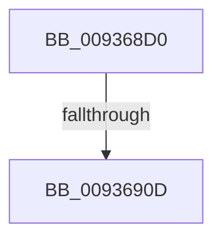

# CmSetCallbackObjectContext

- RVA: `0x009368D0`–`0x0093691A` (길이 `74` bytes)
- VA: `0x00000001409368D0`
- 실행 섹션: `PAGE`
- PDB 이름 있음: `예`; PDB Function 태그: `아니요`
- unwind 정보 RVA: `0x0008F394`
- 디코드: `21`개 명령, `74/74` bytes 표시
- 미해석 바이트: `0` (있으면 어셈블리에 `.byte`로 보존)

> 이 문서는 커널 이미지의 기계어와 PDB 기호를 분석해 생성했습니다. 4번과 5번은 함수 원형과 자료형을 바이너리 사용 방식에서 추정한 C 해석이며 원본 소스 복구 결과는 아닙니다.

## 1. Dependencies

- 직접 호출 지점: **1**; 고유 호출 대상: **1**
- 직접 호출자로 확인된 함수: **3**
- RIP 상대 이미지 참조: **0**

### Outgoing calls
- `0x009368FF` → [CmpInitializeThreadInfo](../../text/3F/CmpInitializeThreadInfo_function_003FBE70.md) (function, `0x003FBE70`)

### Direct callers
- [VrpPostOpenOrCreate](VrpPostOpenOrCreate_function_00936510.md) at `0x0093661D`
- [sub_00B24EA0](../B2/Unknown_function_00B24EA0.md) at `0x00B24F11`
- [sub_00B4588A](../B4/Unknown_function_00B4588A.md) at `0x00B45E83`

### Static image references
- 디코드된 RIP-relative 메모리 참조가 없습니다.

## 2. Other-region calls and transfers

- 다른 실행 섹션으로 향하는 call: **1**
  - `0x009368FF` → [CmpInitializeThreadInfo](../../text/3F/CmpInitializeThreadInfo_function_003FBE70.md) (`PAGE` → `.text`)
- call이 아닌 외부 분기/꼬리 이동: **2**
  - `0x00936907` → [sub_00936BC3](Unknown_function_00936BC3.md) (`tail-transfer`)
  - `0x00936914` → [sub_00936BC3](Unknown_function_00936BC3.md) (`tail-transfer`)

## 3. Assembly (complete function range)

```asm
009368D0  40 55                           push rbp
009368D2  56                              push rsi
009368D3  57                              push rdi
009368D4  41 54                           push r12
009368D6  41 56                           push r14
009368D8  48 83 EC 40                     sub rsp, 0x40
009368DC  0F 57 C0                        xorps xmm0, xmm0
009368DF  33 C0                           xor eax, eax
009368E1  4C 8B F1                        mov r14, rcx
009368E4  48 89 44 24 30                  mov qword ptr [rsp + 0x30], rax
009368E9  48 8D 4C 24 20                  lea rcx, [rsp + 0x20]
009368EE  49 8B F1                        mov rsi, r9
009368F1  0F 11 44 24 20                  movups xmmword ptr [rsp + 0x20], xmm0
009368F6  4D 8B E0                        mov r12, r8
009368F9  48 8B FA                        mov rdi, rdx
009368FC  40 32 ED                        xor bpl, bpl
009368FF  E8 6C 55 AC FF                  call 0x1403fbe70
00936904  4D 85 F6                        test r14, r14
00936907  0F 84 B6 02 00 00               je 0x140936bc3
0093690D  41 81 3E 32 30 79 6B            cmp dword ptr [r14], 0x6b793032
00936914  0F 85 A9 02 00 00               jne 0x140936bc3
```

## 4. C-style interpretation (structured pseudocode)

```c
__int64 __fastcall CmSetCallbackObjectContext(__int64 a1, __int64 a2, __int64 a3, __int64 a4)
{
    __int64 result;
    __int64 v_rbp;
    __int64 v_rsp;
    unsigned __int64 v_stack_m38;
    unsigned __int64 v_stack_m48;

    v_rsp = (v_rsp) - (64);
    result = 0;
    v_stack_m38 = 0;
    v_stack_m48 = v_xmm0;
    v_rbp = 0;
    result = CmpInitializeThreadInfo(v_stack_m48, a2, a3, a4);
}
```

## 5. (Beta) C Style

```c
int64_t CmSetCallbackObjectContext(int64_t Arg1, int64_t Arg2, int64_t Arg3, int64_t Arg4)
{
    int64_t result;
    int64_t local_rbp;
    int64_t local_rsp;
    uint64_t v_stack_m38;
    uint64_t v_stack_m48;

    local_rsp = (local_rsp) - (64);
    result = 0;
    v_stack_m38 = 0;
    v_stack_m48 = v_xmm0;
    local_rbp = 0;
    result = CmpInitializeThreadInfo(v_stack_m48, Arg2, Arg3, Arg4);
}
```

## 6. Execution-region graph

[열기: 2D/3D 그래프와 함수 탐색 컨트롤 패널](../../../control-panel.html?section=page&rva=0x009368D0&view=graph)

- 2D 그래프는 위에서 아래로 흐르고, 3D 그래프는 빈 공간을 드래그해 회전합니다. Shift+드래그는 이동, 휠은 확대·축소, 함수 노드 선택은 대상 보고서 이동입니다.

### Static fallback


