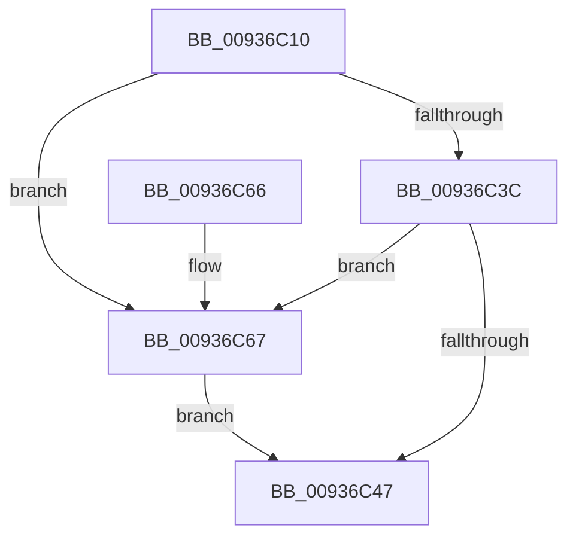

# CmpUnlockContextList

- RVA: `0x00936C10`–`0x00936C75` (길이 `101` bytes)
- VA: `0x0000000140936C10`
- 실행 섹션: `PAGE`
- PDB 이름 있음: `예`; PDB Function 태그: `아니요`
- unwind 정보 RVA: `0x00064C74`
- 디코드: `23`개 명령, `101/101` bytes 표시
- 미해석 바이트: `0` (있으면 어셈블리에 `.byte`로 보존)

> 이 문서는 커널 이미지의 기계어와 PDB 기호를 분석해 생성했습니다. 4번과 5번은 함수 원형과 자료형을 바이너리 사용 방식에서 추정한 C 해석이며 원본 소스 복구 결과는 아닙니다.

## 1. Dependencies

- 직접 호출 지점: **3**; 고유 호출 대상: **3**
- 직접 호출자로 확인된 함수: **3**
- RIP 상대 이미지 참조: **1**

### Outgoing calls
- `0x00936C4E` → [KeAbPostRelease](../../text/2E/KeAbPostRelease_function_002E1600.md) (function, `0x002E1600`)
- `0x00936C5C` → [KeLeaveCriticalRegionThread](../../text/25/KeLeaveCriticalRegionThread_function_0025EFF0.md) (function, `0x0025EFF0`)
- `0x00936C6E` → [ExfReleasePushLock](../../text/26/ExfReleasePushLock_function_002638D0.md) (function, `0x002638D0`)

### Direct callers
- [CmUnRegisterCallback](../7E/CmUnRegisterCallback_function_007E1510.md) at `0x007E1748`
- [CmUnRegisterCallback](../7E/CmUnRegisterCallback_function_007E1510.md) at `0x007E1776`
- [CmpCallbackFillObjectContext](../86/CmpCallbackFillObjectContext_function_00866A10.md) at `0x008672DE`
- [sub_0093691A](Unknown_function_0093691A.md) at `0x00936A76`

### Static image references
- `0x00936C14` → RVA `0x00EF7BC8` (`.data`; read)

## 2. Other-region calls and transfers

- 다른 실행 섹션으로 향하는 call: **3**
  - `0x00936C4E` → [KeAbPostRelease](../../text/2E/KeAbPostRelease_function_002E1600.md) (`PAGE` → `.text`)
  - `0x00936C5C` → [KeLeaveCriticalRegionThread](../../text/25/KeLeaveCriticalRegionThread_function_0025EFF0.md) (`PAGE` → `.text`)
  - `0x00936C6E` → [ExfReleasePushLock](../../text/26/ExfReleasePushLock_function_002638D0.md) (`PAGE` → `.text`)
- 별도 외부 분기/꼬리 이동을 확인하지 못했습니다.

## 3. Assembly (complete function range)

```asm
00936C10  48 83 EC 28                     sub rsp, 0x28
00936C14  0F 0D 0D AD 0F 5C 00            prefetchw byte ptr [rip + 0x5c0fad]
00936C1B  48 8B 05 A6 0F 5C 00            mov rax, qword ptr [rip + 0x5c0fa6]
00936C22  45 33 C0                        xor r8d, r8d
00936C25  48 8B C8                        mov rcx, rax
00936C28  48 83 E1 F0                     and rcx, 0xfffffffffffffff0
00936C2C  48 83 F9 10                     cmp rcx, 0x10
00936C30  48 8D 50 F0                     lea rdx, [rax - 0x10]
00936C34  49 0F 46 D0                     cmovbe rdx, r8
00936C38  A8 02                           test al, 2
00936C3A  75 2B                           jne 0x140936c67
00936C3C  F0 48 0F B1 15 83 0F 5C 00      lock cmpxchg qword ptr [rip + 0x5c0f83], rdx
00936C45  75 20                           jne 0x140936c67
00936C47  48 8D 0D 7A 0F 5C 00            lea rcx, [rip + 0x5c0f7a]
00936C4E  E8 AD A9 9A FF                  call 0x1402e1600
00936C53  65 48 8B 0C 25 88 01 00 00      mov rcx, qword ptr gs:[0x188]
00936C5C  E8 8F 83 92 FF                  call 0x14025eff0
00936C61  48 83 C4 28                     add rsp, 0x28
00936C65  C3                              ret
00936C66  CC                              int3
00936C67  48 8D 0D 5A 0F 5C 00            lea rcx, [rip + 0x5c0f5a]
00936C6E  E8 5D CC 92 FF                  call 0x1402638d0
00936C73  EB D2                           jmp 0x140936c47
```

## 4. C-style interpretation (structured pseudocode)

```c
__int64 __fastcall CmpUnlockContextList(__int64 a1, __int64 a2, int a3)
{
    __int64 result;
    __int64 v_rsp;

    v_rsp = (v_rsp) - (40);
    a3 = 0;
    a1 = (*(unsigned __int64 *)(v_rip + 6033318)) & (-16);
    a2 = *(unsigned __int64 *)(v_rip + 6033318) - 16;
    if (a1 <= 16) { a2 = 0; }
    if ((((unsigned __int8)(*(unsigned __int64 *)(v_rip + 6033318))) & (2)) != 0) goto loc_00936C67;
    if ((((unsigned __int8)(*(unsigned __int64 *)(v_rip + 6033318))) & (2)) != 0) goto loc_00936C67;
loc_00936C47:
    result = KeAbPostRelease(v_rip + 6033274, a2, a3, a4);
    result = KeLeaveCriticalRegionThread(*(unsigned __int64 *)(gs_base + (0 + 392)), a2, a3, a4);
    v_rsp = (v_rsp) + (40);
    return result;
loc_00936C67:
    result = ExfReleasePushLock(v_rip + 6033242, a2, a3, a4);
    goto loc_00936C47;
}
```

## 5. (Beta) C Style

```c
int64_t CmpUnlockContextList(int64_t Arg1, int64_t Arg2, int32_t Arg3)
{
    int64_t result;
    int64_t local_rsp;

    local_rsp = (local_rsp) - (40);
    Arg3 = 0;
    Arg1 = (*(uint64_t *)(v_rip + 0x5C0FA6)) & (-16);
    Arg2 = *(uint64_t *)(v_rip + 0x5C0FA6) - 16;
    if (Arg1 <= 16) { Arg2 = 0; }
    if ((((uint8_t)(*(uint64_t *)(v_rip + 0x5C0FA6))) & (2)) != 0) goto loc_00936C67;
    if ((((uint8_t)(*(uint64_t *)(v_rip + 0x5C0FA6))) & (2)) != 0) goto loc_00936C67;
loc_00936C47:
    result = KeAbPostRelease(v_rip + 6033274, Arg2, Arg3, a4);
    result = KeLeaveCriticalRegionThread(*(uint64_t *)(gs_base + (0 + 0x188)), Arg2, Arg3, a4);
    local_rsp = (local_rsp) + (40);
    return result;
loc_00936C67:
    result = ExfReleasePushLock(v_rip + 6033242, Arg2, Arg3, a4);
    goto loc_00936C47;
}
```

## 6. Execution-region graph

[열기: 2D/3D 그래프와 함수 탐색 컨트롤 패널](../../../control-panel.html?section=page&rva=0x00936C10&view=graph)

- 2D 그래프는 위에서 아래로 흐르고, 3D 그래프는 빈 공간을 드래그해 회전합니다. Shift+드래그는 이동, 휠은 확대·축소, 함수 노드 선택은 대상 보고서 이동입니다.

### Static fallback


