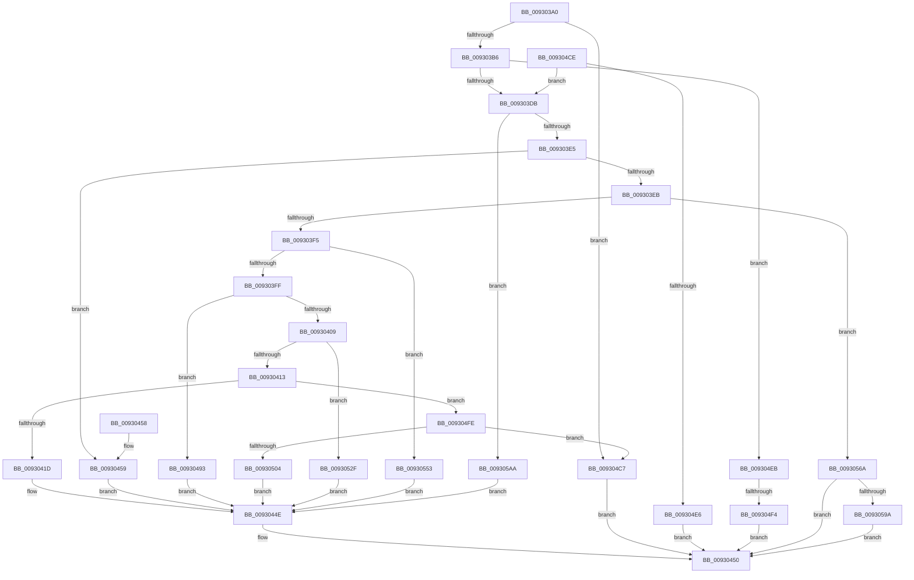

# DrvDbDispatchDriverPackage

- RVA: `0x009303A0`–`0x009305B4` (길이 `532` bytes)
- VA: `0x00000001409303A0`
- 실행 섹션: `PAGE`
- PDB 이름 있음: `예`; PDB Function 태그: `예`
- unwind 정보 RVA: `0x0008EB74`
- 디코드: `133`개 명령, `532/532` bytes 표시
- 미해석 바이트: `0` (있으면 어셈블리에 `.byte`로 보존)

> 이 문서는 커널 이미지의 기계어와 PDB 기호를 분석해 생성했습니다. 4번과 5번은 함수 원형과 자료형을 바이너리 사용 방식에서 추정한 C 해석이며 원본 소스 복구 결과는 아닙니다.

## 1. Dependencies

- 직접 호출 지점: **8**; 고유 호출 대상: **8**
- 직접 호출자로 확인된 함수: **4**
- RIP 상대 이미지 참조: **0**

### Outgoing calls
- `0x00930449` → [DrvDbGetDriverPackageMappedProperty](DrvDbGetDriverPackageMappedProperty_function_009305BC.md) (function, `0x009305BC`)
- `0x0093048C` → [DrvDbOpenObjectRegKey](DrvDbOpenObjectRegKey_function_00931060.md) (function, `0x00931060`)
- `0x009304C0` → [DrvDbGetObjectList](../92/DrvDbGetObjectList_function_0092F224.md) (function, `0x0092F224`)
- `0x00930525` → [DrvDbSetDriverPackageMappedProperty](../83/DrvDbSetDriverPackageMappedProperty_function_00834848.md) (function, `0x00834848`)
- `0x00930549` → [DrvDbGetDriverPackageMappedPropertyKeys](../83/DrvDbGetDriverPackageMappedPropertyKeys_function_00833B34.md) (function, `0x00833B34`)
- `0x00930560` → [DrvDbDeleteObjectRegKey](../83/DrvDbDeleteObjectRegKey_function_00832D70.md) (function, `0x00832D70`)
- `0x0093058B` → [DrvDbOpenDriverPackageRegKey](DrvDbOpenDriverPackageRegKey_function_00931014.md) (function, `0x00931014`)
- `0x009305AA` → [DrvDbValidateDriverFileName](../83/DrvDbValidateDriverFileName_function_00834F3C.md) (function, `0x00834F3C`)

### Direct callers
- [PnpGetObjectProperty](../8E/PnpGetObjectProperty_function_008E1110.md) at `0x008E1520`
- [PnpOpenObjectRegKey](../8E/PnpOpenObjectRegKey_function_008E15E8.md) at `0x008E176D`
- [PnpGetObjectPropertyWorker](../8E/PnpGetObjectPropertyWorker_function_008E1810.md) at `0x008E1BA2`
- [PnpGetObjectProperty](../8E/PnpGetObjectProperty_function_008E2180.md) at `0x008E2655`

### Static image references
- 디코드된 RIP-relative 메모리 참조가 없습니다.

## 2. Other-region calls and transfers

- 다른 실행 섹션으로 향하는 call: **0**
- call이 아닌 외부 분기/꼬리 이동: **1**
  - `0x009304EE` → [sub_00B2383E](../B2/Unknown_function_00B2383E.md) (`tail-transfer`)

## 3. Assembly (complete function range)

```asm
009303A0  40 53                           push rbx
009303A2  48 83 EC 50                     sub rsp, 0x50
009303A6  41 8D 40 FF                     lea eax, [r8 - 1]
009303AA  4C 8B D2                        mov r10, rdx
009303AD  83 F8 0A                        cmp eax, 0xa
009303B0  0F 87 11 01 00 00               ja 0x1409304c7
009303B6  0F AE E8                        lfence
009303B9  48 8B 9C 24 80 00 00 00         mov rbx, qword ptr [rsp + 0x80]
009303C1  49 63 C0                        movsxd rax, r8d
009303C4  4C 8B 9C C1 88 01 00 00         mov r11, qword ptr [rcx + rax*8 + 0x188]
009303CC  45 8B 43 0C                     mov r8d, dword ptr [r11 + 0xc]
009303D0  41 0F BA E0 1C                  bt r8d, 0x1c
009303D5  0F 83 10 01 00 00               jae 0x1409304eb
009303DB  41 83 E9 01                     sub r9d, 1
009303DF  0F 84 C5 01 00 00               je 0x1409305aa
009303E5  41 83 E9 01                     sub r9d, 1
009303E9  74 6E                           je 0x140930459
009303EB  41 83 E9 01                     sub r9d, 1
009303EF  0F 84 75 01 00 00               je 0x14093056a
009303F5  41 83 E9 01                     sub r9d, 1
009303F9  0F 84 54 01 00 00               je 0x140930553
009303FF  41 83 E9 01                     sub r9d, 1
00930403  0F 84 8A 00 00 00               je 0x140930493
00930409  41 83 E9 01                     sub r9d, 1
0093040D  0F 84 1C 01 00 00               je 0x14093052f
00930413  41 83 E9 02                     sub r9d, 2
00930417  0F 85 E1 00 00 00               jne 0x1409304fe
0093041D  48 8B 43 30                     mov rax, qword ptr [rbx + 0x30]
00930421  49 8B CB                        mov rcx, r11
00930424  4C 8B 4B 10                     mov r9, qword ptr [rbx + 0x10]
00930428  4C 8B 03                        mov r8, qword ptr [rbx]
0093042B  48 89 44 24 38                  mov qword ptr [rsp + 0x38], rax
00930430  8B 43 28                        mov eax, dword ptr [rbx + 0x28]
00930433  89 44 24 30                     mov dword ptr [rsp + 0x30], eax
00930437  48 8B 43 20                     mov rax, qword ptr [rbx + 0x20]
0093043B  48 89 44 24 28                  mov qword ptr [rsp + 0x28], rax
00930440  48 8B 43 18                     mov rax, qword ptr [rbx + 0x18]
00930444  48 89 44 24 20                  mov qword ptr [rsp + 0x20], rax
00930449  E8 6E 01 00 00                  call 0x1409305bc
0093044E  8B C8                           mov ecx, eax
00930450  8B C1                           mov eax, ecx
00930452  48 83 C4 50                     add rsp, 0x50
00930456  5B                              pop rbx
00930457  C3                              ret
00930458  CC                              int3
00930459  48 8B 4B 08                     mov rcx, qword ptr [rbx + 8]
0093045D  8A 53 04                        mov dl, byte ptr [rbx + 4]
00930460  44 8B 03                        mov r8d, dword ptr [rbx]
00930463  48 83 64 24 40 00               and qword ptr [rsp + 0x40], 0
00930469  48 8D 43 10                     lea rax, [rbx + 0x10]
0093046D  48 89 44 24 38                  mov qword ptr [rsp + 0x38], rax
00930472  4D 8B CA                        mov r9, r10
00930475  48 89 4C 24 30                  mov qword ptr [rsp + 0x30], rcx
0093047A  49 8B CB                        mov rcx, r11
0093047D  88 54 24 28                     mov byte ptr [rsp + 0x28], dl
00930481  33 D2                           xor edx, edx
00930483  44 89 44 24 20                  mov dword ptr [rsp + 0x20], r8d
00930488  44 8D 42 02                     lea r8d, [rdx + 2]
0093048C  E8 CF 0B 00 00                  call 0x140931060
00930491  EB BB                           jmp 0x14093044e
00930493  48 8B 43 20                     mov rax, qword ptr [rbx + 0x20]
00930497  8B 4B 18                        mov ecx, dword ptr [rbx + 0x18]
0093049A  4C 8B 53 10                     mov r10, qword ptr [rbx + 0x10]
0093049E  4C 8B 4B 08                     mov r9, qword ptr [rbx + 8]
009304A2  4C 8B 03                        mov r8, qword ptr [rbx]
009304A5  83 64 24 38 00                  and dword ptr [rsp + 0x38], 0
009304AA  BA 02 00 00 00                  mov edx, 2
009304AF  48 89 44 24 30                  mov qword ptr [rsp + 0x30], rax
009304B4  89 4C 24 28                     mov dword ptr [rsp + 0x28], ecx
009304B8  49 8B CB                        mov rcx, r11
009304BB  4C 89 54 24 20                  mov qword ptr [rsp + 0x20], r10
009304C0  E8 5F ED FF FF                  call 0x14092f224
009304C5  EB 87                           jmp 0x14093044e
009304C7  B9 0D 00 00 C0                  mov ecx, 0xc000000d
009304CC  EB 82                           jmp 0x140930450
009304CE  41 8A C0                        mov al, r8b
009304D1  F6 D8                           neg al
009304D3  1B C9                           sbb ecx, ecx
009304D5  F7 D1                           not ecx
009304D7  81 E1 22 00 00 C0               and ecx, 0xc0000022
009304DD  45 84 C0                        test r8b, r8b
009304E0  0F 85 F5 FE FF FF               jne 0x1409303db
009304E6  E9 65 FF FF FF                  jmp 0x140930450
009304EB  45 85 C0                        test r8d, r8d
009304EE  0F 85 4A 33 1F 00               jne 0x140b2383e
009304F4  B9 67 04 00 C0                  mov ecx, 0xc0000467
009304F9  E9 52 FF FF FF                  jmp 0x140930450
009304FE  41 83 F9 01                     cmp r9d, 1
00930502  75 C3                           jne 0x1409304c7
00930504  8B 43 28                        mov eax, dword ptr [rbx + 0x28]
00930507  49 8B CB                        mov rcx, r11
0093050A  4C 8B 4B 10                     mov r9, qword ptr [rbx + 0x10]
0093050E  4C 8B 03                        mov r8, qword ptr [rbx]
00930511  89 44 24 30                     mov dword ptr [rsp + 0x30], eax
00930515  48 8B 43 20                     mov rax, qword ptr [rbx + 0x20]
00930519  48 89 44 24 28                  mov qword ptr [rsp + 0x28], rax
0093051E  8B 43 18                        mov eax, dword ptr [rbx + 0x18]
00930521  89 44 24 20                     mov dword ptr [rsp + 0x20], eax
00930525  E8 1E 43 F0 FF                  call 0x140834848
0093052A  E9 1F FF FF FF                  jmp 0x14093044e
0093052F  48 8B 43 28                     mov rax, qword ptr [rbx + 0x28]
00930533  49 8B CB                        mov rcx, r11
00930536  4C 8B 4B 18                     mov r9, qword ptr [rbx + 0x18]
0093053A  4C 8B 03                        mov r8, qword ptr [rbx]
0093053D  48 89 44 24 28                  mov qword ptr [rsp + 0x28], rax
00930542  8B 43 20                        mov eax, dword ptr [rbx + 0x20]
00930545  89 44 24 20                     mov dword ptr [rsp + 0x20], eax
00930549  E8 E6 35 F0 FF                  call 0x140833b34
0093054E  E9 FB FE FF FF                  jmp 0x14093044e
00930553  45 33 C9                        xor r9d, r9d
00930556  4D 8B C2                        mov r8, r10
00930559  49 8B CB                        mov rcx, r11
0093055C  41 8D 51 02                     lea edx, [r9 + 2]
00930560  E8 0B 28 F0 FF                  call 0x140832d70
00930565  E9 E4 FE FF FF                  jmp 0x14093044e
0093056A  44 8B 03                        mov r8d, dword ptr [rbx]
0093056D  48 8D 4C 24 70                  lea rcx, [rsp + 0x70]
00930572  83 64 24 70 00                  and dword ptr [rsp + 0x70], 0
00930577  48 8D 43 08                     lea rax, [rbx + 8]
0093057B  48 89 4C 24 28                  mov qword ptr [rsp + 0x28], rcx
00930580  41 B1 01                        mov r9b, 1
00930583  49 8B CB                        mov rcx, r11
00930586  48 89 44 24 20                  mov qword ptr [rsp + 0x20], rax
0093058B  E8 84 0A 00 00                  call 0x140931014
00930590  8B C8                           mov ecx, eax
00930592  85 C0                           test eax, eax
00930594  0F 88 B6 FE FF FF               js 0x140930450
0093059A  83 7C 24 70 01                  cmp dword ptr [rsp + 0x70], 1
0093059F  0F 94 C0                        sete al
009305A2  88 43 10                        mov byte ptr [rbx + 0x10], al
009305A5  E9 A6 FE FF FF                  jmp 0x140930450
009305AA  E8 8D 49 F0 FF                  call 0x140834f3c
009305AF  E9 9A FE FF FF                  jmp 0x14093044e
```

## 4. C-style interpretation (structured pseudocode)

```c
__int64 __fastcall DrvDbDispatchDriverPackage(__int64 a1, __int64 a2, __int64 a3, int a4, __int64 a5)
{
    __int64 result;
    __int64 v_rsp;
    unsigned __int64 v_stack_m20;
    unsigned int v_stack_m28;
    unsigned __int64 v_stack_m30;
    unsigned __int64 v_stack_m38;
    unsigned int v_stack_p20;
    unsigned __int8 v_stack_p28;
    unsigned __int64 v_stack_p30;
    unsigned __int64 v_stack_p38;
    unsigned __int64 v_stack_p40;
    unsigned __int64 v_stack_p70;

    v_rsp = (v_rsp) - (80);
    if (((unsigned int)(a3 - 1)) > 10) goto loc_009304C7;
    if (((unsigned int)(a3 - 1)) >= 10) goto loc_009304EB;
loc_009303DB:
    a4 = (unsigned int)((a4) - (1));
    if (condition_is_equal) goto loc_009305AA;
    a4 = (unsigned int)((a4) - (1));
    if (condition_is_equal) goto loc_00930459;
    a4 = (unsigned int)((a4) - (1));
    if (condition_is_equal) goto loc_0093056A;
    a4 = (unsigned int)((a4) - (1));
    if (condition_is_equal) goto loc_00930553;
    a4 = (unsigned int)((a4) - (1));
    if (condition_is_equal) goto loc_00930493;
    a4 = (unsigned int)((a4) - (1));
    if (condition_is_equal) goto loc_0093052F;
    a4 = (unsigned int)((a4) - (2));
    if (condition_is_not_equal) goto loc_009304FE;
    v_stack_m20 = *(unsigned __int64 *)(a5 + 48);
    v_stack_m28 = (unsigned int)((unsigned int)(*(unsigned int *)(a5 + 40)));
    v_stack_m30 = *(unsigned __int64 *)(a5 + 32);
    v_stack_m38 = *(unsigned __int64 *)(a5 + 24);
    result = DrvDbGetDriverPackageMappedProperty(*(unsigned __int64 *)(a1 + (int)((unsigned int)(a3)) * 8 + 392), a2, *(unsigned __int64 *)(a5), *(unsigned __int64 *)(a5 + 16));
loc_0093044E:
loc_00930450:
    v_rsp = (v_rsp) + (80);
    return (unsigned int)((unsigned int)((unsigned int)((unsigned int)(result))));
loc_00930459:
    v_stack_p38 = a5 + 16;
    v_stack_p30 = *(unsigned __int64 *)(a5 + 8);
    v_stack_p28 = (unsigned __int8)(*(unsigned __int8 *)(a5 + 4));
    a2 = 0;
    v_stack_p20 = (unsigned int)((unsigned int)(*(unsigned int *)(a5)));
    result = DrvDbOpenObjectRegKey(*(unsigned __int64 *)(a1 + (int)((unsigned int)(a3)) * 8 + 392), a2, a2 + 2, a2);
    goto loc_0093044E;
loc_00930493:
    v_stack_p30 = *(unsigned __int64 *)(a5 + 32);
    v_stack_p28 = (unsigned int)((unsigned int)(*(unsigned int *)(a5 + 24)));
    v_stack_p20 = *(unsigned __int64 *)(a5 + 16);
    result = DrvDbGetObjectList(*(unsigned __int64 *)(a1 + (int)((unsigned int)(a3)) * 8 + 392), 2, *(unsigned __int64 *)(a5), *(unsigned __int64 *)(a5 + 8));
    goto loc_0093044E;
loc_009304C7:
    goto loc_00930450;
loc_009304EB:
    goto loc_00930450;
loc_009304FE:
    if (((unsigned int)(*(unsigned __int64 *)(a5 + 8))) != 1) goto loc_009304C7;
    v_stack_p30 = (unsigned int)((unsigned int)(*(unsigned int *)(a5 + 40)));
    v_stack_p28 = *(unsigned __int64 *)(a5 + 32);
    v_stack_p20 = (unsigned int)((unsigned int)(*(unsigned int *)(a5 + 24)));
    result = DrvDbSetDriverPackageMappedProperty(*(unsigned __int64 *)(a1 + (int)((unsigned int)(a3)) * 8 + 392), 2, *(unsigned __int64 *)(a5), *(unsigned __int64 *)(a5 + 16));
    goto loc_0093044E;
loc_0093052F:
    v_stack_p28 = *(unsigned __int64 *)(a5 + 40);
    v_stack_p20 = (unsigned int)((unsigned int)(*(unsigned int *)(a5 + 32)));
    result = DrvDbGetDriverPackageMappedPropertyKeys(*(unsigned __int64 *)(a1 + (int)((unsigned int)(a3)) * 8 + 392), 2, *(unsigned __int64 *)(a5), *(unsigned __int64 *)(a5 + 24));
    goto loc_0093044E;
loc_00930553:
    a4 = 0;
    result = DrvDbDeleteObjectRegKey(*(unsigned __int64 *)(a1 + (int)((unsigned int)(a3)) * 8 + 392), a4 + 2, *(unsigned __int64 *)(a5 + 16), a4);
    goto loc_0093044E;
loc_0093056A:
    v_stack_p28 = v_stack_p70;
    v_stack_p20 = a5 + 8;
    result = DrvDbOpenDriverPackageRegKey(*(unsigned __int64 *)(a1 + (int)((unsigned int)(a3)) * 8 + 392), a4 + 2, (unsigned int)(*(unsigned int *)(a5)), 1);
    if (sign_flag) goto loc_00930450;
    result = (v_stack_p70 == 1) ? 1 : 0;
    *(unsigned __int8 *)(a5 + 16) = (unsigned __int8)(result);
    goto loc_00930450;
loc_009305AA:
    result = DrvDbValidateDriverFileName((unsigned int)((unsigned int)(result)), a4 + 2, (unsigned int)(*(unsigned int *)(a5)), 1);
    goto loc_0093044E;
}
```

## 5. (Beta) C Style

```c
int64_t DrvDbDispatchDriverPackage(void *Arg1, int64_t Arg2, void *Arg3, int32_t Arg4, void *Arg5)
{
    uint8_t *arg1 = (uint8_t *)Arg1;
    uint8_t *arg3 = (uint8_t *)Arg3;
    uint8_t *arg5 = (uint8_t *)Arg5;

    int64_t result;
    int64_t local_rsp;
    uint64_t v_stack_m20;
    uint32_t v_stack_m28;
    uint64_t v_stack_m30;
    uint64_t v_stack_m38;
    uint32_t v_stack_p20;
    uint8_t v_stack_p28;
    uint64_t v_stack_p30;
    uint64_t v_stack_p38;
    uint64_t v_stack_p40;
    uint64_t v_stack_p70;

    local_rsp = (local_rsp) - (80);
    if (((uint32_t)(Arg3 - 1)) > 10) goto loc_009304C7;
    if (((uint32_t)(Arg3 - 1)) >= 10) goto loc_009304EB;
loc_009303DB:
    Arg4 = (uint32_t)((Arg4) - (1));
    if (condition_is_equal) goto loc_009305AA;
    Arg4 = (uint32_t)((Arg4) - (1));
    if (condition_is_equal) goto loc_00930459;
    Arg4 = (uint32_t)((Arg4) - (1));
    if (condition_is_equal) goto loc_0093056A;
    Arg4 = (uint32_t)((Arg4) - (1));
    if (condition_is_equal) goto loc_00930553;
    Arg4 = (uint32_t)((Arg4) - (1));
    if (condition_is_equal) goto loc_00930493;
    Arg4 = (uint32_t)((Arg4) - (1));
    if (condition_is_equal) goto loc_0093052F;
    Arg4 = (uint32_t)((Arg4) - (2));
    if (condition_is_not_equal) goto loc_009304FE;
    v_stack_m20 = *(uint64_t *)(arg5 + 0x30);
    v_stack_m28 = (uint32_t)((uint32_t)(*(uint32_t *)(arg5 + 0x28)));
    v_stack_m30 = *(uint64_t *)(arg5 + 0x20);
    v_stack_m38 = *(uint64_t *)(arg5 + 0x18);
    result = DrvDbGetDriverPackageMappedProperty(*(uint64_t *)(arg1 + (int32_t)((uint32_t)(arg3)) * 8 + 0x188), Arg2, *(uint64_t *)(arg5), *(uint64_t *)(arg5 + 0x10));
loc_0093044E:
loc_00930450:
    local_rsp = (local_rsp) + (80);
    return (uint32_t)((uint32_t)((uint32_t)((uint32_t)(result))));
loc_00930459:
    v_stack_p38 = Arg5 + 16;
    v_stack_p30 = *(uint64_t *)(arg5 + 0x8);
    v_stack_p28 = (uint8_t)(*(uint8_t *)(arg5 + 0x4));
    Arg2 = 0;
    v_stack_p20 = (uint32_t)((uint32_t)(*(uint32_t *)(arg5)));
    result = DrvDbOpenObjectRegKey(*(uint64_t *)(arg1 + (int32_t)((uint32_t)(arg3)) * 8 + 0x188), Arg2, Arg2 + 2, Arg2);
    goto loc_0093044E;
loc_00930493:
    v_stack_p30 = *(uint64_t *)(arg5 + 0x20);
    v_stack_p28 = (uint32_t)((uint32_t)(*(uint32_t *)(arg5 + 0x18)));
    v_stack_p20 = *(uint64_t *)(arg5 + 0x10);
    result = DrvDbGetObjectList(*(uint64_t *)(arg1 + (int32_t)((uint32_t)(arg3)) * 8 + 0x188), 2, *(uint64_t *)(arg5), *(uint64_t *)(arg5 + 0x8));
    goto loc_0093044E;
loc_009304C7:
    goto loc_00930450;
loc_009304EB:
    goto loc_00930450;
loc_009304FE:
    if (((uint32_t)(*(uint64_t *)(arg5 + 0x8))) != 1) goto loc_009304C7;
    v_stack_p30 = (uint32_t)((uint32_t)(*(uint32_t *)(arg5 + 0x28)));
    v_stack_p28 = *(uint64_t *)(arg5 + 0x20);
    v_stack_p20 = (uint32_t)((uint32_t)(*(uint32_t *)(arg5 + 0x18)));
    result = DrvDbSetDriverPackageMappedProperty(*(uint64_t *)(arg1 + (int32_t)((uint32_t)(arg3)) * 8 + 0x188), 2, *(uint64_t *)(arg5), *(uint64_t *)(arg5 + 0x10));
    goto loc_0093044E;
loc_0093052F:
    v_stack_p28 = *(uint64_t *)(arg5 + 0x28);
    v_stack_p20 = (uint32_t)((uint32_t)(*(uint32_t *)(arg5 + 0x20)));
    result = DrvDbGetDriverPackageMappedPropertyKeys(*(uint64_t *)(arg1 + (int32_t)((uint32_t)(arg3)) * 8 + 0x188), 2, *(uint64_t *)(arg5), *(uint64_t *)(arg5 + 0x18));
    goto loc_0093044E;
loc_00930553:
    Arg4 = 0;
    result = DrvDbDeleteObjectRegKey(*(uint64_t *)(arg1 + (int32_t)((uint32_t)(arg3)) * 8 + 0x188), Arg4 + 2, *(uint64_t *)(arg5 + 0x10), Arg4);
    goto loc_0093044E;
loc_0093056A:
    v_stack_p28 = v_stack_p70;
    v_stack_p20 = Arg5 + 8;
    result = DrvDbOpenDriverPackageRegKey(*(uint64_t *)(arg1 + (int32_t)((uint32_t)(arg3)) * 8 + 0x188), Arg4 + 2, (uint32_t)(*(uint32_t *)(arg5)), 1);
    if (sign_flag) goto loc_00930450;
    result = (v_stack_p70 == 1) ? 1 : 0;
    *(uint8_t *)(arg5 + 0x10) = (uint8_t)(result);
    goto loc_00930450;
loc_009305AA:
    result = DrvDbValidateDriverFileName((uint32_t)((uint32_t)(result)), Arg4 + 2, (uint32_t)(*(uint32_t *)(arg5)), 1);
    goto loc_0093044E;
}
```

### 관측된 메모리 오프셋

구조체 형식이 확인되지 않은 접근은 인자 기준의 오프셋으로만 기록했습니다.

| 기준 인자 | 오프셋 표현 | 폭 (bit) | 접근 |
|---|---:|---:|---|
| `Arg1` | `+ 0x188 + rax*8` | `64` | `R` |
| `Arg3` | `- 0x1` | `32` | `R` |
| `Arg5` | `+ 0x0` | `32` | `R` |
| `Arg5` | `+ 0x0` | `64` | `R` |
| `Arg5` | `+ 0x4` | `8` | `R` |
| `Arg5` | `+ 0x8` | `64` | `R` |
| `Arg5` | `+ 0x10` | `8` | `W` |
| `Arg5` | `+ 0x10` | `64` | `R` |
| `Arg5` | `+ 0x18` | `32` | `R` |
| `Arg5` | `+ 0x18` | `64` | `R` |
| `Arg5` | `+ 0x20` | `32` | `R` |
| `Arg5` | `+ 0x20` | `64` | `R` |
| `Arg5` | `+ 0x28` | `32` | `R` |
| `Arg5` | `+ 0x28` | `64` | `R` |
| `Arg5` | `+ 0x30` | `64` | `R` |

## 6. Execution-region graph

[열기: 2D/3D 그래프와 함수 탐색 컨트롤 패널](../../../control-panel.html?section=page&rva=0x009303A0&view=graph)

- 2D 그래프는 위에서 아래로 흐르고, 3D 그래프는 빈 공간을 드래그해 회전합니다. Shift+드래그는 이동, 휠은 확대·축소, 함수 노드 선택은 대상 보고서 이동입니다.

### Static fallback


