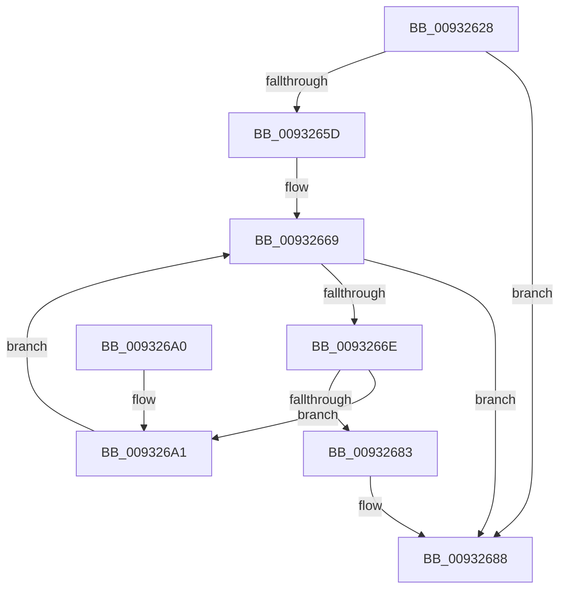

# DrvDbFindDatabaseNode

- RVA: `0x00932628`–`0x009326A6` (길이 `126` bytes)
- VA: `0x0000000140932628`
- 실행 섹션: `PAGE`
- PDB 이름 있음: `예`; PDB Function 태그: `아니요`
- unwind 정보 RVA: `0x0008EE60`
- 디코드: `39`개 명령, `126/126` bytes 표시
- 미해석 바이트: `0` (있으면 어셈블리에 `.byte`로 보존)

> 이 문서는 커널 이미지의 기계어와 PDB 기호를 분석해 생성했습니다. 4번과 5번은 함수 원형과 자료형을 바이너리 사용 방식에서 추정한 C 해석이며 원본 소스 복구 결과는 아닙니다.

## 1. Dependencies

- 직접 호출 지점: **2**; 고유 호출 대상: **2**
- 직접 호출자로 확인된 함수: **11**
- RIP 상대 이미지 참조: **0**

### Outgoing calls
- `0x00932652` → [RtlInitUnicodeStringEx](../../text/46/RtlInitUnicodeStringEx_function_00463960.md) (function, `0x00463960`)
- `0x0093267A` → [RtlEqualUnicodeString](RtlEqualUnicodeString_function_00932A20.md) (function, `0x00932A20`)

### Direct callers
- [DrvDbGetDriverDatabaseMappedPropertyKeys](../83/DrvDbGetDriverDatabaseMappedPropertyKeys_function_0083355C.md) at `0x00833622`
- [DrvDbSetDriverDatabaseMappedProperty](../83/DrvDbSetDriverDatabaseMappedProperty_function_00834014.md) at `0x008341A9`
- [DrvDbSetDriverDatabaseMappedProperty](../83/DrvDbSetDriverDatabaseMappedProperty_function_00834014.md) at `0x0083441B`
- [DrvDbRegisterDatabase](../83/DrvDbRegisterDatabase_function_0083513C.md) at `0x00835173`
- [DrvDbRegisterDatabase](../83/DrvDbRegisterDatabase_function_0083513C.md) at `0x00835196`
- [DrvDbSuspendDatabase](../83/DrvDbSuspendDatabase_function_0083522C.md) at `0x0083527A`
- [DrvDbUnregisterDatabase](../83/DrvDbUnregisterDatabase_function_008352E0.md) at `0x008352FF`
- [DrvDbDispatchDriverDatabase](../8E/DrvDbDispatchDriverDatabase_function_008E6EC0.md) at `0x008E6FA8`
- [DrvDbGetDriverDatabaseMappedProperty](../92/DrvDbGetDriverDatabaseMappedProperty_function_0092EE28.md) at `0x0092EF95`
- [DrvDbGetObjectDatabaseNode](DrvDbGetObjectDatabaseNode_function_00930228.md) at `0x0093030F`
- [sub_00931420](Unknown_function_00931420.md) at `0x0093148E`
- [DrvDbOpenDriverDatabaseRegKey](../AA/DrvDbOpenDriverDatabaseRegKey_function_00AA0FB8.md) at `0x00AA1002`
- [sub_00B233E6](../B2/Unknown_function_00B233E6.md) at `0x00B2371E`

### Static image references
- 디코드된 RIP-relative 메모리 참조가 없습니다.

## 2. Other-region calls and transfers

- 다른 실행 섹션으로 향하는 call: **1**
  - `0x00932652` → [RtlInitUnicodeStringEx](../../text/46/RtlInitUnicodeStringEx_function_00463960.md) (`PAGE` → `.text`)
- 별도 외부 분기/꼬리 이동을 확인하지 못했습니다.

## 3. Assembly (complete function range)

```asm
00932628  48 8B C4                        mov rax, rsp
0093262B  48 89 58 08                     mov qword ptr [rax + 8], rbx
0093262F  48 89 70 10                     mov qword ptr [rax + 0x10], rsi
00932633  48 89 78 18                     mov qword ptr [rax + 0x18], rdi
00932637  41 56                           push r14
00932639  48 83 EC 30                     sub rsp, 0x30
0093263D  49 83 20 00                     and qword ptr [r8], 0
00932641  48 8B F1                        mov rsi, rcx
00932644  0F 57 C0                        xorps xmm0, xmm0
00932647  48 8D 48 E8                     lea rcx, [rax - 0x18]
0093264B  0F 11 40 E8                     movups xmmword ptr [rax - 0x18], xmm0
0093264F  4D 8B F0                        mov r14, r8
00932652  E8 09 13 B3 FF                  call 0x140463960
00932657  8B F8                           mov edi, eax
00932659  85 C0                           test eax, eax
0093265B  78 2B                           js 0x140932688
0093265D  48 83 C6 10                     add rsi, 0x10
00932661  BF 34 00 00 C0                  mov edi, 0xc0000034
00932666  48 8B 1E                        mov rbx, qword ptr [rsi]
00932669  48 3B DE                        cmp rbx, rsi
0093266C  74 1A                           je 0x140932688
0093266E  48 8D 4B 10                     lea rcx, [rbx + 0x10]
00932672  41 B0 01                        mov r8b, 1
00932675  48 8D 54 24 20                  lea rdx, [rsp + 0x20]
0093267A  E8 A1 03 00 00                  call 0x140932a20
0093267F  84 C0                           test al, al
00932681  74 1E                           je 0x1409326a1
00932683  33 FF                           xor edi, edi
00932685  49 89 1E                        mov qword ptr [r14], rbx
00932688  48 8B 5C 24 40                  mov rbx, qword ptr [rsp + 0x40]
0093268D  8B C7                           mov eax, edi
0093268F  48 8B 7C 24 50                  mov rdi, qword ptr [rsp + 0x50]
00932694  48 8B 74 24 48                  mov rsi, qword ptr [rsp + 0x48]
00932699  48 83 C4 30                     add rsp, 0x30
0093269D  41 5E                           pop r14
0093269F  C3                              ret
009326A0  CC                              int3
009326A1  48 8B 1B                        mov rbx, qword ptr [rbx]
009326A4  EB C3                           jmp 0x140932669
```

## 4. C-style interpretation (structured pseudocode)

```c
__int64 __fastcall DrvDbFindDatabaseNode(__int64 a1, __int64 a2, __int64 a3)
{
    __int64 result;
    __int64 v_rdi;
    __int64 v_rsi;
    __int64 v_rsp;
    unsigned __int64 v_stack_m18;
    unsigned __int64 v_stack_p10;
    unsigned __int64 v_stack_p18;
    unsigned __int64 v_stack_p8;

    *(unsigned __int64 *)(v_rsp + 8) = v_rbx;
    *(unsigned __int64 *)(v_rsp + 16) = v_rsi;
    *(unsigned __int64 *)(v_rsp + 24) = v_rdi;
    v_rsp = (v_rsp) - (48);
    *(unsigned __int64 *)(v_rsp - 24) = v_xmm0;
    result = RtlInitUnicodeStringEx(v_rsp - 24, a2, a3, a4);
    if (sign_flag) goto loc_00932688;
    v_rsi = (a1) + (16);
loc_00932669:
    if ((*(unsigned __int64 *)(v_rsi)) == v_rsi) goto loc_00932688;
    result = RtlEqualUnicodeString(*(unsigned __int64 *)(v_rsi) + 16, v_stack_m18, 1, a4);
    if ((unsigned __int8)(result) == 0) goto loc_009326A1;
    v_rdi = 0;
    *(unsigned __int64 *)(a3) = *(unsigned __int64 *)(v_rsi);
loc_00932688:
    v_rsp = (v_rsp) + (48);
    return 0;
loc_009326A1:
    goto loc_00932669;
}
```

## 5. (Beta) C Style

```c
int64_t DrvDbFindDatabaseNode(void *Arg1, int64_t Arg2, void *Arg3)
{
    uint8_t *arg1 = (uint8_t *)Arg1;
    uint8_t *arg3 = (uint8_t *)Arg3;

    int64_t result;
    int64_t local_rdi;
    int64_t local_rsi;
    int64_t local_rsp;
    uint64_t v_stack_m18;
    uint64_t v_stack_p10;
    uint64_t v_stack_p18;
    uint64_t v_stack_p8;

    *(uint64_t *)(local_rsp + 0x8) = local_rbx;
    *(uint64_t *)(local_rsp + 0x10) = local_rsi;
    *(uint64_t *)(local_rsp + 0x18) = local_rdi;
    local_rsp = (local_rsp) - (48);
    *(uint64_t *)(local_rsp - 0x18) = v_xmm0;
    result = RtlInitUnicodeStringEx(local_rsp - 24, Arg2, Arg3, a4);
    if (sign_flag) goto loc_00932688;
    local_rsi = (Arg1) + (16);
loc_00932669:
    if ((*(uint64_t *)(local_rsi)) == local_rsi) goto loc_00932688;
    result = RtlEqualUnicodeString(*(uint64_t *)(local_rsi) + 16, v_stack_m18, 1, a4);
    if ((uint8_t)(result) == 0) goto loc_009326A1;
    local_rdi = 0;
    *(uint64_t *)(arg3) = *(uint64_t *)(local_rsi);
loc_00932688:
    local_rsp = (local_rsp) + (48);
    return 0;
loc_009326A1:
    goto loc_00932669;
}
```

### 관측된 메모리 오프셋

구조체 형식이 확인되지 않은 접근은 인자 기준의 오프셋으로만 기록했습니다.

| 기준 인자 | 오프셋 표현 | 폭 (bit) | 접근 |
|---|---:|---:|---|
| `Arg1` | `+ 0x0` | `64` | `R` |
| `Arg3` | `+ 0x0` | `64` | `R/W` |
| `Arg3` | `+ 0x0` | `64` | `W` |

## 6. Execution-region graph

[열기: 2D/3D 그래프와 함수 탐색 컨트롤 패널](../../../control-panel.html?section=page&rva=0x00932628&view=graph)

- 2D 그래프는 위에서 아래로 흐르고, 3D 그래프는 빈 공간을 드래그해 회전합니다. Shift+드래그는 이동, 휠은 확대·축소, 함수 노드 선택은 대상 보고서 이동입니다.

### Static fallback


