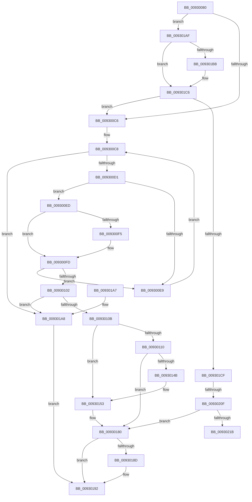

# DrvDbGetDriverInfFileMappedProperty

- RVA: `0x00930080`–`0x00930220` (길이 `416` bytes)
- VA: `0x0000000140930080`
- 실행 섹션: `PAGE`
- PDB 이름 있음: `예`; PDB Function 태그: `예`
- unwind 정보 RVA: `0x0008EB2C`
- 디코드: `104`개 명령, `416/416` bytes 표시
- 미해석 바이트: `0` (있으면 어셈블리에 `.byte`로 보존)

> 이 문서는 커널 이미지의 기계어와 PDB 기호를 분석해 생성했습니다. 4번과 5번은 함수 원형과 자료형을 바이너리 사용 방식에서 추정한 C 해석이며 원본 소스 복구 결과는 아닙니다.

## 1. Dependencies

- 직접 호출 지점: **4**; 고유 호출 대상: **4**
- 직접 호출자로 확인된 함수: **1**
- RIP 상대 이미지 참조: **3**

### Outgoing calls
- `0x00930140` → [DrvDbOpenObjectRegKey](DrvDbOpenObjectRegKey_function_00931060.md) (function, `0x00931060`)
- `0x00930179` → [DrvDbGetRegValueMappedProperty](../92/DrvDbGetRegValueMappedProperty_function_0092FB80.md) (function, `0x0092FB80`)
- `0x0093018D` → [ZwClose](../../text/6A/ZwClose_function_006AD2B0.md) (function, `0x006AD2B0`)
- `0x009301F8` → [DrvDbGetObjectDatabaseNodeName](../92/DrvDbGetObjectDatabaseNodeName_function_0092FAC4.md) (function, `0x0092FAC4`)

### Direct callers
- [DrvDbDispatchDriverInfFile](../92/DrvDbDispatchDriverInfFile_function_0092FE10.md) at `0x0092FEB3`

### Static image references
- `0x009300D5` → RVA `0x00002110` (`.rdata`; read)
- `0x009301B2` → RVA `0x00011F10` (`.rdata`; read)
- `0x009301BF` → RVA `0x00011F18` (`.rdata`; read)

## 2. Other-region calls and transfers

- 다른 실행 섹션으로 향하는 call: **1**
  - `0x0093018D` → [ZwClose](../../text/6A/ZwClose_function_006AD2B0.md) (`PAGE` → `.text`)
- call이 아닌 외부 분기/꼬리 이동: **2**
  - `0x00930209` → [sub_00B23832](../B2/Unknown_function_00B23832.md) (`tail-transfer`)
  - `0x0093021B` → [sub_00B23832](../B2/Unknown_function_00B23832.md) (`tail-transfer`)

## 3. Assembly (complete function range)

```asm
00930080  48 8B C4                        mov rax, rsp
00930083  48 89 58 08                     mov qword ptr [rax + 8], rbx
00930087  48 89 68 10                     mov qword ptr [rax + 0x10], rbp
0093008B  56                              push rsi
0093008C  57                              push rdi
0093008D  41 56                           push r14
0093008F  48 83 EC 50                     sub rsp, 0x50
00930093  4C 8B B4 24 90 00 00 00         mov r14, qword ptr [rsp + 0x90]
0093009B  4D 8B D0                        mov r10, r8
0093009E  48 8B BC 24 A8 00 00 00         mov rdi, qword ptr [rsp + 0xa8]
009300A6  48 8B DA                        mov rbx, rdx
009300A9  48 83 60 20 00                  and qword ptr [rax + 0x20], 0
009300AE  48 8B E9                        mov rbp, rcx
009300B1  41 83 26 00                     and dword ptr [r14], 0
009300B5  83 27 00                        and dword ptr [rdi], 0
009300B8  45 8B 59 10                     mov r11d, dword ptr [r9 + 0x10]
009300BC  41 83 FB 02                     cmp r11d, 2
009300C0  0F 84 E9 00 00 00               je 0x1409301af
009300C6  33 D2                           xor edx, edx
009300C8  83 FA 04                        cmp edx, 4
009300CB  0F 83 D7 00 00 00               jae 0x1409301a8
009300D1  48 8D 0C 92                     lea rcx, [rdx + rdx*4]
009300D5  48 8D 05 34 20 6D FF            lea rax, [rip - 0x92dfcc]
009300DC  48 8D 34 C8                     lea rsi, [rax + rcx*8]
009300E0  4C 8B 06                        mov r8, qword ptr [rsi]
009300E3  45 39 58 10                     cmp dword ptr [r8 + 0x10], r11d
009300E7  74 04                           je 0x1409300ed
009300E9  FF C2                           inc edx
009300EB  EB DB                           jmp 0x1409300c8
009300ED  49 8B 08                        mov rcx, qword ptr [r8]
009300F0  49 2B 09                        sub rcx, qword ptr [r9]
009300F3  75 08                           jne 0x1409300fd
009300F5  49 8B 48 08                     mov rcx, qword ptr [r8 + 8]
009300F9  49 2B 49 08                     sub rcx, qword ptr [r9 + 8]
009300FD  48 85 C9                        test rcx, rcx
00930100  75 E7                           jne 0x1409300e9
00930102  48 85 F6                        test rsi, rsi
00930105  0F 84 9D 00 00 00               je 0x1409301a8
0093010B  4D 85 D2                        test r10, r10
0093010E  75 43                           jne 0x140930153
00930110  4C 21 54 24 40                  and qword ptr [rsp + 0x40], r10
00930115  48 8D 84 24 88 00 00 00         lea rax, [rsp + 0x88]
0093011D  4C 21 54 24 38                  and qword ptr [rsp + 0x38], r10
00930122  44 8D 41 03                     lea r8d, [rcx + 3]
00930126  48 89 44 24 30                  mov qword ptr [rsp + 0x30], rax
0093012B  4C 8B CB                        mov r9, rbx
0093012E  44 88 54 24 28                  mov byte ptr [rsp + 0x28], r10b
00930133  33 D2                           xor edx, edx
00930135  48 8B CD                        mov rcx, rbp
00930138  C7 44 24 20 01 00 00 00         mov dword ptr [rsp + 0x20], 1
00930140  E8 1B 0F 00 00                  call 0x140931060
00930145  8B D8                           mov ebx, eax
00930147  85 C0                           test eax, eax
00930149  78 35                           js 0x140930180
0093014B  4C 8B 94 24 88 00 00 00         mov r10, qword ptr [rsp + 0x88]
00930153  8B 84 24 A0 00 00 00            mov eax, dword ptr [rsp + 0xa0]
0093015A  4D 8B CE                        mov r9, r14
0093015D  48 89 7C 24 30                  mov qword ptr [rsp + 0x30], rdi
00930162  4C 8B C6                        mov r8, rsi
00930165  89 44 24 28                     mov dword ptr [rsp + 0x28], eax
00930169  49 8B D2                        mov rdx, r10
0093016C  48 8B 84 24 98 00 00 00         mov rax, qword ptr [rsp + 0x98]
00930174  48 89 44 24 20                  mov qword ptr [rsp + 0x20], rax
00930179  E8 02 FA FF FF                  call 0x14092fb80
0093017E  8B D8                           mov ebx, eax
00930180  48 8B 8C 24 88 00 00 00         mov rcx, qword ptr [rsp + 0x88]
00930188  48 85 C9                        test rcx, rcx
0093018B  74 05                           je 0x140930192
0093018D  E8 1E D1 D7 FF                  call 0x1406ad2b0
00930192  48 8B 6C 24 78                  mov rbp, qword ptr [rsp + 0x78]
00930197  8B C3                           mov eax, ebx
00930199  48 8B 5C 24 70                  mov rbx, qword ptr [rsp + 0x70]
0093019E  48 83 C4 50                     add rsp, 0x50
009301A2  41 5E                           pop r14
009301A4  5F                              pop rdi
009301A5  5E                              pop rsi
009301A6  C3                              ret
009301A7  CC                              int3
009301A8  BB 16 00 00 C0                  mov ebx, 0xc0000016
009301AD  EB E3                           jmp 0x140930192
009301AF  49 8B 01                        mov rax, qword ptr [r9]
009301B2  48 2B 05 57 1D 6E FF            sub rax, qword ptr [rip - 0x91e2a9]
009301B9  75 0B                           jne 0x1409301c6
009301BB  49 8B 41 08                     mov rax, qword ptr [r9 + 8]
009301BF  48 2B 05 52 1D 6E FF            sub rax, qword ptr [rip - 0x91e2ae]
009301C6  48 85 C0                        test rax, rax
009301C9  0F 85 F7 FE FF FF               jne 0x1409300c6
009301CF  8B 84 24 A0 00 00 00            mov eax, dword ptr [rsp + 0xa0]
009301D6  4C 8B C3                        mov r8, rbx
009301D9  4C 8B 8C 24 98 00 00 00         mov r9, qword ptr [rsp + 0x98]
009301E1  BA 03 00 00 00                  mov edx, 3
009301E6  D1 E8                           shr eax, 1
009301E8  48 89 7C 24 28                  mov qword ptr [rsp + 0x28], rdi
009301ED  89 44 24 20                     mov dword ptr [rsp + 0x20], eax
009301F1  41 C7 06 12 00 00 00            mov dword ptr [r14], 0x12
009301F8  E8 C7 F8 FF FF                  call 0x14092fac4
009301FD  8B D8                           mov ebx, eax
009301FF  B8 00 00 00 80                  mov eax, 0x80000000
00930204  8D 0C 03                        lea ecx, [rbx + rax]
00930207  85 C8                           test eax, ecx
00930209  0F 85 23 36 1F 00               jne 0x140b23832
0093020F  81 FB 23 00 00 C0               cmp ebx, 0xc0000023
00930215  0F 85 65 FF FF FF               jne 0x140930180
0093021B  E9 12 36 1F 00                  jmp 0x140b23832
```

## 4. C-style interpretation (structured pseudocode)

```c
__int64 __fastcall DrvDbGetDriverInfFileMappedProperty(__int64 a1, __int64 a2, __int64 a3, __int64 a4, __int64 a5, __int64 a6, unsigned int a7, __int64 a8)
{
    __int64 result;
    __int64 v_rsp;
    unsigned __int64 v_stack_m28;
    unsigned __int64 v_stack_m30;
    unsigned __int64 v_stack_m38;
    unsigned __int8 v_stack_m40;
    unsigned int v_stack_m48;
    unsigned __int64 v_stack_p10;
    unsigned __int64 v_stack_p20;
    unsigned __int64 v_stack_p28;
    unsigned __int64 v_stack_p8;

    *(unsigned __int64 *)(v_rsp + 8) = v_rbx;
    *(unsigned __int64 *)(v_rsp + 16) = v_rbp;
    v_rsp = (v_rsp) - (80);
    if (((unsigned int)((unsigned int)(*(unsigned int *)(a4 + 16)))) == 2) goto loc_009301AF;
loc_009300C6:
    a2 = 0;
loc_009300C8:
    if (0 >= 4) goto loc_009301A8;
    if ((*(unsigned int *)(*(unsigned __int64 *)(v_rip - 9625548 + a2 + a2 * 4 * 8) + 16)) == ((unsigned int)((unsigned int)(*(unsigned int *)(a4 + 16))))) goto loc_009300ED;
loc_009300E9:
    a2 = (unsigned int)((a2) + 1);
    goto loc_009300C8;
loc_009300ED:
    a1 = (*(unsigned __int64 *)(*(unsigned __int64 *)(v_rip - 9625548 + a2 + a2 * 4 * 8))) - (*(unsigned __int64 *)(a4));
    if (!(condition_is_not_equal)) {
        a1 = *(unsigned __int64 *)(*(unsigned __int64 *)(v_rip - 9625548 + a2 + a2 * 4 * 8) + 8);
        a1 = (a1) - (*(unsigned __int64 *)(a4 + 8));
    }
    if (a1 != 0) goto loc_009300E9;
    if (v_rip - 9625548 + a2 + a2 * 4 * 8 == 0) goto loc_009301A8;
    if (a3 != 0) goto loc_00930153;
    v_stack_m38 = v_stack_p20;
    v_stack_m40 = (unsigned __int8)(a3);
    a2 = 0;
    v_stack_m48 = 1;
    result = DrvDbOpenObjectRegKey(a1, a2, a1 + 3, a2);
    if (sign_flag) goto loc_00930180;
loc_00930153:
    v_stack_m38 = a8;
    v_stack_m40 = (unsigned int)((unsigned int)(a7));
    v_stack_m48 = a6;
    result = DrvDbGetRegValueMappedProperty(a1, v_stack_p20, v_rip - 9625548 + a2 + a2 * 4 * 8, a5);
loc_00930180:
    if (v_stack_p20 != 0) {
        result = ZwClose(v_stack_p20, v_stack_p20, v_rip - 9625548 + a2 + a2 * 4 * 8, a5);
    }
    v_rsp = (v_rsp) + (80);
    return (unsigned int)((unsigned int)((unsigned int)((unsigned int)(result))));
loc_009301A8:
    goto loc_00930192;
loc_009301AF:
    result = (*(unsigned __int64 *)(a5)) - (*(unsigned __int64 *)(v_rip - 9560745));
    if (!(condition_is_not_equal)) {
        result = *(unsigned __int64 *)(a5 + 8);
        result = (result) - (*(unsigned __int64 *)(v_rip - 9560750));
    }
    if (result != 0) goto loc_009300C6;
    result = (unsigned int)(((unsigned int)(a7)) >> (1));
    v_stack_p28 = a8;
    v_stack_p20 = (unsigned int)(result);
    *(unsigned int *)(a5) = 18;
    result = DrvDbGetObjectDatabaseNodeName(v_stack_p20, 3, (unsigned int)(0xC0000016ULL), a6);
    if (((unsigned int)((unsigned int)((unsigned int)(result)))) != 0xC0000023ULL) goto loc_00930180;
}
```

## 5. (Beta) C Style

```c
int64_t DrvDbGetDriverInfFileMappedProperty(int64_t Arg1, int64_t Arg2, int64_t Arg3, void *Arg4, void *Arg5, int64_t Arg6, uint32_t Arg7, void *Arg8)
{
    uint8_t *arg4 = (uint8_t *)Arg4;
    uint8_t *arg5 = (uint8_t *)Arg5;
    uint8_t *arg8 = (uint8_t *)Arg8;

    int64_t result;
    int64_t local_rsp;
    uint64_t v_stack_m28;
    uint64_t v_stack_m30;
    uint64_t v_stack_m38;
    uint8_t v_stack_m40;
    uint32_t v_stack_m48;
    uint64_t v_stack_p10;
    uint64_t v_stack_p20;
    uint64_t v_stack_p28;
    uint64_t v_stack_p8;

    *(uint64_t *)(local_rsp + 0x8) = local_rbx;
    *(uint64_t *)(local_rsp + 0x10) = local_rbp;
    local_rsp = (local_rsp) - (80);
    if (((uint32_t)((uint32_t)(*(uint32_t *)(arg4 + 0x10)))) == 2) goto loc_009301AF;
loc_009300C6:
    Arg2 = 0;
loc_009300C8:
    if (0 >= 4) goto loc_009301A8;
    if ((*(uint32_t *)(*(uint64_t *)(v_rip - 0x92DFCC + Arg2 + Arg2 * 4 * 8) + 0x10)) == ((uint32_t)((uint32_t)(*(uint32_t *)(arg4 + 0x10))))) goto loc_009300ED;
loc_009300E9:
    Arg2 = (uint32_t)((Arg2) + 1);
    goto loc_009300C8;
loc_009300ED:
    Arg1 = (*(uint64_t *)(*(uint64_t *)(v_rip - 0x92DFCC + Arg2 + Arg2 * 4 * 8))) - (*(uint64_t *)(arg4));
    if (!(condition_is_not_equal)) {
        Arg1 = *(uint64_t *)(*(uint64_t *)(v_rip - 0x92DFCC + Arg2 + Arg2 * 4 * 8) + 0x8);
        Arg1 = (Arg1) - (*(uint64_t *)(arg4 + 0x8));
    }
    if (Arg1 != 0) goto loc_009300E9;
    if (v_rip - 9625548 + Arg2 + Arg2 * 4 * 8 == 0) goto loc_009301A8;
    if (Arg3 != 0) goto loc_00930153;
    v_stack_m38 = v_stack_p20;
    v_stack_m40 = (uint8_t)(Arg3);
    Arg2 = 0;
    v_stack_m48 = 1;
    result = DrvDbOpenObjectRegKey(Arg1, Arg2, Arg1 + 3, Arg2);
    if (sign_flag) goto loc_00930180;
loc_00930153:
    v_stack_m38 = Arg8;
    v_stack_m40 = (uint32_t)((uint32_t)(Arg7));
    v_stack_m48 = Arg6;
    result = DrvDbGetRegValueMappedProperty(Arg1, v_stack_p20, v_rip - 9625548 + Arg2 + Arg2 * 4 * 8, Arg5);
loc_00930180:
    if (v_stack_p20 != 0) {
        result = ZwClose(v_stack_p20, v_stack_p20, v_rip - 9625548 + Arg2 + Arg2 * 4 * 8, Arg5);
    }
    local_rsp = (local_rsp) + (80);
    return (uint32_t)((uint32_t)((uint32_t)((uint32_t)(result))));
loc_009301A8:
    goto loc_00930192;
loc_009301AF:
    result = (*(uint64_t *)(arg5)) - (*(uint64_t *)(v_rip - 0x91E2A9));
    if (!(condition_is_not_equal)) {
        result = *(uint64_t *)(arg5 + 0x8);
        result = (result) - (*(uint64_t *)(v_rip - 0x91E2AE));
    }
    if (result != 0) goto loc_009300C6;
    result = (uint32_t)(((uint32_t)(Arg7)) >> (1));
    v_stack_p28 = Arg8;
    v_stack_p20 = (uint32_t)(result);
    *(uint32_t *)(arg5) = 18;
    result = DrvDbGetObjectDatabaseNodeName(v_stack_p20, 3, (uint32_t)(0xC0000016ULL), Arg6);
    if (((uint32_t)((uint32_t)((uint32_t)(result)))) != 0xC0000023ULL) goto loc_00930180;
}
```

### 관측된 메모리 오프셋

구조체 형식이 확인되지 않은 접근은 인자 기준의 오프셋으로만 기록했습니다.

| 기준 인자 | 오프셋 표현 | 폭 (bit) | 접근 |
|---|---:|---:|---|
| `Arg4` | `+ 0x0` | `64` | `R` |
| `Arg4` | `+ 0x8` | `64` | `R` |
| `Arg4` | `+ 0x10` | `32` | `R` |
| `Arg5` | `+ 0x0` | `32` | `R/W` |
| `Arg5` | `+ 0x0` | `32` | `W` |
| `Arg8` | `+ 0x0` | `32` | `R/W` |

## 6. Execution-region graph

[열기: 2D/3D 그래프와 함수 탐색 컨트롤 패널](../../../control-panel.html?section=page&rva=0x00930080&view=graph)

- 2D 그래프는 위에서 아래로 흐르고, 3D 그래프는 빈 공간을 드래그해 회전합니다. Shift+드래그는 이동, 휠은 확대·축소, 함수 노드 선택은 대상 보고서 이동입니다.

### Static fallback


