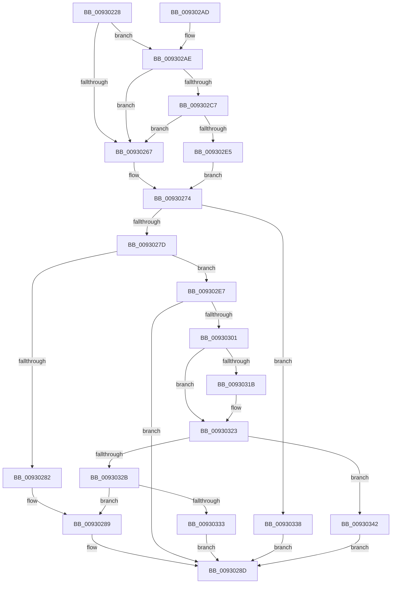

# DrvDbGetObjectDatabaseNode

- RVA: `0x00930228`–`0x0093034C` (길이 `292` bytes)
- VA: `0x0000000140930228`
- 실행 섹션: `PAGE`
- PDB 이름 있음: `예`; PDB Function 태그: `아니요`
- unwind 정보 RVA: `0x0008EB54`
- 디코드: `86`개 명령, `292/292` bytes 표시
- 미해석 바이트: `0` (있으면 어셈블리에 `.byte`로 보존)

> 이 문서는 커널 이미지의 기계어와 PDB 기호를 분석해 생성했습니다. 4번과 5번은 함수 원형과 자료형을 바이너리 사용 방식에서 추정한 C 해석이며 원본 소스 복구 결과는 아닙니다.

## 1. Dependencies

- 직접 호출 지점: **4**; 고유 호출 대상: **4**
- 직접 호출자로 확인된 함수: **1**
- RIP 상대 이미지 참조: **0**

### Outgoing calls
- `0x009302BA` → [wcschr](../../text/50/wcschr_function_00501A60.md) (function, `0x00501A60`)
- `0x009302F6` → [RtlDuplicateUnicodeString](RtlDuplicateUnicodeString_function_009321F0.md) (function, `0x009321F0`)
- `0x0093030F` → [DrvDbFindDatabaseNode](DrvDbFindDatabaseNode_function_00932628.md) (function, `0x00932628`)
- `0x0093031E` → [ExFreePool](../../poolcode/B8/ExFreePool_function_00B82850.md) (function, `0x00B82850`)

### Direct callers
- [DrvDbDeleteObjectRegKey](../83/DrvDbDeleteObjectRegKey_function_00832D70.md) at `0x00832DB8`

### Static image references
- 디코드된 RIP-relative 메모리 참조가 없습니다.

## 2. Other-region calls and transfers

- 다른 실행 섹션으로 향하는 call: **2**
  - `0x009302BA` → [wcschr](../../text/50/wcschr_function_00501A60.md) (`PAGE` → `.text`)
  - `0x0093031E` → [ExFreePool](../../poolcode/B8/ExFreePool_function_00B82850.md) (`PAGE` → `POOLCODE`)
- 별도 외부 분기/꼬리 이동을 확인하지 못했습니다.

## 3. Assembly (complete function range)

```asm
00930228  48 8B C4                        mov rax, rsp
0093022B  48 89 58 08                     mov qword ptr [rax + 8], rbx
0093022F  48 89 68 10                     mov qword ptr [rax + 0x10], rbp
00930233  48 89 70 18                     mov qword ptr [rax + 0x18], rsi
00930237  57                              push rdi
00930238  41 54                           push r12
0093023A  41 55                           push r13
0093023C  41 56                           push r14
0093023E  41 57                           push r15
00930240  48 83 EC 40                     sub rsp, 0x40
00930244  45 33 ED                        xor r13d, r13d
00930247  0F 57 C0                        xorps xmm0, xmm0
0093024A  66 83 3A 40                     cmp word ptr [rdx], 0x40
0093024E  4D 8B F1                        mov r14, r9
00930251  4D 8B E0                        mov r12, r8
00930254  44 89 68 BC                     mov dword ptr [rax - 0x44], r13d
00930258  48 8B F2                        mov rsi, rdx
0093025B  4C 8B F9                        mov r15, rcx
0093025E  41 8B DD                        mov ebx, r13d
00930261  0F 11 40 C8                     movups xmmword ptr [rax - 0x38], xmm0
00930265  74 47                           je 0x1409302ae
00930267  48 8B FE                        mov rdi, rsi
0093026A  4C 89 6C 24 28                  mov qword ptr [rsp + 0x28], r13
0093026F  44 89 6C 24 20                  mov dword ptr [rsp + 0x20], r13d
00930274  48 85 FF                        test rdi, rdi
00930277  0F 84 BB 00 00 00               je 0x140930338
0093027D  48 3B FE                        cmp rdi, rsi
00930280  75 65                           jne 0x1409302e7
00930282  49 8B 47 30                     mov rax, qword ptr [r15 + 0x30]
00930286  49 89 06                        mov qword ptr [r14], rax
00930289  49 89 3C 24                     mov qword ptr [r12], rdi
0093028D  4C 8D 5C 24 40                  lea r11, [rsp + 0x40]
00930292  8B C3                           mov eax, ebx
00930294  49 8B 5B 30                     mov rbx, qword ptr [r11 + 0x30]
00930298  49 8B 6B 38                     mov rbp, qword ptr [r11 + 0x38]
0093029C  49 8B 73 40                     mov rsi, qword ptr [r11 + 0x40]
009302A0  49 8B E3                        mov rsp, r11
009302A3  41 5F                           pop r15
009302A5  41 5E                           pop r14
009302A7  41 5D                           pop r13
009302A9  41 5C                           pop r12
009302AB  5F                              pop rdi
009302AC  C3                              ret
009302AD  CC                              int3
009302AE  48 8D 6A 02                     lea rbp, [rdx + 2]
009302B2  BA 3A 00 00 00                  mov edx, 0x3a
009302B7  48 8B CD                        mov rcx, rbp
009302BA  E8 A1 17 BD FF                  call 0x140501a60
009302BF  48 8B F8                        mov rdi, rax
009302C2  48 85 C0                        test rax, rax
009302C5  74 A0                           je 0x140930267
009302C7  48 2B C5                        sub rax, rbp
009302CA  48 89 6C 24 28                  mov qword ptr [rsp + 0x28], rbp
009302CF  48 D1 F8                        sar rax, 1
009302D2  66 03 C0                        add ax, ax
009302D5  66 89 44 24 20                  mov word ptr [rsp + 0x20], ax
009302DA  66 89 44 24 22                  mov word ptr [rsp + 0x22], ax
009302DF  48 83 C7 02                     add rdi, 2
009302E3  74 82                           je 0x140930267
009302E5  EB 8D                           jmp 0x140930274
009302E7  4C 8D 44 24 30                  lea r8, [rsp + 0x30]
009302EC  B9 01 00 00 00                  mov ecx, 1
009302F1  48 8D 54 24 20                  lea rdx, [rsp + 0x20]
009302F6  E8 F5 1E 00 00                  call 0x1409321f0
009302FB  8B D8                           mov ebx, eax
009302FD  85 C0                           test eax, eax
009302FF  78 8C                           js 0x14093028d
00930301  48 8B 74 24 38                  mov rsi, qword ptr [rsp + 0x38]
00930306  4D 8B C6                        mov r8, r14
00930309  48 8B D6                        mov rdx, rsi
0093030C  49 8B CF                        mov rcx, r15
0093030F  E8 14 23 00 00                  call 0x140932628
00930314  8B D8                           mov ebx, eax
00930316  48 85 F6                        test rsi, rsi
00930319  74 08                           je 0x140930323
0093031B  48 8B CE                        mov rcx, rsi
0093031E  E8 2D 25 25 00                  call 0x140b82850
00930323  81 FB 34 00 00 C0               cmp ebx, 0xc0000034
00930329  74 17                           je 0x140930342
0093032B  85 DB                           test ebx, ebx
0093032D  0F 89 56 FF FF FF               jns 0x140930289
00930333  E9 55 FF FF FF                  jmp 0x14093028d
00930338  BB 0D 00 00 C0                  mov ebx, 0xc000000d
0093033D  E9 4B FF FF FF                  jmp 0x14093028d
00930342  BB 3A 00 00 C0                  mov ebx, 0xc000003a
00930347  E9 41 FF FF FF                  jmp 0x14093028d
```

## 4. C-style interpretation (structured pseudocode)

```c
__int64 __fastcall DrvDbGetObjectDatabaseNode(__int64 a1, __int64 a2, __int64 a3, __int64 a4)
{
    __int64 result;
    __int64 v_r13;
    __int64 v_rdi;
    __int64 v_rsp;
    unsigned __int64 v_stack_m10;
    unsigned __int64 v_stack_m18;
    unsigned __int16 v_stack_m1E;
    unsigned __int16 v_stack_m20;
    unsigned __int64 v_stack_m28;
    unsigned __int64 v_stack_m40;
    unsigned int v_stack_m48;
    unsigned __int64 v_stack_m8;

    *(unsigned __int64 *)(v_rsp + 8) = v_rbx;
    *(unsigned __int64 *)(v_rsp + 16) = v_rbp;
    *(unsigned __int64 *)(v_rsp + 24) = v_rsi;
    v_rsp = (v_rsp) - (64);
    v_r13 = 0;
    *(unsigned int *)(v_rsp - 68) = 0;
    *(unsigned __int64 *)(v_rsp - 56) = v_xmm0;
    if ((*(unsigned __int16 *)(a2)) == 64) goto loc_009302AE;
loc_00930267:
    v_stack_m40 = 0;
    v_stack_m48 = 0;
loc_00930274:
    if (a2 == 0) goto loc_00930338;
    if (a2 != a2) goto loc_009302E7;
    *(unsigned __int64 *)(a4) = *(unsigned __int64 *)(a1 + 48);
loc_00930289:
    *(unsigned __int64 *)(a3) = a2;
loc_0093028D:
    return 0;
loc_009302AE:
    result = wcschr(a2 + 2, 58, a3, a4);
    if (result == 0) goto loc_00930267;
    result = (result) - (a2 + 2);
    v_stack_m18 = a2 + 2;
    result = (result) >> (1);
    result = (unsigned __int16)((result) + ((unsigned __int16)(result)));
    v_stack_m20 = (unsigned __int16)(result);
    v_stack_m1E = (unsigned __int16)(result);
    v_rdi = (result) + (2);
    if (condition_is_equal) goto loc_00930267;
    goto loc_00930274;
loc_009302E7:
    result = RtlDuplicateUnicodeString(1, v_stack_m20, v_stack_m10, a4);
    if (sign_flag) goto loc_0093028D;
    result = DrvDbFindDatabaseNode(a1, v_stack_m8, a4, a4);
    if (v_stack_m8 != 0) {
        a1 = v_stack_m8;
        result = ExFreePool(a1, v_stack_m8, a4, a4);
    }
    if (((unsigned int)((unsigned int)((unsigned int)(result)))) == 0xC0000034ULL) goto loc_00930342;
    if (!sign_flag) goto loc_00930289;
    goto loc_0093028D;
loc_00930338:
    goto loc_0093028D;
loc_00930342:
    goto loc_0093028D;
}
```

## 5. (Beta) C Style

```c
int64_t DrvDbGetObjectDatabaseNode(void *Arg1, void *Arg2, void *Arg3, void *Arg4)
{
    uint8_t *arg1 = (uint8_t *)Arg1;
    uint8_t *arg2 = (uint8_t *)Arg2;
    uint8_t *arg3 = (uint8_t *)Arg3;
    uint8_t *arg4 = (uint8_t *)Arg4;

    int64_t result;
    int64_t local_r13;
    int64_t local_rdi;
    int64_t local_rsp;
    uint64_t v_stack_m10;
    uint64_t v_stack_m18;
    uint16_t v_stack_m1E;
    uint16_t v_stack_m20;
    uint64_t v_stack_m28;
    uint64_t v_stack_m40;
    uint32_t v_stack_m48;
    uint64_t v_stack_m8;

    *(uint64_t *)(local_rsp + 0x8) = local_rbx;
    *(uint64_t *)(local_rsp + 0x10) = local_rbp;
    *(uint64_t *)(local_rsp + 0x18) = local_rsi;
    local_rsp = (local_rsp) - (64);
    local_r13 = 0;
    *(uint32_t *)(local_rsp - 0x44) = 0;
    *(uint64_t *)(local_rsp - 0x38) = v_xmm0;
    if ((*(uint16_t *)(arg2)) == 64) goto loc_009302AE;
loc_00930267:
    v_stack_m40 = 0;
    v_stack_m48 = 0;
loc_00930274:
    if (Arg2 == NULL) goto loc_00930338;
    if (Arg2 != Arg2) goto loc_009302E7;
    *(uint64_t *)(arg4) = *(uint64_t *)(arg1 + 0x30);
loc_00930289:
    *(void **)(arg3) = Arg2;
loc_0093028D:
    return 0;
loc_009302AE:
    result = wcschr(Arg2 + 2, 58, Arg3, Arg4);
    if (result == 0) goto loc_00930267;
    result = (result) - (Arg2 + 2);
    v_stack_m18 = Arg2 + 2;
    result = (result) >> (1);
    result = (uint16_t)((result) + ((uint16_t)(result)));
    v_stack_m20 = (uint16_t)(result);
    v_stack_m1E = (uint16_t)(result);
    local_rdi = (result) + (2);
    if (condition_is_equal) goto loc_00930267;
    goto loc_00930274;
loc_009302E7:
    result = RtlDuplicateUnicodeString(1, v_stack_m20, v_stack_m10, Arg4);
    if (sign_flag) goto loc_0093028D;
    result = DrvDbFindDatabaseNode(Arg1, v_stack_m8, Arg4, Arg4);
    if (v_stack_m8 != 0) {
        Arg1 = v_stack_m8;
        result = ExFreePool(Arg1, v_stack_m8, Arg4, Arg4);
    }
    if (((uint32_t)((uint32_t)((uint32_t)(result)))) == 0xC0000034ULL) goto loc_00930342;
    if (!sign_flag) goto loc_00930289;
    goto loc_0093028D;
loc_00930338:
    goto loc_0093028D;
loc_00930342:
    goto loc_0093028D;
}
```

### 관측된 메모리 오프셋

구조체 형식이 확인되지 않은 접근은 인자 기준의 오프셋으로만 기록했습니다.

| 기준 인자 | 오프셋 표현 | 폭 (bit) | 접근 |
|---|---:|---:|---|
| `Arg1` | `+ 0x30` | `64` | `R` |
| `Arg2` | `+ 0x0` | `16` | `R` |
| `Arg2` | `+ 0x2` | `64` | `R` |
| `Arg3` | `+ 0x0` | `64` | `W` |
| `Arg4` | `+ 0x0` | `64` | `W` |

## 6. Execution-region graph

[열기: 2D/3D 그래프와 함수 탐색 컨트롤 패널](../../../control-panel.html?section=page&rva=0x00930228&view=graph)

- 2D 그래프는 위에서 아래로 흐르고, 3D 그래프는 빈 공간을 드래그해 회전합니다. Shift+드래그는 이동, 휠은 확대·축소, 함수 노드 선택은 대상 보고서 이동입니다.

### Static fallback


