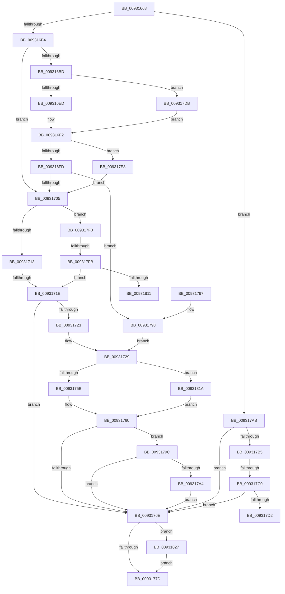

# DrvDbLoadDatabaseNode

- RVA: `0x00931668`–`0x00931836` (길이 `462` bytes)
- VA: `0x0000000140931668`
- 실행 섹션: `PAGE`
- PDB 이름 있음: `예`; PDB Function 태그: `예`
- unwind 정보 RVA: `0x0008ED0C`
- 디코드: `130`개 명령, `462/462` bytes 표시
- 미해석 바이트: `0` (있으면 어셈블리에 `.byte`로 보존)

> 이 문서는 커널 이미지의 기계어와 PDB 기호를 분석해 생성했습니다. 4번과 5번은 함수 원형과 자료형을 바이너리 사용 방식에서 추정한 C 해석이며 원본 소스 복구 결과는 아닙니다.

## 1. Dependencies

- 직접 호출 지점: **7**; 고유 호출 대상: **4**
- 직접 호출자로 확인된 함수: **7**
- RIP 상대 이미지 참조: **1**

### Outgoing calls
- `0x009316ED` → [PiDrvDbNodeActionCallback](PiDrvDbNodeActionCallback_function_00931980.md) (function, `0x00931980`)
- `0x0093175B` → [PiDrvDbNodeActionCallback](PiDrvDbNodeActionCallback_function_00931980.md) (function, `0x00931980`)
- `0x009317C7` → [_PnpCtxGetCachedContextBaseKey](../8E/_PnpCtxGetCachedContextBaseKey_function_008EFB2C.md) (function, `0x008EFB2C`)
- `0x009317DE` → [guard_dispatch_icall](../../text/6B/guard_dispatch_icall_function_006BAAD0.md) (function, `0x006BAAD0`)
- `0x00931802` → [_PnpCtxGetCachedContextBaseKey](../8E/_PnpCtxGetCachedContextBaseKey_function_008EFB2C.md) (function, `0x008EFB2C`)
- `0x0093181D` → [guard_dispatch_icall](../../text/6B/guard_dispatch_icall_function_006BAAD0.md) (function, `0x006BAAD0`)
- `0x0093182C` → [ExFreePoolWithTag](../../poolcode/B8/ExFreePoolWithTag_function_00B82870.md) (function, `0x00B82870`)

### Direct callers
- [DrvDbSetDriverDatabaseMappedProperty](../83/DrvDbSetDriverDatabaseMappedProperty_function_00834014.md) at `0x00834243`
- [DrvDbOpenContext](../83/DrvDbOpenContext_function_00834F8C.md) at `0x0083508C`
- [sub_00930EBB](Unknown_function_00930EBB.md) at `0x00930EC1`
- [sub_00930F5A](Unknown_function_00930F5A.md) at `0x00930FB0`
- [sub_00931330](Unknown_function_00931330.md) at `0x00931336`
- [DrvDbOpenDriverDatabaseRegKey](../AA/DrvDbOpenDriverDatabaseRegKey_function_00AA0FB8.md) at `0x00AA112E`
- [sub_00B24164](../B2/Unknown_function_00B24164.md) at `0x00B2416B`

### Static image references
- `0x009316A5` → RVA `0x00931980` (`PiDrvDbNodeActionCallback`; read)

## 2. Other-region calls and transfers

- 다른 실행 섹션으로 향하는 call: **3**
  - `0x009317DE` → [guard_dispatch_icall](../../text/6B/guard_dispatch_icall_function_006BAAD0.md) (`PAGE` → `.text`)
  - `0x0093181D` → [guard_dispatch_icall](../../text/6B/guard_dispatch_icall_function_006BAAD0.md) (`PAGE` → `.text`)
  - `0x0093182C` → [ExFreePoolWithTag](../../poolcode/B8/ExFreePoolWithTag_function_00B82870.md) (`PAGE` → `POOLCODE`)
- call이 아닌 외부 분기/꼬리 이동: **5**
  - `0x00931718` → [sub_00B24270 + 0xBE](../B2/Unknown_function_00B24270.md) (`tail-transfer`)
  - `0x009317BA` → [sub_00B24270 + 0x2E](../B2/Unknown_function_00B24270.md) (`tail-transfer`)
  - `0x009317D6` → [sub_00B24270 + 0x2E](../B2/Unknown_function_00B24270.md) (`tail-transfer`)
  - `0x009317F5` → [sub_00B24270](../B2/Unknown_function_00B24270.md) (`tail-transfer`)
  - `0x00931815` → [sub_00B24270](../B2/Unknown_function_00B24270.md) (`tail-transfer`)

## 3. Assembly (complete function range)

```asm
00931668  48 89 5C 24 08                  mov qword ptr [rsp + 8], rbx
0093166D  55                              push rbp
0093166E  56                              push rsi
0093166F  57                              push rdi
00931670  41 54                           push r12
00931672  41 55                           push r13
00931674  41 56                           push r14
00931676  41 57                           push r15
00931678  48 8B EC                        mov rbp, rsp
0093167B  48 83 EC 50                     sub rsp, 0x50
0093167F  8B 42 40                        mov eax, dword ptr [rdx + 0x40]
00931682  33 DB                           xor ebx, ebx
00931684  48 21 5D 58                     and qword ptr [rbp + 0x58], rbx
00931688  33 F6                           xor esi, esi
0093168A  21 5D 50                        and dword ptr [rbp + 0x50], ebx
0093168D  45 33 ED                        xor r13d, r13d
00931690  45 33 FF                        xor r15d, r15d
00931693  48 89 75 F0                     mov qword ptr [rbp - 0x10], rsi
00931697  44 8D 63 01                     lea r12d, [rbx + 1]
0093169B  4C 8B F1                        mov r14, rcx
0093169E  44 89 65 48                     mov dword ptr [rbp + 0x48], r12d
009316A2  48 8B FA                        mov rdi, rdx
009316A5  48 8D 0D D4 02 00 00            lea rcx, [rip + 0x2d4]
009316AC  A8 21                           test al, 0x21
009316AE  0F 85 F7 00 00 00               jne 0x1409317ab
009316B4  4C 8B 7A 50                     mov r15, qword ptr [rdx + 0x50]
009316B8  4D 85 FF                        test r15, r15
009316BB  74 48                           je 0x140931705
009316BD  48 8D 42 60                     lea rax, [rdx + 0x60]
009316C1  4C 3B F9                        cmp r15, rcx
009316C4  48 89 45 58                     mov qword ptr [rbp + 0x58], rax
009316C8  45 8B CC                        mov r9d, r12d
009316CB  48 8B 42 58                     mov rax, qword ptr [rdx + 0x58]
009316CF  45 8B C4                        mov r8d, r12d
009316D2  48 8B 52 18                     mov rdx, qword ptr [rdx + 0x18]
009316D6  49 8B CE                        mov rcx, r14
009316D9  48 89 44 24 28                  mov qword ptr [rsp + 0x28], rax
009316DE  48 8D 45 58                     lea rax, [rbp + 0x58]
009316E2  48 89 44 24 20                  mov qword ptr [rsp + 0x20], rax
009316E7  0F 85 EE 00 00 00               jne 0x1409317db
009316ED  E8 8E 02 00 00                  call 0x140931980
009316F2  3D 02 00 00 C0                  cmp eax, 0xc0000002
009316F7  0F 84 EB 00 00 00               je 0x1409317e8
009316FD  85 C0                           test eax, eax
009316FF  0F 88 93 00 00 00               js 0x140931798
00931705  4C 8D 67 60                     lea r12, [rdi + 0x60]
00931709  49 39 1C 24                     cmp qword ptr [r12], rbx
0093170D  0F 84 DD 00 00 00               je 0x1409317f0
00931713  8B 47 40                        mov eax, dword ptr [rdi + 0x40]
00931716  A8 08                           test al, 8
00931718  0F 84 10 2C 1F 00               je 0x140b2432e
0093171E  4D 85 FF                        test r15, r15
00931721  74 4B                           je 0x14093176e
00931723  41 BC 01 00 00 00               mov r12d, 1
00931729  48 8B 47 58                     mov rax, qword ptr [rdi + 0x58]
0093172D  48 8D 0D 4C 02 00 00            lea rcx, [rip + 0x24c]
00931734  48 8B 57 18                     mov rdx, qword ptr [rdi + 0x18]
00931738  4C 3B F9                        cmp r15, rcx
0093173B  48 89 44 24 28                  mov qword ptr [rsp + 0x28], rax
00931740  41 B9 02 00 00 00               mov r9d, 2
00931746  48 8D 45 58                     lea rax, [rbp + 0x58]
0093174A  45 8B C4                        mov r8d, r12d
0093174D  48 89 44 24 20                  mov qword ptr [rsp + 0x20], rax
00931752  49 8B CE                        mov rcx, r14
00931755  0F 85 BF 00 00 00               jne 0x14093181a
0093175B  E8 20 02 00 00                  call 0x140931980
00931760  BA 00 00 00 80                  mov edx, 0x80000000
00931765  8B C8                           mov ecx, eax
00931767  8D 04 10                        lea eax, [rax + rdx]
0093176A  85 C2                           test edx, eax
0093176C  74 2E                           je 0x14093179c
0093176E  89 9F A0 00 00 00               mov dword ptr [rdi + 0xa0], ebx
00931774  4D 85 ED                        test r13, r13
00931777  0F 85 AA 00 00 00               jne 0x140931827
0093177D  8B C3                           mov eax, ebx
0093177F  48 8B 9C 24 90 00 00 00         mov rbx, qword ptr [rsp + 0x90]
00931787  48 83 C4 50                     add rsp, 0x50
0093178B  41 5F                           pop r15
0093178D  41 5E                           pop r14
0093178F  41 5D                           pop r13
00931791  41 5C                           pop r12
00931793  5F                              pop rdi
00931794  5E                              pop rsi
00931795  5D                              pop rbp
00931796  C3                              ret
00931797  CC                              int3
00931798  8B D8                           mov ebx, eax
0093179A  EB 8D                           jmp 0x140931729
0093179C  81 F9 02 00 00 C0               cmp ecx, 0xc0000002
009317A2  74 CA                           je 0x14093176e
009317A4  85 DB                           test ebx, ebx
009317A6  0F 44 D9                        cmove ebx, ecx
009317A9  EB C3                           jmp 0x14093176e
009317AB  4C 8D 62 60                     lea r12, [rdx + 0x60]
009317AF  49 39 1C 24                     cmp qword ptr [r12], rbx
009317B3  75 B9                           jne 0x14093176e
009317B5  8B 52 28                        mov edx, dword ptr [rdx + 0x28]
009317B8  85 D2                           test edx, edx
009317BA  0F 84 DE 2A 1F 00               je 0x140b2429e
009317C0  49 8B 0E                        mov rcx, qword ptr [r14]
009317C3  4C 8D 45 F0                     lea r8, [rbp - 0x10]
009317C7  E8 60 E3 FB FF                  call 0x1408efb2c
009317CC  8B D8                           mov ebx, eax
009317CE  85 C0                           test eax, eax
009317D0  78 9C                           js 0x14093176e
009317D2  48 8B 75 F0                     mov rsi, qword ptr [rbp - 0x10]
009317D6  E9 C3 2A 1F 00                  jmp 0x140b2429e
009317DB  49 8B C7                        mov rax, r15
009317DE  E8 ED 92 D8 FF                  call 0x1406baad0
009317E3  E9 0A FF FF FF                  jmp 0x1409316f2
009317E8  45 33 FF                        xor r15d, r15d
009317EB  E9 15 FF FF FF                  jmp 0x140931705
009317F0  8B 57 28                        mov edx, dword ptr [rdi + 0x28]
009317F3  85 D2                           test edx, edx
009317F5  0F 84 75 2A 1F 00               je 0x140b24270
009317FB  49 8B 0E                        mov rcx, qword ptr [r14]
009317FE  4C 8D 45 F0                     lea r8, [rbp - 0x10]
00931802  E8 25 E3 FB FF                  call 0x1408efb2c
00931807  8B D8                           mov ebx, eax
00931809  85 C0                           test eax, eax
0093180B  0F 88 0D FF FF FF               js 0x14093171e
00931811  48 8B 75 F0                     mov rsi, qword ptr [rbp - 0x10]
00931815  E9 56 2A 1F 00                  jmp 0x140b24270
0093181A  49 8B C7                        mov rax, r15
0093181D  E8 AE 92 D8 FF                  call 0x1406baad0
00931822  E9 39 FF FF FF                  jmp 0x140931760
00931827  33 D2                           xor edx, edx
00931829  49 8B CD                        mov rcx, r13
0093182C  E8 3F 10 25 00                  call 0x140b82870
00931831  E9 47 FF FF FF                  jmp 0x14093177d
```

## 4. C-style interpretation (structured pseudocode)

```c
__int64 __fastcall DrvDbLoadDatabaseNode(__int64 a1, __int64 a2)
{
    __int64 result;
    __int64 v_r13;
    __int64 v_r15;
    __int64 v_rbx;
    __int64 v_rsi;
    __int64 v_rsp;
    unsigned __int64 v_stack_m48;
    unsigned __int64 v_stack_m60;
    unsigned __int64 v_stack_m68;
    unsigned int v_stack_p10;
    unsigned int v_stack_p18;
    unsigned __int64 v_stack_p20;
    unsigned __int64 v_stack_p8;

    v_stack_p8 = v_rbx;
    v_rsp = (v_rsp) - (80);
    v_rbx = 0;
    v_rsi = 0;
    v_r13 = 0;
    v_r15 = 0;
    v_stack_m48 = 0;
    v_stack_p10 = (unsigned int)(v_rbx + 1);
    if ((((unsigned __int8)((unsigned int)(*(unsigned int *)(a2 + 64)))) & (33)) != 0) goto loc_009317AB;
    if (*(unsigned __int64 *)(a2 + 80) == 0) goto loc_00931705;
    v_stack_p20 = a2 + 96;
    v_stack_m60 = *(unsigned __int64 *)(a2 + 88);
    v_stack_m68 = v_stack_p20;
    if ((*(unsigned __int64 *)(a2 + 80)) != (v_rip + 724)) goto loc_009317DB;
    result = PiDrvDbNodeActionCallback(a1, *(unsigned __int64 *)(a2 + 24), (unsigned int)((unsigned int)(v_rbx + 1)), (unsigned int)((unsigned int)(v_rbx + 1)));
loc_009316F2:
    if (((unsigned int)(result)) == 0xC0000002ULL) goto loc_009317E8;
    if (sign_flag) goto loc_00931798;
loc_00931705:
    if ((*(unsigned __int64 *)(a2 + 96)) == 0) goto loc_009317F0;
loc_0093171E:
    if (*(unsigned __int64 *)(a2 + 80) == 0) goto loc_0093176E;
loc_00931729:
    v_stack_m60 = *(unsigned __int64 *)(a2 + 88);
    v_stack_m68 = v_stack_p20;
    if ((*(unsigned __int64 *)(a2 + 80)) != (v_rip + 588)) goto loc_0093181A;
    result = PiDrvDbNodeActionCallback(a1, *(unsigned __int64 *)(a2 + 24), 1, 2);
loc_00931760:
    if ((((unsigned int)((unsigned int)(0x80000000ULL))) & ((unsigned int)(result + (unsigned int)(0x80000000ULL) * 1))) == 0) goto loc_0093179C;
loc_0093176E:
    *(unsigned int *)(a2 + 160) = 0;
    if (0 != 0) goto loc_00931827;
loc_0093177D:
    v_rsp = (v_rsp) + (80);
    return 0;
loc_00931798:
    goto loc_00931729;
loc_0093179C:
    if (((unsigned int)((unsigned int)((unsigned int)(result)))) == 0xC0000002ULL) goto loc_0093176E;
    v_rbx = 0;
    if (0 == 0) { v_rbx = (unsigned int)((unsigned int)((unsigned int)(result))); }
    goto loc_0093176E;
loc_009317AB:
    if ((*(unsigned __int64 *)((unsigned int)(0x80000000ULL) + 96)) != v_rbx) goto loc_0093176E;
    result = _PnpCtxGetCachedContextBaseKey(*(unsigned __int64 *)(a1), (unsigned int)(*(unsigned int *)((unsigned int)(0x80000000ULL) + 40)), v_stack_m48, 2);
    if (sign_flag) goto loc_0093176E;
loc_009317DB:
    result = guard_dispatch_icall(*(unsigned __int64 *)(a1), (unsigned int)(*(unsigned int *)((unsigned int)(0x80000000ULL) + 40)), v_stack_m48, 2);
    goto loc_009316F2;
loc_009317E8:
    v_r15 = 0;
    goto loc_00931705;
loc_009317F0:
    result = _PnpCtxGetCachedContextBaseKey(*(unsigned __int64 *)(a1), (unsigned int)(*(unsigned int *)(a2 + 40)), v_stack_m48, 2);
    if (sign_flag) goto loc_0093171E;
loc_0093181A:
    result = guard_dispatch_icall(*(unsigned __int64 *)(a1), (unsigned int)(*(unsigned int *)(a2 + 40)), v_stack_m48, 2);
    goto loc_00931760;
loc_00931827:
    a2 = 0;
    result = ExFreePoolWithTag(0, a2, v_stack_m48, 2);
    goto loc_0093177D;
}
```

## 5. (Beta) C Style

```c
int64_t DrvDbLoadDatabaseNode(void *Arg1, void *Arg2)
{
    uint8_t *arg1 = (uint8_t *)Arg1;
    uint8_t *arg2 = (uint8_t *)Arg2;

    int64_t result;
    int64_t local_r13;
    int64_t local_r15;
    int64_t local_rbx;
    int64_t local_rsi;
    int64_t local_rsp;
    uint64_t v_stack_m48;
    uint64_t v_stack_m60;
    uint64_t v_stack_m68;
    uint32_t v_stack_p10;
    uint32_t v_stack_p18;
    uint64_t v_stack_p20;
    uint64_t v_stack_p8;

    v_stack_p8 = local_rbx;
    local_rsp = (local_rsp) - (80);
    local_rbx = 0;
    local_rsi = 0;
    local_r13 = 0;
    local_r15 = 0;
    v_stack_m48 = 0;
    v_stack_p10 = (uint32_t)(local_rbx + 1);
    if ((((uint8_t)((uint32_t)(*(uint32_t *)(arg2 + 0x40)))) & (33)) != 0) goto loc_009317AB;
    if (*(uint64_t *)(arg2 + 0x50) == 0) goto loc_00931705;
    v_stack_p20 = Arg2 + 96;
    v_stack_m60 = *(uint64_t *)(arg2 + 0x58);
    v_stack_m68 = v_stack_p20;
    if ((*(uint64_t *)(arg2 + 0x50)) != (v_rip + 724)) goto loc_009317DB;
    result = PiDrvDbNodeActionCallback(Arg1, *(uint64_t *)(arg2 + 0x18), (uint32_t)((uint32_t)(local_rbx + 1)), (uint32_t)((uint32_t)(local_rbx + 1)));
loc_009316F2:
    if (((uint32_t)(result)) == 0xC0000002ULL) goto loc_009317E8;
    if (sign_flag) goto loc_00931798;
loc_00931705:
    if ((*(uint64_t *)(arg2 + 0x60)) == 0) goto loc_009317F0;
loc_0093171E:
    if (*(uint64_t *)(arg2 + 0x50) == 0) goto loc_0093176E;
loc_00931729:
    v_stack_m60 = *(uint64_t *)(arg2 + 0x58);
    v_stack_m68 = v_stack_p20;
    if ((*(uint64_t *)(arg2 + 0x50)) != (v_rip + 588)) goto loc_0093181A;
    result = PiDrvDbNodeActionCallback(Arg1, *(uint64_t *)(arg2 + 0x18), 1, 2);
loc_00931760:
    if ((((uint32_t)((uint32_t)(0x80000000ULL))) & ((uint32_t)(result + (uint32_t)(0x80000000ULL) * 1))) == 0) goto loc_0093179C;
loc_0093176E:
    *(uint32_t *)(arg2 + 0xA0) = 0;
    if (0 != 0) goto loc_00931827;
loc_0093177D:
    local_rsp = (local_rsp) + (80);
    return 0;
loc_00931798:
    goto loc_00931729;
loc_0093179C:
    if (((uint32_t)((uint32_t)((uint32_t)(result)))) == 0xC0000002ULL) goto loc_0093176E;
    local_rbx = 0;
    if (0 == 0) { local_rbx = (uint32_t)((uint32_t)((uint32_t)(result))); }
    goto loc_0093176E;
loc_009317AB:
    if ((*(uint64_t *)((uint32_t)(0x80000000ULL) + 0x60)) != local_rbx) goto loc_0093176E;
    result = _PnpCtxGetCachedContextBaseKey(*(uint64_t *)(arg1), (uint32_t)(*(uint32_t *)((uint32_t)(0x80000000ULL) + 0x28)), v_stack_m48, 2);
    if (sign_flag) goto loc_0093176E;
loc_009317DB:
    result = guard_dispatch_icall(*(uint64_t *)(arg1), (uint32_t)(*(uint32_t *)((uint32_t)(0x80000000ULL) + 0x28)), v_stack_m48, 2);
    goto loc_009316F2;
loc_009317E8:
    local_r15 = 0;
    goto loc_00931705;
loc_009317F0:
    result = _PnpCtxGetCachedContextBaseKey(*(uint64_t *)(arg1), (uint32_t)(*(uint32_t *)(arg2 + 0x28)), v_stack_m48, 2);
    if (sign_flag) goto loc_0093171E;
loc_0093181A:
    result = guard_dispatch_icall(*(uint64_t *)(arg1), (uint32_t)(*(uint32_t *)(arg2 + 0x28)), v_stack_m48, 2);
    goto loc_00931760;
loc_00931827:
    Arg2 = 0;
    result = ExFreePoolWithTag(0, Arg2, v_stack_m48, 2);
    goto loc_0093177D;
}
```

### 관측된 메모리 오프셋

구조체 형식이 확인되지 않은 접근은 인자 기준의 오프셋으로만 기록했습니다.

| 기준 인자 | 오프셋 표현 | 폭 (bit) | 접근 |
|---|---:|---:|---|
| `Arg1` | `+ 0x0` | `64` | `R` |
| `Arg2` | `+ 0x0` | `64` | `R` |
| `Arg2` | `+ 0x18` | `64` | `R` |
| `Arg2` | `+ 0x28` | `32` | `R` |
| `Arg2` | `+ 0x40` | `32` | `R` |
| `Arg2` | `+ 0x50` | `64` | `R` |
| `Arg2` | `+ 0x58` | `64` | `R` |
| `Arg2` | `+ 0x60` | `64` | `R` |
| `Arg2` | `+ 0xA0` | `32` | `W` |

## 6. Execution-region graph

[열기: 2D/3D 그래프와 함수 탐색 컨트롤 패널](../../../control-panel.html?section=page&rva=0x00931668&view=graph)

- 2D 그래프는 위에서 아래로 흐르고, 3D 그래프는 빈 공간을 드래그해 회전합니다. Shift+드래그는 이동, 휠은 확대·축소, 함수 노드 선택은 대상 보고서 이동입니다.

### Static fallback


