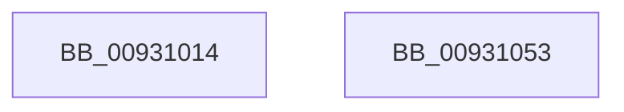

# DrvDbOpenDriverPackageRegKey

- RVA: `0x00931014`–`0x00931054` (길이 `64` bytes)
- VA: `0x0000000140931014`
- 실행 섹션: `PAGE`
- PDB 이름 있음: `예`; PDB Function 태그: `아니요`
- unwind 정보 RVA: `0x0005CC98`
- 디코드: `16`개 명령, `64/64` bytes 표시
- 미해석 바이트: `0` (있으면 어셈블리에 `.byte`로 보존)

> 이 문서는 커널 이미지의 기계어와 PDB 기호를 분석해 생성했습니다. 4번과 5번은 함수 원형과 자료형을 바이너리 사용 방식에서 추정한 C 해석이며 원본 소스 복구 결과는 아닙니다.

## 1. Dependencies

- 직접 호출 지점: **1**; 고유 호출 대상: **1**
- 직접 호출자로 확인된 함수: **4**
- RIP 상대 이미지 참조: **0**

### Outgoing calls
- `0x00931049` → [DrvDbOpenObjectRegKey](DrvDbOpenObjectRegKey_function_00931060.md) (function, `0x00931060`)

### Direct callers
- [DrvDbGetDriverPackageMappedPropertyKeys](../83/DrvDbGetDriverPackageMappedPropertyKeys_function_00833B34.md) at `0x00833BE5`
- [DrvDbSetDriverPackageMappedProperty](../83/DrvDbSetDriverPackageMappedProperty_function_00834848.md) at `0x0083495C`
- [DrvDbDispatchDriverPackage](DrvDbDispatchDriverPackage_function_009303A0.md) at `0x0093058B`
- [sub_00B23888](../B2/Unknown_function_00B23888.md) at `0x00B238BA`
- [sub_00B23888](../B2/Unknown_function_00B23888.md) at `0x00B23A75`
- [sub_00B23888](../B2/Unknown_function_00B23888.md) at `0x00B23D55`
- [sub_00B23888](../B2/Unknown_function_00B23888.md) at `0x00B23E00`
- [sub_00B23888](../B2/Unknown_function_00B23888.md) at `0x00B23F78`

### Static image references
- 디코드된 RIP-relative 메모리 참조가 없습니다.

## 2. Other-region calls and transfers

- 다른 실행 섹션으로 향하는 call: **0**
- 별도 외부 분기/꼬리 이동을 확인하지 못했습니다.

## 3. Assembly (complete function range)

```asm
00931014  4C 8B DC                        mov r11, rsp
00931017  48 83 EC 58                     sub rsp, 0x58
0093101B  49 83 63 E8 00                  and qword ptr [r11 - 0x18], 0
00931020  48 8B 84 24 88 00 00 00         mov rax, qword ptr [rsp + 0x88]
00931028  49 89 43 E0                     mov qword ptr [r11 - 0x20], rax
0093102C  48 8B 84 24 80 00 00 00         mov rax, qword ptr [rsp + 0x80]
00931034  49 89 43 D8                     mov qword ptr [r11 - 0x28], rax
00931038  45 88 4B D0                     mov byte ptr [r11 - 0x30], r9b
0093103C  4C 8B CA                        mov r9, rdx
0093103F  33 D2                           xor edx, edx
00931041  45 89 43 C8                     mov dword ptr [r11 - 0x38], r8d
00931045  44 8D 42 02                     lea r8d, [rdx + 2]
00931049  E8 12 00 00 00                  call 0x140931060
0093104E  48 83 C4 58                     add rsp, 0x58
00931052  C3                              ret
00931053  CC                              int3
```

## 4. C-style interpretation (structured pseudocode)

```c
__int64 __fastcall DrvDbOpenDriverPackageRegKey(__int64 a1, __int64 a2, int a3, unsigned __int8 a4, __int64 a5, __int64 a6)
{
    __int64 result;
    __int64 v_rsp;

    v_rsp = (v_rsp) - (88);
    *(unsigned __int64 *)(v_rsp - 32) = a6;
    *(unsigned __int64 *)(v_rsp - 40) = a5;
    *(unsigned __int8 *)(v_rsp - 48) = a4;
    a2 = 0;
    *(unsigned int *)(v_rsp - 56) = a3;
    result = DrvDbOpenObjectRegKey(a1, a2, a2 + 2, a2);
    v_rsp = (v_rsp) + (88);
    return result;
}
```

## 5. (Beta) C Style

```c
int64_t DrvDbOpenDriverPackageRegKey(int64_t Arg1, int64_t Arg2, int32_t Arg3, uint8_t Arg4, int64_t Arg5, int64_t Arg6)
{
    int64_t result;
    int64_t local_rsp;

    local_rsp = (local_rsp) - (88);
    *(uint64_t *)(local_rsp - 0x20) = Arg6;
    *(uint64_t *)(local_rsp - 0x28) = Arg5;
    *(uint8_t *)(local_rsp - 0x30) = Arg4;
    Arg2 = 0;
    *(uint32_t *)(local_rsp - 0x38) = Arg3;
    result = DrvDbOpenObjectRegKey(Arg1, Arg2, Arg2 + 2, Arg2);
    local_rsp = (local_rsp) + (88);
    return result;
}
```

## 6. Execution-region graph

[열기: 2D/3D 그래프와 함수 탐색 컨트롤 패널](../../../control-panel.html?section=page&rva=0x00931014&view=graph)

- 2D 그래프는 위에서 아래로 흐르고, 3D 그래프는 빈 공간을 드래그해 회전합니다. Shift+드래그는 이동, 휠은 확대·축소, 함수 노드 선택은 대상 보고서 이동입니다.

### Static fallback


