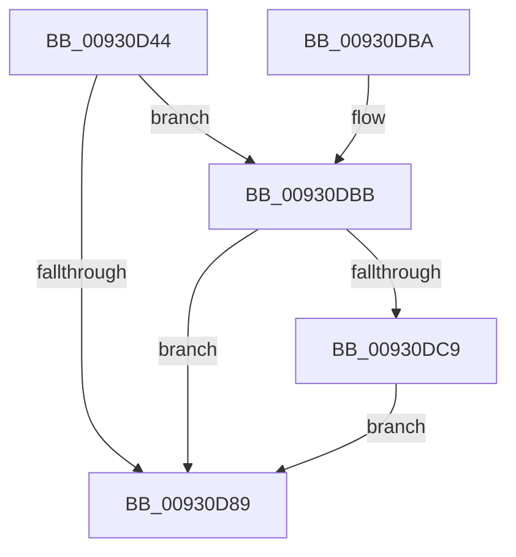

# DrvDbReleaseDatabaseNodeBaseKey

- RVA: `0x00930D44`–`0x00930DD8` (길이 `148` bytes)
- VA: `0x0000000140930D44`
- 실행 섹션: `PAGE`
- PDB 이름 있음: `예`; PDB Function 태그: `아니요`
- unwind 정보 RVA: `0x0008EBC0`
- 디코드: `40`개 명령, `148/148` bytes 표시
- 미해석 바이트: `0` (있으면 어셈블리에 `.byte`로 보존)

> 이 문서는 커널 이미지의 기계어와 PDB 기호를 분석해 생성했습니다. 4번과 5번은 함수 원형과 자료형을 바이너리 사용 방식에서 추정한 C 해석이며 원본 소스 복구 결과는 아닙니다.

## 1. Dependencies

- 직접 호출 지점: **5**; 고유 호출 대상: **5**
- 직접 호출자로 확인된 함수: **2**
- RIP 상대 이미지 참조: **0**

### Outgoing calls
- `0x00930D7D` → [ExAcquireResourceExclusiveLite](../../text/21/ExAcquireResourceExclusiveLite_function_00214E20.md) (function, `0x00214E20`)
- `0x00930D90` → [ExReleaseResourceLite](../../text/25/ExReleaseResourceLite_function_0025FA10.md) (function, `0x0025FA10`)
- `0x00930D9E` → [KeLeaveCriticalRegionThread](../../text/25/KeLeaveCriticalRegionThread_function_0025EFF0.md) (function, `0x0025EFF0`)
- `0x00930DBE` → [ZwClose](../../text/6A/ZwClose_function_006AD2B0.md) (function, `0x006AD2B0`)
- `0x00930DCF` → [DrvDbUnloadDatabaseNode](DrvDbUnloadDatabaseNode_function_0093183C.md) (function, `0x0093183C`)

### Direct callers
- [DrvDbDeleteObjectRegKey](../83/DrvDbDeleteObjectRegKey_function_00832D70.md) at `0x00832E7B`
- [DrvDbDeleteObjectRegKey](../83/DrvDbDeleteObjectRegKey_function_00832D70.md) at `0x00832EC8`
- [DrvDbGetObjectList](../92/DrvDbGetObjectList_function_0092F224.md) at `0x0092F351`
- [DrvDbGetObjectList](../92/DrvDbGetObjectList_function_0092F224.md) at `0x0092F417`

### Static image references
- 디코드된 RIP-relative 메모리 참조가 없습니다.

## 2. Other-region calls and transfers

- 다른 실행 섹션으로 향하는 call: **4**
  - `0x00930D7D` → [ExAcquireResourceExclusiveLite](../../text/21/ExAcquireResourceExclusiveLite_function_00214E20.md) (`PAGE` → `.text`)
  - `0x00930D90` → [ExReleaseResourceLite](../../text/25/ExReleaseResourceLite_function_0025FA10.md) (`PAGE` → `.text`)
  - `0x00930D9E` → [KeLeaveCriticalRegionThread](../../text/25/KeLeaveCriticalRegionThread_function_0025EFF0.md) (`PAGE` → `.text`)
  - `0x00930DBE` → [ZwClose](../../text/6A/ZwClose_function_006AD2B0.md) (`PAGE` → `.text`)
- 별도 외부 분기/꼬리 이동을 확인하지 못했습니다.

## 3. Assembly (complete function range)

```asm
00930D44  48 89 5C 24 08                  mov qword ptr [rsp + 8], rbx
00930D49  48 89 6C 24 10                  mov qword ptr [rsp + 0x10], rbp
00930D4E  48 89 74 24 18                  mov qword ptr [rsp + 0x18], rsi
00930D53  57                              push rdi
00930D54  48 83 EC 20                     sub rsp, 0x20
00930D58  65 48 8B 04 25 88 01 00 00      mov rax, qword ptr gs:[0x188]
00930D61  48 8B FA                        mov rdi, rdx
00930D64  48 8B E9                        mov rbp, rcx
00930D67  B2 01                           mov dl, 1
00930D69  49 8B F1                        mov rsi, r9
00930D6C  33 DB                           xor ebx, ebx
00930D6E  66 FF 88 E4 01 00 00            dec word ptr [rax + 0x1e4]
00930D75  90                              nop
00930D76  48 8B 8F 98 00 00 00            mov rcx, qword ptr [rdi + 0x98]
00930D7D  E8 9E 40 8E FF                  call 0x140214e20
00930D82  8B 47 40                        mov eax, dword ptr [rdi + 0x40]
00930D85  A8 02                           test al, 2
00930D87  74 32                           je 0x140930dbb
00930D89  48 8B 8F 98 00 00 00            mov rcx, qword ptr [rdi + 0x98]
00930D90  E8 7B EC 92 FF                  call 0x14025fa10
00930D95  65 48 8B 0C 25 88 01 00 00      mov rcx, qword ptr gs:[0x188]
00930D9E  E8 4D E2 92 FF                  call 0x14025eff0
00930DA3  48 8B 6C 24 38                  mov rbp, qword ptr [rsp + 0x38]
00930DA8  8B C3                           mov eax, ebx
00930DAA  48 8B 5C 24 30                  mov rbx, qword ptr [rsp + 0x30]
00930DAF  48 8B 74 24 40                  mov rsi, qword ptr [rsp + 0x40]
00930DB4  48 83 C4 20                     add rsp, 0x20
00930DB8  5F                              pop rdi
00930DB9  C3                              ret
00930DBA  CC                              int3
00930DBB  48 8B CE                        mov rcx, rsi
00930DBE  E8 ED C4 D7 FF                  call 0x1406ad2b0
00930DC3  8B D8                           mov ebx, eax
00930DC5  85 C0                           test eax, eax
00930DC7  78 C0                           js 0x140930d89
00930DC9  48 8B D7                        mov rdx, rdi
00930DCC  48 8B CD                        mov rcx, rbp
00930DCF  E8 68 0A 00 00                  call 0x14093183c
00930DD4  8B D8                           mov ebx, eax
00930DD6  EB B1                           jmp 0x140930d89
```

## 4. C-style interpretation (structured pseudocode)

```c
__int64 __fastcall DrvDbReleaseDatabaseNodeBaseKey(__int64 a1, __int64 a2, __int64 a3, __int64 a4)
{
    __int64 result;
    __int64 v_rbx;
    __int64 v_rsp;
    unsigned __int64 v_stack_p10;
    unsigned __int64 v_stack_p18;
    unsigned __int64 v_stack_p8;

    v_stack_p8 = v_rbx;
    v_stack_p10 = v_rbp;
    v_stack_p18 = v_rsi;
    v_rsp = (v_rsp) - (32);
    v_rbx = 0;
    result = ExAcquireResourceExclusiveLite(*(unsigned __int64 *)(a2 + 152), 1, a3, a4);
    if ((((unsigned __int8)((unsigned int)(*(unsigned int *)(a2 + 64)))) & (2)) == 0) goto loc_00930DBB;
loc_00930D89:
    result = ExReleaseResourceLite(*(unsigned __int64 *)(a2 + 152), 1, a3, a4);
    result = KeLeaveCriticalRegionThread(*(unsigned __int64 *)(gs_base + (0 + 392)), 1, a3, a4);
    v_rsp = (v_rsp) + (32);
    return 0;
loc_00930DBB:
    result = ZwClose(v_stack_p18, 1, a3, a4);
    if (sign_flag) goto loc_00930D89;
    result = DrvDbUnloadDatabaseNode(v_stack_p10, a2, a3, a4);
    goto loc_00930D89;
}
```

## 5. (Beta) C Style

```c
int64_t DrvDbReleaseDatabaseNodeBaseKey(int64_t Arg1, void *Arg2, int64_t Arg3, int64_t Arg4)
{
    uint8_t *arg2 = (uint8_t *)Arg2;

    int64_t result;
    int64_t local_rbx;
    int64_t local_rsp;
    uint64_t v_stack_p10;
    uint64_t v_stack_p18;
    uint64_t v_stack_p8;

    v_stack_p8 = local_rbx;
    v_stack_p10 = local_rbp;
    v_stack_p18 = local_rsi;
    local_rsp = (local_rsp) - (32);
    local_rbx = 0;
    result = ExAcquireResourceExclusiveLite(*(uint64_t *)(arg2 + 0x98), 1, Arg3, Arg4);
    if ((((uint8_t)((uint32_t)(*(uint32_t *)(arg2 + 0x40)))) & (2)) == 0) goto loc_00930DBB;
loc_00930D89:
    result = ExReleaseResourceLite(*(uint64_t *)(arg2 + 0x98), 1, Arg3, Arg4);
    result = KeLeaveCriticalRegionThread(*(uint64_t *)(gs_base + (0 + 0x188)), 1, Arg3, Arg4);
    local_rsp = (local_rsp) + (32);
    return 0;
loc_00930DBB:
    result = ZwClose(v_stack_p18, 1, Arg3, Arg4);
    if (sign_flag) goto loc_00930D89;
    result = DrvDbUnloadDatabaseNode(v_stack_p10, Arg2, Arg3, Arg4);
    goto loc_00930D89;
}
```

### 관측된 메모리 오프셋

구조체 형식이 확인되지 않은 접근은 인자 기준의 오프셋으로만 기록했습니다.

| 기준 인자 | 오프셋 표현 | 폭 (bit) | 접근 |
|---|---:|---:|---|
| `Arg2` | `+ 0x40` | `32` | `R` |
| `Arg2` | `+ 0x98` | `64` | `R` |

## 6. Execution-region graph

[열기: 2D/3D 그래프와 함수 탐색 컨트롤 패널](../../../control-panel.html?section=page&rva=0x00930D44&view=graph)

- 2D 그래프는 위에서 아래로 흐르고, 3D 그래프는 빈 공간을 드래그해 회전합니다. Shift+드래그는 이동, 휠은 확대·축소, 함수 노드 선택은 대상 보고서 이동입니다.

### Static fallback


