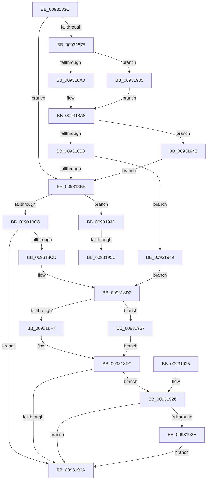

# DrvDbUnloadDatabaseNode

- RVA: `0x0093183C`–`0x00931971` (길이 `309` bytes)
- VA: `0x000000014093183C`
- 실행 섹션: `PAGE`
- PDB 이름 있음: `예`; PDB Function 태그: `예`
- unwind 정보 RVA: `0x0008ED38`
- 디코드: `92`개 명령, `309/309` bytes 표시
- 미해석 바이트: `0` (있으면 어셈블리에 `.byte`로 보존)

> 이 문서는 커널 이미지의 기계어와 PDB 기호를 분석해 생성했습니다. 4번과 5번은 함수 원형과 자료형을 바이너리 사용 방식에서 추정한 C 해석이며 원본 소스 복구 결과는 아닙니다.

## 1. Dependencies

- 직접 호출 지점: **4**; 고유 호출 대상: **2**
- 직접 호출자로 확인된 함수: **7**
- RIP 상대 이미지 참조: **1**

### Outgoing calls
- `0x009318A3` → [PiDrvDbNodeActionCallback](PiDrvDbNodeActionCallback_function_00931980.md) (function, `0x00931980`)
- `0x009318F7` → [PiDrvDbNodeActionCallback](PiDrvDbNodeActionCallback_function_00931980.md) (function, `0x00931980`)
- `0x00931938` → [guard_dispatch_icall](../../text/6B/guard_dispatch_icall_function_006BAAD0.md) (function, `0x006BAAD0`)
- `0x0093196A` → [guard_dispatch_icall](../../text/6B/guard_dispatch_icall_function_006BAAD0.md) (function, `0x006BAAD0`)

### Direct callers
- [DrvDbSetDriverDatabaseMappedProperty](../83/DrvDbSetDriverDatabaseMappedProperty_function_00834014.md) at `0x0083424A`
- [DrvDbDestroyDatabaseNode](../83/DrvDbDestroyDatabaseNode_function_00835674.md) at `0x00835689`
- [DrvDbReleaseDatabaseNodeBaseKey](DrvDbReleaseDatabaseNodeBaseKey_function_00930D44.md) at `0x00930DCF`
- [sub_00931400](Unknown_function_00931400.md) at `0x00931416`
- [sub_00931420](Unknown_function_00931420.md) at `0x0093145A`
- [DrvDbOpenDriverDatabaseRegKey](../AA/DrvDbOpenDriverDatabaseRegKey_function_00AA0FB8.md) at `0x00AA1148`
- [sub_00B24270](../B2/Unknown_function_00B24270.md) at `0x00B24465`

### Static image references
- `0x00931857` → RVA `0x00931980` (`PiDrvDbNodeActionCallback`; read)

## 2. Other-region calls and transfers

- 다른 실행 섹션으로 향하는 call: **2**
  - `0x00931938` → [guard_dispatch_icall](../../text/6B/guard_dispatch_icall_function_006BAAD0.md) (`PAGE` → `.text`)
  - `0x0093196A` → [guard_dispatch_icall](../../text/6B/guard_dispatch_icall_function_006BAAD0.md) (`PAGE` → `.text`)
- call이 아닌 외부 분기/꼬리 이동: **2**
  - `0x00931956` → [sub_00B24488 + 0x2A](../B2/Unknown_function_00B24488.md) (`tail-transfer`)
  - `0x00931962` → [sub_00B24488](../B2/Unknown_function_00B24488.md) (`tail-transfer`)

## 3. Assembly (complete function range)

```asm
0093183C  4C 8B DC                        mov r11, rsp
0093183F  49 89 5B 08                     mov qword ptr [r11 + 8], rbx
00931843  49 89 6B 18                     mov qword ptr [r11 + 0x18], rbp
00931847  56                              push rsi
00931848  57                              push rdi
00931849  41 54                           push r12
0093184B  41 56                           push r14
0093184D  41 57                           push r15
0093184F  48 83 EC 40                     sub rsp, 0x40
00931853  48 8B 72 50                     mov rsi, qword ptr [rdx + 0x50]
00931857  4C 8D 35 22 01 00 00            lea r14, [rip + 0x122]
0093185E  33 DB                           xor ebx, ebx
00931860  4C 8B E1                        mov r12, rcx
00931863  49 21 5B 10                     and qword ptr [r11 + 0x10], rbx
00931867  48 8B FA                        mov rdi, rdx
0093186A  8D 4B 01                        lea ecx, [rbx + 1]
0093186D  8D 6B 02                        lea ebp, [rbx + 2]
00931870  48 85 F6                        test rsi, rsi
00931873  74 46                           je 0x1409318bb
00931875  48 8D 42 60                     lea rax, [rdx + 0x60]
00931879  44 8B C9                        mov r9d, ecx
0093187C  49 89 43 10                     mov qword ptr [r11 + 0x10], rax
00931880  44 8B C5                        mov r8d, ebp
00931883  48 8B 42 58                     mov rax, qword ptr [rdx + 0x58]
00931887  49 8B CC                        mov rcx, r12
0093188A  48 8B 52 18                     mov rdx, qword ptr [rdx + 0x18]
0093188E  49 89 43 C0                     mov qword ptr [r11 - 0x40], rax
00931892  49 8D 43 10                     lea rax, [r11 + 0x10]
00931896  49 89 43 B8                     mov qword ptr [r11 - 0x48], rax
0093189A  49 3B F6                        cmp rsi, r14
0093189D  0F 85 92 00 00 00               jne 0x140931935
009318A3  E8 D8 00 00 00                  call 0x140931980
009318A8  3D 02 00 00 C0                  cmp eax, 0xc0000002
009318AD  0F 84 8F 00 00 00               je 0x140931942
009318B3  85 C0                           test eax, eax
009318B5  0F 88 8E 00 00 00               js 0x140931949
009318BB  4C 8D 7F 60                     lea r15, [rdi + 0x60]
009318BF  49 39 1F                        cmp qword ptr [r15], rbx
009318C2  0F 85 85 00 00 00               jne 0x14093194d
009318C8  48 85 F6                        test rsi, rsi
009318CB  74 3D                           je 0x14093190a
009318CD  BD 02 00 00 00                  mov ebp, 2
009318D2  48 8B 47 58                     mov rax, qword ptr [rdi + 0x58]
009318D6  44 8B CD                        mov r9d, ebp
009318D9  48 8B 57 18                     mov rdx, qword ptr [rdi + 0x18]
009318DD  44 8B C5                        mov r8d, ebp
009318E0  48 89 44 24 28                  mov qword ptr [rsp + 0x28], rax
009318E5  48 8D 44 24 78                  lea rax, [rsp + 0x78]
009318EA  48 89 44 24 20                  mov qword ptr [rsp + 0x20], rax
009318EF  49 8B CC                        mov rcx, r12
009318F2  49 3B F6                        cmp rsi, r14
009318F5  75 70                           jne 0x140931967
009318F7  E8 84 00 00 00                  call 0x140931980
009318FC  BA 00 00 00 80                  mov edx, 0x80000000
00931901  8B C8                           mov ecx, eax
00931903  8D 04 10                        lea eax, [rax + rdx]
00931906  85 C2                           test edx, eax
00931908  74 1C                           je 0x140931926
0093190A  4C 8D 5C 24 40                  lea r11, [rsp + 0x40]
0093190F  8B C3                           mov eax, ebx
00931911  49 8B 5B 30                     mov rbx, qword ptr [r11 + 0x30]
00931915  49 8B 6B 40                     mov rbp, qword ptr [r11 + 0x40]
00931919  49 8B E3                        mov rsp, r11
0093191C  41 5F                           pop r15
0093191E  41 5E                           pop r14
00931920  41 5C                           pop r12
00931922  5F                              pop rdi
00931923  5E                              pop rsi
00931924  C3                              ret
00931925  CC                              int3
00931926  81 F9 02 00 00 C0               cmp ecx, 0xc0000002
0093192C  74 DC                           je 0x14093190a
0093192E  85 DB                           test ebx, ebx
00931930  0F 44 D9                        cmove ebx, ecx
00931933  EB D5                           jmp 0x14093190a
00931935  48 8B C6                        mov rax, rsi
00931938  E8 93 91 D8 FF                  call 0x1406baad0
0093193D  E9 66 FF FF FF                  jmp 0x1409318a8
00931942  33 F6                           xor esi, esi
00931944  E9 72 FF FF FF                  jmp 0x1409318bb
00931949  8B D8                           mov ebx, eax
0093194B  EB 85                           jmp 0x1409318d2
0093194D  8B 47 40                        mov eax, dword ptr [rdi + 0x40]
00931950  4D 8B F7                        mov r14, r15
00931953  40 84 C5                        test bpl, al
00931956  0F 84 56 2B 1F 00               je 0x140b244b2
0093195C  33 ED                           xor ebp, ebp
0093195E  4C 8D 77 68                     lea r14, [rdi + 0x68]
00931962  E9 21 2B 1F 00                  jmp 0x140b24488
00931967  48 8B C6                        mov rax, rsi
0093196A  E8 61 91 D8 FF                  call 0x1406baad0
0093196F  EB 8B                           jmp 0x1409318fc
```

## 4. C-style interpretation (structured pseudocode)

```c
__int64 __fastcall DrvDbUnloadDatabaseNode(__int64 a1, __int64 a2)
{
    __int64 result;
    __int64 v_rbp;
    __int64 v_rbx;
    __int64 v_rsi;
    __int64 v_rsp;
    unsigned __int64 v_stack_m28;
    unsigned __int64 v_stack_m40;
    unsigned __int64 v_stack_m48;
    unsigned __int64 v_stack_p10;

    *(unsigned __int64 *)(v_rsp + 8) = v_rbx;
    *(unsigned __int64 *)(v_rsp + 24) = v_rbp;
    v_rsp = (v_rsp) - (64);
    v_rbx = 0;
    if (*(unsigned __int64 *)(a2 + 80) == 0) goto loc_009318BB;
    *(unsigned __int64 *)(v_rsp + 16) = a2 + 96;
    *(unsigned __int64 *)(v_rsp - 64) = *(unsigned __int64 *)(a2 + 88);
    *(unsigned __int64 *)(v_rsp - 72) = v_rsp + 16;
    if ((*(unsigned __int64 *)(a2 + 80)) != (v_rip + 290)) goto loc_00931935;
    result = PiDrvDbNodeActionCallback(a1, *(unsigned __int64 *)(a2 + 24), (unsigned int)((unsigned int)(v_rbx + 2)), (unsigned int)((unsigned int)(v_rbx + 1)));
loc_009318A8:
    if (((unsigned int)(result)) == 0xC0000002ULL) goto loc_00931942;
    if (sign_flag) goto loc_00931949;
loc_009318BB:
    if ((*(unsigned __int64 *)(a2 + 96)) != 0) goto loc_0093194D;
    if (*(unsigned __int64 *)(a2 + 80) == 0) goto loc_0093190A;
loc_009318D2:
    v_stack_m40 = *(unsigned __int64 *)(a2 + 88);
    v_stack_m48 = v_stack_p10;
    if ((*(unsigned __int64 *)(a2 + 80)) != (v_rip + 290)) goto loc_00931967;
    result = PiDrvDbNodeActionCallback(a1, *(unsigned __int64 *)(a2 + 24), 2, 2);
loc_009318FC:
    if ((((unsigned int)((unsigned int)(0x80000000ULL))) & ((unsigned int)(result + (unsigned int)(0x80000000ULL) * 1))) == 0) goto loc_00931926;
loc_0093190A:
    return 0;
loc_00931926:
    if (((unsigned int)((unsigned int)((unsigned int)(result)))) == 0xC0000002ULL) goto loc_0093190A;
    v_rbx = *(unsigned __int64 *)(v_stack_m28 + 48);
    if ((unsigned int)(*(unsigned __int64 *)(v_stack_m28 + 48)) == 0) { v_rbx = (unsigned int)((unsigned int)((unsigned int)(result))); }
    goto loc_0093190A;
loc_00931935:
    result = guard_dispatch_icall((unsigned int)((unsigned int)(result)), (unsigned int)(0x80000000ULL), 2, 2);
    goto loc_009318A8;
loc_00931942:
    v_rsi = 0;
    goto loc_009318BB;
loc_00931949:
    goto loc_009318D2;
loc_0093194D:
    v_rbp = 0;
loc_00931967:
    result = guard_dispatch_icall((unsigned int)((unsigned int)(result)), (unsigned int)(0x80000000ULL), 2, 2);
    goto loc_009318FC;
}
```

## 5. (Beta) C Style

```c
int64_t DrvDbUnloadDatabaseNode(int64_t Arg1, void *Arg2)
{
    uint8_t *arg2 = (uint8_t *)Arg2;

    int64_t result;
    int64_t local_rbp;
    int64_t local_rbx;
    int64_t local_rsi;
    int64_t local_rsp;
    uint64_t v_stack_m28;
    uint64_t v_stack_m40;
    uint64_t v_stack_m48;
    uint64_t v_stack_p10;

    *(uint64_t *)(local_rsp + 0x8) = local_rbx;
    *(uint64_t *)(local_rsp + 0x18) = local_rbp;
    local_rsp = (local_rsp) - (64);
    local_rbx = 0;
    if (*(uint64_t *)(arg2 + 0x50) == 0) goto loc_009318BB;
    *(void **)(local_rsp + 0x10) = Arg2 + 96;
    *(uint64_t *)(local_rsp - 0x40) = *(uint64_t *)(arg2 + 0x58);
    *(uint64_t *)(local_rsp - 0x48) = local_rsp + 16;
    if ((*(uint64_t *)(arg2 + 0x50)) != (v_rip + 290)) goto loc_00931935;
    result = PiDrvDbNodeActionCallback(Arg1, *(uint64_t *)(arg2 + 0x18), (uint32_t)((uint32_t)(local_rbx + 2)), (uint32_t)((uint32_t)(local_rbx + 1)));
loc_009318A8:
    if (((uint32_t)(result)) == 0xC0000002ULL) goto loc_00931942;
    if (sign_flag) goto loc_00931949;
loc_009318BB:
    if ((*(uint64_t *)(arg2 + 0x60)) != 0) goto loc_0093194D;
    if (*(uint64_t *)(arg2 + 0x50) == 0) goto loc_0093190A;
loc_009318D2:
    v_stack_m40 = *(uint64_t *)(arg2 + 0x58);
    v_stack_m48 = v_stack_p10;
    if ((*(uint64_t *)(arg2 + 0x50)) != (v_rip + 290)) goto loc_00931967;
    result = PiDrvDbNodeActionCallback(Arg1, *(uint64_t *)(arg2 + 0x18), 2, 2);
loc_009318FC:
    if ((((uint32_t)((uint32_t)(0x80000000ULL))) & ((uint32_t)(result + (uint32_t)(0x80000000ULL) * 1))) == 0) goto loc_00931926;
loc_0093190A:
    return 0;
loc_00931926:
    if (((uint32_t)((uint32_t)((uint32_t)(result)))) == 0xC0000002ULL) goto loc_0093190A;
    local_rbx = *(uint64_t *)(v_stack_m28 + 0x30);
    if ((uint32_t)(*(uint64_t *)(v_stack_m28 + 0x30)) == 0) { local_rbx = (uint32_t)((uint32_t)((uint32_t)(result))); }
    goto loc_0093190A;
loc_00931935:
    result = guard_dispatch_icall((uint32_t)((uint32_t)(result)), (uint32_t)(0x80000000ULL), 2, 2);
    goto loc_009318A8;
loc_00931942:
    local_rsi = 0;
    goto loc_009318BB;
loc_00931949:
    goto loc_009318D2;
loc_0093194D:
    local_rbp = 0;
loc_00931967:
    result = guard_dispatch_icall((uint32_t)((uint32_t)(result)), (uint32_t)(0x80000000ULL), 2, 2);
    goto loc_009318FC;
}
```

### 관측된 메모리 오프셋

구조체 형식이 확인되지 않은 접근은 인자 기준의 오프셋으로만 기록했습니다.

| 기준 인자 | 오프셋 표현 | 폭 (bit) | 접근 |
|---|---:|---:|---|
| `Arg2` | `+ 0x0` | `64` | `R` |
| `Arg2` | `+ 0x18` | `64` | `R` |
| `Arg2` | `+ 0x40` | `32` | `R` |
| `Arg2` | `+ 0x50` | `64` | `R` |
| `Arg2` | `+ 0x58` | `64` | `R` |
| `Arg2` | `+ 0x60` | `64` | `R` |
| `Arg2` | `+ 0x68` | `64` | `R` |

## 6. Execution-region graph

[열기: 2D/3D 그래프와 함수 탐색 컨트롤 패널](../../../control-panel.html?section=page&rva=0x0093183C&view=graph)

- 2D 그래프는 위에서 아래로 흐르고, 3D 그래프는 빈 공간을 드래그해 회전합니다. Shift+드래그는 이동, 휠은 확대·축소, 함수 노드 선택은 대상 보고서 이동입니다.

### Static fallback


