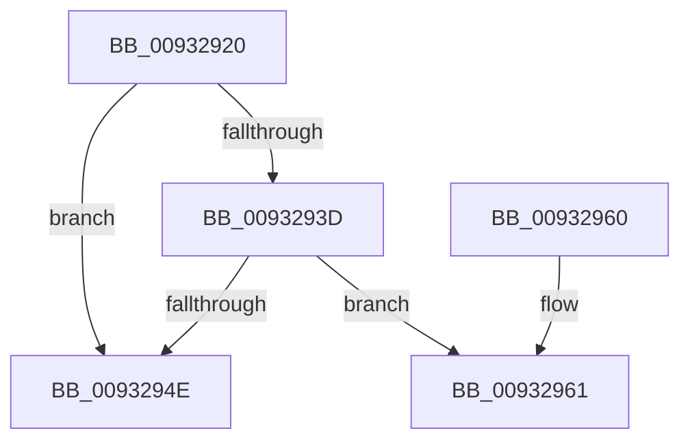

# EtwpAcquireLoggerContextByLoggerId

- RVA: `0x00932920`–`0x0093296D` (길이 `77` bytes)
- VA: `0x0000000140932920`
- 실행 섹션: `PAGE`
- PDB 이름 있음: `예`; PDB Function 태그: `아니요`
- unwind 정보 RVA: `0x0008EEB0`
- 디코드: `22`개 명령, `77/77` bytes 표시
- 미해석 바이트: `0` (있으면 어셈블리에 `.byte`로 보존)

> 이 문서는 커널 이미지의 기계어와 PDB 기호를 분석해 생성했습니다. 4번과 5번은 함수 원형과 자료형을 바이너리 사용 방식에서 추정한 C 해석이며 원본 소스 복구 결과는 아닙니다.

## 1. Dependencies

- 직접 호출 지점: **0**; 고유 호출 대상: **0**
- 직접 호출자로 확인된 함수: **35**
- RIP 상대 이미지 참조: **0**

### Outgoing calls
- 직접 디코드된 call 명령이 없습니다.

### Direct callers
- [EtwpAdjustSiloTraceBuffers](../../text/3E/EtwpAdjustSiloTraceBuffers_function_003EB720.md) at `0x003EB74C`
- [EtwpGetPmcSessions](../../text/64/EtwpGetPmcSessions_function_0064EB08.md) at `0x0064EB76`
- [EtwpGetCompressionSettings](../../text/65/EtwpGetCompressionSettings_function_006535A8.md) at `0x006535D9`
- [EtwpSetCompressionSettings](../../text/65/EtwpSetCompressionSettings_function_00653910.md) at `0x00653940`
- [EtwpTrackProviderBinaryKm](../6F/EtwpTrackProviderBinaryKm_function_006FD8E8.md) at `0x006FDA2F`
- [EtwpTrackProviderBinaryKm](../6F/EtwpTrackProviderBinaryKm_function_006FD8E8.md) at `0x006FDA7F`
- [EtwShutdown](../7B/EtwShutdown_function_007B50B0.md) at `0x007B5157`
- [EtwpQueryReferenceTime](../7B/EtwpQueryReferenceTime_function_007B92F0.md) at `0x007B9320`
- [WmiQueryTraceInformation](../7B/WmiQueryTraceInformation_function_007B9370.md) at `0x007B944D`
- [WmiQueryTraceInformation](../7B/WmiQueryTraceInformation_function_007B9370.md) at `0x007B94F2`
- [WmiQueryTraceInformation](../7B/WmiQueryTraceInformation_function_007B9370.md) at `0x007B9994`
- [WmiQueryTraceInformation](../7B/WmiQueryTraceInformation_function_007B9370.md) at `0x007B9ACC`
- [WmiQueryTraceInformation](../7B/WmiQueryTraceInformation_function_007B9370.md) at `0x007B9B61`
- [EtwRegisterEventCallback](../7B/EtwRegisterEventCallback_function_007BC3B0.md) at `0x007BC3FC`
- [EtwpUpdatePeriodicCaptureState](../7B/EtwpUpdatePeriodicCaptureState_function_007BCC4C.md) at `0x007BCC99`
- [EtwpGetSoftRestartInformation](../7B/EtwpGetSoftRestartInformation_function_007BEC70.md) at `0x007BED02`
- [EtwpKsrCallback](../7B/EtwpKsrCallback_function_007BEE10.md) at `0x007BEE85`
- [EtwpTrackProviderRegistration](../8C/EtwpTrackProviderRegistration_function_008C368C.md) at `0x008C36DC`
- [EtwpTrackProviderRegistration](../8C/EtwpTrackProviderRegistration_function_008C368C.md) at `0x008C3734`
- [EtwpTrackProviderRegistration](../8C/EtwpTrackProviderRegistration_function_008C368C.md) at `0x008C3797`
- [EtwpValidateEnableNotification](../8C/EtwpValidateEnableNotification_function_008C779C.md) at `0x008C782F`
- [EtwpAcquireLoggerContext](EtwpAcquireLoggerContext_function_009326AC.md) at `0x00932739`
- [EtwpAcquireLoggerContext](EtwpAcquireLoggerContext_function_009326AC.md) at `0x00932791`
- [EtwpAcquireLoggerContextByLoggerName](EtwpAcquireLoggerContextByLoggerName_function_0093283C.md) at `0x0093287A`
- [EtwpCheckLoggerAccessAndDoRundown](../9E/EtwpCheckLoggerAccessAndDoRundown_function_009E3EFC.md) at `0x009E3F21`
- [sub_009E8C24](../9E/Unknown_function_009E8C24.md) at `0x009E918B`
- [EtwpUpdateDisallowList](../9E/EtwpUpdateDisallowList_function_009EA880.md) at `0x009EA898`
- [EtwpAddRegEntryToGroup](../9F/EtwpAddRegEntryToGroup_function_009F39D4.md) at `0x009F3BE1`
- [EtwpAddRegEntryToGroup](../9F/EtwpAddRegEntryToGroup_function_009F39D4.md) at `0x009F3D26`
- [EtwpAddRegEntryToGroup](../9F/EtwpAddRegEntryToGroup_function_009F39D4.md) at `0x009F3E80`
- [EtwpAddRegEntryToGroup](../9F/EtwpAddRegEntryToGroup_function_009F39D4.md) at `0x009F3F7A`
- [EtwpSetProviderBinaryTracking](../A0/EtwpSetProviderBinaryTracking_function_00A03BF4.md) at `0x00A03C13`
- [EtwpEventTracingCounterSetCallback](../A0/EtwpEventTracingCounterSetCallback_function_00A0E0C0.md) at `0x00A0E23A`
- [EtwSetPerformanceTraceInformation](../A5/EtwSetPerformanceTraceInformation_function_00A53928.md) at `0x00A53A59`
- [EtwSetPerformanceTraceInformation](../A5/EtwSetPerformanceTraceInformation_function_00A53928.md) at `0x00A53B35`
- [EtwpSetSoftRestartInformation](../A5/EtwpSetSoftRestartInformation_function_00A53DB8.md) at `0x00A53E93`
- [EtwpLookupLoggerIdByName](../A6/EtwpLookupLoggerIdByName_function_00A60FF8.md) at `0x00A6102D`
- [EtwpRealtimeConnect](../A6/EtwpRealtimeConnect_function_00A65C88.md) at `0x00A65E18`
- [AddDecodeGuidToSessions](../A7/AddDecodeGuidToSessions_function_00A79A7C.md) at `0x00A79AE3`
- [EtwpGetDisallowList](../A7/EtwpGetDisallowList_function_00A7DE80.md) at `0x00A7DEB1`
- [EtwpStartLogger](../A9/EtwpStartLogger_function_00A99D80.md) at `0x00A9A478`
- [EtwpRealtimeDisconnectConsumer](../A9/EtwpRealtimeDisconnectConsumer_function_00A9E3D0.md) at `0x00A9E423`
- [NtTraceControl](../A9/NtTraceControl_function_00A9ED40.md) at `0x00A9F83B`
- [EtwpTracingProvEnableCallback](../AC/EtwpTracingProvEnableCallback_function_00AC28B0.md) at `0x00AC28EC`
- [EtwQueryPerformanceTraceInformation](../AF/EtwQueryPerformanceTraceInformation_function_00AF28A4.md) at `0x00AF29D3`
- [EtwQueryPerformanceTraceInformation](../AF/EtwQueryPerformanceTraceInformation_function_00AF28A4.md) at `0x00AF2ADE`
- [EtwQueryPerformanceTraceInformation](../AF/EtwQueryPerformanceTraceInformation_function_00AF28A4.md) at `0x00AF2BC8`
- [EtwQueryPerformanceTraceInformation](../AF/EtwQueryPerformanceTraceInformation_function_00AF28A4.md) at `0x00AF2DBC`
- [sub_00B3C988](../B3/Unknown_function_00B3C988.md) at `0x00B3CBFA`
- [sub_00B3C988](../B3/Unknown_function_00B3C988.md) at `0x00B3CDC2`
- [sub_00B3C988](../B3/Unknown_function_00B3C988.md) at `0x00B3CE9C`
- [sub_00B3C988](../B3/Unknown_function_00B3C988.md) at `0x00B3D2D2`
- [sub_00B3C988](../B3/Unknown_function_00B3C988.md) at `0x00B3D328`
- [sub_00B3C988](../B3/Unknown_function_00B3C988.md) at `0x00B3D3E3`
- [EtwpFixBootLoggers](../../init/C4/EtwpFixBootLoggers_function_00C4F09C.md) at `0x00C4F0FE`

### Static image references
- 디코드된 RIP-relative 메모리 참조가 없습니다.

## 2. Other-region calls and transfers

- 다른 실행 섹션으로 향하는 call: **0**
- 별도 외부 분기/꼬리 이동을 확인하지 못했습니다.

## 3. Assembly (complete function range)

```asm
00932920  48 89 5C 24 10                  mov qword ptr [rsp + 0x10], rbx
00932925  48 89 6C 24 18                  mov qword ptr [rsp + 0x18], rbp
0093292A  57                              push rdi
0093292B  48 83 EC 30                     sub rsp, 0x30
0093292F  41 0F B6 E8                     movzx ebp, r8b
00932933  8B FA                           mov edi, edx
00932935  48 8B D9                        mov rbx, rcx
00932938  3B 51 10                        cmp edx, dword ptr [rcx + 0x10]
0093293B  73 11                           jae 0x14093294e
0093293D  48 8B 81 C8 02 00 00            mov rax, qword ptr [rcx + 0x2c8]
00932944  4C 8B 0C F8                     mov r9, qword ptr [rax + rdi*8]
00932948  41 F6 C1 01                     test r9b, 1
0093294C  74 13                           je 0x140932961
0093294E  33 C0                           xor eax, eax
00932950  48 8B 5C 24 48                  mov rbx, qword ptr [rsp + 0x48]
00932955  48 8B 6C 24 50                  mov rbp, qword ptr [rsp + 0x50]
0093295A  48 83 C4 30                     add rsp, 0x30
0093295E  5F                              pop rdi
0093295F  C3                              ret
00932960  CC                              int3
00932961  48 8B 89 C0 02 00 00            mov rcx, qword ptr [rcx + 0x2c0]
00932968  BA 01 00 00 00                  mov edx, 1
```

## 4. C-style interpretation (structured pseudocode)

```c
__int64 __fastcall EtwpAcquireLoggerContextByLoggerId(__int64 a1, int a2, unsigned __int8 a3)
{
    __int64 result;
    __int64 v_rsp;
    unsigned __int64 v_stack_p10;
    unsigned __int64 v_stack_p18;

    v_stack_p10 = v_rbx;
    v_stack_p18 = v_rbp;
    v_rsp = (v_rsp) - (48);
    if (a2 >= (*(unsigned int *)(a1 + 16))) goto loc_0093294E;
    if ((((unsigned __int8)(*(unsigned __int64 *)(*(unsigned __int64 *)(a1 + 712) + (unsigned int)(a2) * 8))) & (1)) == 0) goto loc_00932961;
loc_0093294E:
    result = 0;
    v_rsp = (v_rsp) + (48);
    return result;
loc_00932961:
    return result;
}
```

## 5. (Beta) C Style

```c
int64_t EtwpAcquireLoggerContextByLoggerId(void *Arg1, int32_t Arg2, uint8_t Arg3)
{
    uint8_t *arg1 = (uint8_t *)Arg1;

    int64_t result;
    int64_t local_rsp;
    uint64_t v_stack_p10;
    uint64_t v_stack_p18;

    v_stack_p10 = local_rbx;
    v_stack_p18 = local_rbp;
    local_rsp = (local_rsp) - (48);
    if (Arg2 >= (*(uint32_t *)(arg1 + 0x10))) goto loc_0093294E;
    if ((((uint8_t)(*(uint64_t *)(*(uint64_t *)(arg1 + 0x2C8) + (uint32_t)(Arg2) * 8))) & (1)) == 0) goto loc_00932961;
loc_0093294E:
    result = 0;
    local_rsp = (local_rsp) + (48);
    return result;
loc_00932961:
    return result;
}
```

### 관측된 메모리 오프셋

구조체 형식이 확인되지 않은 접근은 인자 기준의 오프셋으로만 기록했습니다.

| 기준 인자 | 오프셋 표현 | 폭 (bit) | 접근 |
|---|---:|---:|---|
| `Arg1` | `+ 0x10` | `32` | `R` |
| `Arg1` | `+ 0x2C0` | `64` | `R` |
| `Arg1` | `+ 0x2C8` | `64` | `R` |

## 6. Execution-region graph

[열기: 2D/3D 그래프와 함수 탐색 컨트롤 패널](../../../control-panel.html?section=page&rva=0x00932920&view=graph)

- 2D 그래프는 위에서 아래로 흐르고, 3D 그래프는 빈 공간을 드래그해 회전합니다. Shift+드래그는 이동, 휠은 확대·축소, 함수 노드 선택은 대상 보고서 이동입니다.

### Static fallback


