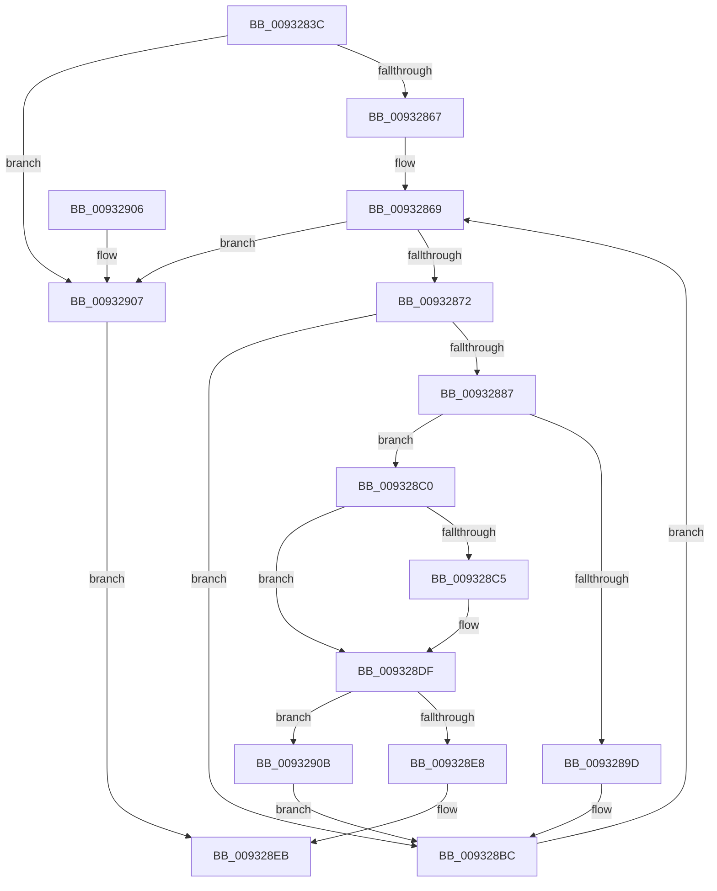

# EtwpAcquireLoggerContextByLoggerName

- RVA: `0x0093283C`–`0x00932918` (길이 `220` bytes)
- VA: `0x000000014093283C`
- 실행 섹션: `PAGE`
- PDB 이름 있음: `예`; PDB Function 태그: `아니요`
- unwind 정보 RVA: `0x0008EE94`
- 디코드: `61`개 명령, `220/220` bytes 표시
- 미해석 바이트: `0` (있으면 어셈블리에 `.byte`로 보존)

> 이 문서는 커널 이미지의 기계어와 PDB 기호를 분석해 생성했습니다. 4번과 5번은 함수 원형과 자료형을 바이너리 사용 방식에서 추정한 C 해석이며 원본 소스 복구 결과는 아닙니다.

## 1. Dependencies

- 직접 호출 지점: **5**; 고유 호출 대상: **5**
- 직접 호출자로 확인된 함수: **3**
- RIP 상대 이미지 참조: **0**

### Outgoing calls
- `0x0093287A` → [EtwpAcquireLoggerContextByLoggerId](EtwpAcquireLoggerContextByLoggerId_function_00932920.md) (function, `0x00932920`)
- `0x00932894` → [RtlEqualUnicodeString](RtlEqualUnicodeString_function_00932A20.md) (function, `0x00932A20`)
- `0x009328B7` → [ExReleaseRundownProtectionCacheAwareEx](../../text/25/ExReleaseRundownProtectionCacheAwareEx_function_0025F050.md) (function, `0x0025F050`)
- `0x009328DA` → [KeWaitForSingleObject](../../text/20/KeWaitForSingleObject_function_0020E6B0.md) (function, `0x0020E6B0`)
- `0x00932911` → [EtwpReleaseLoggerContext](../A0/EtwpReleaseLoggerContext_function_00A04160.md) (function, `0x00A04160`)

### Direct callers
- [WdipSemGetLoggerIds](../A5/WdipSemGetLoggerIds_function_00A5CBB4.md) at `0x00A5CC1C`
- [WdipSemGetLoggerIds](../A5/WdipSemGetLoggerIds_function_00A5CBB4.md) at `0x00A5CC6D`
- [EtwQueryTraceHandleByLoggerName](../AA/EtwQueryTraceHandleByLoggerName_function_00AA2578.md) at `0x00AA25AE`
- [EtwpEnableBootLoggerRegistryProviders](../../init/C4/EtwpEnableBootLoggerRegistryProviders_function_00C4EF8C.md) at `0x00C4F033`

### Static image references
- 디코드된 RIP-relative 메모리 참조가 없습니다.

## 2. Other-region calls and transfers

- 다른 실행 섹션으로 향하는 call: **2**
  - `0x009328B7` → [ExReleaseRundownProtectionCacheAwareEx](../../text/25/ExReleaseRundownProtectionCacheAwareEx_function_0025F050.md) (`PAGE` → `.text`)
  - `0x009328DA` → [KeWaitForSingleObject](../../text/20/KeWaitForSingleObject_function_0020E6B0.md) (`PAGE` → `.text`)
- 별도 외부 분기/꼬리 이동을 확인하지 못했습니다.

## 3. Assembly (complete function range)

```asm
0093283C  48 8B C4                        mov rax, rsp
0093283F  48 89 58 08                     mov qword ptr [rax + 8], rbx
00932843  48 89 68 10                     mov qword ptr [rax + 0x10], rbp
00932847  48 89 70 18                     mov qword ptr [rax + 0x18], rsi
0093284B  48 89 78 20                     mov qword ptr [rax + 0x20], rdi
0093284F  41 56                           push r14
00932851  48 83 EC 30                     sub rsp, 0x30
00932855  41 8A F0                        mov sil, r8b
00932858  4C 8B F2                        mov r14, rdx
0093285B  48 8B E9                        mov rbp, rcx
0093285E  48 85 D2                        test rdx, rdx
00932861  0F 84 A0 00 00 00               je 0x140932907
00932867  33 FF                           xor edi, edi
00932869  3B 7D 10                        cmp edi, dword ptr [rbp + 0x10]
0093286C  0F 83 95 00 00 00               jae 0x140932907
00932872  45 33 C0                        xor r8d, r8d
00932875  8B D7                           mov edx, edi
00932877  48 8B CD                        mov rcx, rbp
0093287A  E8 A1 00 00 00                  call 0x140932920
0093287F  48 8B D8                        mov rbx, rax
00932882  48 85 C0                        test rax, rax
00932885  74 35                           je 0x1409328bc
00932887  48 8D 88 88 00 00 00            lea rcx, [rax + 0x88]
0093288E  41 B0 01                        mov r8b, 1
00932891  49 8B D6                        mov rdx, r14
00932894  E8 87 01 00 00                  call 0x140932a20
00932899  84 C0                           test al, al
0093289B  75 23                           jne 0x1409328c0
0093289D  48 8B 83 50 05 00 00            mov rax, qword ptr [rbx + 0x550]
009328A4  BA 01 00 00 00                  mov edx, 1
009328A9  44 8B 03                        mov r8d, dword ptr [rbx]
009328AC  48 8B 88 C0 02 00 00            mov rcx, qword ptr [rax + 0x2c0]
009328B3  4A 8B 0C C1                     mov rcx, qword ptr [rcx + r8*8]
009328B7  E8 94 C7 92 FF                  call 0x14025f050
009328BC  FF C7                           inc edi
009328BE  EB A9                           jmp 0x140932869
009328C0  40 84 F6                        test sil, sil
009328C3  74 1A                           je 0x1409328df
009328C5  48 83 64 24 20 00               and qword ptr [rsp + 0x20], 0
009328CB  48 8D 8B 78 02 00 00            lea rcx, [rbx + 0x278]
009328D2  45 33 C9                        xor r9d, r9d
009328D5  45 33 C0                        xor r8d, r8d
009328D8  33 D2                           xor edx, edx
009328DA  E8 D1 BD 8D FF                  call 0x14020e6b0
009328DF  83 BB 40 01 00 00 00            cmp dword ptr [rbx + 0x140], 0
009328E6  74 23                           je 0x14093290b
009328E8  48 8B C3                        mov rax, rbx
009328EB  48 8B 5C 24 40                  mov rbx, qword ptr [rsp + 0x40]
009328F0  48 8B 6C 24 48                  mov rbp, qword ptr [rsp + 0x48]
009328F5  48 8B 74 24 50                  mov rsi, qword ptr [rsp + 0x50]
009328FA  48 8B 7C 24 58                  mov rdi, qword ptr [rsp + 0x58]
009328FF  48 83 C4 30                     add rsp, 0x30
00932903  41 5E                           pop r14
00932905  C3                              ret
00932906  CC                              int3
00932907  33 C0                           xor eax, eax
00932909  EB E0                           jmp 0x1409328eb
0093290B  40 8A D6                        mov dl, sil
0093290E  48 8B CB                        mov rcx, rbx
00932911  E8 4A 18 0D 00                  call 0x140a04160
00932916  EB A4                           jmp 0x1409328bc
```

## 4. C-style interpretation (structured pseudocode)

```c
__int64 __fastcall EtwpAcquireLoggerContextByLoggerName(__int64 a1, __int64 a2, int a3, int a4)
{
    __int64 result;
    __int64 v_rdi;
    __int64 v_rsp;
    unsigned __int64 v_stack_m18;
    unsigned __int64 v_stack_p10;
    unsigned __int64 v_stack_p18;
    unsigned __int64 v_stack_p20;
    unsigned __int64 v_stack_p8;

    *(unsigned __int64 *)(v_rsp + 8) = v_rbx;
    *(unsigned __int64 *)(v_rsp + 16) = v_rbp;
    *(unsigned __int64 *)(v_rsp + 24) = v_rsi;
    *(unsigned __int64 *)(v_rsp + 32) = v_rdi;
    v_rsp = (v_rsp) - (48);
    if (a2 == 0) goto loc_00932907;
    v_rdi = 0;
loc_00932869:
    if (0 >= (*(unsigned int *)(a1 + 16))) goto loc_00932907;
    a3 = 0;
    result = EtwpAcquireLoggerContextByLoggerId(a1, 0, a3, a4);
    if (result == 0) goto loc_009328BC;
    result = RtlEqualUnicodeString(result + 136, a2, 1, a4);
    if ((unsigned __int8)(result) != 0) goto loc_009328C0;
    result = ExReleaseRundownProtectionCacheAwareEx(*(unsigned __int64 *)(*(unsigned __int64 *)(*(unsigned __int64 *)(result + 1360) + 704) + (unsigned int)(*(unsigned int *)(result)) * 8), 1, (unsigned int)(*(unsigned int *)(result)), a4);
loc_009328BC:
    v_rdi = (unsigned int)((v_rdi) + 1);
    goto loc_00932869;
loc_009328C0:
    if ((unsigned __int8)((unsigned __int8)(a3)) != 0) {
        a1 = result + 632;
        a4 = 0;
        a3 = 0;
        a2 = 0;
        result = KeWaitForSingleObject(a1, a2, a3, a4);
    }
    if ((*(unsigned int *)(result + 320)) == 0) goto loc_0093290B;
loc_009328EB:
    v_rsp = (v_rsp) + (48);
    return result;
loc_00932907:
    result = 0;
    goto loc_009328EB;
loc_0093290B:
    result = EtwpReleaseLoggerContext(v_stack_p8, (unsigned __int8)(v_stack_p18), a3, a4);
    goto loc_009328BC;
}
```

## 5. (Beta) C Style

```c
int64_t EtwpAcquireLoggerContextByLoggerName(void *Arg1, int64_t Arg2, int32_t Arg3, int32_t Arg4)
{
    uint8_t *arg1 = (uint8_t *)Arg1;

    int64_t result;
    int64_t local_rdi;
    int64_t local_rsp;
    uint64_t v_stack_m18;
    uint64_t v_stack_p10;
    uint64_t v_stack_p18;
    uint64_t v_stack_p20;
    uint64_t v_stack_p8;

    *(uint64_t *)(local_rsp + 0x8) = local_rbx;
    *(uint64_t *)(local_rsp + 0x10) = local_rbp;
    *(uint64_t *)(local_rsp + 0x18) = local_rsi;
    *(uint64_t *)(local_rsp + 0x20) = local_rdi;
    local_rsp = (local_rsp) - (48);
    if (Arg2 == 0) goto loc_00932907;
    local_rdi = 0;
loc_00932869:
    if (0 >= (*(uint32_t *)(arg1 + 0x10))) goto loc_00932907;
    Arg3 = 0;
    result = EtwpAcquireLoggerContextByLoggerId(Arg1, 0, Arg3, Arg4);
    if (result == 0) goto loc_009328BC;
    result = RtlEqualUnicodeString(result + 136, Arg2, 1, Arg4);
    if ((uint8_t)(result) != 0) goto loc_009328C0;
    result = ExReleaseRundownProtectionCacheAwareEx(*(uint64_t *)(*(uint64_t *)(*(uint64_t *)(result + 0x550) + 0x2C0) + (uint32_t)(*(uint32_t *)(result)) * 8), 1, (uint32_t)(*(uint32_t *)(result)), Arg4);
loc_009328BC:
    local_rdi = (uint32_t)((local_rdi) + 1);
    goto loc_00932869;
loc_009328C0:
    if ((uint8_t)((uint8_t)(Arg3)) != 0) {
        Arg1 = result + 632;
        Arg4 = 0;
        Arg3 = 0;
        Arg2 = 0;
        result = KeWaitForSingleObject(Arg1, Arg2, Arg3, Arg4);
    }
    if ((*(uint32_t *)(result + 0x140)) == 0) goto loc_0093290B;
loc_009328EB:
    local_rsp = (local_rsp) + (48);
    return result;
loc_00932907:
    result = 0;
    goto loc_009328EB;
loc_0093290B:
    result = EtwpReleaseLoggerContext(v_stack_p8, (uint8_t)(v_stack_p18), Arg3, Arg4);
    goto loc_009328BC;
}
```

### 관측된 메모리 오프셋

구조체 형식이 확인되지 않은 접근은 인자 기준의 오프셋으로만 기록했습니다.

| 기준 인자 | 오프셋 표현 | 폭 (bit) | 접근 |
|---|---:|---:|---|
| `Arg1` | `+ 0x10` | `32` | `R` |

## 6. Execution-region graph

[열기: 2D/3D 그래프와 함수 탐색 컨트롤 패널](../../../control-panel.html?section=page&rva=0x0093283C&view=graph)

- 2D 그래프는 위에서 아래로 흐르고, 3D 그래프는 빈 공간을 드래그해 회전합니다. Shift+드래그는 이동, 휠은 확대·축소, 함수 노드 선택은 대상 보고서 이동입니다.

### Static fallback


