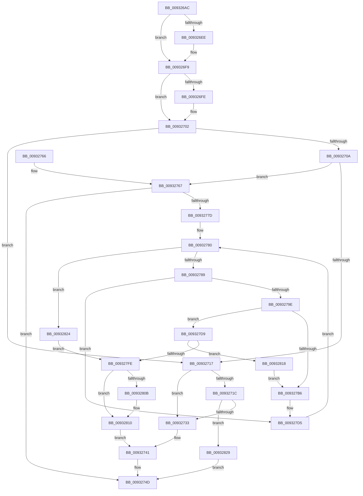

# EtwpAcquireLoggerContext

- RVA: `0x009326AC`–`0x00932833` (길이 `391` bytes)
- VA: `0x00000001409326AC`
- 실행 섹션: `PAGE`
- PDB 이름 있음: `예`; PDB Function 태그: `아니요`
- unwind 정보 RVA: `0x0008EE78`
- 디코드: `107`개 명령, `391/391` bytes 표시
- 미해석 바이트: `0` (있으면 어셈블리에 `.byte`로 보존)

> 이 문서는 커널 이미지의 기계어와 PDB 기호를 분석해 생성했습니다. 4번과 5번은 함수 원형과 자료형을 바이너리 사용 방식에서 추정한 C 해석이며 원본 소스 복구 결과는 아닙니다.

## 1. Dependencies

- 직접 호출 지점: **8**; 고유 호출 대상: **7**
- 직접 호출자로 확인된 함수: **6**
- RIP 상대 이미지 참조: **2**

### Outgoing calls
- `0x00932739` → [EtwpAcquireLoggerContextByLoggerId](EtwpAcquireLoggerContextByLoggerId_function_00932920.md) (function, `0x00932920`)
- `0x00932774` → [EtwpCaptureString](../9B/EtwpCaptureString_function_009BD754.md) (function, `0x009BD754`)
- `0x00932791` → [EtwpAcquireLoggerContextByLoggerId](EtwpAcquireLoggerContextByLoggerId_function_00932920.md) (function, `0x00932920`)
- `0x009327AD` → [RtlEqualUnicodeString](RtlEqualUnicodeString_function_00932A20.md) (function, `0x00932A20`)
- `0x009327D0` → [ExReleaseRundownProtectionCacheAwareEx](../../text/25/ExReleaseRundownProtectionCacheAwareEx_function_0025F050.md) (function, `0x0025F050`)
- `0x009327F0` → [KeWaitForSingleObject](../../text/20/KeWaitForSingleObject_function_0020E6B0.md) (function, `0x0020E6B0`)
- `0x0093280B` → [ExFreePool](../../poolcode/B8/ExFreePool_function_00B82850.md) (function, `0x00B82850`)
- `0x0093281D` → [KeReleaseMutex](../../text/39/KeReleaseMutex_function_00396810.md) (function, `0x00396810`)

### Direct callers
- [EtwpTransitionToRealtime](../../text/65/EtwpTransitionToRealtime_function_006518D8.md) at `0x00651920`
- [EtwpIncrementTraceFile](../7B/EtwpIncrementTraceFile_function_007B9210.md) at `0x007B9254`
- [EtwpQueryTrace](../8B/EtwpQueryTrace_function_008BF8B0.md) at `0x008BF8F4`
- [EtwpStopTrace](../9B/EtwpStopTrace_function_009BCE84.md) at `0x009BCEE5`
- [EtwpUpdateTrace](../AB/EtwpUpdateTrace_function_00ABCC7C.md) at `0x00ABCCE4`
- [EtwpFlushTrace](../AF/EtwpFlushTrace_function_00AF47B4.md) at `0x00AF480D`

### Static image references
- `0x009326E2` → RVA `0x00011F40` (`.rdata`; read)
- `0x009326F2` → RVA `0x00011F48` (`.rdata`; read)

## 2. Other-region calls and transfers

- 다른 실행 섹션으로 향하는 call: **4**
  - `0x009327D0` → [ExReleaseRundownProtectionCacheAwareEx](../../text/25/ExReleaseRundownProtectionCacheAwareEx_function_0025F050.md) (`PAGE` → `.text`)
  - `0x009327F0` → [KeWaitForSingleObject](../../text/20/KeWaitForSingleObject_function_0020E6B0.md) (`PAGE` → `.text`)
  - `0x0093280B` → [ExFreePool](../../poolcode/B8/ExFreePool_function_00B82850.md) (`PAGE` → `POOLCODE`)
  - `0x0093281D` → [KeReleaseMutex](../../text/39/KeReleaseMutex_function_00396810.md) (`PAGE` → `.text`)
- 별도 외부 분기/꼬리 이동을 확인하지 못했습니다.

## 3. Assembly (complete function range)

```asm
009326AC  48 89 5C 24 08                  mov qword ptr [rsp + 8], rbx
009326B1  48 89 6C 24 10                  mov qword ptr [rsp + 0x10], rbp
009326B6  48 89 74 24 18                  mov qword ptr [rsp + 0x18], rsi
009326BB  57                              push rdi
009326BC  41 56                           push r14
009326BE  41 57                           push r15
009326C0  48 83 EC 40                     sub rsp, 0x40
009326C4  4C 8B D2                        mov r10, rdx
009326C7  4C 8D 89 98 11 00 00            lea r9, [rcx + 0x1198]
009326CE  4D 8B F0                        mov r14, r8
009326D1  45 33 FF                        xor r15d, r15d
009326D4  41 83 C8 FF                     or r8d, 0xffffffff
009326D8  48 8B F1                        mov rsi, rcx
009326DB  41 8B D0                        mov edx, r8d
009326DE  49 8B 42 18                     mov rax, qword ptr [r10 + 0x18]
009326E2  48 2B 05 57 F8 6D FF            sub rax, qword ptr [rip - 0x9207a9]
009326E9  4D 89 3E                        mov qword ptr [r14], r15
009326EC  75 0B                           jne 0x1409326f9
009326EE  49 8B 42 20                     mov rax, qword ptr [r10 + 0x20]
009326F2  48 2B 05 4F F8 6D FF            sub rax, qword ptr [rip - 0x9207b1]
009326F9  48 85 C0                        test rax, rax
009326FC  75 04                           jne 0x140932702
009326FE  41 0F B6 11                     movzx edx, byte ptr [r9]
00932702  41 0F B6 01                     movzx eax, byte ptr [r9]
00932706  3B D0                           cmp edx, eax
00932708  74 0D                           je 0x140932717
0093270A  49 8D 8A 90 00 00 00            lea rcx, [r10 + 0x90]
00932711  66 44 39 39                     cmp word ptr [rcx], r15w
00932715  77 50                           ja 0x140932767
00932717  41 3B D0                        cmp edx, r8d
0093271A  75 17                           jne 0x140932733
0093271C  41 0F B7 52 08                  movzx edx, word ptr [r10 + 8]
00932721  81 FA FF FF 00 00               cmp edx, 0xffff
00932727  0F 44 D0                        cmove edx, eax
0093272A  3B 56 10                        cmp edx, dword ptr [rsi + 0x10]
0093272D  0F 83 F6 00 00 00               jae 0x140932829
00932733  41 B0 01                        mov r8b, 1
00932736  48 8B CE                        mov rcx, rsi
00932739  E8 E2 01 00 00                  call 0x140932920
0093273E  49 89 06                        mov qword ptr [r14], rax
00932741  48 F7 D8                        neg rax
00932744  1B C0                           sbb eax, eax
00932746  F7 D0                           not eax
00932748  25 96 02 00 C0                  and eax, 0xc0000296
0093274D  48 8B 5C 24 60                  mov rbx, qword ptr [rsp + 0x60]
00932752  48 8B 6C 24 68                  mov rbp, qword ptr [rsp + 0x68]
00932757  48 8B 74 24 70                  mov rsi, qword ptr [rsp + 0x70]
0093275C  48 83 C4 40                     add rsp, 0x40
00932760  41 5F                           pop r15
00932762  41 5E                           pop r14
00932764  5F                              pop rdi
00932765  C3                              ret
00932766  CC                              int3
00932767  0F 57 C0                        xorps xmm0, xmm0
0093276A  48 8D 54 24 30                  lea rdx, [rsp + 0x30]
0093276F  0F 11 44 24 30                  movups xmmword ptr [rsp + 0x30], xmm0
00932774  E8 DB AF 08 00                  call 0x1409bd754
00932779  85 C0                           test eax, eax
0093277B  78 D0                           js 0x14093274d
0093277D  41 8B FF                        mov edi, r15d
00932780  3B 7E 10                        cmp edi, dword ptr [rsi + 0x10]
00932783  0F 83 9B 00 00 00               jae 0x140932824
00932789  45 33 C0                        xor r8d, r8d
0093278C  8B D7                           mov edx, edi
0093278E  48 8B CE                        mov rcx, rsi
00932791  E8 8A 01 00 00                  call 0x140932920
00932796  48 8B D8                        mov rbx, rax
00932799  48 85 C0                        test rax, rax
0093279C  74 37                           je 0x1409327d5
0093279E  48 8D 88 88 00 00 00            lea rcx, [rax + 0x88]
009327A5  41 B0 01                        mov r8b, 1
009327A8  48 8D 54 24 30                  lea rdx, [rsp + 0x30]
009327AD  E8 6E 02 00 00                  call 0x140932a20
009327B2  84 C0                           test al, al
009327B4  75 23                           jne 0x1409327d9
009327B6  48 8B 83 50 05 00 00            mov rax, qword ptr [rbx + 0x550]
009327BD  BA 01 00 00 00                  mov edx, 1
009327C2  44 8B 03                        mov r8d, dword ptr [rbx]
009327C5  48 8B 88 C0 02 00 00            mov rcx, qword ptr [rax + 0x2c0]
009327CC  4A 8B 0C C1                     mov rcx, qword ptr [rcx + r8*8]
009327D0  E8 7B C8 92 FF                  call 0x14025f050
009327D5  FF C7                           inc edi
009327D7  EB A7                           jmp 0x140932780
009327D9  48 8D AB 78 02 00 00            lea rbp, [rbx + 0x278]
009327E0  4C 89 7C 24 20                  mov qword ptr [rsp + 0x20], r15
009327E5  48 8B CD                        mov rcx, rbp
009327E8  45 33 C9                        xor r9d, r9d
009327EB  45 33 C0                        xor r8d, r8d
009327EE  33 D2                           xor edx, edx
009327F0  E8 BB BE 8D FF                  call 0x14020e6b0
009327F5  44 39 BB 40 01 00 00            cmp dword ptr [rbx + 0x140], r15d
009327FC  74 1A                           je 0x140932818
009327FE  48 8B 4C 24 38                  mov rcx, qword ptr [rsp + 0x38]
00932803  49 89 1E                        mov qword ptr [r14], rbx
00932806  48 85 C9                        test rcx, rcx
00932809  74 05                           je 0x140932810
0093280B  E8 40 00 25 00                  call 0x140b82850
00932810  49 8B 06                        mov rax, qword ptr [r14]
00932813  E9 29 FF FF FF                  jmp 0x140932741
00932818  33 D2                           xor edx, edx
0093281A  48 8B CD                        mov rcx, rbp
0093281D  E8 EE 3F A6 FF                  call 0x140396810
00932822  EB 92                           jmp 0x1409327b6
00932824  49 8B DF                        mov rbx, r15
00932827  EB D5                           jmp 0x1409327fe
00932829  B8 08 00 00 C0                  mov eax, 0xc0000008
0093282E  E9 1A FF FF FF                  jmp 0x14093274d
```

## 4. C-style interpretation (structured pseudocode)

```c
__int64 __fastcall EtwpAcquireLoggerContext(__int64 a1, __int64 a2, __int64 a3)
{
    __int64 result;
    __int64 v_r15;
    __int64 v_rdi;
    __int64 v_rsp;
    unsigned __int64 v_stack_p10;
    unsigned __int64 v_stack_p18;
    unsigned __int64 v_stack_p20;
    unsigned __int64 v_stack_p30;
    unsigned __int64 v_stack_p38;
    unsigned __int64 v_stack_p8;

    v_stack_p8 = v_rbx;
    v_stack_p10 = v_rbp;
    v_stack_p18 = v_rsi;
    v_rsp = (v_rsp) - (64);
    v_r15 = 0;
    a3 = (unsigned int)((a3) | (0xFFFFFFFFULL));
    result = (*(unsigned __int64 *)(a2 + 24)) - (*(unsigned __int64 *)(v_rip - 9570217));
    *(unsigned __int64 *)(a3) = 0;
    if (!(condition_is_not_equal)) {
        result = *(unsigned __int64 *)(a2 + 32);
        result = (result) - (*(unsigned __int64 *)(v_rip - 9570225));
    }
    if (result == 0) {
        a2 = *(unsigned __int8 *)(a1 + 4504);
    }
    if (((unsigned int)(a2)) == ((unsigned int)(*(unsigned __int8 *)(a1 + 4504)))) goto loc_00932717;
    if ((*(unsigned __int16 *)(a2 + 144)) > 0) goto loc_00932767;
loc_00932717:
    if (((unsigned int)(a2)) != ((unsigned int)(a3))) goto loc_00932733;
    a2 = *(unsigned __int16 *)(a2 + 8);
    if (((unsigned int)(*(unsigned __int16 *)(a2 + 8))) == 0xFFFFULL) { a2 = (unsigned int)(*(unsigned __int8 *)(a1 + 4504)); }
    if (((unsigned int)(a2)) >= (*(unsigned int *)(a1 + 16))) goto loc_00932829;
loc_00932733:
    result = EtwpAcquireLoggerContextByLoggerId(a1, a2, 1, a1 + 4504);
    *(unsigned __int64 *)(a3) = result;
loc_00932741:
    result = -(result);
    result = (unsigned int)(~(result));
    result = (unsigned int)((result) & (0xC0000296ULL));
loc_0093274D:
    v_rsp = (v_rsp) + (64);
    return result;
loc_00932767:
    v_stack_p30 = v_xmm0;
    result = EtwpCaptureString(a1, v_stack_p30, 1, a1 + 4504);
    if (sign_flag) goto loc_0093274D;
loc_00932780:
    if (0 >= (*(unsigned int *)(v_stack_p18 + 16))) goto loc_00932824;
    a3 = 0;
    result = EtwpAcquireLoggerContextByLoggerId(v_stack_p18, 0, a3, a1 + 4504);
    if (result == 0) goto loc_009327D5;
    result = RtlEqualUnicodeString(result + 136, v_stack_p30, 1, a1 + 4504);
    if ((unsigned __int8)(result) != 0) goto loc_009327D9;
loc_009327B6:
    result = ExReleaseRundownProtectionCacheAwareEx(*(unsigned __int64 *)(*(unsigned __int64 *)(*(unsigned __int64 *)(result + 1360) + 704) + (unsigned int)(*(unsigned int *)(result)) * 8), 1, (unsigned int)(*(unsigned int *)(result)), a1 + 4504);
loc_009327D5:
    v_rdi = (unsigned int)((0) + 1);
    goto loc_00932780;
loc_009327D9:
    v_stack_p20 = 0;
    a4 = 0;
    a3 = 0;
    a2 = 0;
    result = KeWaitForSingleObject(result + 632, a2, a3, a4);
    if ((*(unsigned int *)(result + 320)) == 0) goto loc_00932818;
loc_009327FE:
    *(unsigned __int64 *)(a3) = result;
    if (v_stack_p38 != 0) {
        result = ExFreePool(v_stack_p38, a2, a3, a4);
    }
    goto loc_00932741;
loc_00932818:
    a2 = 0;
    result = KeReleaseMutex(result + 632, a2, a3, a4);
    goto loc_009327B6;
loc_00932824:
    goto loc_009327FE;
loc_00932829:
    goto loc_0093274D;
}
```

## 5. (Beta) C Style

```c
int64_t EtwpAcquireLoggerContext(void *Arg1, void *Arg2, void *Arg3)
{
    uint8_t *arg1 = (uint8_t *)Arg1;
    uint8_t *arg2 = (uint8_t *)Arg2;
    uint8_t *arg3 = (uint8_t *)Arg3;

    int64_t result;
    int64_t local_r15;
    int64_t local_rdi;
    int64_t local_rsp;
    uint64_t v_stack_p10;
    uint64_t v_stack_p18;
    uint64_t v_stack_p20;
    uint64_t v_stack_p30;
    uint64_t v_stack_p38;
    uint64_t v_stack_p8;

    v_stack_p8 = local_rbx;
    v_stack_p10 = local_rbp;
    v_stack_p18 = local_rsi;
    local_rsp = (local_rsp) - (64);
    local_r15 = 0;
    Arg3 = (uint32_t)((Arg3) | (0xFFFFFFFFULL));
    result = (*(uint64_t *)(arg2 + 0x18)) - (*(uint64_t *)(v_rip - 0x9207A9));
    *(uint64_t *)(arg3) = 0;
    if (!(condition_is_not_equal)) {
        result = *(uint64_t *)(arg2 + 0x20);
        result = (result) - (*(uint64_t *)(v_rip - 0x9207B1));
    }
    if (result == 0) {
        Arg2 = *(uint8_t *)(arg1 + 0x1198);
    }
    if (((uint32_t)(Arg2)) == ((uint32_t)(*(uint8_t *)(arg1 + 0x1198)))) goto loc_00932717;
    if ((*(uint16_t *)(arg2 + 0x90)) > 0) goto loc_00932767;
loc_00932717:
    if (((uint32_t)(Arg2)) != ((uint32_t)(Arg3))) goto loc_00932733;
    Arg2 = *(uint16_t *)(arg2 + 0x8);
    if (((uint32_t)(*(uint16_t *)(arg2 + 0x8))) == 0xFFFFULL) { Arg2 = (uint32_t)(*(uint8_t *)(arg1 + 0x1198)); }
    if (((uint32_t)(Arg2)) >= (*(uint32_t *)(arg1 + 0x10))) goto loc_00932829;
loc_00932733:
    result = EtwpAcquireLoggerContextByLoggerId(Arg1, Arg2, 1, Arg1 + 4504);
    *(uint64_t *)(arg3) = result;
loc_00932741:
    result = -(result);
    result = (uint32_t)(~(result));
    result = (uint32_t)((result) & (0xC0000296ULL));
loc_0093274D:
    local_rsp = (local_rsp) + (64);
    return result;
loc_00932767:
    v_stack_p30 = v_xmm0;
    result = EtwpCaptureString(Arg1, v_stack_p30, 1, Arg1 + 4504);
    if (sign_flag) goto loc_0093274D;
loc_00932780:
    if (0 >= (*(uint32_t *)(v_stack_p18 + 0x10))) goto loc_00932824;
    Arg3 = 0;
    result = EtwpAcquireLoggerContextByLoggerId(v_stack_p18, 0, Arg3, Arg1 + 4504);
    if (result == 0) goto loc_009327D5;
    result = RtlEqualUnicodeString(result + 136, v_stack_p30, 1, Arg1 + 4504);
    if ((uint8_t)(result) != 0) goto loc_009327D9;
loc_009327B6:
    result = ExReleaseRundownProtectionCacheAwareEx(*(uint64_t *)(*(uint64_t *)(*(uint64_t *)(result + 0x550) + 0x2C0) + (uint32_t)(*(uint32_t *)(result)) * 8), 1, (uint32_t)(*(uint32_t *)(result)), Arg1 + 4504);
loc_009327D5:
    local_rdi = (uint32_t)((0) + 1);
    goto loc_00932780;
loc_009327D9:
    v_stack_p20 = 0;
    a4 = 0;
    Arg3 = 0;
    Arg2 = 0;
    result = KeWaitForSingleObject(result + 632, Arg2, Arg3, a4);
    if ((*(uint32_t *)(result + 0x140)) == 0) goto loc_00932818;
loc_009327FE:
    *(uint64_t *)(arg3) = result;
    if (v_stack_p38 != 0) {
        result = ExFreePool(v_stack_p38, Arg2, Arg3, a4);
    }
    goto loc_00932741;
loc_00932818:
    Arg2 = 0;
    result = KeReleaseMutex(result + 632, Arg2, Arg3, a4);
    goto loc_009327B6;
loc_00932824:
    goto loc_009327FE;
loc_00932829:
    goto loc_0093274D;
}
```

### 관측된 메모리 오프셋

구조체 형식이 확인되지 않은 접근은 인자 기준의 오프셋으로만 기록했습니다.

| 기준 인자 | 오프셋 표현 | 폭 (bit) | 접근 |
|---|---:|---:|---|
| `Arg1` | `+ 0x0` | `8` | `R` |
| `Arg1` | `+ 0x10` | `32` | `R` |
| `Arg1` | `+ 0x1198` | `64` | `R` |
| `Arg2` | `+ 0x0` | `16` | `R` |
| `Arg2` | `+ 0x8` | `16` | `R` |
| `Arg2` | `+ 0x18` | `64` | `R` |
| `Arg2` | `+ 0x20` | `64` | `R` |
| `Arg2` | `+ 0x90` | `64` | `R` |
| `Arg3` | `+ 0x0` | `64` | `R` |
| `Arg3` | `+ 0x0` | `64` | `W` |

## 6. Execution-region graph

[열기: 2D/3D 그래프와 함수 탐색 컨트롤 패널](../../../control-panel.html?section=page&rva=0x009326AC&view=graph)

- 2D 그래프는 위에서 아래로 흐르고, 3D 그래프는 빈 공간을 드래그해 회전합니다. Shift+드래그는 이동, 휠은 확대·축소, 함수 노드 선택은 대상 보고서 이동입니다.

### Static fallback


