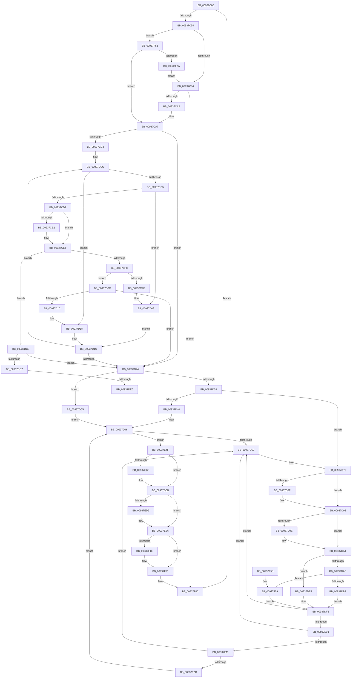

# FsRtlAddToTunnelCacheEx

- RVA: `0x00937C00`–`0x00937F7F` (길이 `895` bytes)
- VA: `0x0000000140937C00`
- 실행 섹션: `PAGE`
- PDB 이름 있음: `예`; PDB Function 태그: `예`
- unwind 정보 RVA: `0x0008F5A4`
- 디코드: `236`개 명령, `895/895` bytes 표시
- 미해석 바이트: `0` (있으면 어셈블리에 `.byte`로 보존)

> 이 문서는 커널 이미지의 기계어와 PDB 기호를 분석해 생성했습니다. 4번과 5번은 함수 원형과 자료형을 바이너리 사용 방식에서 추정한 C 해석이며 원본 소스 복구 결과는 아닙니다.

## 1. Dependencies

- 직접 호출 지점: **10**; 고유 호출 대상: **8**
- 직접 호출자로 확인된 함수: **1**
- RIP 상대 이미지 참조: **2**

### Outgoing calls
- `0x00937C91` → [ExAllocatePool2](../../poolcode/B8/ExAllocatePool2_function_00B820F0.md) (function, `0x00B820F0`)
- `0x00937CB0` → [ExAcquireFastMutex](../../text/20/ExAcquireFastMutex_function_0020E5A0.md) (function, `0x0020E5A0`)
- `0x00937CEC` → [RtlCompareUnicodeString](RtlCompareUnicodeString_function_00937F90.md) (function, `0x00937F90`)
- `0x00937EC6` → [memcpy](../../text/6C/memcpy_function_006C6840.md) (function, `0x006C6840`)
- `0x00937EE1` → [memcpy](../../text/6C/memcpy_function_006C6840.md) (function, `0x006C6840`)
- `0x00937F11` → [memcpy](../../text/6C/memcpy_function_006C6840.md) (function, `0x006C6840`)
- `0x00937F29` → [FsRtlPruneTunnelCache](FsRtlPruneTunnelCache_function_009380F0.md) (function, `0x009380F0`)
- `0x00937F31` → [ExReleaseFastMutex](../../text/25/ExReleaseFastMutex_function_002519C0.md) (function, `0x002519C0`)
- `0x00937F3B` → [FsRtlEmptyFreePoolList](../../text/38/FsRtlEmptyFreePoolList_function_00386D30.md) (function, `0x00386D30`)
- `0x00937F69` → [ExAllocateFromPagedLookasideList](../../text/3F/ExAllocateFromPagedLookasideList_function_003FB730.md) (function, `0x003FB730`)

### Direct callers
- [FsRtlAddToTunnelCache](FsRtlAddToTunnelCache_function_009379D0.md) at `0x009379F9`

### Static image references
- `0x00937C35` → RVA `0x00FD8034` (`PAGEDATA`; read)
- `0x00937F62` → RVA `0x00E11F00` (`.data`; read)

## 2. Other-region calls and transfers

- 다른 실행 섹션으로 향하는 call: **8**
  - `0x00937C91` → [ExAllocatePool2](../../poolcode/B8/ExAllocatePool2_function_00B820F0.md) (`PAGE` → `POOLCODE`)
  - `0x00937CB0` → [ExAcquireFastMutex](../../text/20/ExAcquireFastMutex_function_0020E5A0.md) (`PAGE` → `.text`)
  - `0x00937EC6` → [memcpy](../../text/6C/memcpy_function_006C6840.md) (`PAGE` → `.text`)
  - `0x00937EE1` → [memcpy](../../text/6C/memcpy_function_006C6840.md) (`PAGE` → `.text`)
  - `0x00937F11` → [memcpy](../../text/6C/memcpy_function_006C6840.md) (`PAGE` → `.text`)
  - `0x00937F31` → [ExReleaseFastMutex](../../text/25/ExReleaseFastMutex_function_002519C0.md) (`PAGE` → `.text`)
  - `0x00937F3B` → [FsRtlEmptyFreePoolList](../../text/38/FsRtlEmptyFreePoolList_function_00386D30.md) (`PAGE` → `.text`)
  - `0x00937F69` → [ExAllocateFromPagedLookasideList](../../text/3F/ExAllocateFromPagedLookasideList_function_003FB730.md) (`PAGE` → `.text`)
- call이 아닌 외부 분기/꼬리 이동: **2**
  - `0x00937DE0` → [sub_00B24F52](../B2/Unknown_function_00B24F52.md) (`tail-transfer`)
  - `0x00937DEA` → [sub_00B24F52](../B2/Unknown_function_00B24F52.md) (`tail-transfer`)

## 3. Assembly (complete function range)

```asm
00937C00  4C 8B DC                        mov r11, rsp
00937C03  49 89 5B 08                     mov qword ptr [r11 + 8], rbx
00937C07  4D 89 43 18                     mov qword ptr [r11 + 0x18], r8
00937C0B  49 89 53 10                     mov qword ptr [r11 + 0x10], rdx
00937C0F  55                              push rbp
00937C10  56                              push rsi
00937C11  57                              push rdi
00937C12  41 54                           push r12
00937C14  41 55                           push r13
00937C16  41 56                           push r14
00937C18  41 57                           push r15
00937C1A  48 83 EC 40                     sub rsp, 0x40
00937C1E  8B B4 24 A0 00 00 00            mov esi, dword ptr [rsp + 0xa0]
00937C25  33 C0                           xor eax, eax
00937C27  44 8B EE                        mov r13d, esi
00937C2A  88 44 24 20                     mov byte ptr [rsp + 0x20], al
00937C2E  83 E6 02                        and esi, 2
00937C31  41 83 E5 01                     and r13d, 1
00937C35  39 05 F9 03 6A 00               cmp dword ptr [rip + 0x6a03f9], eax
00937C3B  4D 8B E1                        mov r12, r9
00937C3E  4D 8B F0                        mov r14, r8
00937C41  89 B4 24 A0 00 00 00            mov dword ptr [rsp + 0xa0], esi
00937C48  48 8B E9                        mov rbp, rcx
00937C4B  44 8B F8                        mov r15d, eax
00937C4E  0F 84 EC 02 00 00               je 0x140937f40
00937C54  41 0F B7 38                     movzx edi, word ptr [r8]
00937C58  49 8D 43 B0                     lea rax, [r11 - 0x50]
00937C5C  03 BC 24 A8 00 00 00            add edi, dword ptr [rsp + 0xa8]
00937C63  41 0F B7 09                     movzx ecx, word ptr [r9]
00937C67  83 C1 70                        add ecx, 0x70
00937C6A  49 89 43 B8                     mov qword ptr [r11 - 0x48], rax
00937C6E  03 F9                           add edi, ecx
00937C70  49 8D 43 B0                     lea rax, [r11 - 0x50]
00937C74  49 89 43 B0                     mov qword ptr [r11 - 0x50], rax
00937C78  81 FF B0 00 00 00               cmp edi, 0xb0
00937C7E  0F 86 DE 02 00 00               jbe 0x140937f62
00937C84  8B D7                           mov edx, edi
00937C86  B9 02 01 00 00                  mov ecx, 0x102
00937C8B  41 B8 54 75 6E 50               mov r8d, 0x506e7554
00937C91  E8 5A A4 24 00                  call 0x140b820f0
00937C96  48 8B D8                        mov rbx, rax
00937C99  48 85 C0                        test rax, rax
00937C9C  0F 84 9E 02 00 00               je 0x140937f40
00937CA2  C6 44 24 20 01                  mov byte ptr [rsp + 0x20], 1
00937CA7  85 F6                           test esi, esi
00937CA9  48 8B CD                        mov rcx, rbp
00937CAC  4D 0F 44 F4                     cmove r14, r12
00937CB0  E8 EB 68 8D FF                  call 0x14020e5a0
00937CB5  48 8D 75 38                     lea rsi, [rbp + 0x38]
00937CB9  45 33 C0                        xor r8d, r8d
00937CBC  48 8B 3E                        mov rdi, qword ptr [rsi]
00937CBF  48 85 FF                        test rdi, rdi
00937CC2  74 60                           je 0x140937d24
00937CC4  48 8B 8C 24 88 00 00 00         mov rcx, qword ptr [rsp + 0x88]
00937CCC  4C 8B FF                        mov r15, rdi
00937CCF  48 39 4F 30                     cmp qword ptr [rdi + 0x30], rcx
00937CD3  72 43                           jb 0x140937d18
00937CD5  77 2F                           ja 0x140937d06
00937CD7  8B 47 38                        mov eax, dword ptr [rdi + 0x38]
00937CDA  48 8D 4F 50                     lea rcx, [rdi + 0x50]
00937CDE  A8 02                           test al, 2
00937CE0  75 04                           jne 0x140937ce6
00937CE2  48 8D 4F 40                     lea rcx, [rdi + 0x40]
00937CE6  41 B0 01                        mov r8b, 1
00937CE9  49 8B D6                        mov rdx, r14
00937CEC  E8 9F 02 00 00                  call 0x140937f90
00937CF1  45 33 C0                        xor r8d, r8d
00937CF4  85 C0                           test eax, eax
00937CF6  0F 84 D2 00 00 00               je 0x140937dce
00937CFC  7E 0E                           jle 0x140937d0c
00937CFE  48 8B 8C 24 88 00 00 00         mov rcx, qword ptr [rsp + 0x88]
00937D06  48 8D 77 08                     lea rsi, [rdi + 8]
00937D0A  EB 10                           jmp 0x140937d1c
00937D0C  85 C0                           test eax, eax
00937D0E  79 14                           jns 0x140937d24
00937D10  48 8B 8C 24 88 00 00 00         mov rcx, qword ptr [rsp + 0x88]
00937D18  48 8D 77 10                     lea rsi, [rdi + 0x10]
00937D1C  48 8B 3E                        mov rdi, qword ptr [rsi]
00937D1F  48 85 FF                        test rdi, rdi
00937D22  75 A8                           jne 0x140937ccc
00937D24  48 89 1B                        mov qword ptr [rbx], rbx
00937D27  4C 89 43 08                     mov qword ptr [rbx + 8], r8
00937D2B  4C 89 43 10                     mov qword ptr [rbx + 0x10], r8
00937D2F  4D 85 FF                        test r15, r15
00937D32  0F 84 8D 00 00 00               je 0x140937dc5
00937D38  48 8B 06                        mov rax, qword ptr [rsi]
00937D3B  48 85 C0                        test rax, rax
00937D3E  75 30                           jne 0x140937d70
00937D40  4C 89 3B                        mov qword ptr [rbx], r15
00937D43  48 89 1E                        mov qword ptr [rsi], rbx
00937D46  48 A1 14 00 00 00 80 F7 FF FF   movabs rax, qword ptr [0xfffff78000000014]
00937D50  48 8D 53 18                     lea rdx, [rbx + 0x18]
00937D54  48 89 43 28                     mov qword ptr [rbx + 0x28], rax
00937D58  48 8D 45 40                     lea rax, [rbp + 0x40]
00937D5C  48 8B 48 08                     mov rcx, qword ptr [rax + 8]
00937D60  48 39 01                        cmp qword ptr [rcx], rax
00937D63  0F 84 E6 00 00 00               je 0x140937e4f
00937D69  B9 03 00 00 00                  mov ecx, 3
00937D6E  CD 29                           int 0x29
00937D70  48 8B 40 10                     mov rax, qword ptr [rax + 0x10]
00937D74  48 89 43 10                     mov qword ptr [rbx + 0x10], rax
00937D78  48 8B 06                        mov rax, qword ptr [rsi]
00937D7B  48 8B 48 08                     mov rcx, qword ptr [rax + 8]
00937D7F  48 89 4B 08                     mov qword ptr [rbx + 8], rcx
00937D83  48 8B 06                        mov rax, qword ptr [rsi]
00937D86  48 8B 48 10                     mov rcx, qword ptr [rax + 0x10]
00937D8A  48 85 C9                        test rcx, rcx
00937D8D  74 03                           je 0x140937d92
00937D8F  48 89 19                        mov qword ptr [rcx], rbx
00937D92  48 8B 06                        mov rax, qword ptr [rsi]
00937D95  48 8B 48 08                     mov rcx, qword ptr [rax + 8]
00937D99  48 85 C9                        test rcx, rcx
00937D9C  74 03                           je 0x140937da1
00937D9E  48 89 19                        mov qword ptr [rcx], rbx
00937DA1  48 8B 06                        mov rax, qword ptr [rsi]
00937DA4  48 8B 08                        mov rcx, qword ptr [rax]
00937DA7  48 3B C8                        cmp rcx, rax
00937DAA  74 43                           je 0x140937def
00937DAC  48 89 0B                        mov qword ptr [rbx], rcx
00937DAF  48 8B 06                        mov rax, qword ptr [rsi]
00937DB2  48 8B 08                        mov rcx, qword ptr [rax]
00937DB5  48 39 41 08                     cmp qword ptr [rcx + 8], rax
00937DB9  0F 85 9A 01 00 00               jne 0x140937f59
00937DBF  48 89 59 08                     mov qword ptr [rcx + 8], rbx
00937DC3  EB 2E                           jmp 0x140937df3
00937DC5  48 89 5D 38                     mov qword ptr [rbp + 0x38], rbx
00937DC9  E9 78 FF FF FF                  jmp 0x140937d46
00937DCE  45 84 ED                        test r13b, r13b
00937DD1  0F 84 4D FF FF FF               je 0x140937d24
00937DD7  8B 47 38                        mov eax, dword ptr [rdi + 0x38]
00937DDA  48 8D 4F 50                     lea rcx, [rdi + 0x50]
00937DDE  A8 02                           test al, 2
00937DE0  0F 85 6C D1 1E 00               jne 0x140b24f52
00937DE6  48 8D 4F 40                     lea rcx, [rdi + 0x40]
00937DEA  E9 63 D1 1E 00                  jmp 0x140b24f52
00937DEF  48 89 5D 38                     mov qword ptr [rbp + 0x38], rbx
00937DF3  49 8D 47 18                     lea rax, [r15 + 0x18]
00937DF7  48 8B 10                        mov rdx, qword ptr [rax]
00937DFA  48 39 42 08                     cmp qword ptr [rdx + 8], rax
00937DFE  0F 85 65 FF FF FF               jne 0x140937d69
00937E04  48 8B 48 08                     mov rcx, qword ptr [rax + 8]
00937E08  48 39 01                        cmp qword ptr [rcx], rax
00937E0B  0F 85 58 FF FF FF               jne 0x140937d69
00937E11  48 89 11                        mov qword ptr [rcx], rdx
00937E14  48 89 4A 08                     mov qword ptr [rdx + 8], rcx
00937E18  48 8D 54 24 28                  lea rdx, [rsp + 0x28]
00937E1D  48 8B 4C 24 28                  mov rcx, qword ptr [rsp + 0x28]
00937E22  48 39 51 08                     cmp qword ptr [rcx + 8], rdx
00937E26  0F 85 3D FF FF FF               jne 0x140937d69
00937E2C  48 89 08                        mov qword ptr [rax], rcx
00937E2F  48 8D 54 24 28                  lea rdx, [rsp + 0x28]
00937E34  48 89 50 08                     mov qword ptr [rax + 8], rdx
00937E38  48 89 41 08                     mov qword ptr [rcx + 8], rax
00937E3C  48 89 44 24 28                  mov qword ptr [rsp + 0x28], rax
00937E41  B8 FF FF 00 00                  mov eax, 0xffff
00937E46  66 01 45 50                     add word ptr [rbp + 0x50], ax
00937E4A  E9 F7 FE FF FF                  jmp 0x140937d46
00937E4F  48 89 02                        mov qword ptr [rdx], rax
00937E52  BE 01 00 00 00                  mov esi, 1
00937E57  48 89 4A 08                     mov qword ptr [rdx + 8], rcx
00937E5B  48 89 11                        mov qword ptr [rcx], rdx
00937E5E  48 8D 4B 70                     lea rcx, [rbx + 0x70]
00937E62  48 89 50 08                     mov qword ptr [rax + 8], rdx
00937E66  66 01 75 50                     add word ptr [rbp + 0x50], si
00937E6A  48 8B 84 24 88 00 00 00         mov rax, qword ptr [rsp + 0x88]
00937E72  F7 9C 24 A0 00 00 00            neg dword ptr [rsp + 0xa0]
00937E79  48 89 43 30                     mov qword ptr [rbx + 0x30], rax
00937E7D  1B C0                           sbb eax, eax
00937E7F  83 E0 02                        and eax, 2
00937E82  89 43 38                        mov dword ptr [rbx + 0x38], eax
00937E85  48 8B BC 24 90 00 00 00         mov rdi, qword ptr [rsp + 0x90]
00937E8D  48 89 4B 58                     mov qword ptr [rbx + 0x58], rcx
00937E91  0F B7 17                        movzx edx, word ptr [rdi]
00937E94  48 83 C2 70                     add rdx, 0x70
00937E98  48 03 D3                        add rdx, rbx
00937E9B  48 89 53 48                     mov qword ptr [rbx + 0x48], rdx
00937E9F  0F B7 07                        movzx eax, word ptr [rdi]
00937EA2  66 89 43 52                     mov word ptr [rbx + 0x52], ax
00937EA6  66 89 43 50                     mov word ptr [rbx + 0x50], ax
00937EAA  41 0F B7 04 24                  movzx eax, word ptr [r12]
00937EAF  66 89 43 42                     mov word ptr [rbx + 0x42], ax
00937EB3  66 89 43 40                     mov word ptr [rbx + 0x40], ax
00937EB7  0F B7 07                        movzx eax, word ptr [rdi]
00937EBA  66 85 C0                        test ax, ax
00937EBD  74 0C                           je 0x140937ecb
00937EBF  48 8B 57 08                     mov rdx, qword ptr [rdi + 8]
00937EC3  44 8B C0                        mov r8d, eax
00937EC6  E8 75 E9 D8 FF                  call 0x1406c6840
00937ECB  41 0F B7 04 24                  movzx eax, word ptr [r12]
00937ED0  66 85 C0                        test ax, ax
00937ED3  74 11                           je 0x140937ee6
00937ED5  49 8B 54 24 08                  mov rdx, qword ptr [r12 + 8]
00937EDA  44 8B C0                        mov r8d, eax
00937EDD  48 8B 4B 48                     mov rcx, qword ptr [rbx + 0x48]
00937EE1  E8 5A E9 D8 FF                  call 0x1406c6840
00937EE6  0F B7 07                        movzx eax, word ptr [rdi]
00937EE9  41 0F B7 0C 24                  movzx ecx, word ptr [r12]
00937EEE  48 03 C3                        add rax, rbx
00937EF1  48 8B 94 24 B0 00 00 00         mov rdx, qword ptr [rsp + 0xb0]
00937EF9  48 83 C1 70                     add rcx, 0x70
00937EFD  48 03 C8                        add rcx, rax
00937F00  8B 84 24 A8 00 00 00            mov eax, dword ptr [rsp + 0xa8]
00937F07  44 8B C0                        mov r8d, eax
00937F0A  48 89 4B 60                     mov qword ptr [rbx + 0x60], rcx
00937F0E  89 43 68                        mov dword ptr [rbx + 0x68], eax
00937F11  E8 2A E9 D8 FF                  call 0x1406c6840
00937F16  33 C0                           xor eax, eax
00937F18  38 44 24 20                     cmp byte ptr [rsp + 0x20], al
00937F1C  74 03                           je 0x140937f21
00937F1E  09 73 38                        or dword ptr [rbx + 0x38], esi
00937F21  48 8D 54 24 28                  lea rdx, [rsp + 0x28]
00937F26  48 8B CD                        mov rcx, rbp
00937F29  E8 C2 01 00 00                  call 0x1409380f0
00937F2E  48 8B CD                        mov rcx, rbp
00937F31  E8 8A 9A 91 FF                  call 0x1402519c0
00937F36  48 8D 4C 24 28                  lea rcx, [rsp + 0x28]
00937F3B  E8 F0 ED A4 FF                  call 0x140386d30
00937F40  48 8B 9C 24 80 00 00 00         mov rbx, qword ptr [rsp + 0x80]
00937F48  48 83 C4 40                     add rsp, 0x40
00937F4C  41 5F                           pop r15
00937F4E  41 5E                           pop r14
00937F50  41 5D                           pop r13
00937F52  41 5C                           pop r12
00937F54  5F                              pop rdi
00937F55  5E                              pop rsi
00937F56  5D                              pop rbp
00937F57  C3                              ret
00937F58  CC                              int3
00937F59  48 89 59 10                     mov qword ptr [rcx + 0x10], rbx
00937F5D  E9 91 FE FF FF                  jmp 0x140937df3
00937F62  48 8D 0D 97 9F 4D 00            lea rcx, [rip + 0x4d9f97]
00937F69  E8 C2 37 AC FF                  call 0x1403fb730
00937F6E  48 8B D8                        mov rbx, rax
00937F71  48 85 C0                        test rax, rax
00937F74  0F 85 2D FD FF FF               jne 0x140937ca7
00937F7A  E9 05 FD FF FF                  jmp 0x140937c84
```

## 4. C-style interpretation (structured pseudocode)

```c
__int64 __fastcall FsRtlAddToTunnelCacheEx(__int64 a1, __int64 a2, __int64 a3, __int64 a4, unsigned int a5, unsigned int a6, __int64 a7)
{
    __int64 result;
    __int64 v_r13;
    __int64 v_rdi;
    __int64 v_rsi;
    __int64 v_rsp;
    unsigned __int64 v_stack_m50;
    unsigned __int8 v_stack_m58;
    unsigned __int64 v_stack_p10;
    unsigned __int64 v_stack_p18;
    unsigned int v_stack_p28;
    unsigned __int64 v_stack_p8;

    *(unsigned __int64 *)(v_rsp + 8) = v_rbx;
    *(unsigned __int64 *)(v_rsp + 24) = a3;
    *(unsigned __int64 *)(v_rsp + 16) = a2;
    v_rsp = (v_rsp) - (64);
    result = 0;
    v_stack_m58 = 0;
    v_rsi = (unsigned int)(((unsigned int)(a5)) & (2));
    v_r13 = (unsigned int)(((unsigned int)((unsigned int)((unsigned int)(a5)))) & (1));
    v_stack_p28 = (unsigned int)(v_rsi);
    if ((*(unsigned int *)(v_rip + 6947833)) == 0) goto loc_00937F40;
    v_rdi = (unsigned int)((*(unsigned __int16 *)(a3)) + (a6));
    a1 = (unsigned int)((*(unsigned __int16 *)(a4)) + (112));
    *(unsigned __int64 *)(v_rsp - 72) = v_rsp - 80;
    v_rdi = (unsigned int)((v_rdi) + ((unsigned int)(a1)));
    *(unsigned __int64 *)(v_rsp - 80) = v_rsp - 80;
    if (((unsigned int)(v_rdi)) <= 176) goto loc_00937F62;
loc_00937C84:
    result = ExAllocatePool2(258, (unsigned int)((unsigned int)(v_rdi)), (unsigned int)(0x506E7554ULL), a4);
    if (result == 0) goto loc_00937F40;
    v_stack_m58 = 1;
loc_00937CA7:
    if ((unsigned int)(v_rsi) == 0) { a3 = a4; }
    result = ExAcquireFastMutex(a1, (unsigned int)((unsigned int)(v_rdi)), (unsigned int)(0x506E7554ULL), a4);
    a3 = 0;
    if (*(unsigned __int64 *)(a1 + 56) == 0) goto loc_00937D24;
loc_00937CCC:
    if ((*(unsigned __int64 *)(*(unsigned __int64 *)(a1 + 56) + 48)) < v_stack_p10) goto loc_00937D18;
    if ((*(unsigned __int64 *)(*(unsigned __int64 *)(a1 + 56) + 48)) > v_stack_p10) goto loc_00937D06;
    if ((((unsigned __int8)((unsigned int)(*(unsigned int *)(*(unsigned __int64 *)(a1 + 56) + 56)))) & (2)) == 0) {
        a1 = *(unsigned __int64 *)(a1 + 56) + 64;
    }
    result = RtlCompareUnicodeString(a1, 0, 1, a4);
    a3 = 0;
    if ((unsigned int)(result) == 0) goto loc_00937DCE;
    if (condition_is_less_or_equal) goto loc_00937D0C;
loc_00937D06:
    goto loc_00937D1C;
loc_00937D0C:
    if (!sign_flag) goto loc_00937D24;
loc_00937D18:
loc_00937D1C:
    if (*(unsigned __int64 *)(*(unsigned __int64 *)(a1 + 56) + 16) != 0) goto loc_00937CCC;
loc_00937D24:
    *(unsigned __int64 *)(result) = result;
    *(unsigned __int64 *)(result + 8) = 0;
    *(unsigned __int64 *)(result + 16) = 0;
    if (*(unsigned __int64 *)(a1 + 56) == 0) goto loc_00937DC5;
    if (*(unsigned __int64 *)(*(unsigned __int64 *)(a1 + 56) + 16) != 0) goto loc_00937D70;
    *(unsigned __int64 *)(result) = *(unsigned __int64 *)(a1 + 56);
    *(unsigned __int64 *)(*(unsigned __int64 *)(a1 + 56) + 16) = result;
loc_00937D46:
    *(unsigned __int64 *)(result + 40) = *(unsigned __int64 *)(*(unsigned __int64 *)(a1 + 56) + 16);
    if ((*(unsigned __int64 *)(*(unsigned __int64 *)(a1 + 64 + 8))) == (a1 + 64)) goto loc_00937E4F;
loc_00937D69:
loc_00937D70:
    *(unsigned __int64 *)(result + 16) = *(unsigned __int64 *)(a1 + 64 + 16);
    *(unsigned __int64 *)(result + 8) = *(unsigned __int64 *)(*(unsigned __int64 *)(*(unsigned __int64 *)(a1 + 56) + 16) + 8);
    if (*(unsigned __int64 *)(*(unsigned __int64 *)(*(unsigned __int64 *)(a1 + 56) + 16) + 16) != 0) {
        *(unsigned __int64 *)(*(unsigned __int64 *)(*(unsigned __int64 *)(*(unsigned __int64 *)(a1 + 56) + 16) + 16)) = result;
    }
    if (*(unsigned __int64 *)(*(unsigned __int64 *)(*(unsigned __int64 *)(a1 + 56) + 16) + 8) != 0) {
        *(unsigned __int64 *)(*(unsigned __int64 *)(*(unsigned __int64 *)(*(unsigned __int64 *)(a1 + 56) + 16) + 8)) = result;
    }
    if ((*(unsigned __int64 *)(*(unsigned __int64 *)(*(unsigned __int64 *)(a1 + 56) + 16))) == (*(unsigned __int64 *)(*(unsigned __int64 *)(a1 + 56) + 16))) goto loc_00937DEF;
    *(unsigned __int64 *)(result) = *(unsigned __int64 *)(*(unsigned __int64 *)(*(unsigned __int64 *)(a1 + 56) + 16));
    if ((*(unsigned __int64 *)(*(unsigned __int64 *)(*(unsigned __int64 *)(*(unsigned __int64 *)(a1 + 56) + 16)) + 8)) != (*(unsigned __int64 *)(*(unsigned __int64 *)(a1 + 56) + 16))) goto loc_00937F59;
    *(unsigned __int64 *)(*(unsigned __int64 *)(*(unsigned __int64 *)(*(unsigned __int64 *)(a1 + 56) + 16)) + 8) = result;
    goto loc_00937DF3;
loc_00937DC5:
    *(unsigned __int64 *)(a1 + 56) = result;
    goto loc_00937D46;
loc_00937DCE:
    if ((unsigned __int8)(v_r13) == 0) goto loc_00937D24;
loc_00937DEF:
    *(unsigned __int64 *)(a1 + 56) = result;
loc_00937DF3:
    if ((*(unsigned __int64 *)(*(unsigned __int64 *)(*(unsigned __int64 *)(a1 + 56) + 24) + 8)) != (*(unsigned __int64 *)(a1 + 56) + 24)) goto loc_00937D69;
    if ((*(unsigned __int64 *)(*(unsigned __int64 *)(*(unsigned __int64 *)(a1 + 56) + 24 + 8))) != (*(unsigned __int64 *)(a1 + 56) + 24)) goto loc_00937D69;
    *(unsigned __int64 *)(*(unsigned __int64 *)(*(unsigned __int64 *)(a1 + 56) + 24 + 8)) = *(unsigned __int64 *)(*(unsigned __int64 *)(a1 + 56) + 24);
    *(unsigned __int64 *)(*(unsigned __int64 *)(*(unsigned __int64 *)(a1 + 56) + 24) + 8) = *(unsigned __int64 *)(*(unsigned __int64 *)(a1 + 56) + 24 + 8);
    if ((*(unsigned __int64 *)(v_stack_m50 + 8)) != v_stack_m50) goto loc_00937D69;
    *(unsigned __int64 *)(*(unsigned __int64 *)(a1 + 56) + 24) = v_stack_m50;
    *(unsigned __int64 *)(*(unsigned __int64 *)(a1 + 56) + 24 + 8) = v_stack_m50;
    *(unsigned __int64 *)(v_stack_m50 + 8) = *(unsigned __int64 *)(a1 + 56) + 24;
    v_stack_m50 = *(unsigned __int64 *)(a1 + 56) + 24;
    goto loc_00937D46;
loc_00937E4F:
    *(unsigned __int64 *)(v_stack_m50) = (unsigned int)(0xFFFFULL);
    *(unsigned __int64 *)(v_stack_m50 + 8) = v_stack_m50;
    *(unsigned __int64 *)(v_stack_m50) = v_stack_m50;
    *(unsigned __int64 *)((unsigned int)(0xFFFFULL) + 8) = v_stack_m50;
    *(unsigned __int64 *)(result + 48) = v_stack_p10;
    result = (unsigned int)((v_stack_p10) & (2));
    *(unsigned int *)(result + 56) = (unsigned int)(result);
    *(unsigned __int64 *)(result + 88) = result + 112;
    a2 = (*(unsigned __int16 *)(v_stack_p18)) + (112);
    a2 = (a2) + (result);
    *(unsigned __int64 *)(result + 72) = a2;
    *(unsigned __int16 *)(result + 82) = (unsigned __int16)(*(unsigned __int16 *)(v_stack_p18));
    *(unsigned __int16 *)(result + 80) = (unsigned __int16)(*(unsigned __int16 *)(v_stack_p18));
    *(unsigned __int16 *)(result + 66) = (unsigned __int16)(*(unsigned __int16 *)(a4));
    *(unsigned __int16 *)(result + 64) = (unsigned __int16)(*(unsigned __int16 *)(a4));
    result = *(unsigned __int16 *)(v_stack_p18);
    if ((unsigned __int16)(*(unsigned __int16 *)(v_stack_p18)) != 0) {
        a2 = *(unsigned __int64 *)(v_stack_p18 + 8);
        a3 = (unsigned int)(*(unsigned __int16 *)(v_stack_p18));
        result = memcpy(result + 112, a2, a3, a4);
    }
    result = *(unsigned __int16 *)(a4);
    if ((unsigned __int16)(*(unsigned __int16 *)(a4)) != 0) {
        a2 = *(unsigned __int64 *)(a4 + 8);
        a3 = (unsigned int)(*(unsigned __int16 *)(a4));
        a1 = *(unsigned __int64 *)(result + 72);
        result = memcpy(a1, a2, a3, a4);
    }
    result = (*(unsigned __int16 *)(v_stack_p18)) + (result);
    a1 = (*(unsigned __int16 *)(a4)) + (112);
    a1 = (a1) + (result);
    *(unsigned __int64 *)(result + 96) = a1;
    *(unsigned int *)(result + 104) = (unsigned int)((unsigned int)(a6));
    result = memcpy(a1, a7, (unsigned int)((unsigned int)((unsigned int)(a6))), a4);
    result = 0;
    if (v_stack_m58 != 0) {
    }
    result = FsRtlPruneTunnelCache(a1, v_stack_m50, (unsigned int)((unsigned int)((unsigned int)(a6))), a4);
    result = ExReleaseFastMutex(a1, v_stack_m50, (unsigned int)((unsigned int)((unsigned int)(a6))), a4);
    result = FsRtlEmptyFreePoolList(v_stack_m50, v_stack_m50, (unsigned int)((unsigned int)((unsigned int)(a6))), a4);
loc_00937F40:
    v_rsp = (v_rsp) + (64);
    return result;
loc_00937F59:
    *(unsigned __int64 *)(v_stack_m50 + 16) = v_stack_p8;
    goto loc_00937DF3;
loc_00937F62:
    result = ExAllocateFromPagedLookasideList(v_rip + 5087127, v_stack_m50, (unsigned int)((unsigned int)((unsigned int)(a6))), a4);
    if (result != 0) goto loc_00937CA7;
    goto loc_00937C84;
}
```

## 5. (Beta) C Style

```c
int64_t FsRtlAddToTunnelCacheEx(void *Arg1, int64_t Arg2, void *Arg3, void *Arg4, uint32_t Arg5, uint32_t Arg6, int64_t Arg7)
{
    uint8_t *arg1 = (uint8_t *)Arg1;
    uint8_t *arg3 = (uint8_t *)Arg3;
    uint8_t *arg4 = (uint8_t *)Arg4;

    int64_t result;
    int64_t local_r13;
    int64_t local_rdi;
    int64_t local_rsi;
    int64_t local_rsp;
    uint64_t v_stack_m50;
    uint8_t v_stack_m58;
    uint64_t v_stack_p10;
    uint64_t v_stack_p18;
    uint32_t v_stack_p28;
    uint64_t v_stack_p8;

    *(uint64_t *)(local_rsp + 0x8) = local_rbx;
    *(void **)(local_rsp + 0x18) = Arg3;
    *(uint64_t *)(local_rsp + 0x10) = Arg2;
    local_rsp = (local_rsp) - (64);
    result = 0;
    v_stack_m58 = 0;
    local_rsi = (uint32_t)(((uint32_t)(Arg5)) & (2));
    local_r13 = (uint32_t)(((uint32_t)((uint32_t)((uint32_t)(Arg5)))) & (1));
    v_stack_p28 = (uint32_t)(local_rsi);
    if ((*(uint32_t *)(v_rip + 0x6A03F9)) == 0) goto loc_00937F40;
    local_rdi = (uint32_t)((*(uint16_t *)(arg3)) + (Arg6));
    Arg1 = (uint32_t)((*(uint16_t *)(arg4)) + (112));
    *(uint64_t *)(local_rsp - 0x48) = local_rsp - 80;
    local_rdi = (uint32_t)((local_rdi) + ((uint32_t)(Arg1)));
    *(uint64_t *)(local_rsp - 0x50) = local_rsp - 80;
    if (((uint32_t)(local_rdi)) <= 176) goto loc_00937F62;
loc_00937C84:
    result = ExAllocatePool2(258, (uint32_t)((uint32_t)(local_rdi)), (uint32_t)(0x506E7554ULL), Arg4);
    if (result == 0) goto loc_00937F40;
    v_stack_m58 = 1;
loc_00937CA7:
    if ((uint32_t)(local_rsi) == 0) { Arg3 = Arg4; }
    result = ExAcquireFastMutex(Arg1, (uint32_t)((uint32_t)(local_rdi)), (uint32_t)(0x506E7554ULL), Arg4);
    Arg3 = 0;
    if (*(uint64_t *)(arg1 + 0x38) == 0) goto loc_00937D24;
loc_00937CCC:
    if ((*(uint64_t *)(*(uint64_t *)(arg1 + 0x38) + 0x30)) < v_stack_p10) goto loc_00937D18;
    if ((*(uint64_t *)(*(uint64_t *)(arg1 + 0x38) + 0x30)) > v_stack_p10) goto loc_00937D06;
    if ((((uint8_t)((uint32_t)(*(uint32_t *)(*(uint64_t *)(arg1 + 0x38) + 0x38)))) & (2)) == 0) {
        Arg1 = *(uint64_t *)(arg1 + 0x38) + 64;
    }
    result = RtlCompareUnicodeString(Arg1, 0, 1, Arg4);
    Arg3 = 0;
    if ((uint32_t)(result) == 0) goto loc_00937DCE;
    if (condition_is_less_or_equal) goto loc_00937D0C;
loc_00937D06:
    goto loc_00937D1C;
loc_00937D0C:
    if (!sign_flag) goto loc_00937D24;
loc_00937D18:
loc_00937D1C:
    if (*(uint64_t *)(*(uint64_t *)(arg1 + 0x38) + 0x10) != 0) goto loc_00937CCC;
loc_00937D24:
    *(uint64_t *)(result) = result;
    *(uint64_t *)(result + 0x8) = 0;
    *(uint64_t *)(result + 0x10) = 0;
    if (*(uint64_t *)(arg1 + 0x38) == 0) goto loc_00937DC5;
    if (*(uint64_t *)(*(uint64_t *)(arg1 + 0x38) + 0x10) != 0) goto loc_00937D70;
    *(uint64_t *)(result) = *(uint64_t *)(arg1 + 0x38);
    *(uint64_t *)(*(uint64_t *)(arg1 + 0x38) + 0x10) = result;
loc_00937D46:
    *(uint64_t *)(result + 0x28) = *(uint64_t *)(*(uint64_t *)(arg1 + 0x38) + 0x10);
    if ((*(uint64_t *)(*(uint64_t *)(arg1 + 0x40 + 0x8))) == (Arg1 + 64)) goto loc_00937E4F;
loc_00937D69:
loc_00937D70:
    *(uint64_t *)(result + 0x10) = *(uint64_t *)(arg1 + 0x40 + 0x10);
    *(uint64_t *)(result + 0x8) = *(uint64_t *)(*(uint64_t *)(*(uint64_t *)(arg1 + 0x38) + 0x10) + 0x8);
    if (*(uint64_t *)(*(uint64_t *)(*(uint64_t *)(arg1 + 0x38) + 0x10) + 0x10) != 0) {
        *(uint64_t *)(*(uint64_t *)(*(uint64_t *)(*(uint64_t *)(arg1 + 0x38) + 0x10) + 0x10)) = result;
    }
    if (*(uint64_t *)(*(uint64_t *)(*(uint64_t *)(arg1 + 0x38) + 0x10) + 0x8) != 0) {
        *(uint64_t *)(*(uint64_t *)(*(uint64_t *)(*(uint64_t *)(arg1 + 0x38) + 0x10) + 0x8)) = result;
    }
    if ((*(uint64_t *)(*(uint64_t *)(*(uint64_t *)(arg1 + 0x38) + 0x10))) == (*(uint64_t *)(*(uint64_t *)(arg1 + 0x38) + 0x10))) goto loc_00937DEF;
    *(uint64_t *)(result) = *(uint64_t *)(*(uint64_t *)(*(uint64_t *)(arg1 + 0x38) + 0x10));
    if ((*(uint64_t *)(*(uint64_t *)(*(uint64_t *)(*(uint64_t *)(arg1 + 0x38) + 0x10)) + 0x8)) != (*(uint64_t *)(*(uint64_t *)(arg1 + 0x38) + 0x10))) goto loc_00937F59;
    *(uint64_t *)(*(uint64_t *)(*(uint64_t *)(*(uint64_t *)(arg1 + 0x38) + 0x10)) + 0x8) = result;
    goto loc_00937DF3;
loc_00937DC5:
    *(uint64_t *)(arg1 + 0x38) = result;
    goto loc_00937D46;
loc_00937DCE:
    if ((uint8_t)(local_r13) == 0) goto loc_00937D24;
loc_00937DEF:
    *(uint64_t *)(arg1 + 0x38) = result;
loc_00937DF3:
    if ((*(uint64_t *)(*(uint64_t *)(*(uint64_t *)(arg1 + 0x38) + 0x18) + 0x8)) != (*(uint64_t *)(arg1 + 0x38) + 24)) goto loc_00937D69;
    if ((*(uint64_t *)(*(uint64_t *)(*(uint64_t *)(arg1 + 0x38) + 0x18 + 0x8))) != (*(uint64_t *)(arg1 + 0x38) + 24)) goto loc_00937D69;
    *(uint64_t *)(*(uint64_t *)(*(uint64_t *)(arg1 + 0x38) + 0x18 + 0x8)) = *(uint64_t *)(*(uint64_t *)(arg1 + 0x38) + 0x18);
    *(uint64_t *)(*(uint64_t *)(*(uint64_t *)(arg1 + 0x38) + 0x18) + 0x8) = *(uint64_t *)(*(uint64_t *)(arg1 + 0x38) + 0x18 + 0x8);
    if ((*(uint64_t *)(v_stack_m50 + 0x8)) != v_stack_m50) goto loc_00937D69;
    *(uint64_t *)(*(uint64_t *)(arg1 + 0x38) + 0x18) = v_stack_m50;
    *(uint64_t *)(*(uint64_t *)(arg1 + 0x38) + 0x18 + 0x8) = v_stack_m50;
    *(uint64_t *)(v_stack_m50 + 0x8) = *(uint64_t *)(arg1 + 0x38) + 24;
    v_stack_m50 = *(uint64_t *)(arg1 + 0x38) + 24;
    goto loc_00937D46;
loc_00937E4F:
    *(uint64_t *)(v_stack_m50) = (uint32_t)(0xFFFFULL);
    *(uint64_t *)(v_stack_m50 + 0x8) = v_stack_m50;
    *(uint64_t *)(v_stack_m50) = v_stack_m50;
    *(uint64_t *)((uint32_t)(0xFFFFULL) + 0x8) = v_stack_m50;
    *(uint64_t *)(result + 0x30) = v_stack_p10;
    result = (uint32_t)((v_stack_p10) & (2));
    *(uint32_t *)(result + 0x38) = (uint32_t)(result);
    *(uint64_t *)(result + 0x58) = result + 112;
    Arg2 = (*(uint16_t *)(v_stack_p18)) + (112);
    Arg2 = (Arg2) + (result);
    *(uint64_t *)(result + 0x48) = Arg2;
    *(uint16_t *)(result + 0x52) = (uint16_t)(*(uint16_t *)(v_stack_p18));
    *(uint16_t *)(result + 0x50) = (uint16_t)(*(uint16_t *)(v_stack_p18));
    *(uint16_t *)(result + 0x42) = (uint16_t)(*(uint16_t *)(arg4));
    *(uint16_t *)(result + 0x40) = (uint16_t)(*(uint16_t *)(arg4));
    result = *(uint16_t *)(v_stack_p18);
    if ((uint16_t)(*(uint16_t *)(v_stack_p18)) != 0) {
        Arg2 = *(uint64_t *)(v_stack_p18 + 0x8);
        Arg3 = (uint32_t)(*(uint16_t *)(v_stack_p18));
        result = memcpy(result + 112, Arg2, Arg3, Arg4);
    }
    result = *(uint16_t *)(arg4);
    if ((uint16_t)(*(uint16_t *)(arg4)) != 0) {
        Arg2 = *(uint64_t *)(arg4 + 0x8);
        Arg3 = (uint32_t)(*(uint16_t *)(arg4));
        Arg1 = *(uint64_t *)(result + 0x48);
        result = memcpy(Arg1, Arg2, Arg3, Arg4);
    }
    result = (*(uint16_t *)(v_stack_p18)) + (result);
    Arg1 = (*(uint16_t *)(arg4)) + (112);
    Arg1 = (Arg1) + (result);
    *(void **)(result + 0x60) = Arg1;
    *(uint32_t *)(result + 0x68) = (uint32_t)((uint32_t)(Arg6));
    result = memcpy(Arg1, Arg7, (uint32_t)((uint32_t)((uint32_t)(Arg6))), Arg4);
    result = 0;
    if (v_stack_m58 != 0) {
    }
    result = FsRtlPruneTunnelCache(Arg1, v_stack_m50, (uint32_t)((uint32_t)((uint32_t)(Arg6))), Arg4);
    result = ExReleaseFastMutex(Arg1, v_stack_m50, (uint32_t)((uint32_t)((uint32_t)(Arg6))), Arg4);
    result = FsRtlEmptyFreePoolList(v_stack_m50, v_stack_m50, (uint32_t)((uint32_t)((uint32_t)(Arg6))), Arg4);
loc_00937F40:
    local_rsp = (local_rsp) + (64);
    return result;
loc_00937F59:
    *(uint64_t *)(v_stack_m50 + 0x10) = v_stack_p8;
    goto loc_00937DF3;
loc_00937F62:
    result = ExAllocateFromPagedLookasideList(v_rip + 5087127, v_stack_m50, (uint32_t)((uint32_t)((uint32_t)(Arg6))), Arg4);
    if (result != 0) goto loc_00937CA7;
    goto loc_00937C84;
}
```

### 관측된 메모리 오프셋

구조체 형식이 확인되지 않은 접근은 인자 기준의 오프셋으로만 기록했습니다.

| 기준 인자 | 오프셋 표현 | 폭 (bit) | 접근 |
|---|---:|---:|---|
| `Arg1` | `+ 0x0` | `64` | `R` |
| `Arg1` | `+ 0x8` | `64` | `R` |
| `Arg1` | `+ 0x8` | `64` | `W` |
| `Arg1` | `+ 0x38` | `64` | `R` |
| `Arg1` | `+ 0x38` | `64` | `W` |
| `Arg1` | `+ 0x40` | `64` | `R` |
| `Arg1` | `+ 0x50` | `16` | `R/W` |
| `Arg3` | `+ 0x0` | `16` | `R` |
| `Arg4` | `+ 0x0` | `16` | `R` |
| `Arg4` | `+ 0x8` | `64` | `R` |

## 6. Execution-region graph

[열기: 2D/3D 그래프와 함수 탐색 컨트롤 패널](../../../control-panel.html?section=page&rva=0x00937C00&view=graph)

- 2D 그래프는 위에서 아래로 흐르고, 3D 그래프는 빈 공간을 드래그해 회전합니다. Shift+드래그는 이동, 휠은 확대·축소, 함수 노드 선택은 대상 보고서 이동입니다.

### Static fallback


