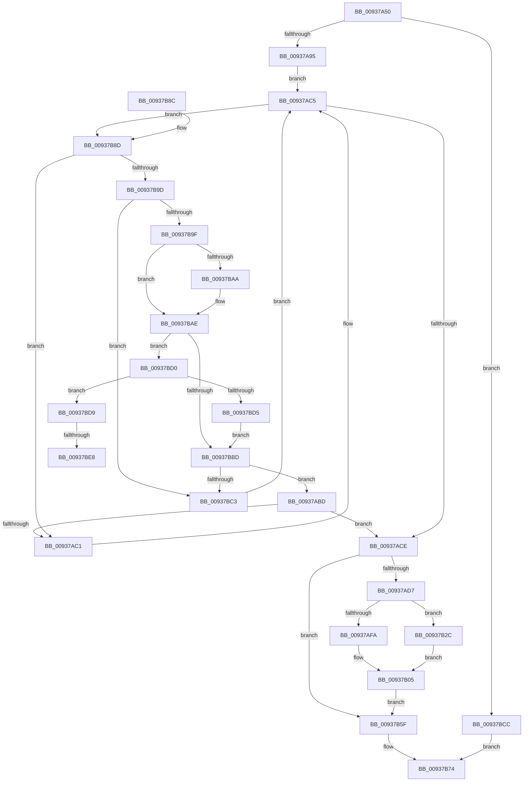

# FsRtlFindInTunnelCacheEx

- RVA: `0x00937A50`–`0x00937BF1` (길이 `417` bytes)
- VA: `0x0000000140937A50`
- 실행 섹션: `PAGE`
- PDB 이름 있음: `예`; PDB Function 태그: `예`
- unwind 정보 RVA: `0x0008F554`
- 디코드: `115`개 명령, `417/417` bytes 표시
- 미해석 바이트: `0` (있으면 어셈블리에 `.byte`로 보존)

> 이 문서는 커널 이미지의 기계어와 PDB 기호를 분석해 생성했습니다. 4번과 5번은 함수 원형과 자료형을 바이너리 사용 방식에서 추정한 C 해석이며 원본 소스 복구 결과는 아닙니다.

## 1. Dependencies

- 직접 호출 지점: **10**; 고유 호출 대상: **8**
- 직접 호출자로 확인된 함수: **1**
- RIP 상대 이미지 참조: **1**

### Outgoing calls
- `0x00937AA5` → [ExAcquireFastMutex](../../text/20/ExAcquireFastMutex_function_0020E5A0.md) (function, `0x0020E5A0`)
- `0x00937AB2` → [FsRtlPruneTunnelCache](FsRtlPruneTunnelCache_function_009380F0.md) (function, `0x009380F0`)
- `0x00937AE0` → [RtlCopyUnicodeString](../../text/3F/RtlCopyUnicodeString_function_003FEF30.md) (function, `0x003FEF30`)
- `0x00937B00` → [RtlCopyUnicodeString](../../text/3F/RtlCopyUnicodeString_function_003FEF30.md) (function, `0x003FEF30`)
- `0x00937B15` → [memcpy](../../text/6C/memcpy_function_006C6840.md) (function, `0x006C6840`)
- `0x00937B3A` → [ExAllocatePoolWithTag](../../poolcode/B8/ExAllocatePoolWithTag_function_00B82010.md) (function, `0x00B82010`)
- `0x00937B58` → [memcpy](../../text/6C/memcpy_function_006C6840.md) (function, `0x006C6840`)
- `0x00937B62` → [ExReleaseFastMutex](../../text/25/ExReleaseFastMutex_function_002519C0.md) (function, `0x002519C0`)
- `0x00937B6C` → [FsRtlEmptyFreePoolList](../../text/38/FsRtlEmptyFreePoolList_function_00386D30.md) (function, `0x00386D30`)
- `0x00937BB4` → [RtlCompareUnicodeString](RtlCompareUnicodeString_function_00937F90.md) (function, `0x00937F90`)

### Direct callers
- [FsRtlFindInTunnelCache](FsRtlFindInTunnelCache_function_00937A10.md) at `0x00937A3A`

### Static image references
- `0x00937A89` → RVA `0x00FD8034` (`PAGEDATA`; read)

## 2. Other-region calls and transfers

- 다른 실행 섹션으로 향하는 call: **8**
  - `0x00937AA5` → [ExAcquireFastMutex](../../text/20/ExAcquireFastMutex_function_0020E5A0.md) (`PAGE` → `.text`)
  - `0x00937AE0` → [RtlCopyUnicodeString](../../text/3F/RtlCopyUnicodeString_function_003FEF30.md) (`PAGE` → `.text`)
  - `0x00937B00` → [RtlCopyUnicodeString](../../text/3F/RtlCopyUnicodeString_function_003FEF30.md) (`PAGE` → `.text`)
  - `0x00937B15` → [memcpy](../../text/6C/memcpy_function_006C6840.md) (`PAGE` → `.text`)
  - `0x00937B3A` → [ExAllocatePoolWithTag](../../poolcode/B8/ExAllocatePoolWithTag_function_00B82010.md) (`PAGE` → `POOLCODE`)
  - `0x00937B58` → [memcpy](../../text/6C/memcpy_function_006C6840.md) (`PAGE` → `.text`)
  - `0x00937B62` → [ExReleaseFastMutex](../../text/25/ExReleaseFastMutex_function_002519C0.md) (`PAGE` → `.text`)
  - `0x00937B6C` → [FsRtlEmptyFreePoolList](../../text/38/FsRtlEmptyFreePoolList_function_00386D30.md) (`PAGE` → `.text`)
- call이 아닌 외부 분기/꼬리 이동: **2**
  - `0x00937BE2` → [sub_00B24F40](../B2/Unknown_function_00B24F40.md) (`tail-transfer`)
  - `0x00937BEC` → [sub_00B24F40](../B2/Unknown_function_00B24F40.md) (`tail-transfer`)

## 3. Assembly (complete function range)

```asm
00937A50  4C 8B DC                        mov r11, rsp
00937A53  49 89 5B 10                     mov qword ptr [r11 + 0x10], rbx
00937A57  49 89 73 18                     mov qword ptr [r11 + 0x18], rsi
00937A5B  4D 89 4B 20                     mov qword ptr [r11 + 0x20], r9
00937A5F  49 89 4B 08                     mov qword ptr [r11 + 8], rcx
00937A63  57                              push rdi
00937A64  41 54                           push r12
00937A66  41 55                           push r13
00937A68  41 56                           push r14
00937A6A  41 57                           push r15
00937A6C  48 83 EC 30                     sub rsp, 0x30
00937A70  4D 8B E8                        mov r13, r8
00937A73  4C 8B E2                        mov r12, rdx
00937A76  4C 8B F1                        mov r14, rcx
00937A79  33 FF                           xor edi, edi
00937A7B  8B F7                           mov esi, edi
00937A7D  44 8B BC 24 88 00 00 00         mov r15d, dword ptr [rsp + 0x88]
00937A85  41 83 E7 01                     and r15d, 1
00937A89  39 3D A5 05 6A 00               cmp dword ptr [rip + 0x6a05a5], edi
00937A8F  0F 84 37 01 00 00               je 0x140937bcc
00937A95  49 8D 43 C8                     lea rax, [r11 - 0x38]
00937A99  49 89 43 D0                     mov qword ptr [r11 - 0x30], rax
00937A9D  49 8D 43 C8                     lea rax, [r11 - 0x38]
00937AA1  49 89 43 C8                     mov qword ptr [r11 - 0x38], rax
00937AA5  E8 F6 6A 8D FF                  call 0x14020e5a0
00937AAA  48 8D 54 24 20                  lea rdx, [rsp + 0x20]
00937AAF  49 8B CE                        mov rcx, r14
00937AB2  E8 39 06 00 00                  call 0x1409380f0
00937AB7  49 8B 5E 38                     mov rbx, qword ptr [r14 + 0x38]
00937ABB  EB 08                           jmp 0x140937ac5
00937ABD  85 C0                           test eax, eax
00937ABF  79 0D                           jns 0x140937ace
00937AC1  48 8B 5B 10                     mov rbx, qword ptr [rbx + 0x10]
00937AC5  48 85 DB                        test rbx, rbx
00937AC8  0F 85 BF 00 00 00               jne 0x140937b8d
00937ACE  48 85 DB                        test rbx, rbx
00937AD1  0F 84 88 00 00 00               je 0x140937b5f
00937AD7  48 8D 56 50                     lea rdx, [rsi + 0x50]
00937ADB  48 8B 4C 24 78                  mov rcx, qword ptr [rsp + 0x78]
00937AE0  E8 4B 74 AC FF                  call 0x1403fef30
00937AE5  48 8D 7E 40                     lea rdi, [rsi + 0x40]
00937AE9  48 8B 9C 24 80 00 00 00         mov rbx, qword ptr [rsp + 0x80]
00937AF1  0F B7 07                        movzx eax, word ptr [rdi]
00937AF4  66 39 43 02                     cmp word ptr [rbx + 2], ax
00937AF8  72 32                           jb 0x140937b2c
00937AFA  48 8B D7                        mov rdx, rdi
00937AFD  48 8B CB                        mov rcx, rbx
00937B00  E8 2B 74 AC FF                  call 0x1403fef30
00937B05  44 8B 46 68                     mov r8d, dword ptr [rsi + 0x68]
00937B09  48 8B 56 60                     mov rdx, qword ptr [rsi + 0x60]
00937B0D  48 8B 8C 24 98 00 00 00         mov rcx, qword ptr [rsp + 0x98]
00937B15  E8 26 ED D8 FF                  call 0x1406c6840
00937B1A  8B 4E 68                        mov ecx, dword ptr [rsi + 0x68]
00937B1D  48 8B 84 24 90 00 00 00         mov rax, qword ptr [rsp + 0x90]
00937B25  89 08                           mov dword ptr [rax], ecx
00937B27  40 B7 01                        mov dil, 1
00937B2A  EB 33                           jmp 0x140937b5f
00937B2C  48 8B D0                        mov rdx, rax
00937B2F  B9 11 00 00 00                  mov ecx, 0x11
00937B34  41 B8 54 75 6E 34               mov r8d, 0x346e7554
00937B3A  E8 D1 A4 24 00                  call 0x140b82010
00937B3F  48 8B C8                        mov rcx, rax
00937B42  48 89 43 08                     mov qword ptr [rbx + 8], rax
00937B46  0F B7 07                        movzx eax, word ptr [rdi]
00937B49  66 89 43 02                     mov word ptr [rbx + 2], ax
00937B4D  66 89 03                        mov word ptr [rbx], ax
00937B50  44 0F B7 07                     movzx r8d, word ptr [rdi]
00937B54  48 8B 56 48                     mov rdx, qword ptr [rsi + 0x48]
00937B58  E8 E3 EC D8 FF                  call 0x1406c6840
00937B5D  EB A6                           jmp 0x140937b05
00937B5F  49 8B CE                        mov rcx, r14
00937B62  E8 59 9E 91 FF                  call 0x1402519c0
00937B67  48 8D 4C 24 20                  lea rcx, [rsp + 0x20]
00937B6C  E8 BF F1 A4 FF                  call 0x140386d30
00937B71  40 8A C7                        mov al, dil
00937B74  48 8B 5C 24 68                  mov rbx, qword ptr [rsp + 0x68]
00937B79  48 8B 74 24 70                  mov rsi, qword ptr [rsp + 0x70]
00937B7E  48 83 C4 30                     add rsp, 0x30
00937B82  41 5F                           pop r15
00937B84  41 5E                           pop r14
00937B86  41 5D                           pop r13
00937B88  41 5C                           pop r12
00937B8A  5F                              pop rdi
00937B8B  C3                              ret
00937B8C  CC                              int3
00937B8D  48 8B F3                        mov rsi, rbx
00937B90  48 8B 43 30                     mov rax, qword ptr [rbx + 0x30]
00937B94  49 3B C4                        cmp rax, r12
00937B97  0F 82 24 FF FF FF               jb 0x140937ac1
00937B9D  77 24                           ja 0x140937bc3
00937B9F  8B 43 38                        mov eax, dword ptr [rbx + 0x38]
00937BA2  A8 02                           test al, 2
00937BA4  48 8D 4B 50                     lea rcx, [rbx + 0x50]
00937BA8  75 04                           jne 0x140937bae
00937BAA  48 8D 4B 40                     lea rcx, [rbx + 0x40]
00937BAE  41 B0 01                        mov r8b, 1
00937BB1  49 8B D5                        mov rdx, r13
00937BB4  E8 D7 03 00 00                  call 0x140937f90
00937BB9  85 C0                           test eax, eax
00937BBB  74 13                           je 0x140937bd0
00937BBD  0F 8E FA FE FF FF               jle 0x140937abd
00937BC3  48 8B 5B 08                     mov rbx, qword ptr [rbx + 8]
00937BC7  E9 F9 FE FF FF                  jmp 0x140937ac5
00937BCC  32 C0                           xor al, al
00937BCE  EB A4                           jmp 0x140937b74
00937BD0  45 84 FF                        test r15b, r15b
00937BD3  75 04                           jne 0x140937bd9
00937BD5  85 C0                           test eax, eax
00937BD7  EB E4                           jmp 0x140937bbd
00937BD9  8B 43 38                        mov eax, dword ptr [rbx + 0x38]
00937BDC  A8 02                           test al, 2
00937BDE  48 8D 4B 50                     lea rcx, [rbx + 0x50]
00937BE2  0F 85 58 D3 1E 00               jne 0x140b24f40
00937BE8  48 8D 4B 40                     lea rcx, [rbx + 0x40]
00937BEC  E9 4F D3 1E 00                  jmp 0x140b24f40
```

## 4. C-style interpretation (structured pseudocode)

```c
__int64 __fastcall FsRtlFindInTunnelCacheEx(__int64 a1, __int64 a2, __int64 a3, __int64 a4, __int64 a5, unsigned int a6, __int64 a7, __int64 a8)
{
    __int64 result;
    __int64 v_r15;
    __int64 v_rdi;
    __int64 v_rsp;
    unsigned __int64 v_stack_m38;
    unsigned __int64 v_stack_p10;
    unsigned __int64 v_stack_p18;
    unsigned __int64 v_stack_p20;

    *(unsigned __int64 *)(v_rsp + 16) = v_rbx;
    *(unsigned __int64 *)(v_rsp + 24) = v_rsi;
    *(unsigned __int64 *)(v_rsp + 32) = a4;
    *(unsigned __int64 *)(v_rsp + 8) = a1;
    v_rsp = (v_rsp) - (48);
    v_rdi = 0;
    v_r15 = (unsigned int)(((unsigned int)(a6)) & (1));
    if ((*(unsigned int *)(v_rip + 6948261)) == 0) goto loc_00937BCC;
    *(unsigned __int64 *)(v_rsp - 48) = v_rsp - 56;
    *(unsigned __int64 *)(v_rsp - 56) = v_rsp - 56;
    result = ExAcquireFastMutex(a1, a2, a3, a4);
    result = FsRtlPruneTunnelCache(a1, v_stack_m38, a3, a4);
    goto loc_00937AC5;
loc_00937ABD:
    if (!sign_flag) goto loc_00937ACE;
loc_00937AC1:
loc_00937AC5:
    if (*(unsigned __int64 *)(*(unsigned __int64 *)(a1 + 56) + 16) != 0) goto loc_00937B8D;
loc_00937ACE:
    if (*(unsigned __int64 *)(*(unsigned __int64 *)(a1 + 56) + 16) == 0) goto loc_00937B5F;
    result = RtlCopyUnicodeString(v_stack_p20, 0 + 80, a3, a4);
    if ((*(unsigned __int16 *)(a5 + 2)) < ((unsigned __int16)(*(unsigned __int16 *)(0 + 64)))) goto loc_00937B2C;
    result = RtlCopyUnicodeString(a5, 0 + 64, a3, a4);
loc_00937B05:
    result = memcpy(a8, *(unsigned __int64 *)(0 + 96), (unsigned int)(*(unsigned int *)(0 + 104)), a4);
    *(unsigned int *)(a7) = (unsigned int)((unsigned int)(*(unsigned int *)(0 + 104)));
    goto loc_00937B5F;
loc_00937B2C:
    result = ExAllocatePoolWithTag(17, a7, (unsigned int)(0x346E7554ULL), a4);
    *(unsigned __int64 *)(a5 + 8) = result;
    *(unsigned __int16 *)(a5 + 2) = (unsigned __int16)(*(unsigned __int16 *)(1));
    *(unsigned __int16 *)(a5) = (unsigned __int16)(*(unsigned __int16 *)(1));
    result = memcpy(result, *(unsigned __int64 *)(0 + 72), *(unsigned __int16 *)(1), a4);
    goto loc_00937B05;
loc_00937B5F:
    result = ExReleaseFastMutex(a1, *(unsigned __int64 *)(0 + 72), *(unsigned __int16 *)(1), a4);
    result = FsRtlEmptyFreePoolList(v_stack_m38, *(unsigned __int64 *)(0 + 72), *(unsigned __int16 *)(1), a4);
loc_00937B74:
    v_rsp = (v_rsp) + (48);
    return 1;
loc_00937B8D:
    if ((*(unsigned __int64 *)(v_stack_p10 + 48)) < a2) goto loc_00937AC1;
    if ((*(unsigned __int64 *)(v_stack_p10 + 48)) > a2) goto loc_00937BC3;
    if ((((unsigned __int8)((unsigned int)(*(unsigned int *)(v_stack_p10 + 56)))) & (2)) == 0) {
        a1 = v_stack_p10 + 64;
    }
    result = RtlCompareUnicodeString(a1, a3, 1, a4);
    if ((unsigned int)(result) == 0) goto loc_00937BD0;
loc_00937BBD:
    if (condition_is_less_or_equal) goto loc_00937ABD;
loc_00937BC3:
    goto loc_00937AC5;
loc_00937BCC:
    result = 0;
    goto loc_00937B74;
loc_00937BD0:
    if ((unsigned __int8)(v_r15) != 0) goto loc_00937BD9;
    goto loc_00937BBD;
loc_00937BD9:
}
```

## 5. (Beta) C Style

```c
int64_t FsRtlFindInTunnelCacheEx(void *Arg1, int64_t Arg2, int64_t Arg3, int64_t Arg4, void *Arg5, uint32_t Arg6, void *Arg7, int64_t Arg8)
{
    uint8_t *arg1 = (uint8_t *)Arg1;
    uint8_t *arg5 = (uint8_t *)Arg5;
    uint8_t *arg7 = (uint8_t *)Arg7;

    int64_t result;
    int64_t local_r15;
    int64_t local_rdi;
    int64_t local_rsp;
    uint64_t v_stack_m38;
    uint64_t v_stack_p10;
    uint64_t v_stack_p18;
    uint64_t v_stack_p20;

    *(uint64_t *)(local_rsp + 0x10) = local_rbx;
    *(uint64_t *)(local_rsp + 0x18) = local_rsi;
    *(uint64_t *)(local_rsp + 0x20) = Arg4;
    *(void **)(local_rsp + 0x8) = Arg1;
    local_rsp = (local_rsp) - (48);
    local_rdi = 0;
    local_r15 = (uint32_t)(((uint32_t)(Arg6)) & (1));
    if ((*(uint32_t *)(v_rip + 0x6A05A5)) == 0) goto loc_00937BCC;
    *(uint64_t *)(local_rsp - 0x30) = local_rsp - 56;
    *(uint64_t *)(local_rsp - 0x38) = local_rsp - 56;
    result = ExAcquireFastMutex(Arg1, Arg2, Arg3, Arg4);
    result = FsRtlPruneTunnelCache(Arg1, v_stack_m38, Arg3, Arg4);
    goto loc_00937AC5;
loc_00937ABD:
    if (!sign_flag) goto loc_00937ACE;
loc_00937AC1:
loc_00937AC5:
    if (*(uint64_t *)(*(uint64_t *)(arg1 + 0x38) + 0x10) != 0) goto loc_00937B8D;
loc_00937ACE:
    if (*(uint64_t *)(*(uint64_t *)(arg1 + 0x38) + 0x10) == 0) goto loc_00937B5F;
    result = RtlCopyUnicodeString(v_stack_p20, 0 + 80, Arg3, Arg4);
    if ((*(uint16_t *)(arg5 + 0x2)) < ((uint16_t)(*(uint16_t *)(0 + 0x40)))) goto loc_00937B2C;
    result = RtlCopyUnicodeString(Arg5, 0 + 64, Arg3, Arg4);
loc_00937B05:
    result = memcpy(Arg8, *(uint64_t *)(0 + 0x60), (uint32_t)(*(uint32_t *)(0 + 0x68)), Arg4);
    *(uint32_t *)(arg7) = (uint32_t)((uint32_t)(*(uint32_t *)(0 + 0x68)));
    goto loc_00937B5F;
loc_00937B2C:
    result = ExAllocatePoolWithTag(17, Arg7, (uint32_t)(0x346E7554ULL), Arg4);
    *(uint64_t *)(arg5 + 0x8) = result;
    *(uint16_t *)(arg5 + 0x2) = (uint16_t)(*(uint16_t *)(1));
    *(uint16_t *)(arg5) = (uint16_t)(*(uint16_t *)(1));
    result = memcpy(result, *(uint64_t *)(0 + 0x48), *(uint16_t *)(1), Arg4);
    goto loc_00937B05;
loc_00937B5F:
    result = ExReleaseFastMutex(Arg1, *(uint64_t *)(0 + 0x48), *(uint16_t *)(1), Arg4);
    result = FsRtlEmptyFreePoolList(v_stack_m38, *(uint64_t *)(0 + 0x48), *(uint16_t *)(1), Arg4);
loc_00937B74:
    local_rsp = (local_rsp) + (48);
    return 1;
loc_00937B8D:
    if ((*(uint64_t *)(v_stack_p10 + 0x30)) < Arg2) goto loc_00937AC1;
    if ((*(uint64_t *)(v_stack_p10 + 0x30)) > Arg2) goto loc_00937BC3;
    if ((((uint8_t)((uint32_t)(*(uint32_t *)(v_stack_p10 + 0x38)))) & (2)) == 0) {
        Arg1 = v_stack_p10 + 64;
    }
    result = RtlCompareUnicodeString(Arg1, Arg3, 1, Arg4);
    if ((uint32_t)(result) == 0) goto loc_00937BD0;
loc_00937BBD:
    if (condition_is_less_or_equal) goto loc_00937ABD;
loc_00937BC3:
    goto loc_00937AC5;
loc_00937BCC:
    result = 0;
    goto loc_00937B74;
loc_00937BD0:
    if ((uint8_t)(local_r15) != 0) goto loc_00937BD9;
    goto loc_00937BBD;
loc_00937BD9:
}
```

### 관측된 메모리 오프셋

구조체 형식이 확인되지 않은 접근은 인자 기준의 오프셋으로만 기록했습니다.

| 기준 인자 | 오프셋 표현 | 폭 (bit) | 접근 |
|---|---:|---:|---|
| `Arg1` | `+ 0x38` | `64` | `R` |
| `Arg5` | `+ 0x0` | `16` | `W` |
| `Arg5` | `+ 0x2` | `16` | `R` |
| `Arg5` | `+ 0x2` | `16` | `W` |
| `Arg5` | `+ 0x8` | `64` | `W` |
| `Arg7` | `+ 0x0` | `32` | `W` |

## 6. Execution-region graph

[열기: 2D/3D 그래프와 함수 탐색 컨트롤 패널](../../../control-panel.html?section=page&rva=0x00937A50&view=graph)

- 2D 그래프는 위에서 아래로 흐르고, 3D 그래프는 빈 공간을 드래그해 회전합니다. Shift+드래그는 이동, 휠은 확대·축소, 함수 노드 선택은 대상 보고서 이동입니다.

### Static fallback


