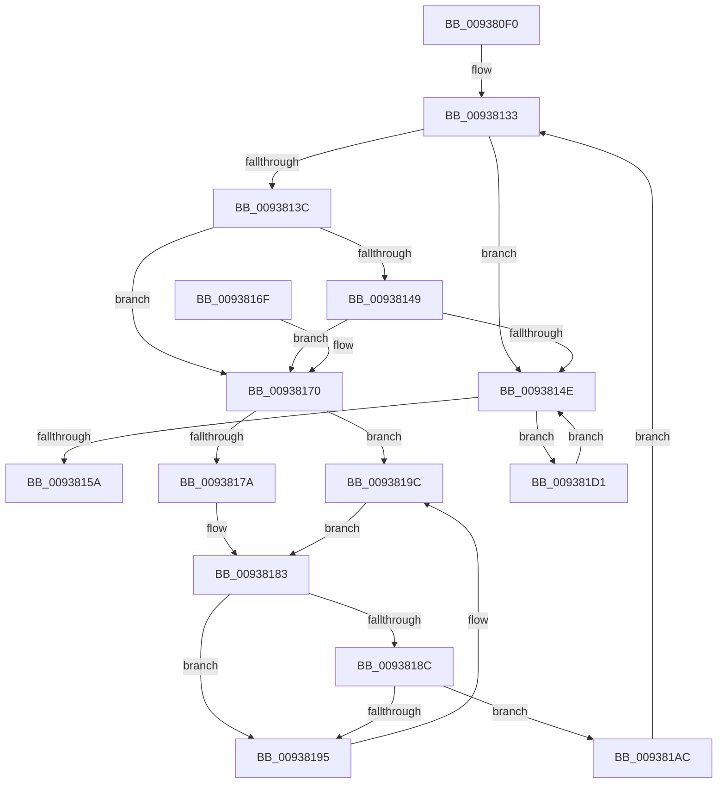

# FsRtlPruneTunnelCache

- RVA: `0x009380F0`–`0x009381EE` (길이 `254` bytes)
- VA: `0x00000001409380F0`
- 실행 섹션: `PAGE`
- PDB 이름 있음: `예`; PDB Function 태그: `아니요`
- unwind 정보 RVA: `0x0008F5D0`
- 디코드: `75`개 명령, `254/254` bytes 표시
- 미해석 바이트: `0` (있으면 어셈블리에 `.byte`로 보존)

> 이 문서는 커널 이미지의 기계어와 PDB 기호를 분석해 생성했습니다. 4번과 5번은 함수 원형과 자료형을 바이너리 사용 방식에서 추정한 C 해석이며 원본 소스 복구 결과는 아닙니다.

## 1. Dependencies

- 직접 호출 지점: **4**; 고유 호출 대상: **4**
- 직접 호출자로 확인된 함수: **2**
- RIP 상대 이미지 참조: **2**

### Outgoing calls
- `0x0093817E` → [RtlDeleteNoSplay](../../text/38/RtlDeleteNoSplay_function_0038C410.md) (function, `0x0038C410`)
- `0x0093819C` → [RtlDelete](../../text/38/RtlDelete_function_0038D8B0.md) (function, `0x0038D8B0`)
- `0x009381C7` → [FsRtlFreeTunnelNode](../../text/38/FsRtlFreeTunnelNode_function_00388D68.md) (function, `0x00388D68`)
- `0x009381E4` → [FsRtlRemoveNodeFromTunnel](../../text/38/FsRtlRemoveNodeFromTunnel_function_0038A450.md) (function, `0x0038A450`)

### Direct callers
- [FsRtlFindInTunnelCacheEx](FsRtlFindInTunnelCacheEx_function_00937A50.md) at `0x00937AB2`
- [FsRtlAddToTunnelCacheEx](FsRtlAddToTunnelCacheEx_function_00937C00.md) at `0x00937F29`

### Static image references
- `0x00938127` → RVA `0x00FD80DC` (`PAGEDATA`; read)
- `0x00938152` → RVA `0x00FD8034` (`PAGEDATA`; read)

## 2. Other-region calls and transfers

- 다른 실행 섹션으로 향하는 call: **4**
  - `0x0093817E` → [RtlDeleteNoSplay](../../text/38/RtlDeleteNoSplay_function_0038C410.md) (`PAGE` → `.text`)
  - `0x0093819C` → [RtlDelete](../../text/38/RtlDelete_function_0038D8B0.md) (`PAGE` → `.text`)
  - `0x009381C7` → [FsRtlFreeTunnelNode](../../text/38/FsRtlFreeTunnelNode_function_00388D68.md) (`PAGE` → `.text`)
  - `0x009381E4` → [FsRtlRemoveNodeFromTunnel](../../text/38/FsRtlRemoveNodeFromTunnel_function_0038A450.md) (`PAGE` → `.text`)
- 별도 외부 분기/꼬리 이동을 확인하지 못했습니다.

## 3. Assembly (complete function range)

```asm
009380F0  48 89 5C 24 18                  mov qword ptr [rsp + 0x18], rbx
009380F5  48 89 54 24 10                  mov qword ptr [rsp + 0x10], rdx
009380FA  55                              push rbp
009380FB  56                              push rsi
009380FC  57                              push rdi
009380FD  41 54                           push r12
009380FF  41 55                           push r13
00938101  41 56                           push r14
00938103  41 57                           push r15
00938105  48 83 EC 20                     sub rsp, 0x20
00938109  4C 8B 64 24 68                  mov r12, qword ptr [rsp + 0x68]
0093810E  4C 8D 69 40                     lea r13, [rcx + 0x40]
00938112  48 BF 14 00 00 00 80 F7 FF FF   movabs rdi, 0xfffff78000000014
0093811C  C6 44 24 60 01                  mov byte ptr [rsp + 0x60], 1
00938121  48 8B E9                        mov rbp, rcx
00938124  48 8B 3F                        mov rdi, qword ptr [rdi]
00938127  8B 05 AF FF 69 00               mov eax, dword ptr [rip + 0x69ffaf]
0093812D  48 8B DF                        mov rbx, rdi
00938130  48 2B D8                        sub rbx, rax
00938133  4D 8B 75 00                     mov r14, qword ptr [r13]
00938137  4D 3B F5                        cmp r14, r13
0093813A  74 12                           je 0x14093814e
0093813C  4D 8D 7E E8                     lea r15, [r14 - 0x18]
00938140  49 8B 47 28                     mov rax, qword ptr [r15 + 0x28]
00938144  48 3B C3                        cmp rax, rbx
00938147  7C 27                           jl 0x140938170
00938149  48 3B C7                        cmp rax, rdi
0093814C  7F 22                           jg 0x140938170
0093814E  0F B7 45 50                     movzx eax, word ptr [rbp + 0x50]
00938152  3B 05 DC FE 69 00               cmp eax, dword ptr [rip + 0x69fedc]
00938158  77 77                           ja 0x1409381d1
0093815A  48 8B 5C 24 70                  mov rbx, qword ptr [rsp + 0x70]
0093815F  48 83 C4 20                     add rsp, 0x20
00938163  41 5F                           pop r15
00938165  41 5E                           pop r14
00938167  41 5D                           pop r13
00938169  41 5C                           pop r12
0093816B  5F                              pop rdi
0093816C  5E                              pop rsi
0093816D  5D                              pop rbp
0093816E  C3                              ret
0093816F  CC                              int3
00938170  80 7C 24 60 00                  cmp byte ptr [rsp + 0x60], 0
00938175  49 8B CF                        mov rcx, r15
00938178  75 22                           jne 0x14093819c
0093817A  48 8D 55 38                     lea rdx, [rbp + 0x38]
0093817E  E8 8D 42 A5 FF                  call 0x14038c410
00938183  49 8B 0E                        mov rcx, qword ptr [r14]
00938186  4C 39 71 08                     cmp qword ptr [rcx + 8], r14
0093818A  75 09                           jne 0x140938195
0093818C  49 8B 46 08                     mov rax, qword ptr [r14 + 8]
00938190  4C 39 30                        cmp qword ptr [rax], r14
00938193  74 17                           je 0x1409381ac
00938195  B9 03 00 00 00                  mov ecx, 3
0093819A  CD 29                           int 0x29
0093819C  E8 0F 57 A5 FF                  call 0x14038d8b0
009381A1  48 89 45 38                     mov qword ptr [rbp + 0x38], rax
009381A5  C6 44 24 60 00                  mov byte ptr [rsp + 0x60], 0
009381AA  EB D7                           jmp 0x140938183
009381AC  4C 8B 64 24 68                  mov r12, qword ptr [rsp + 0x68]
009381B1  48 89 08                        mov qword ptr [rax], rcx
009381B4  49 8B D4                        mov rdx, r12
009381B7  48 89 41 08                     mov qword ptr [rcx + 8], rax
009381BB  B8 FF FF 00 00                  mov eax, 0xffff
009381C0  66 01 45 50                     add word ptr [rbp + 0x50], ax
009381C4  49 8B CF                        mov rcx, r15
009381C7  E8 9C 0B A5 FF                  call 0x140388d68
009381CC  E9 62 FF FF FF                  jmp 0x140938133
009381D1  49 8B 55 00                     mov rdx, qword ptr [r13]
009381D5  4C 8D 4C 24 60                  lea r9, [rsp + 0x60]
009381DA  48 83 EA 18                     sub rdx, 0x18
009381DE  4D 8B C4                        mov r8, r12
009381E1  48 8B CD                        mov rcx, rbp
009381E4  E8 67 22 A5 FF                  call 0x14038a450
009381E9  E9 60 FF FF FF                  jmp 0x14093814e
```

## 4. C-style interpretation (structured pseudocode)

```c
__int64 __fastcall FsRtlPruneTunnelCache(__int64 a1, __int64 a2)
{
    __int64 result;
    __int64 v_rbx;
    __int64 v_rsp;
    unsigned __int64 v_stack_p10;
    unsigned __int64 v_stack_p18;
    unsigned __int8 v_stack_p60;
    unsigned __int64 v_stack_p68;
    unsigned __int8 v_stack_p8;

    v_stack_p18 = v_rbx;
    v_stack_p10 = a2;
    v_rsp = (v_rsp) - (32);
    v_stack_p8 = 1;
    v_rbx = (*(unsigned __int64 *)(v_rdi)) - ((unsigned int)(*(unsigned int *)(v_rip + 6946735)));
loc_00938133:
    if ((*(unsigned __int64 *)(a1 + 64)) == (a1 + 64)) goto loc_0093814E;
    if ((*(unsigned __int64 *)(*(unsigned __int64 *)(a1 + 64) - 24 + 40)) < v_rbx) goto loc_00938170;
    if ((*(unsigned __int64 *)(*(unsigned __int64 *)(a1 + 64) - 24 + 40)) > (*(unsigned __int64 *)(v_rdi))) goto loc_00938170;
loc_0093814E:
    if (((unsigned int)(*(unsigned __int16 *)(a1 + 80))) > (*(unsigned int *)(v_rip + 6946524))) goto loc_009381D1;
    v_rsp = (v_rsp) + (32);
    return *(unsigned __int16 *)(a1 + 80);
loc_00938170:
    if (v_stack_p60 != 0) goto loc_0093819C;
    result = RtlDeleteNoSplay(*(unsigned __int64 *)(a1 + 64) - 24, a1 + 56, a3, a4);
loc_00938183:
    if ((*(unsigned __int64 *)(*(unsigned __int64 *)(*(unsigned __int64 *)(a1 + 64)) + 8)) != (*(unsigned __int64 *)(a1 + 64))) goto loc_00938195;
    if ((*(unsigned __int64 *)(*(unsigned __int64 *)(*(unsigned __int64 *)(a1 + 64) + 8))) == (*(unsigned __int64 *)(a1 + 64))) goto loc_009381AC;
loc_00938195:
loc_0093819C:
    result = RtlDelete(3, a1 + 56, a3, a4);
    *(unsigned __int64 *)(a1 + 56) = result;
    v_stack_p60 = 0;
    goto loc_00938183;
loc_009381AC:
    *(unsigned __int64 *)(result) = 3;
    *(unsigned __int64 *)(3 + 8) = result;
    result = FsRtlFreeTunnelNode(*(unsigned __int64 *)(a1 + 64) - 24, v_stack_p68, a3, a4);
    goto loc_00938133;
loc_009381D1:
    a2 = (*(unsigned __int64 *)(a1 + 64)) - (24);
    result = FsRtlRemoveNodeFromTunnel(a1, a2, v_stack_p68, v_stack_p60);
    goto loc_0093814E;
}
```

## 5. (Beta) C Style

```c
int64_t FsRtlPruneTunnelCache(void *Arg1, int64_t Arg2)
{
    uint8_t *arg1 = (uint8_t *)Arg1;

    int64_t result;
    int64_t local_rbx;
    int64_t local_rsp;
    uint64_t v_stack_p10;
    uint64_t v_stack_p18;
    uint8_t v_stack_p60;
    uint64_t v_stack_p68;
    uint8_t v_stack_p8;

    v_stack_p18 = local_rbx;
    v_stack_p10 = Arg2;
    local_rsp = (local_rsp) - (32);
    v_stack_p8 = 1;
    local_rbx = (*(uint64_t *)(local_rdi)) - ((uint32_t)(*(uint32_t *)(v_rip + 0x69FFAF)));
loc_00938133:
    if ((*(uint64_t *)(arg1 + 0x40)) == (Arg1 + 64)) goto loc_0093814E;
    if ((*(uint64_t *)(*(uint64_t *)(arg1 + 0x40) - 0x18 + 0x28)) < local_rbx) goto loc_00938170;
    if ((*(uint64_t *)(*(uint64_t *)(arg1 + 0x40) - 0x18 + 0x28)) > (*(uint64_t *)(local_rdi))) goto loc_00938170;
loc_0093814E:
    if (((uint32_t)(*(uint16_t *)(arg1 + 0x50))) > (*(uint32_t *)(v_rip + 0x69FEDC))) goto loc_009381D1;
    local_rsp = (local_rsp) + (32);
    return *(uint16_t *)(arg1 + 0x50);
loc_00938170:
    if (v_stack_p60 != 0) goto loc_0093819C;
    result = RtlDeleteNoSplay(*(uint64_t *)(arg1 + 0x40) - 24, Arg1 + 56, a3, a4);
loc_00938183:
    if ((*(uint64_t *)(*(uint64_t *)(*(uint64_t *)(arg1 + 0x40)) + 0x8)) != (*(uint64_t *)(arg1 + 0x40))) goto loc_00938195;
    if ((*(uint64_t *)(*(uint64_t *)(*(uint64_t *)(arg1 + 0x40) + 0x8))) == (*(uint64_t *)(arg1 + 0x40))) goto loc_009381AC;
loc_00938195:
loc_0093819C:
    result = RtlDelete(3, Arg1 + 56, a3, a4);
    *(uint64_t *)(arg1 + 0x38) = result;
    v_stack_p60 = 0;
    goto loc_00938183;
loc_009381AC:
    *(uint64_t *)(result) = 3;
    *(uint64_t *)(3 + 0x8) = result;
    result = FsRtlFreeTunnelNode(*(uint64_t *)(arg1 + 0x40) - 24, v_stack_p68, a3, a4);
    goto loc_00938133;
loc_009381D1:
    Arg2 = (*(uint64_t *)(arg1 + 0x40)) - (24);
    result = FsRtlRemoveNodeFromTunnel(Arg1, Arg2, v_stack_p68, v_stack_p60);
    goto loc_0093814E;
}
```

### 관측된 메모리 오프셋

구조체 형식이 확인되지 않은 접근은 인자 기준의 오프셋으로만 기록했습니다.

| 기준 인자 | 오프셋 표현 | 폭 (bit) | 접근 |
|---|---:|---:|---|
| `Arg1` | `+ 0x0` | `64` | `R` |
| `Arg1` | `+ 0x38` | `64` | `R` |
| `Arg1` | `+ 0x38` | `64` | `W` |
| `Arg1` | `+ 0x40` | `64` | `R` |
| `Arg1` | `+ 0x50` | `16` | `R` |
| `Arg1` | `+ 0x50` | `16` | `R/W` |

## 6. Execution-region graph

[열기: 2D/3D 그래프와 함수 탐색 컨트롤 패널](../../../control-panel.html?section=page&rva=0x009380F0&view=graph)

- 2D 그래프는 위에서 아래로 흐르고, 3D 그래프는 빈 공간을 드래그해 회전합니다. Shift+드래그는 이동, 휠은 확대·축소, 함수 노드 선택은 대상 보고서 이동입니다.

### Static fallback


