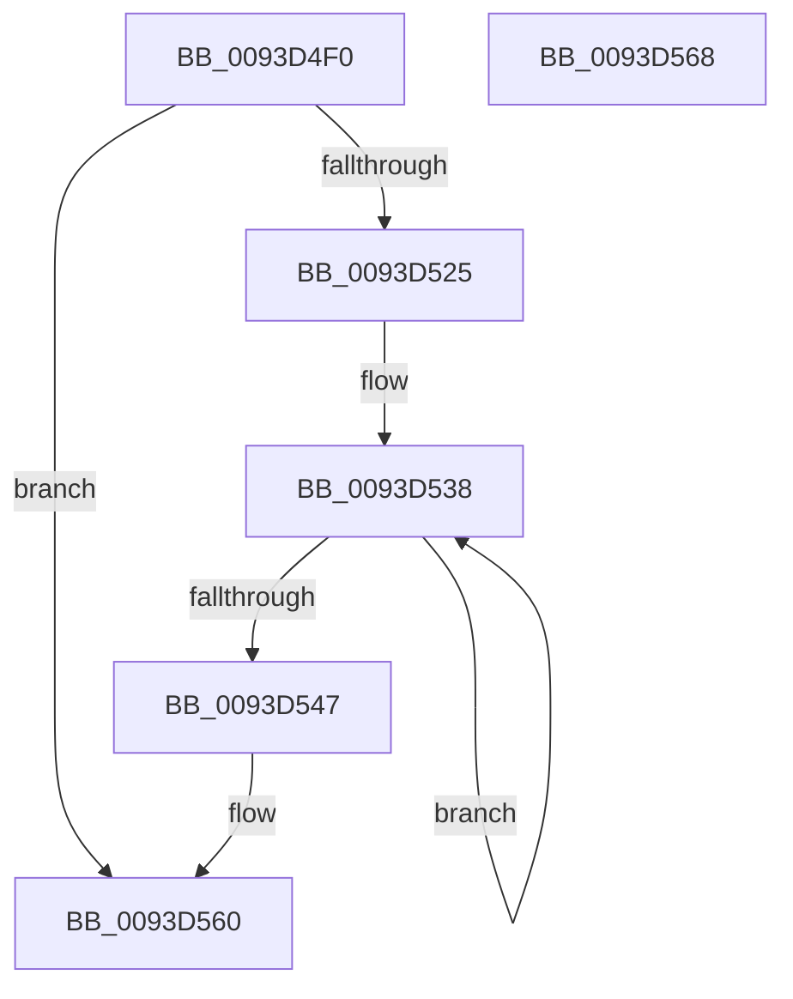

# MiAllocateReadList

- RVA: `0x0093D4F0`–`0x0093D569` (길이 `121` bytes)
- VA: `0x000000014093D4F0`
- 실행 섹션: `PAGE`
- PDB 이름 있음: `예`; PDB Function 태그: `아니요`
- unwind 정보 RVA: `0x0005C788`
- 디코드: `31`개 명령, `121/121` bytes 표시
- 미해석 바이트: `0` (있으면 어셈블리에 `.byte`로 보존)

> 이 문서는 커널 이미지의 기계어와 PDB 기호를 분석해 생성했습니다. 4번과 5번은 함수 원형과 자료형을 바이너리 사용 방식에서 추정한 C 해석이며 원본 소스 복구 결과는 아닙니다.

## 1. Dependencies

- 직접 호출 지점: **4**; 고유 호출 대상: **3**
- 직접 호출자로 확인된 함수: **2**
- RIP 상대 이미지 참조: **0**

### Outgoing calls
- `0x0093D4F6` → [MmGetCurrentProcessorColor](../../text/41/MmGetCurrentProcessorColor_function_00418930.md) (function, `0x00418930`)
- `0x0093D518` → [ExAllocatePoolMm](../../text/35/ExAllocatePoolMm_function_0035B690.md) (function, `0x0035B690`)
- `0x0093D529` → [MiInitializePageChainHead](../../text/41/MiInitializePageChainHead_function_0041D800.md) (function, `0x0041D800`)
- `0x0093D538` → [MiInitializePageChainHead](../../text/41/MiInitializePageChainHead_function_0041D800.md) (function, `0x0041D800`)

### Direct callers
- [MiPfPrepareReadList](MiPfPrepareReadList_function_0093CD5C.md) at `0x0093CE3B`
- [MiPfPrepareSequentialReadList](MiPfPrepareSequentialReadList_function_0093D8E8.md) at `0x0093DB97`

### Static image references
- 디코드된 RIP-relative 메모리 참조가 없습니다.

## 2. Other-region calls and transfers

- 다른 실행 섹션으로 향하는 call: **4**
  - `0x0093D4F6` → [MmGetCurrentProcessorColor](../../text/41/MmGetCurrentProcessorColor_function_00418930.md) (`PAGE` → `.text`)
  - `0x0093D518` → [ExAllocatePoolMm](../../text/35/ExAllocatePoolMm_function_0035B690.md) (`PAGE` → `.text`)
  - `0x0093D529` → [MiInitializePageChainHead](../../text/41/MiInitializePageChainHead_function_0041D800.md) (`PAGE` → `.text`)
  - `0x0093D538` → [MiInitializePageChainHead](../../text/41/MiInitializePageChainHead_function_0041D800.md) (`PAGE` → `.text`)
- 별도 외부 분기/꼬리 이동을 확인하지 못했습니다.

## 3. Assembly (complete function range)

```asm
0093D4F0  48 83 EC 28                     sub rsp, 0x28
0093D4F4  8B D1                           mov edx, ecx
0093D4F6  E8 35 B4 AD FF                  call 0x140418930
0093D4FB  8D 4A FF                        lea ecx, [rdx - 1]
0093D4FE  0F BA E8 1F                     bts eax, 0x1f
0093D502  44 8B C8                        mov r9d, eax
0093D505  41 B8 4D 6D 52 6C               mov r8d, 0x6c526d4d
0093D50B  48 8D 14 CD F8 00 00 00         lea rdx, [rcx*8 + 0xf8]
0093D513  B9 40 00 00 00                  mov ecx, 0x40
0093D518  E8 73 E1 A1 FF                  call 0x14035b690
0093D51D  48 8B D0                        mov rdx, rax
0093D520  48 85 C0                        test rax, rax
0093D523  74 3B                           je 0x14093d560
0093D525  48 8D 48 28                     lea rcx, [rax + 0x28]
0093D529  E8 D2 02 AE FF                  call 0x14041d800
0093D52E  48 8D 4A 40                     lea rcx, [rdx + 0x40]
0093D532  41 B8 05 00 00 00               mov r8d, 5
0093D538  E8 C3 02 AE FF                  call 0x14041d800
0093D53D  48 83 C1 18                     add rcx, 0x18
0093D541  49 83 E8 01                     sub r8, 1
0093D545  75 F1                           jne 0x14093d538
0093D547  48 8D 82 E0 00 00 00            lea rax, [rdx + 0xe0]
0093D54E  48 89 40 08                     mov qword ptr [rax + 8], rax
0093D552  48 89 00                        mov qword ptr [rax], rax
0093D555  48 8D 42 18                     lea rax, [rdx + 0x18]
0093D559  48 89 40 08                     mov qword ptr [rax + 8], rax
0093D55D  48 89 00                        mov qword ptr [rax], rax
0093D560  48 8B C2                        mov rax, rdx
0093D563  48 83 C4 28                     add rsp, 0x28
0093D567  C3                              ret
0093D568  CC                              int3
```

## 4. C-style interpretation (structured pseudocode)

```c
__int64 __fastcall MiAllocateReadList(int a1)
{
    __int64 result;
    __int64 v_rsp;

    v_rsp = (v_rsp) - (40);
    result = MmGetCurrentProcessorColor(a1, (unsigned int)(a1), a3, a4);
    result = ExAllocatePoolMm(64, (unsigned int)(a1) - 1 * 8 + 248, (unsigned int)(0x6C526D4DULL), (unsigned int)((unsigned int)(result)));
    if (result == 0) goto loc_0093D560;
    result = MiInitializePageChainHead(result + 40, result, (unsigned int)(0x6C526D4DULL), (unsigned int)((unsigned int)(result)));
loc_0093D538:
    result = MiInitializePageChainHead(result + 64, result, 5, (unsigned int)((unsigned int)(result)));
    a1 = (result + 64) + (24);
    a3 = (5) - (1);
    if (condition_is_not_equal) goto loc_0093D538;
    *(unsigned __int64 *)(result + 224 + 8) = result + 224;
    *(unsigned __int64 *)(result + 224) = result + 224;
    *(unsigned __int64 *)(result + 24 + 8) = result + 24;
    *(unsigned __int64 *)(result + 24) = result + 24;
loc_0093D560:
    v_rsp = (v_rsp) + (40);
    return result;
}
```

## 5. (Beta) C Style

```c
int64_t MiAllocateReadList(int32_t Arg1)
{
    int64_t result;
    int64_t local_rsp;

    local_rsp = (local_rsp) - (40);
    result = MmGetCurrentProcessorColor(Arg1, (uint32_t)(Arg1), a3, a4);
    result = ExAllocatePoolMm(64, (uint32_t)(Arg1) - 1 * 8 + 248, (uint32_t)(0x6C526D4DULL), (uint32_t)((uint32_t)(result)));
    if (result == 0) goto loc_0093D560;
    result = MiInitializePageChainHead(result + 40, result, (uint32_t)(0x6C526D4DULL), (uint32_t)((uint32_t)(result)));
loc_0093D538:
    result = MiInitializePageChainHead(result + 64, result, 5, (uint32_t)((uint32_t)(result)));
    Arg1 = (result + 64) + (24);
    a3 = (5) - (1);
    if (condition_is_not_equal) goto loc_0093D538;
    *(uint64_t *)(result + 0xE0 + 0x8) = result + 224;
    *(uint64_t *)(result + 0xE0) = result + 224;
    *(uint64_t *)(result + 0x18 + 0x8) = result + 24;
    *(uint64_t *)(result + 0x18) = result + 24;
loc_0093D560:
    local_rsp = (local_rsp) + (40);
    return result;
}
```

## 6. Execution-region graph

[열기: 2D/3D 그래프와 함수 탐색 컨트롤 패널](../../../control-panel.html?section=page&rva=0x0093D4F0&view=graph)

- 2D 그래프는 위에서 아래로 흐르고, 3D 그래프는 빈 공간을 드래그해 회전합니다. Shift+드래그는 이동, 휠은 확대·축소, 함수 노드 선택은 대상 보고서 이동입니다.

### Static fallback


