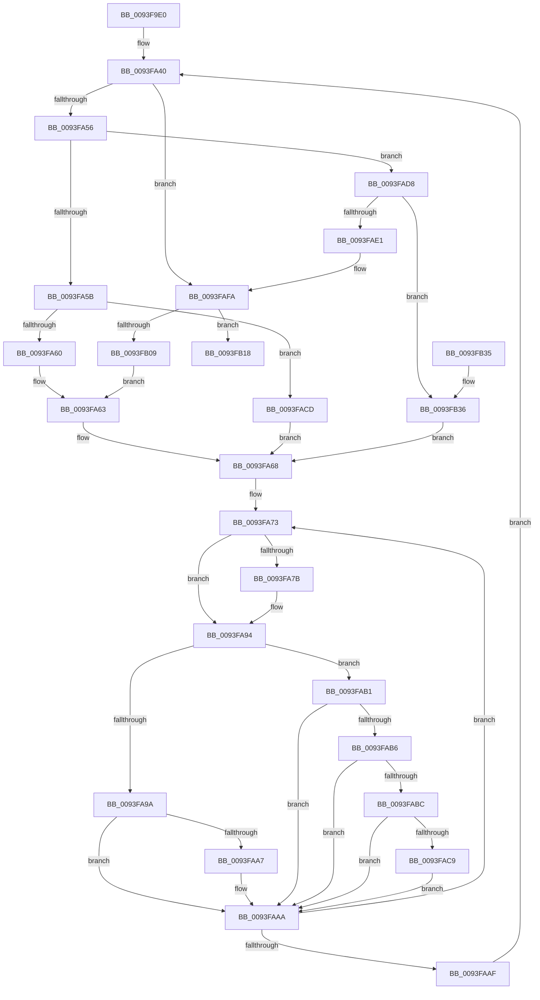

# MiApplyCompressedFixups

- RVA: `0x0093F9E0`–`0x0093FB3E` (길이 `350` bytes)
- VA: `0x000000014093F9E0`
- 실행 섹션: `PAGE`
- PDB 이름 있음: `예`; PDB Function 태그: `아니요`
- unwind 정보 RVA: `0x00090144`
- 디코드: `106`개 명령, `350/350` bytes 표시
- 미해석 바이트: `0` (있으면 어셈블리에 `.byte`로 보존)

> 이 문서는 커널 이미지의 기계어와 PDB 기호를 분석해 생성했습니다. 4번과 5번은 함수 원형과 자료형을 바이너리 사용 방식에서 추정한 C 해석이며 원본 소스 복구 결과는 아닙니다.

## 1. Dependencies

- 직접 호출 지점: **2**; 고유 호출 대상: **1**
- 직접 호출자로 확인된 함수: **1**
- RIP 상대 이미지 참조: **0**

### Outgoing calls
- `0x0093FA8E` → [KeBugCheckEx](../../text/4F/KeBugCheckEx_function_004FD660.md) (function, `0x004FD660`)
- `0x0093FAF4` → [KeBugCheckEx](../../text/4F/KeBugCheckEx_function_004FD660.md) (function, `0x004FD660`)

### Direct callers
- [MiPerformFixups](MiPerformFixups_function_0093F5F4.md) at `0x0093F725`

### Static image references
- 디코드된 RIP-relative 메모리 참조가 없습니다.

## 2. Other-region calls and transfers

- 다른 실행 섹션으로 향하는 call: **2**
  - `0x0093FA8E` → [KeBugCheckEx](../../text/4F/KeBugCheckEx_function_004FD660.md) (`PAGE` → `.text`)
  - `0x0093FAF4` → [KeBugCheckEx](../../text/4F/KeBugCheckEx_function_004FD660.md) (`PAGE` → `.text`)
- 별도 외부 분기/꼬리 이동을 확인하지 못했습니다.

## 3. Assembly (complete function range)

```asm
0093F9E0  48 89 5C 24 08                  mov qword ptr [rsp + 8], rbx
0093F9E5  48 89 6C 24 10                  mov qword ptr [rsp + 0x10], rbp
0093F9EA  48 89 74 24 18                  mov qword ptr [rsp + 0x18], rsi
0093F9EF  57                              push rdi
0093F9F0  41 54                           push r12
0093F9F2  41 55                           push r13
0093F9F4  41 56                           push r14
0093F9F6  41 57                           push r15
0093F9F8  48 83 EC 30                     sub rsp, 0x30
0093F9FC  48 8B 41 60                     mov rax, qword ptr [rcx + 0x60]
0093FA00  41 BE FF 0F 00 00               mov r14d, 0xfff
0093FA06  48 83 E0 F8                     and rax, 0xfffffffffffffff8
0093FA0A  4D 8B D0                        mov r10, r8
0093FA0D  49 8B E9                        mov rbp, r9
0093FA10  4C 8B DA                        mov r11, rdx
0093FA13  48 8B F9                        mov rdi, rcx
0093FA16  BB 04 00 00 00                  mov ebx, 4
0093FA1B  41 BD 0F FF 00 00               mov r13d, 0xff0f
0093FA21  45 8D 66 FD                     lea r12d, [r14 - 3]
0093FA25  48 8B 40 20                     mov rax, qword ptr [rax + 0x20]
0093FA29  45 8D 7E F9                     lea r15d, [r14 - 7]
0093FA2D  0F B6 70 40                     movzx esi, byte ptr [rax + 0x40]
0093FA31  48 8B C2                        mov rax, rdx
0093FA34  40 80 E6 0F                     and sil, 0xf
0093FA38  49 83 E2 FE                     and r10, 0xfffffffffffffffe
0093FA3C  0F 1F 40 00                     nop dword ptr [rax]
0093FA40  41 0F B6 12                     movzx edx, byte ptr [r10]
0093FA44  49 FF C2                        inc r10
0093FA47  0F B6 CA                        movzx ecx, dl
0093FA4A  80 E1 F0                        and cl, 0xf0
0093FA4D  80 F9 F0                        cmp cl, 0xf0
0093FA50  0F 84 A4 00 00 00               je 0x14093fafa
0093FA56  80 FA EF                        cmp dl, 0xef
0093FA59  74 7D                           je 0x14093fad8
0093FA5B  80 FA EB                        cmp dl, 0xeb
0093FA5E  73 6D                           jae 0x14093facd
0093FA60  0F B7 DA                        movzx ebx, dx
0093FA63  BA 01 00 00 00                  mov edx, 1
0093FA68  44 0F B7 C3                     movzx r8d, bx
0093FA6C  4D 8D 8B 00 10 00 00            lea r9, [r11 + 0x1000]
0093FA73  49 03 C0                        add rax, r8
0093FA76  49 3B C1                        cmp rax, r9
0093FA79  72 19                           jb 0x14093fa94
0093FA7B  BA 31 00 00 00                  mov edx, 0x31
0093FA80  4C 89 54 24 20                  mov qword ptr [rsp + 0x20], r10
0093FA85  4D 8B CB                        mov r9, r11
0093FA88  4C 8B C7                        mov r8, rdi
0093FA8B  8D 4A E9                        lea ecx, [rdx - 0x17]
0093FA8E  E8 CD DB BB FF                  call 0x1404fd660
0093FA93  CC                              int3
0093FA94  40 80 FE 0A                     cmp sil, 0xa
0093FA98  75 17                           jne 0x14093fab1
0093FA9A  0F B7 C8                        movzx ecx, ax
0093FA9D  66 41 23 CE                     and cx, r14w
0093FAA1  66 41 3B CF                     cmp cx, r15w
0093FAA5  77 03                           ja 0x14093faaa
0093FAA7  48 01 28                        add qword ptr [rax], rbp
0093FAAA  83 C2 FF                        add edx, -1
0093FAAD  75 C4                           jne 0x14093fa73
0093FAAF  EB 8F                           jmp 0x14093fa40
0093FAB1  40 84 F6                        test sil, sil
0093FAB4  74 F4                           je 0x14093faaa
0093FAB6  40 80 FE 03                     cmp sil, 3
0093FABA  75 EE                           jne 0x14093faaa
0093FABC  0F B7 C8                        movzx ecx, ax
0093FABF  66 41 23 CE                     and cx, r14w
0093FAC3  66 41 3B CC                     cmp cx, r12w
0093FAC7  77 E1                           ja 0x14093faaa
0093FAC9  01 28                           add dword ptr [rax], ebp
0093FACB  EB DD                           jmp 0x14093faaa
0093FACD  8B CA                           mov ecx, edx
0093FACF  BA EF 00 00 00                  mov edx, 0xef
0093FAD4  2B D1                           sub edx, ecx
0093FAD6  EB 90                           jmp 0x14093fa68
0093FAD8  41 0F B6 12                     movzx edx, byte ptr [r10]
0093FADC  83 FA 04                        cmp edx, 4
0093FADF  77 55                           ja 0x14093fb36
0093FAE1  BA 31 00 00 00                  mov edx, 0x31
0093FAE6  4C 89 54 24 20                  mov qword ptr [rsp + 0x20], r10
0093FAEB  4D 8B CB                        mov r9, r11
0093FAEE  4C 8B C7                        mov r8, rdi
0093FAF1  8D 4A E9                        lea ecx, [rdx - 0x17]
0093FAF4  E8 67 DB BB FF                  call 0x1404fd660
0093FAF9  CC                              int3
0093FAFA  41 0F B6 0A                     movzx ecx, byte ptr [r10]
0093FAFE  0F B7 DA                        movzx ebx, dx
0093FB01  66 41 23 DD                     and bx, r13w
0093FB05  84 C9                           test cl, cl
0093FB07  74 0F                           je 0x14093fb18
0093FB09  66 C1 E1 04                     shl cx, 4
0093FB0D  66 0B D9                        or bx, cx
0093FB10  49 FF C2                        inc r10
0093FB13  E9 4B FF FF FF                  jmp 0x14093fa63
0093FB18  48 8B 5C 24 60                  mov rbx, qword ptr [rsp + 0x60]
0093FB1D  48 8B 6C 24 68                  mov rbp, qword ptr [rsp + 0x68]
0093FB22  48 8B 74 24 70                  mov rsi, qword ptr [rsp + 0x70]
0093FB27  48 83 C4 30                     add rsp, 0x30
0093FB2B  41 5F                           pop r15
0093FB2D  41 5E                           pop r14
0093FB2F  41 5D                           pop r13
0093FB31  41 5C                           pop r12
0093FB33  5F                              pop rdi
0093FB34  C3                              ret
0093FB35  CC                              int3
0093FB36  49 FF C2                        inc r10
0093FB39  E9 2A FF FF FF                  jmp 0x14093fa68
```

## 4. C-style interpretation (structured pseudocode)

```c
__int64 __fastcall MiApplyCompressedFixups(__int64 a1, __int64 a2, __int64 a3, __int64 a4)
{
    __int64 result;
    __int64 v_r10;
    __int64 v_rbx;
    __int64 v_rsi;
    __int64 v_rsp;
    unsigned __int64 v_stack_m38;
    unsigned __int64 v_stack_p10;
    unsigned __int64 v_stack_p18;
    unsigned __int64 v_stack_p8;

    v_stack_p8 = v_rbx;
    v_stack_p10 = v_rbp;
    v_stack_p18 = v_rsi;
    v_rsp = (v_rsp) - (48);
    result = (*(unsigned __int64 *)(a1 + 96)) & (-8);
    v_rsi = (unsigned __int8)((*(unsigned __int8 *)(*(unsigned __int64 *)(result + 32) + 64)) & (15));
    v_r10 = (a3) & (-2);
loc_0093FA40:
    v_r10 = (v_r10) + 1;
    a1 = (unsigned __int8)(((unsigned __int8)(*(unsigned __int8 *)(v_r10))) & (240));
    if (((unsigned __int8)(a1)) == 240) goto loc_0093FAFA;
    if (((unsigned __int8)(*(unsigned __int8 *)(v_r10))) == 239) goto loc_0093FAD8;
    if (((unsigned __int8)(*(unsigned __int8 *)(v_r10))) >= 235) goto loc_0093FACD;
loc_0093FA63:
loc_0093FA68:
loc_0093FA73:
    result = (a2) + ((unsigned __int16)((unsigned __int16)(*(unsigned __int8 *)(v_r10))));
    if (result >= (a2 + 4096)) {
        a2 = 49;
        v_stack_m38 = v_r10;
        a4 = a2;
        a3 = a1;
        a1 = a2 - 23;
        result = KeBugCheckEx(a1, a2, a3, a4);
    }
    if (((unsigned __int8)(v_rsi)) != 10) goto loc_0093FAB1;
    a1 = (unsigned __int16)(((unsigned __int16)(result)) & ((unsigned __int16)((unsigned int)(0xFFFULL))));
    if (((unsigned __int16)(a1)) <= ((unsigned __int16)((unsigned int)(0xFFFULL) - 7))) {
    }
    a2 = (unsigned int)((a2) + (-1));
    if (condition_is_not_equal) goto loc_0093FA73;
    goto loc_0093FA40;
loc_0093FAB1:
    if ((unsigned __int8)(v_rsi) == 0) goto loc_0093FAAA;
    if (((unsigned __int8)(v_rsi)) != 3) goto loc_0093FAAA;
    a1 = (unsigned __int16)(((unsigned __int16)(result)) & ((unsigned __int16)((unsigned int)(0xFFFULL))));
    if (((unsigned __int16)(a1)) > ((unsigned __int16)((unsigned int)(0xFFFULL) - 3))) goto loc_0093FAAA;
    goto loc_0093FAAA;
loc_0093FACD:
    a2 = (unsigned int)((239) - ((unsigned int)((unsigned int)((unsigned int)(a2)))));
    goto loc_0093FA68;
loc_0093FAD8:
    if (((unsigned int)(*(unsigned __int8 *)(v_r10))) > 4) goto loc_0093FB36;
    v_stack_m38 = v_r10;
    result = KeBugCheckEx(49 - 23, 49, a1, a2);
loc_0093FAFA:
    v_rbx = (unsigned __int16)((49) & ((unsigned __int16)((unsigned int)(0xFF0FULL))));
    if ((unsigned __int8)(*(unsigned __int8 *)(v_r10)) == 0) goto loc_0093FB18;
    a1 = (unsigned __int16)((*(unsigned __int8 *)(v_r10)) << (4));
    v_rbx = (unsigned __int16)((v_rbx) | ((unsigned __int16)(a1)));
    v_r10 = (v_r10) + 1;
    goto loc_0093FA63;
loc_0093FB18:
    v_rsp = (v_rsp) + (48);
    return result;
loc_0093FB36:
    v_r10 = (v_r10) + 1;
    goto loc_0093FA68;
}
```

## 5. (Beta) C Style

```c
int64_t MiApplyCompressedFixups(void *Arg1, void *Arg2, int64_t Arg3, int64_t Arg4)
{
    uint8_t *arg1 = (uint8_t *)Arg1;
    uint8_t *arg2 = (uint8_t *)Arg2;

    int64_t result;
    int64_t local_r10;
    int64_t local_rbx;
    int64_t local_rsi;
    int64_t local_rsp;
    uint64_t v_stack_m38;
    uint64_t v_stack_p10;
    uint64_t v_stack_p18;
    uint64_t v_stack_p8;

    v_stack_p8 = local_rbx;
    v_stack_p10 = local_rbp;
    v_stack_p18 = local_rsi;
    local_rsp = (local_rsp) - (48);
    result = (*(uint64_t *)(arg1 + 0x60)) & (-8);
    local_rsi = (uint8_t)((*(uint8_t *)(*(uint64_t *)(result + 0x20) + 0x40)) & (15));
    local_r10 = (Arg3) & (-2);
loc_0093FA40:
    local_r10 = (local_r10) + 1;
    Arg1 = (uint8_t)(((uint8_t)(*(uint8_t *)(local_r10))) & (240));
    if (((uint8_t)(Arg1)) == 240) goto loc_0093FAFA;
    if (((uint8_t)(*(uint8_t *)(local_r10))) == 239) goto loc_0093FAD8;
    if (((uint8_t)(*(uint8_t *)(local_r10))) >= 235) goto loc_0093FACD;
loc_0093FA63:
loc_0093FA68:
loc_0093FA73:
    result = (Arg2) + ((uint16_t)((uint16_t)(*(uint8_t *)(local_r10))));
    if (result >= (Arg2 + 4096)) {
        Arg2 = 49;
        v_stack_m38 = local_r10;
        Arg4 = Arg2;
        Arg3 = Arg1;
        Arg1 = Arg2 - 23;
        result = KeBugCheckEx(Arg1, Arg2, Arg3, Arg4);
    }
    if (((uint8_t)(local_rsi)) != 10) goto loc_0093FAB1;
    Arg1 = (uint16_t)(((uint16_t)(result)) & ((uint16_t)((uint32_t)(0xFFFULL))));
    if (((uint16_t)(Arg1)) <= ((uint16_t)((uint32_t)(0xFFFULL) - 7))) {
    }
    Arg2 = (uint32_t)((Arg2) + (-1));
    if (condition_is_not_equal) goto loc_0093FA73;
    goto loc_0093FA40;
loc_0093FAB1:
    if ((uint8_t)(local_rsi) == 0) goto loc_0093FAAA;
    if (((uint8_t)(local_rsi)) != 3) goto loc_0093FAAA;
    Arg1 = (uint16_t)(((uint16_t)(result)) & ((uint16_t)((uint32_t)(0xFFFULL))));
    if (((uint16_t)(Arg1)) > ((uint16_t)((uint32_t)(0xFFFULL) - 3))) goto loc_0093FAAA;
    goto loc_0093FAAA;
loc_0093FACD:
    Arg2 = (uint32_t)((239) - ((uint32_t)((uint32_t)((uint32_t)(Arg2)))));
    goto loc_0093FA68;
loc_0093FAD8:
    if (((uint32_t)(*(uint8_t *)(local_r10))) > 4) goto loc_0093FB36;
    v_stack_m38 = local_r10;
    result = KeBugCheckEx(49 - 23, 49, Arg1, Arg2);
loc_0093FAFA:
    local_rbx = (uint16_t)((49) & ((uint16_t)((uint32_t)(0xFF0FULL))));
    if ((uint8_t)(*(uint8_t *)(local_r10)) == 0) goto loc_0093FB18;
    Arg1 = (uint16_t)((*(uint8_t *)(local_r10)) << (4));
    local_rbx = (uint16_t)((local_rbx) | ((uint16_t)(Arg1)));
    local_r10 = (local_r10) + 1;
    goto loc_0093FA63;
loc_0093FB18:
    local_rsp = (local_rsp) + (48);
    return result;
loc_0093FB36:
    local_r10 = (local_r10) + 1;
    goto loc_0093FA68;
}
```

### 관측된 메모리 오프셋

구조체 형식이 확인되지 않은 접근은 인자 기준의 오프셋으로만 기록했습니다.

| 기준 인자 | 오프셋 표현 | 폭 (bit) | 접근 |
|---|---:|---:|---|
| `Arg1` | `+ 0x60` | `64` | `R` |
| `Arg2` | `+ 0x0` | `32` | `R` |

## 6. Execution-region graph

[열기: 2D/3D 그래프와 함수 탐색 컨트롤 패널](../../../control-panel.html?section=page&rva=0x0093F9E0&view=graph)

- 2D 그래프는 위에서 아래로 흐르고, 3D 그래프는 빈 공간을 드래그해 회전합니다. Shift+드래그는 이동, 휠은 확대·축소, 함수 노드 선택은 대상 보고서 이동입니다.

### Static fallback


