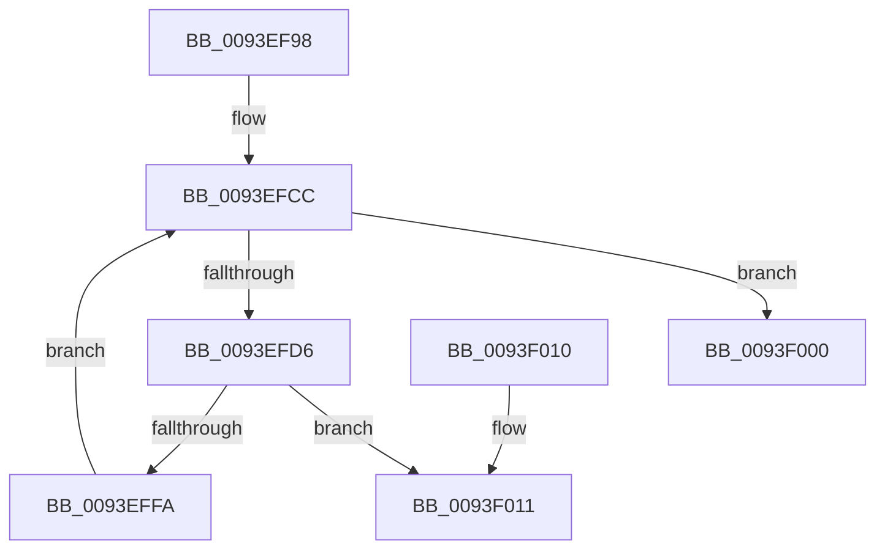

# MiApplyRawFixups

- RVA: `0x0093EF98`–`0x0093F027` (길이 `143` bytes)
- VA: `0x000000014093EF98`
- 실행 섹션: `PAGE`
- PDB 이름 있음: `예`; PDB Function 태그: `아니요`
- unwind 정보 RVA: `0x000900A4`
- 디코드: `43`개 명령, `143/143` bytes 표시
- 미해석 바이트: `0` (있으면 어셈블리에 `.byte`로 보존)

> 이 문서는 커널 이미지의 기계어와 PDB 기호를 분석해 생성했습니다. 4번과 5번은 함수 원형과 자료형을 바이너리 사용 방식에서 추정한 C 해석이며 원본 소스 복구 결과는 아닙니다.

## 1. Dependencies

- 직접 호출 지점: **2**; 고유 호출 대상: **2**
- 직접 호출자로 확인된 함수: **1**
- RIP 상대 이미지 참조: **0**

### Outgoing calls
- `0x0093EFF1` → [MiDoSingleFixup](MiDoSingleFixup_function_0093F030.md) (function, `0x0093F030`)
- `0x0093F021` → [KeBugCheckEx](../../text/4F/KeBugCheckEx_function_004FD660.md) (function, `0x004FD660`)

### Direct callers
- [MiPerformFixups](MiPerformFixups_function_0093F5F4.md) at `0x0093F8B9`

### Static image references
- 디코드된 RIP-relative 메모리 참조가 없습니다.

## 2. Other-region calls and transfers

- 다른 실행 섹션으로 향하는 call: **1**
  - `0x0093F021` → [KeBugCheckEx](../../text/4F/KeBugCheckEx_function_004FD660.md) (`PAGE` → `.text`)
- 별도 외부 분기/꼬리 이동을 확인하지 못했습니다.

## 3. Assembly (complete function range)

```asm
0093EF98  48 89 5C 24 08                  mov qword ptr [rsp + 8], rbx
0093EF9D  48 89 74 24 10                  mov qword ptr [rsp + 0x10], rsi
0093EFA2  57                              push rdi
0093EFA3  48 83 EC 30                     sub rsp, 0x30
0093EFA7  49 83 E0 FE                     and r8, 0xfffffffffffffffe
0093EFAB  49 8B F1                        mov rsi, r9
0093EFAE  4C 8B CA                        mov r9, rdx
0093EFB1  48 8B D9                        mov rbx, rcx
0093EFB4  41 8B 38                        mov edi, dword ptr [r8]
0093EFB7  4D 8D 58 08                     lea r11, [r8 + 8]
0093EFBB  45 8B 50 04                     mov r10d, dword ptr [r8 + 4]
0093EFBF  81 E7 FF 0F 00 00               and edi, 0xfff
0093EFC5  41 83 EA 08                     sub r10d, 8
0093EFC9  41 D1 EA                        shr r10d, 1
0093EFCC  41 8B C2                        mov eax, r10d
0093EFCF  41 FF CA                        dec r10d
0093EFD2  85 C0                           test eax, eax
0093EFD4  74 2A                           je 0x14093f000
0093EFD6  41 0F B7 03                     movzx eax, word ptr [r11]
0093EFDA  4C 8B C6                        mov r8, rsi
0093EFDD  0F B7 D0                        movzx edx, ax
0093EFE0  8B CF                           mov ecx, edi
0093EFE2  25 FF 0F 00 00                  and eax, 0xfff
0093EFE7  66 C1 EA 0C                     shr dx, 0xc
0093EFEB  49 03 C1                        add rax, r9
0093EFEE  48 03 C8                        add rcx, rax
0093EFF1  E8 3A 00 00 00                  call 0x14093f030
0093EFF6  85 C0                           test eax, eax
0093EFF8  74 17                           je 0x14093f011
0093EFFA  49 83 C3 02                     add r11, 2
0093EFFE  EB CC                           jmp 0x14093efcc
0093F000  48 8B 5C 24 40                  mov rbx, qword ptr [rsp + 0x40]
0093F005  48 8B 74 24 48                  mov rsi, qword ptr [rsp + 0x48]
0093F00A  48 83 C4 30                     add rsp, 0x30
0093F00E  5F                              pop rdi
0093F00F  C3                              ret
0093F010  CC                              int3
0093F011  BA 30 00 00 00                  mov edx, 0x30
0093F016  4C 89 5C 24 20                  mov qword ptr [rsp + 0x20], r11
0093F01B  4C 8B C3                        mov r8, rbx
0093F01E  8D 4A EA                        lea ecx, [rdx - 0x16]
0093F021  E8 3A E6 BB FF                  call 0x1404fd660
0093F026  CC                              int3
```

## 4. C-style interpretation (structured pseudocode)

```c
__int64 __fastcall MiApplyRawFixups(__int64 a1, __int64 a2, __int64 a3, __int64 a4)
{
    __int64 result;
    __int64 v_r10;
    __int64 v_r11;
    __int64 v_rdi;
    __int64 v_rsp;
    unsigned __int64 v_stack_p10;
    unsigned __int64 v_stack_p20;
    unsigned __int64 v_stack_p8;

    v_stack_p8 = v_rbx;
    v_stack_p10 = v_rsi;
    v_rsp = (v_rsp) - (48);
    a3 = (a3) & (-2);
    v_rdi = (unsigned int)(((unsigned int)(*(unsigned int *)(a3))) & (0xFFFULL));
    v_r10 = (unsigned int)(((unsigned int)(*(unsigned int *)(a3 + 4))) - (8));
    v_r10 = (unsigned int)((v_r10) >> (1));
loc_0093EFCC:
    v_r10 = (unsigned int)((v_r10) - 1);
    if ((unsigned int)((unsigned int)((unsigned int)(v_r10))) == 0) goto loc_0093F000;
    result = (unsigned int)((*(unsigned __int16 *)(a3 + 8)) & (0xFFFULL));
    a2 = (unsigned __int16)(((unsigned __int16)(*(unsigned __int16 *)(a3 + 8))) >> (12));
    result = (result) + (a2);
    a1 = ((unsigned int)((unsigned int)(v_rdi))) + (result);
    result = MiDoSingleFixup(a1, a2, a4, a2);
    if ((unsigned int)(result) == 0) goto loc_0093F011;
    v_r11 = (a3 + 8) + (2);
    goto loc_0093EFCC;
loc_0093F000:
    v_rsp = (v_rsp) + (48);
    return result;
loc_0093F011:
    v_stack_p20 = v_r11;
    result = KeBugCheckEx(48 - 22, 48, v_stack_p8, a2);
    return result;
}
```

## 5. (Beta) C Style

```c
int64_t MiApplyRawFixups(int64_t Arg1, int64_t Arg2, void *Arg3, int64_t Arg4)
{
    uint8_t *arg3 = (uint8_t *)Arg3;

    int64_t result;
    int64_t local_r10;
    int64_t local_r11;
    int64_t local_rdi;
    int64_t local_rsp;
    uint64_t v_stack_p10;
    uint64_t v_stack_p20;
    uint64_t v_stack_p8;

    v_stack_p8 = local_rbx;
    v_stack_p10 = local_rsi;
    local_rsp = (local_rsp) - (48);
    Arg3 = (Arg3) & (-2);
    local_rdi = (uint32_t)(((uint32_t)(*(uint32_t *)(arg3))) & (0xFFFULL));
    local_r10 = (uint32_t)(((uint32_t)(*(uint32_t *)(arg3 + 0x4))) - (8));
    local_r10 = (uint32_t)((local_r10) >> (1));
loc_0093EFCC:
    local_r10 = (uint32_t)((local_r10) - 1);
    if ((uint32_t)((uint32_t)((uint32_t)(local_r10))) == 0) goto loc_0093F000;
    result = (uint32_t)((*(uint16_t *)(arg3 + 0x8)) & (0xFFFULL));
    Arg2 = (uint16_t)(((uint16_t)(*(uint16_t *)(arg3 + 0x8))) >> (12));
    result = (result) + (Arg2);
    Arg1 = ((uint32_t)((uint32_t)(local_rdi))) + (result);
    result = MiDoSingleFixup(Arg1, Arg2, Arg4, Arg2);
    if ((uint32_t)(result) == 0) goto loc_0093F011;
    local_r11 = (Arg3 + 8) + (2);
    goto loc_0093EFCC;
loc_0093F000:
    local_rsp = (local_rsp) + (48);
    return result;
loc_0093F011:
    v_stack_p20 = local_r11;
    result = KeBugCheckEx(48 - 22, 48, v_stack_p8, Arg2);
    return result;
}
```

### 관측된 메모리 오프셋

구조체 형식이 확인되지 않은 접근은 인자 기준의 오프셋으로만 기록했습니다.

| 기준 인자 | 오프셋 표현 | 폭 (bit) | 접근 |
|---|---:|---:|---|
| `Arg3` | `+ 0x0` | `32` | `R` |
| `Arg3` | `+ 0x4` | `32` | `R` |
| `Arg3` | `+ 0x8` | `64` | `R` |

## 6. Execution-region graph

[열기: 2D/3D 그래프와 함수 탐색 컨트롤 패널](../../../control-panel.html?section=page&rva=0x0093EF98&view=graph)

- 2D 그래프는 위에서 아래로 흐르고, 3D 그래프는 빈 공간을 드래그해 회전합니다. Shift+드래그는 이동, 휠은 확대·축소, 함수 노드 선택은 대상 보고서 이동입니다.

### Static fallback


