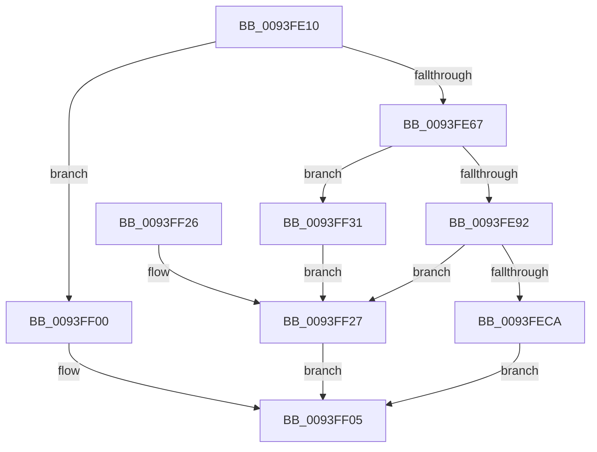

# MiCreateRetpolineRelocationInformation

- RVA: `0x0093FE10`–`0x0093FF38` (길이 `296` bytes)
- VA: `0x000000014093FE10`
- 실행 섹션: `PAGE`
- PDB 이름 있음: `예`; PDB Function 태그: `아니요`
- unwind 정보 RVA: `0x00090190`
- 디코드: `83`개 명령, `296/296` bytes 표시
- 미해석 바이트: `0` (있으면 어셈블리에 `.byte`로 보존)

> 이 문서는 커널 이미지의 기계어와 PDB 기호를 분석해 생성했습니다. 4번과 5번은 함수 원형과 자료형을 바이너리 사용 방식에서 추정한 C 해석이며 원본 소스 복구 결과는 아닙니다.

## 1. Dependencies

- 직접 호출 지점: **4**; 고유 호출 대상: **3**
- 직접 호출자로 확인된 함수: **2**
- RIP 상대 이미지 참조: **2**

### Outgoing calls
- `0x0093FE56` → [MiAllocatePool](../../text/35/MiAllocatePool_function_0035B540.md) (function, `0x0035B540`)
- `0x0093FE7D` → [MiAllocatePool](../../text/35/MiAllocatePool_function_0035B540.md) (function, `0x0035B540`)
- `0x0093FEBF` → [RtlCreateRetpolineRelocationInformation](../../text/44/RtlCreateRetpolineRelocationInformation_function_0044AC14.md) (function, `0x0044AC14`)
- `0x0093FF2A` → [MiFreeRetpolineRelocationInformation](MiFreeRetpolineRelocationInformation_function_0093F194.md) (function, `0x0093F194`)

### Direct callers
- [MiCaptureBootDriverRetpolineInfo](../80/MiCaptureBootDriverRetpolineInfo_function_0080137C.md) at `0x00801484`
- [MiParseImageLoadConfig](../94/MiParseImageLoadConfig_function_00940D18.md) at `0x009411EA`

### Static image references
- `0x0093FED7` → RVA `0x00E375B0` (`.data`; read)
- `0x0093FEDD` → RVA `0x00E375AC` (`.data`; read)

## 2. Other-region calls and transfers

- 다른 실행 섹션으로 향하는 call: **3**
  - `0x0093FE56` → [MiAllocatePool](../../text/35/MiAllocatePool_function_0035B540.md) (`PAGE` → `.text`)
  - `0x0093FE7D` → [MiAllocatePool](../../text/35/MiAllocatePool_function_0035B540.md) (`PAGE` → `.text`)
  - `0x0093FEBF` → [RtlCreateRetpolineRelocationInformation](../../text/44/RtlCreateRetpolineRelocationInformation_function_0044AC14.md) (`PAGE` → `.text`)
- 별도 외부 분기/꼬리 이동을 확인하지 못했습니다.

## 3. Assembly (complete function range)

```asm
0093FE10  48 8B C4                        mov rax, rsp
0093FE13  48 89 58 08                     mov qword ptr [rax + 8], rbx
0093FE17  48 89 68 10                     mov qword ptr [rax + 0x10], rbp
0093FE1B  48 89 70 18                     mov qword ptr [rax + 0x18], rsi
0093FE1F  48 89 78 20                     mov qword ptr [rax + 0x20], rdi
0093FE23  41 54                           push r12
0093FE25  41 56                           push r14
0093FE27  41 57                           push r15
0093FE29  48 83 EC 50                     sub rsp, 0x50
0093FE2D  41 8B D8                        mov ebx, r8d
0093FE30  41 8B E8                        mov ebp, r8d
0093FE33  44 8B E2                        mov r12d, edx
0093FE36  C1 EB 0C                        shr ebx, 0xc
0093FE39  48 8B F1                        mov rsi, rcx
0093FE3C  41 B8 4D 69 52 72               mov r8d, 0x7252694d
0093FE42  B9 00 01 00 00                  mov ecx, 0x100
0093FE47  4D 8B F9                        mov r15, r9
0093FE4A  44 8D 34 DD 00 00 00 00         lea r14d, [rbx*8]
0093FE52  41 8D 56 40                     lea edx, [r14 + 0x40]
0093FE56  E8 E5 B6 A1 FF                  call 0x14035b540
0093FE5B  48 8B F8                        mov rdi, rax
0093FE5E  48 85 C0                        test rax, rax
0093FE61  0F 84 99 00 00 00               je 0x14093ff00
0093FE67  8D 1C 5B                        lea ebx, [rbx + rbx*2]
0093FE6A  B9 00 01 00 00                  mov ecx, 0x100
0093FE6F  03 5E 04                        add ebx, dword ptr [rsi + 4]
0093FE72  41 B8 4D 69 52 72               mov r8d, 0x7252694d
0093FE78  C1 E3 02                        shl ebx, 2
0093FE7B  8B D3                           mov edx, ebx
0093FE7D  E8 BE B6 A1 FF                  call 0x14035b540
0093FE82  48 89 47 38                     mov qword ptr [rdi + 0x38], rax
0093FE86  48 8B C8                        mov rcx, rax
0093FE89  48 85 C0                        test rax, rax
0093FE8C  0F 84 9F 00 00 00               je 0x14093ff31
0093FE92  4C 8B 4E 10                     mov r9, qword ptr [rsi + 0x10]
0093FE96  48 8D 47 40                     lea rax, [rdi + 0x40]
0093FE9A  4C 8B 46 08                     mov r8, qword ptr [rsi + 8]
0093FE9E  8B 56 04                        mov edx, dword ptr [rsi + 4]
0093FEA1  44 89 74 24 40                  mov dword ptr [rsp + 0x40], r14d
0093FEA6  48 89 44 24 38                  mov qword ptr [rsp + 0x38], rax
0093FEAB  48 8B 46 18                     mov rax, qword ptr [rsi + 0x18]
0093FEAF  89 5C 24 30                     mov dword ptr [rsp + 0x30], ebx
0093FEB3  48 89 4C 24 28                  mov qword ptr [rsp + 0x28], rcx
0093FEB8  8B CD                           mov ecx, ebp
0093FEBA  48 89 44 24 20                  mov qword ptr [rsp + 0x20], rax
0093FEBF  E8 50 AD B0 FF                  call 0x14044ac14
0093FEC4  8B D8                           mov ebx, eax
0093FEC6  85 C0                           test eax, eax
0093FEC8  78 5D                           js 0x14093ff27
0093FECA  8B 06                           mov eax, dword ptr [rsi]
0093FECC  B9 00 F0 FF FF                  mov ecx, 0xfffff000
0093FED1  89 47 04                        mov dword ptr [rdi + 4], eax
0093FED4  44 89 27                        mov dword ptr [rdi], r12d
0093FED7  8B 05 D3 76 4F 00               mov eax, dword ptr [rip + 0x4f76d3]
0093FEDD  8B 15 C9 76 4F 00               mov edx, dword ptr [rip + 0x4f76c9]
0093FEE3  05 FF 0F 00 00                  add eax, 0xfff
0093FEE8  03 D0                           add edx, eax
0093FEEA  8D 85 FF 0F 00 00               lea eax, [rbp + 0xfff]
0093FEF0  23 C1                           and eax, ecx
0093FEF2  23 D1                           and edx, ecx
0093FEF4  03 D0                           add edx, eax
0093FEF6  89 57 30                        mov dword ptr [rdi + 0x30], edx
0093FEF9  33 DB                           xor ebx, ebx
0093FEFB  49 89 3F                        mov qword ptr [r15], rdi
0093FEFE  EB 05                           jmp 0x14093ff05
0093FF00  BB 9A 00 00 C0                  mov ebx, 0xc000009a
0093FF05  4C 8D 5C 24 50                  lea r11, [rsp + 0x50]
0093FF0A  8B C3                           mov eax, ebx
0093FF0C  49 8B 5B 20                     mov rbx, qword ptr [r11 + 0x20]
0093FF10  49 8B 6B 28                     mov rbp, qword ptr [r11 + 0x28]
0093FF14  49 8B 73 30                     mov rsi, qword ptr [r11 + 0x30]
0093FF18  49 8B 7B 38                     mov rdi, qword ptr [r11 + 0x38]
0093FF1C  49 8B E3                        mov rsp, r11
0093FF1F  41 5F                           pop r15
0093FF21  41 5E                           pop r14
0093FF23  41 5C                           pop r12
0093FF25  C3                              ret
0093FF26  CC                              int3
0093FF27  48 8B CF                        mov rcx, rdi
0093FF2A  E8 65 F2 FF FF                  call 0x14093f194
0093FF2F  EB D4                           jmp 0x14093ff05
0093FF31  BB 9A 00 00 C0                  mov ebx, 0xc000009a
0093FF36  EB EF                           jmp 0x14093ff27
```

## 4. C-style interpretation (structured pseudocode)

```c
__int64 __fastcall MiCreateRetpolineRelocationInformation(__int64 a1, int a2, int a3, __int64 a4)
{
    __int64 result;
    __int64 v_rbx;
    __int64 v_rsp;
    unsigned __int64 v_stack_m18;
    unsigned int v_stack_m28;
    unsigned __int64 v_stack_m30;
    unsigned int v_stack_m38;
    unsigned __int64 v_stack_m40;
    unsigned __int64 v_stack_m48;

    *(unsigned __int64 *)(v_rsp + 8) = v_rbx;
    *(unsigned __int64 *)(v_rsp + 16) = v_rbp;
    *(unsigned __int64 *)(v_rsp + 24) = v_rsi;
    *(unsigned __int64 *)(v_rsp + 32) = v_rdi;
    v_rsp = (v_rsp) - (80);
    v_rbx = (unsigned int)(((unsigned int)(a3)) >> (12));
    result = MiAllocatePool(256, v_rbx * 8 + 64, (unsigned int)(0x7252694DULL), a4);
    if (result == 0) goto loc_0093FF00;
    v_rbx = (unsigned int)((v_rbx + v_rbx * 2) + (*(unsigned int *)(a1 + 4)));
    v_rbx = (unsigned int)((v_rbx) << (2));
    result = MiAllocatePool(256, (unsigned int)((unsigned int)(v_rbx)), (unsigned int)(0x7252694DULL), a4);
    *(unsigned __int64 *)(result + 56) = result;
    if (result == 0) goto loc_0093FF31;
    v_stack_m28 = (unsigned int)(v_rbx * 8);
    v_stack_m30 = result + 64;
    v_stack_m38 = (unsigned int)(v_rbx);
    v_stack_m40 = result;
    v_stack_m48 = *(unsigned __int64 *)(a1 + 24);
    result = RtlCreateRetpolineRelocationInformation((unsigned int)((unsigned int)((unsigned int)(a3))), (unsigned int)(*(unsigned int *)(a1 + 4)), *(unsigned __int64 *)(a1 + 8), *(unsigned __int64 *)(a1 + 16));
    if (sign_flag) goto loc_0093FF27;
    *(unsigned int *)(result + 4) = (unsigned int)((unsigned int)(*(unsigned int *)(a1)));
    *(unsigned int *)(result) = (unsigned int)((unsigned int)(a2));
    result = (unsigned int)(((unsigned int)(*(unsigned int *)(v_rip + 5207763))) + (0xFFFULL));
    a2 = (unsigned int)(((unsigned int)(*(unsigned int *)(v_rip + 5207753))) + ((unsigned int)(result)));
    result = (unsigned int)(((unsigned int)(a3) + 4095) & ((unsigned int)((unsigned int)(0xFFFFF000ULL))));
    a2 = (unsigned int)((a2) & ((unsigned int)((unsigned int)(0xFFFFF000ULL))));
    a2 = (unsigned int)((a2) + ((unsigned int)(result)));
    *(unsigned int *)(result + 48) = a2;
    v_rbx = 0;
    *(unsigned __int64 *)(a4) = result;
    goto loc_0093FF05;
loc_0093FF00:
loc_0093FF05:
    return (unsigned int)((unsigned int)((unsigned int)(0xC000009AULL)));
loc_0093FF27:
    result = MiFreeRetpolineRelocationInformation(*(unsigned __int64 *)(v_stack_m18 + 56), a2, *(unsigned __int64 *)(a1 + 8), *(unsigned __int64 *)(a1 + 16));
    goto loc_0093FF05;
loc_0093FF31:
    goto loc_0093FF27;
}
```

## 5. (Beta) C Style

```c
int64_t MiCreateRetpolineRelocationInformation(void *Arg1, int32_t Arg2, void *Arg3, void *Arg4)
{
    uint8_t *arg1 = (uint8_t *)Arg1;
    uint8_t *arg3 = (uint8_t *)Arg3;
    uint8_t *arg4 = (uint8_t *)Arg4;

    int64_t result;
    int64_t local_rbx;
    int64_t local_rsp;
    uint64_t v_stack_m18;
    uint32_t v_stack_m28;
    uint64_t v_stack_m30;
    uint32_t v_stack_m38;
    uint64_t v_stack_m40;
    uint64_t v_stack_m48;

    *(uint64_t *)(local_rsp + 0x8) = local_rbx;
    *(uint64_t *)(local_rsp + 0x10) = local_rbp;
    *(uint64_t *)(local_rsp + 0x18) = local_rsi;
    *(uint64_t *)(local_rsp + 0x20) = local_rdi;
    local_rsp = (local_rsp) - (80);
    local_rbx = (uint32_t)(((uint32_t)(Arg3)) >> (12));
    result = MiAllocatePool(256, local_rbx * 8 + 64, (uint32_t)(0x7252694DULL), Arg4);
    if (result == 0) goto loc_0093FF00;
    local_rbx = (uint32_t)((local_rbx + local_rbx * 2) + (*(uint32_t *)(arg1 + 0x4)));
    local_rbx = (uint32_t)((local_rbx) << (2));
    result = MiAllocatePool(256, (uint32_t)((uint32_t)(local_rbx)), (uint32_t)(0x7252694DULL), Arg4);
    *(uint64_t *)(result + 0x38) = result;
    if (result == 0) goto loc_0093FF31;
    v_stack_m28 = (uint32_t)(local_rbx * 8);
    v_stack_m30 = result + 64;
    v_stack_m38 = (uint32_t)(local_rbx);
    v_stack_m40 = result;
    v_stack_m48 = *(uint64_t *)(arg1 + 0x18);
    result = RtlCreateRetpolineRelocationInformation((uint32_t)((uint32_t)((uint32_t)(Arg3))), (uint32_t)(*(uint32_t *)(arg1 + 0x4)), *(uint64_t *)(arg1 + 0x8), *(uint64_t *)(arg1 + 0x10));
    if (sign_flag) goto loc_0093FF27;
    *(uint32_t *)(result + 0x4) = (uint32_t)((uint32_t)(*(uint32_t *)(arg1)));
    *(uint32_t *)(result) = (uint32_t)((uint32_t)(Arg2));
    result = (uint32_t)(((uint32_t)(*(uint32_t *)(v_rip + 0x4F76D3))) + (0xFFFULL));
    Arg2 = (uint32_t)(((uint32_t)(*(uint32_t *)(v_rip + 0x4F76C9))) + ((uint32_t)(result)));
    result = (uint32_t)(((uint32_t)(Arg3) + 4095) & ((uint32_t)((uint32_t)(0xFFFFF000ULL))));
    Arg2 = (uint32_t)((Arg2) & ((uint32_t)((uint32_t)(0xFFFFF000ULL))));
    Arg2 = (uint32_t)((Arg2) + ((uint32_t)(result)));
    *(uint32_t *)(result + 0x30) = Arg2;
    local_rbx = 0;
    *(uint64_t *)(arg4) = result;
    goto loc_0093FF05;
loc_0093FF00:
loc_0093FF05:
    return (uint32_t)((uint32_t)((uint32_t)(0xC000009AULL)));
loc_0093FF27:
    result = MiFreeRetpolineRelocationInformation(*(uint64_t *)(v_stack_m18 + 0x38), Arg2, *(uint64_t *)(arg1 + 0x8), *(uint64_t *)(arg1 + 0x10));
    goto loc_0093FF05;
loc_0093FF31:
    goto loc_0093FF27;
}
```

### 관측된 메모리 오프셋

구조체 형식이 확인되지 않은 접근은 인자 기준의 오프셋으로만 기록했습니다.

| 기준 인자 | 오프셋 표현 | 폭 (bit) | 접근 |
|---|---:|---:|---|
| `Arg1` | `+ 0x0` | `32` | `R` |
| `Arg1` | `+ 0x4` | `32` | `R` |
| `Arg1` | `+ 0x8` | `64` | `R` |
| `Arg1` | `+ 0x10` | `64` | `R` |
| `Arg1` | `+ 0x18` | `64` | `R` |
| `Arg3` | `+ 0xFFF` | `32` | `R` |
| `Arg4` | `+ 0x0` | `64` | `W` |

## 6. Execution-region graph

[열기: 2D/3D 그래프와 함수 탐색 컨트롤 패널](../../../control-panel.html?section=page&rva=0x0093FE10&view=graph)

- 2D 그래프는 위에서 아래로 흐르고, 3D 그래프는 빈 공간을 드래그해 회전합니다. Shift+드래그는 이동, 휠은 확대·축소, 함수 노드 선택은 대상 보고서 이동입니다.

### Static fallback


