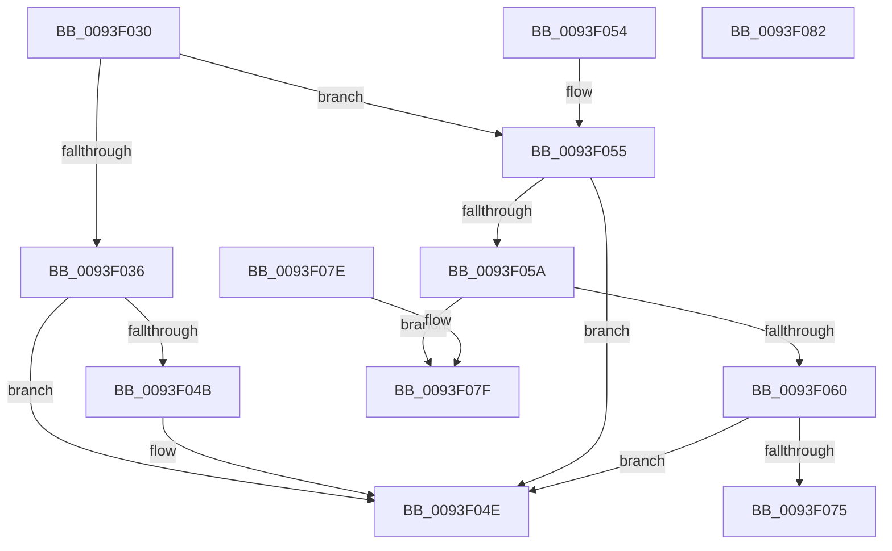

# MiDoSingleFixup

- RVA: `0x0093F030`–`0x0093F083` (길이 `83` bytes)
- VA: `0x000000014093F030`
- 실행 섹션: `PAGE`
- PDB 이름 있음: `예`; PDB Function 태그: `아니요`
- unwind 정보 RVA: `0x000DB714`
- 디코드: `29`개 명령, `83/83` bytes 표시
- 미해석 바이트: `0` (있으면 어셈블리에 `.byte`로 보존)

> 이 문서는 커널 이미지의 기계어와 PDB 기호를 분석해 생성했습니다. 4번과 5번은 함수 원형과 자료형을 바이너리 사용 방식에서 추정한 C 해석이며 원본 소스 복구 결과는 아닙니다.

## 1. Dependencies

- 직접 호출 지점: **0**; 고유 호출 대상: **0**
- 직접 호출자로 확인된 함수: **1**
- RIP 상대 이미지 참조: **0**

### Outgoing calls
- 직접 디코드된 call 명령이 없습니다.

### Direct callers
- [MiApplyRawFixups](MiApplyRawFixups_function_0093EF98.md) at `0x0093EFF1`

### Static image references
- 디코드된 RIP-relative 메모리 참조가 없습니다.

## 2. Other-region calls and transfers

- 다른 실행 섹션으로 향하는 call: **0**
- 별도 외부 분기/꼬리 이동을 확인하지 못했습니다.

## 3. Assembly (complete function range)

```asm
0093F030  66 83 FA 0A                     cmp dx, 0xa
0093F034  75 1F                           jne 0x14093f055
0093F036  BA FF 0F 00 00                  mov edx, 0xfff
0093F03B  0F B7 C1                        movzx eax, cx
0093F03E  66 23 C2                        and ax, dx
0093F041  BA F8 0F 00 00                  mov edx, 0xff8
0093F046  66 3B C2                        cmp ax, dx
0093F049  77 03                           ja 0x14093f04e
0093F04B  4C 01 01                        add qword ptr [rcx], r8
0093F04E  B8 01 00 00 00                  mov eax, 1
0093F053  C3                              ret
0093F054  CC                              int3
0093F055  66 85 D2                        test dx, dx
0093F058  74 F4                           je 0x14093f04e
0093F05A  66 83 FA 03                     cmp dx, 3
0093F05E  75 1F                           jne 0x14093f07f
0093F060  BA FF 0F 00 00                  mov edx, 0xfff
0093F065  0F B7 C1                        movzx eax, cx
0093F068  66 23 C2                        and ax, dx
0093F06B  BA FC 0F 00 00                  mov edx, 0xffc
0093F070  66 3B C2                        cmp ax, dx
0093F073  77 D9                           ja 0x14093f04e
0093F075  44 01 01                        add dword ptr [rcx], r8d
0093F078  B8 01 00 00 00                  mov eax, 1
0093F07D  C3                              ret
0093F07E  CC                              int3
0093F07F  33 C0                           xor eax, eax
0093F081  C3                              ret
0093F082  CC                              int3
```

## 4. C-style interpretation (structured pseudocode)

```c
__int64 __fastcall MiDoSingleFixup(__int64 a1, unsigned __int16 a2, __int64 a3)
{
    __int64 result;

    if (a2 != 10) goto loc_0093F055;
    result = (unsigned __int16)(((unsigned __int16)(a1)) & ((unsigned __int16)((unsigned int)(0xFFFULL))));
    if (((unsigned __int16)(result)) <= ((unsigned __int16)((unsigned int)(0xFF8ULL)))) {
    }
    return 1;
loc_0093F055:
    if ((unsigned __int16)((unsigned int)(0xFF8ULL)) == 0) goto loc_0093F04E;
    if (((unsigned __int16)((unsigned int)(0xFF8ULL))) != 3) goto loc_0093F07F;
    result = (unsigned __int16)(((unsigned __int16)(a1)) & ((unsigned __int16)((unsigned int)(0xFFFULL))));
    if (((unsigned __int16)(result)) > ((unsigned __int16)((unsigned int)(0xFFCULL)))) goto loc_0093F04E;
    return 1;
loc_0093F07F:
    result = 0;
    return result;
}
```

## 5. (Beta) C Style

```c
int64_t MiDoSingleFixup(void *Arg1, uint16_t Arg2, int64_t Arg3)
{
    uint8_t *arg1 = (uint8_t *)Arg1;

    int64_t result;

    if (Arg2 != 10) goto loc_0093F055;
    result = (uint16_t)(((uint16_t)(Arg1)) & ((uint16_t)((uint32_t)(0xFFFULL))));
    if (((uint16_t)(result)) <= ((uint16_t)((uint32_t)(0xFF8ULL)))) {
    }
    return 1;
loc_0093F055:
    if ((uint16_t)((uint32_t)(0xFF8ULL)) == 0) goto loc_0093F04E;
    if (((uint16_t)((uint32_t)(0xFF8ULL))) != 3) goto loc_0093F07F;
    result = (uint16_t)(((uint16_t)(Arg1)) & ((uint16_t)((uint32_t)(0xFFFULL))));
    if (((uint16_t)(result)) > ((uint16_t)((uint32_t)(0xFFCULL)))) goto loc_0093F04E;
    return 1;
loc_0093F07F:
    result = 0;
    return result;
}
```

### 관측된 메모리 오프셋

구조체 형식이 확인되지 않은 접근은 인자 기준의 오프셋으로만 기록했습니다.

| 기준 인자 | 오프셋 표현 | 폭 (bit) | 접근 |
|---|---:|---:|---|
| `Arg1` | `+ 0x0` | `32` | `R/W` |
| `Arg1` | `+ 0x0` | `64` | `R/W` |

## 6. Execution-region graph

[열기: 2D/3D 그래프와 함수 탐색 컨트롤 패널](../../../control-panel.html?section=page&rva=0x0093F030&view=graph)

- 2D 그래프는 위에서 아래로 흐르고, 3D 그래프는 빈 공간을 드래그해 회전합니다. Shift+드래그는 이동, 휠은 확대·축소, 함수 노드 선택은 대상 보고서 이동입니다.

### Static fallback


