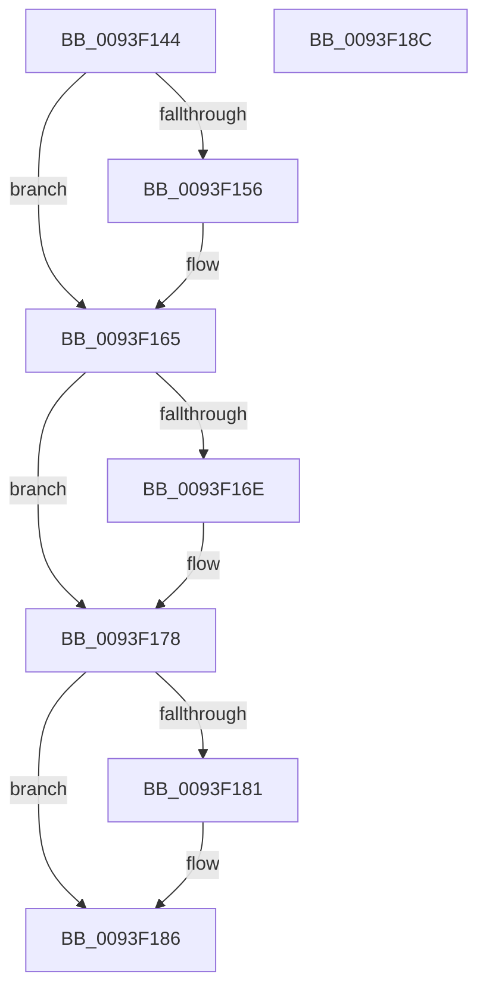

# MiFreeImageLoadConfig

- RVA: `0x0093F144`–`0x0093F18D` (길이 `73` bytes)
- VA: `0x000000014093F144`
- 실행 섹션: `PAGE`
- PDB 이름 있음: `예`; PDB Function 태그: `아니요`
- unwind 정보 RVA: `0x0005CF00`
- 디코드: `22`개 명령, `73/73` bytes 표시
- 미해석 바이트: `0` (있으면 어셈블리에 `.byte`로 보존)

> 이 문서는 커널 이미지의 기계어와 PDB 기호를 분석해 생성했습니다. 4번과 5번은 함수 원형과 자료형을 바이너리 사용 방식에서 추정한 C 해석이며 원본 소스 복구 결과는 아닙니다.

## 1. Dependencies

- 직접 호출 지점: **3**; 고유 호출 대상: **3**
- 직접 호출자로 확인된 함수: **3**
- RIP 상대 이미지 참조: **0**

### Outgoing calls
- `0x0093F15B` → [ExFreePoolWithTag](../../poolcode/B8/ExFreePoolWithTag_function_00B82870.md) (function, `0x00B82870`)
- `0x0093F16E` → [MiFreeRetpolineRelocationInformation](MiFreeRetpolineRelocationInformation_function_0093F194.md) (function, `0x0093F194`)
- `0x0093F181` → [PdcCloseEvent](../8D/PdcCloseEvent_function_008D2404.md) (function, `0x008D2404`)

### Direct callers
- [MiFreeRelocations](MiFreeRelocations_function_0093F08C.md) at `0x0093F0C6`
- [MiParseImageLoadConfig](../94/MiParseImageLoadConfig_function_00940D18.md) at `0x00941449`
- [MiRelocateImage](../98/MiRelocateImage_function_00988E14.md) at `0x00989548`

### Static image references
- 디코드된 RIP-relative 메모리 참조가 없습니다.

## 2. Other-region calls and transfers

- 다른 실행 섹션으로 향하는 call: **1**
  - `0x0093F15B` → [ExFreePoolWithTag](../../poolcode/B8/ExFreePoolWithTag_function_00B82870.md) (`PAGE` → `POOLCODE`)
- 별도 외부 분기/꼬리 이동을 확인하지 못했습니다.

## 3. Assembly (complete function range)

```asm
0093F144  40 53                           push rbx
0093F146  48 83 EC 20                     sub rsp, 0x20
0093F14A  48 8B D9                        mov rbx, rcx
0093F14D  48 8B 49 08                     mov rcx, qword ptr [rcx + 8]
0093F151  48 85 C9                        test rcx, rcx
0093F154  74 0F                           je 0x14093f165
0093F156  BA 52 76 61 4C                  mov edx, 0x4c617652
0093F15B  E8 10 37 24 00                  call 0x140b82870
0093F160  48 83 63 08 00                  and qword ptr [rbx + 8], 0
0093F165  48 8B 4B 10                     mov rcx, qword ptr [rbx + 0x10]
0093F169  48 85 C9                        test rcx, rcx
0093F16C  74 0A                           je 0x14093f178
0093F16E  E8 21 00 00 00                  call 0x14093f194
0093F173  48 83 63 10 00                  and qword ptr [rbx + 0x10], 0
0093F178  48 8B 4B 18                     mov rcx, qword ptr [rbx + 0x18]
0093F17C  48 85 C9                        test rcx, rcx
0093F17F  74 05                           je 0x14093f186
0093F181  E8 7E 32 F9 FF                  call 0x1408d2404
0093F186  48 83 C4 20                     add rsp, 0x20
0093F18A  5B                              pop rbx
0093F18B  C3                              ret
0093F18C  CC                              int3
```

## 4. C-style interpretation (structured pseudocode)

```c
__int64 __fastcall MiFreeImageLoadConfig(__int64 a1)
{
    __int64 result;
    __int64 v_rsp;

    v_rsp = (v_rsp) - (32);
    if (*(unsigned __int64 *)(a1 + 8) != 0) {
        a2 = 0x4C617652ULL;
        result = ExFreePoolWithTag(*(unsigned __int64 *)(a1 + 8), a2, a3, a4);
    }
    if (*(unsigned __int64 *)(a1 + 16) != 0) {
        result = MiFreeRetpolineRelocationInformation(*(unsigned __int64 *)(a1 + 16), a2, a3, a4);
    }
    if (*(unsigned __int64 *)(a1 + 24) != 0) {
        result = PdcCloseEvent(*(unsigned __int64 *)(a1 + 24), a2, a3, a4);
    }
    v_rsp = (v_rsp) + (32);
    return result;
}
```

## 5. (Beta) C Style

```c
int64_t MiFreeImageLoadConfig(void *Arg1)
{
    uint8_t *arg1 = (uint8_t *)Arg1;

    int64_t result;
    int64_t local_rsp;

    local_rsp = (local_rsp) - (32);
    if (*(uint64_t *)(arg1 + 0x8) != 0) {
        a2 = 0x4C617652ULL;
        result = ExFreePoolWithTag(*(uint64_t *)(arg1 + 0x8), a2, a3, a4);
    }
    if (*(uint64_t *)(arg1 + 0x10) != 0) {
        result = MiFreeRetpolineRelocationInformation(*(uint64_t *)(arg1 + 0x10), a2, a3, a4);
    }
    if (*(uint64_t *)(arg1 + 0x18) != 0) {
        result = PdcCloseEvent(*(uint64_t *)(arg1 + 0x18), a2, a3, a4);
    }
    local_rsp = (local_rsp) + (32);
    return result;
}
```

### 관측된 메모리 오프셋

구조체 형식이 확인되지 않은 접근은 인자 기준의 오프셋으로만 기록했습니다.

| 기준 인자 | 오프셋 표현 | 폭 (bit) | 접근 |
|---|---:|---:|---|
| `Arg1` | `+ 0x8` | `64` | `R` |
| `Arg1` | `+ 0x8` | `64` | `R/W` |
| `Arg1` | `+ 0x10` | `64` | `R` |
| `Arg1` | `+ 0x10` | `64` | `R/W` |
| `Arg1` | `+ 0x18` | `64` | `R` |

## 6. Execution-region graph

[열기: 2D/3D 그래프와 함수 탐색 컨트롤 패널](../../../control-panel.html?section=page&rva=0x0093F144&view=graph)

- 2D 그래프는 위에서 아래로 흐르고, 3D 그래프는 빈 공간을 드래그해 회전합니다. Shift+드래그는 이동, 휠은 확대·축소, 함수 노드 선택은 대상 보고서 이동입니다.

### Static fallback


