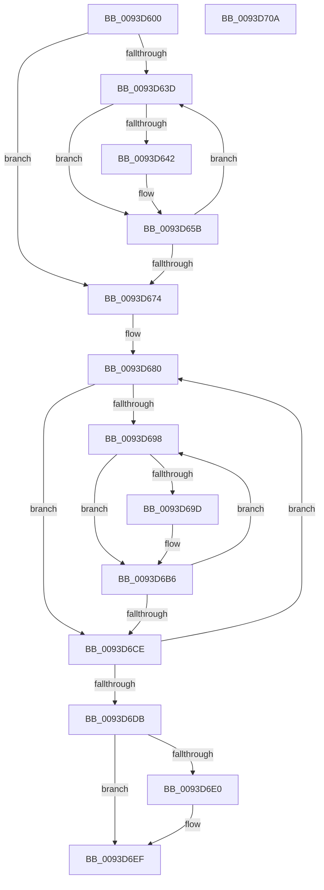

# MiFreeReadListPages

- RVA: `0x0093D600`–`0x0093D70B` (길이 `267` bytes)
- VA: `0x000000014093D600`
- 실행 섹션: `PAGE`
- PDB 이름 있음: `예`; PDB Function 태그: `아니요`
- unwind 정보 RVA: `0x0006D984`
- 디코드: `72`개 명령, `267/267` bytes 표시
- 미해석 바이트: `0` (있으면 어셈블리에 `.byte`로 보존)

> 이 문서는 커널 이미지의 기계어와 PDB 기호를 분석해 생성했습니다. 4번과 5번은 함수 원형과 자료형을 바이너리 사용 방식에서 추정한 C 해석이며 원본 소스 복구 결과는 아닙니다.

## 1. Dependencies

- 직접 호출 지점: **9**; 고유 호출 대상: **4**
- 직접 호출자로 확인된 함수: **2**
- RIP 상대 이미지 참조: **1**

### Outgoing calls
- `0x0093D624` → [MiGetAwePageSize](../../text/46/MiGetAwePageSize_function_0046CFA8.md) (function, `0x0046CFA8`)
- `0x0093D630` → [MiUnlinkPageChainHead](../../text/36/MiUnlinkPageChainHead_function_00365C40.md) (function, `0x00365C40`)
- `0x0093D65E` → [MiReleaseFreshPage](../../text/33/MiReleaseFreshPage_function_00334AE0.md) (function, `0x00334AE0`)
- `0x0093D667` → [MiUnlinkPageChainHead](../../text/36/MiUnlinkPageChainHead_function_00365C40.md) (function, `0x00365C40`)
- `0x0093D683` → [MiGetAwePageSize](../../text/46/MiGetAwePageSize_function_0046CFA8.md) (function, `0x0046CFA8`)
- `0x0093D68B` → [MiUnlinkPageChainHead](../../text/36/MiUnlinkPageChainHead_function_00365C40.md) (function, `0x00365C40`)
- `0x0093D6B9` → [MiReleaseFreshPage](../../text/33/MiReleaseFreshPage_function_00334AE0.md) (function, `0x00334AE0`)
- `0x0093D6C1` → [MiUnlinkPageChainHead](../../text/36/MiUnlinkPageChainHead_function_00365C40.md) (function, `0x00365C40`)
- `0x0093D6EA` → [MiReturnFaultCharges](../../text/36/MiReturnFaultCharges_function_0036D928.md) (function, `0x0036D928`)

### Direct callers
- [MiPfPutPagesInTransition](../../text/36/MiPfPutPagesInTransition_function_003640EC.md) at `0x00364864`
- [MiReleaseReadListResources](MiReleaseReadListResources_function_0093D570.md) at `0x0093D586`

### Static image references
- `0x0093D646` → RVA `0x00E30088` (`.data`; read)

## 2. Other-region calls and transfers

- 다른 실행 섹션으로 향하는 call: **9**
  - `0x0093D624` → [MiGetAwePageSize](../../text/46/MiGetAwePageSize_function_0046CFA8.md) (`PAGE` → `.text`)
  - `0x0093D630` → [MiUnlinkPageChainHead](../../text/36/MiUnlinkPageChainHead_function_00365C40.md) (`PAGE` → `.text`)
  - `0x0093D65E` → [MiReleaseFreshPage](../../text/33/MiReleaseFreshPage_function_00334AE0.md) (`PAGE` → `.text`)
  - `0x0093D667` → [MiUnlinkPageChainHead](../../text/36/MiUnlinkPageChainHead_function_00365C40.md) (`PAGE` → `.text`)
  - `0x0093D683` → [MiGetAwePageSize](../../text/46/MiGetAwePageSize_function_0046CFA8.md) (`PAGE` → `.text`)
  - `0x0093D68B` → [MiUnlinkPageChainHead](../../text/36/MiUnlinkPageChainHead_function_00365C40.md) (`PAGE` → `.text`)
  - `0x0093D6B9` → [MiReleaseFreshPage](../../text/33/MiReleaseFreshPage_function_00334AE0.md) (`PAGE` → `.text`)
  - `0x0093D6C1` → [MiUnlinkPageChainHead](../../text/36/MiUnlinkPageChainHead_function_00365C40.md) (`PAGE` → `.text`)
  - `0x0093D6EA` → [MiReturnFaultCharges](../../text/36/MiReturnFaultCharges_function_0036D928.md) (`PAGE` → `.text`)
- 별도 외부 분기/꼬리 이동을 확인하지 못했습니다.

## 3. Assembly (complete function range)

```asm
0093D600  48 89 5C 24 08                  mov qword ptr [rsp + 8], rbx
0093D605  48 89 6C 24 10                  mov qword ptr [rsp + 0x10], rbp
0093D60A  48 89 74 24 18                  mov qword ptr [rsp + 0x18], rsi
0093D60F  48 89 7C 24 20                  mov qword ptr [rsp + 0x20], rdi
0093D614  41 56                           push r14
0093D616  48 83 EC 20                     sub rsp, 0x20
0093D61A  48 8B F1                        mov rsi, rcx
0093D61D  45 33 F6                        xor r14d, r14d
0093D620  48 83 C1 28                     add rcx, 0x28
0093D624  E8 7F F9 B2 FF                  call 0x14046cfa8
0093D629  48 8D 4E 28                     lea rcx, [rsi + 0x28]
0093D62D  48 8B F8                        mov rdi, rax
0093D630  E8 0B 86 A2 FF                  call 0x140365c40
0093D635  4C 8B C0                        mov r8, rax
0093D638  48 85 C0                        test rax, rax
0093D63B  74 37                           je 0x14093d674
0093D63D  4D 85 F6                        test r14, r14
0093D640  75 19                           jne 0x14093d65b
0093D642  49 8B 48 28                     mov rcx, qword ptr [r8 + 0x28]
0093D646  48 8B 05 3B 2A 4F 00            mov rax, qword ptr [rip + 0x4f2a3b]
0093D64D  48 C1 E9 2B                     shr rcx, 0x2b
0093D651  81 E1 FF 03 00 00               and ecx, 0x3ff
0093D657  4C 8B 34 C8                     mov r14, qword ptr [rax + rcx*8]
0093D65B  49 8B C8                        mov rcx, r8
0093D65E  E8 7D 74 9F FF                  call 0x140334ae0
0093D663  48 8D 4E 28                     lea rcx, [rsi + 0x28]
0093D667  E8 D4 85 A2 FF                  call 0x140365c40
0093D66C  4C 8B C0                        mov r8, rax
0093D66F  48 85 C0                        test rax, rax
0093D672  75 C9                           jne 0x14093d63d
0093D674  48 8D 5E 40                     lea rbx, [rsi + 0x40]
0093D678  BE 05 00 00 00                  mov esi, 5
0093D67D  0F 1F 00                        nop dword ptr [rax]
0093D680  48 8B CB                        mov rcx, rbx
0093D683  E8 20 F9 B2 FF                  call 0x14046cfa8
0093D688  48 8B E8                        mov rbp, rax
0093D68B  E8 B0 85 A2 FF                  call 0x140365c40
0093D690  4C 8B C0                        mov r8, rax
0093D693  48 85 C0                        test rax, rax
0093D696  74 36                           je 0x14093d6ce
0093D698  4D 85 F6                        test r14, r14
0093D69B  75 19                           jne 0x14093d6b6
0093D69D  49 8B 48 28                     mov rcx, qword ptr [r8 + 0x28]
0093D6A1  48 8B 05 E0 29 4F 00            mov rax, qword ptr [rip + 0x4f29e0]
0093D6A8  48 C1 E9 2B                     shr rcx, 0x2b
0093D6AC  81 E1 FF 03 00 00               and ecx, 0x3ff
0093D6B2  4C 8B 34 C8                     mov r14, qword ptr [rax + rcx*8]
0093D6B6  49 8B C8                        mov rcx, r8
0093D6B9  E8 22 74 9F FF                  call 0x140334ae0
0093D6BE  48 8B CB                        mov rcx, rbx
0093D6C1  E8 7A 85 A2 FF                  call 0x140365c40
0093D6C6  4C 8B C0                        mov r8, rax
0093D6C9  48 85 C0                        test rax, rax
0093D6CC  75 CA                           jne 0x14093d698
0093D6CE  48 03 FD                        add rdi, rbp
0093D6D1  48 83 C3 18                     add rbx, 0x18
0093D6D5  48 83 EE 01                     sub rsi, 1
0093D6D9  75 A5                           jne 0x14093d680
0093D6DB  48 85 FF                        test rdi, rdi
0093D6DE  74 0F                           je 0x14093d6ef
0093D6E0  44 8D 46 01                     lea r8d, [rsi + 1]
0093D6E4  48 8B D7                        mov rdx, rdi
0093D6E7  49 8B CE                        mov rcx, r14
0093D6EA  E8 39 02 A3 FF                  call 0x14036d928
0093D6EF  48 8B 5C 24 30                  mov rbx, qword ptr [rsp + 0x30]
0093D6F4  48 8B 6C 24 38                  mov rbp, qword ptr [rsp + 0x38]
0093D6F9  48 8B 74 24 40                  mov rsi, qword ptr [rsp + 0x40]
0093D6FE  48 8B 7C 24 48                  mov rdi, qword ptr [rsp + 0x48]
0093D703  48 83 C4 20                     add rsp, 0x20
0093D707  41 5E                           pop r14
0093D709  C3                              ret
0093D70A  CC                              int3
```

## 4. C-style interpretation (structured pseudocode)

```c
__int64 __fastcall MiFreeReadListPages(__int64 a1)
{
    __int64 result;
    __int64 v_r14;
    __int64 v_rbx;
    __int64 v_rdi;
    __int64 v_rsi;
    __int64 v_rsp;
    unsigned __int64 v_stack_p10;
    unsigned __int64 v_stack_p18;
    unsigned __int64 v_stack_p20;
    unsigned __int64 v_stack_p8;

    v_stack_p8 = v_rbx;
    v_stack_p10 = v_rbp;
    v_stack_p18 = v_rsi;
    v_stack_p20 = v_rdi;
    v_rsp = (v_rsp) - (32);
    v_r14 = 0;
    a1 = (a1) + (40);
    result = MiGetAwePageSize(a1, a2, a3, a4);
    result = MiUnlinkPageChainHead(a1 + 40, a2, a3, a4);
    if (result == 0) goto loc_0093D674;
loc_0093D63D:
    if (0 == 0) {
        a1 = *(unsigned __int64 *)(result + 40);
        result = *(unsigned __int64 *)(v_rip + 5188155);
        a1 = (a1) >> (43);
        a1 = (unsigned int)((a1) & (0x3FFULL));
        v_r14 = *(unsigned __int64 *)(result + a1 * 8);
    }
    result = MiReleaseFreshPage(result, a2, result, a4);
    result = MiUnlinkPageChainHead(a1 + 40, a2, result, a4);
    if (result != 0) goto loc_0093D63D;
loc_0093D674:
loc_0093D680:
    result = MiGetAwePageSize(a1 + 64, a2, result, a4);
    result = MiUnlinkPageChainHead(a1 + 64, a2, result, a4);
    if (result == 0) goto loc_0093D6CE;
loc_0093D698:
    if (v_r14 == 0) {
        a1 = *(unsigned __int64 *)(result + 40);
        result = *(unsigned __int64 *)(v_rip + 5188064);
        a1 = (a1) >> (43);
        a1 = (unsigned int)((a1) & (0x3FFULL));
        v_r14 = *(unsigned __int64 *)(result + a1 * 8);
    }
    result = MiReleaseFreshPage(result, a2, result, a4);
    result = MiUnlinkPageChainHead(a1 + 64, a2, result, a4);
    if (result != 0) goto loc_0093D698;
loc_0093D6CE:
    v_rdi = (result) + (result);
    v_rbx = (a1 + 64) + (24);
    v_rsi = (5) - (1);
    if (condition_is_not_equal) goto loc_0093D680;
    if (v_rdi != 0) {
        a3 = v_rsi + 1;
        a2 = v_rdi;
        a1 = v_r14;
        result = MiReturnFaultCharges(a1, a2, a3, a4);
    }
    v_rsp = (v_rsp) + (32);
    return result;
}
```

## 5. (Beta) C Style

```c
int64_t MiFreeReadListPages(void *Arg1)
{
    uint8_t *arg1 = (uint8_t *)Arg1;

    int64_t result;
    int64_t local_r14;
    int64_t local_rbx;
    int64_t local_rdi;
    int64_t local_rsi;
    int64_t local_rsp;
    uint64_t v_stack_p10;
    uint64_t v_stack_p18;
    uint64_t v_stack_p20;
    uint64_t v_stack_p8;

    v_stack_p8 = local_rbx;
    v_stack_p10 = local_rbp;
    v_stack_p18 = local_rsi;
    v_stack_p20 = local_rdi;
    local_rsp = (local_rsp) - (32);
    local_r14 = 0;
    Arg1 = (Arg1) + (40);
    result = MiGetAwePageSize(Arg1, a2, a3, a4);
    result = MiUnlinkPageChainHead(Arg1 + 40, a2, a3, a4);
    if (result == 0) goto loc_0093D674;
loc_0093D63D:
    if (0 == 0) {
        Arg1 = *(uint64_t *)(result + 0x28);
        result = *(uint64_t *)(v_rip + 0x4F2A3B);
        Arg1 = (Arg1) >> (43);
        Arg1 = (uint32_t)((Arg1) & (0x3FFULL));
        local_r14 = *(uint64_t *)(result + arg1 * 8);
    }
    result = MiReleaseFreshPage(result, a2, result, a4);
    result = MiUnlinkPageChainHead(Arg1 + 40, a2, result, a4);
    if (result != 0) goto loc_0093D63D;
loc_0093D674:
loc_0093D680:
    result = MiGetAwePageSize(Arg1 + 64, a2, result, a4);
    result = MiUnlinkPageChainHead(Arg1 + 64, a2, result, a4);
    if (result == 0) goto loc_0093D6CE;
loc_0093D698:
    if (local_r14 == 0) {
        Arg1 = *(uint64_t *)(result + 0x28);
        result = *(uint64_t *)(v_rip + 0x4F29E0);
        Arg1 = (Arg1) >> (43);
        Arg1 = (uint32_t)((Arg1) & (0x3FFULL));
        local_r14 = *(uint64_t *)(result + arg1 * 8);
    }
    result = MiReleaseFreshPage(result, a2, result, a4);
    result = MiUnlinkPageChainHead(Arg1 + 64, a2, result, a4);
    if (result != 0) goto loc_0093D698;
loc_0093D6CE:
    local_rdi = (result) + (result);
    local_rbx = (Arg1 + 64) + (24);
    local_rsi = (5) - (1);
    if (condition_is_not_equal) goto loc_0093D680;
    if (local_rdi != 0) {
        a3 = local_rsi + 1;
        a2 = local_rdi;
        Arg1 = local_r14;
        result = MiReturnFaultCharges(Arg1, a2, a3, a4);
    }
    local_rsp = (local_rsp) + (32);
    return result;
}
```

### 관측된 메모리 오프셋

구조체 형식이 확인되지 않은 접근은 인자 기준의 오프셋으로만 기록했습니다.

| 기준 인자 | 오프셋 표현 | 폭 (bit) | 접근 |
|---|---:|---:|---|
| `Arg1` | `+ 0x28` | `64` | `R` |
| `Arg1` | `+ 0x40` | `64` | `R` |

## 6. Execution-region graph

[열기: 2D/3D 그래프와 함수 탐색 컨트롤 패널](../../../control-panel.html?section=page&rva=0x0093D600&view=graph)

- 2D 그래프는 위에서 아래로 흐르고, 3D 그래프는 빈 공간을 드래그해 회전합니다. Shift+드래그는 이동, 휠은 확대·축소, 함수 노드 선택은 대상 보고서 이동입니다.

### Static fallback


