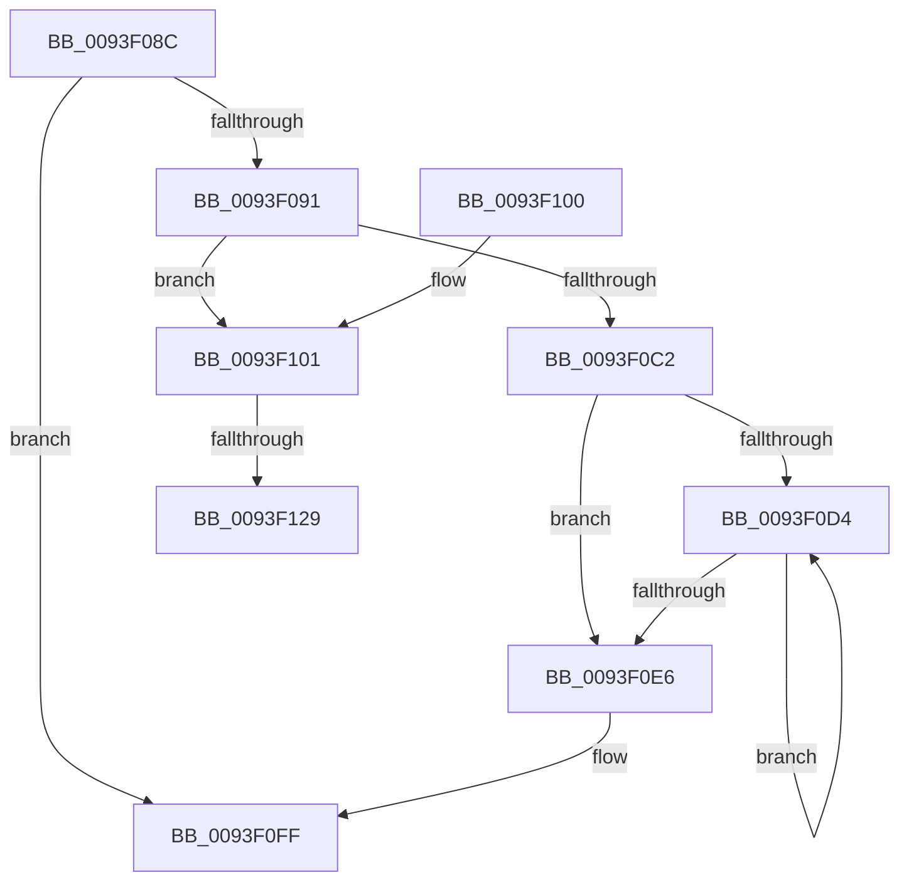

# MiFreeRelocations

- RVA: `0x0093F08C`–`0x0093F13D` (길이 `177` bytes)
- VA: `0x000000014093F08C`
- 실행 섹션: `PAGE`
- PDB 이름 있음: `예`; PDB Function 태그: `예`
- unwind 정보 RVA: `0x000900B8`
- 디코드: `51`개 명령, `177/177` bytes 표시
- 미해석 바이트: `0` (있으면 어셈블리에 `.byte`로 보존)

> 이 문서는 커널 이미지의 기계어와 PDB 기호를 분석해 생성했습니다. 4번과 5번은 함수 원형과 자료형을 바이너리 사용 방식에서 추정한 C 해석이며 원본 소스 복구 결과는 아닙니다.

## 1. Dependencies

- 직접 호출 지점: **3**; 고유 호출 대상: **2**
- 직접 호출자로 확인된 함수: **2**
- RIP 상대 이미지 참조: **0**

### Outgoing calls
- `0x0093F0C6` → [MiFreeImageLoadConfig](MiFreeImageLoadConfig_function_0093F144.md) (function, `0x0093F144`)
- `0x0093F0D9` → [ExFreePoolWithTag](../../poolcode/B8/ExFreePoolWithTag_function_00B82870.md) (function, `0x00B82870`)
- `0x0093F0EB` → [ExFreePoolWithTag](../../poolcode/B8/ExFreePoolWithTag_function_00B82870.md) (function, `0x00B82870`)

### Direct callers
- [MiDeleteControlArea](../../text/36/MiDeleteControlArea_function_003691F4.md) at `0x00369328`
- [MiRelocateImage](../98/MiRelocateImage_function_00988E14.md) at `0x009893D4`

### Static image references
- 디코드된 RIP-relative 메모리 참조가 없습니다.

## 2. Other-region calls and transfers

- 다른 실행 섹션으로 향하는 call: **2**
  - `0x0093F0D9` → [ExFreePoolWithTag](../../poolcode/B8/ExFreePoolWithTag_function_00B82870.md) (`PAGE` → `POOLCODE`)
  - `0x0093F0EB` → [ExFreePoolWithTag](../../poolcode/B8/ExFreePoolWithTag_function_00B82870.md) (`PAGE` → `POOLCODE`)
- call이 아닌 외부 분기/꼬리 이동: **2**
  - `0x0093F123` → [sub_00B25330](../B2/Unknown_function_00B25330.md) (`tail-transfer`)
  - `0x0093F138` → [sub_00B25330 + 0x5](../B2/Unknown_function_00B25330.md) (`tail-transfer`)

## 3. Assembly (complete function range)

```asm
0093F08C  48 85 D2                        test rdx, rdx
0093F08F  74 6E                           je 0x14093f0ff
0093F091  48 89 5C 24 08                  mov qword ptr [rsp + 8], rbx
0093F096  48 89 74 24 10                  mov qword ptr [rsp + 0x10], rsi
0093F09B  57                              push rdi
0093F09C  48 83 EC 40                     sub rsp, 0x40
0093F0A0  33 C0                           xor eax, eax
0093F0A2  BE FF FF FF FF                  mov esi, 0xffffffff
0093F0A7  48 89 44 24 30                  mov qword ptr [rsp + 0x30], rax
0093F0AC  0F 57 C0                        xorps xmm0, xmm0
0093F0AF  8B 41 58                        mov eax, dword ptr [rcx + 0x58]
0093F0B2  48 8B FA                        mov rdi, rdx
0093F0B5  48 8B D9                        mov rbx, rcx
0093F0B8  0F 11 44 24 20                  movups xmmword ptr [rsp + 0x20], xmm0
0093F0BD  48 3B C6                        cmp rax, rsi
0093F0C0  75 3F                           jne 0x14093f101
0093F0C2  48 8D 4F 48                     lea rcx, [rdi + 0x48]
0093F0C6  E8 79 00 00 00                  call 0x14093f144
0093F0CB  48 8B 4F 10                     mov rcx, qword ptr [rdi + 0x10]
0093F0CF  48 85 C9                        test rcx, rcx
0093F0D2  74 12                           je 0x14093f0e6
0093F0D4  48 8B 19                        mov rbx, qword ptr [rcx]
0093F0D7  33 D2                           xor edx, edx
0093F0D9  E8 92 37 24 00                  call 0x140b82870
0093F0DE  48 8B CB                        mov rcx, rbx
0093F0E1  48 85 DB                        test rbx, rbx
0093F0E4  75 EE                           jne 0x14093f0d4
0093F0E6  33 D2                           xor edx, edx
0093F0E8  48 8B CF                        mov rcx, rdi
0093F0EB  E8 80 37 24 00                  call 0x140b82870
0093F0F0  48 8B 5C 24 50                  mov rbx, qword ptr [rsp + 0x50]
0093F0F5  48 8B 74 24 58                  mov rsi, qword ptr [rsp + 0x58]
0093F0FA  48 83 C4 40                     add rsp, 0x40
0093F0FE  5F                              pop rdi
0093F0FF  C3                              ret
0093F100  CC                              int3
0093F101  8B 49 5C                        mov ecx, dword ptr [rcx + 0x5c]
0093F104  48 89 44 24 20                  mov qword ptr [rsp + 0x20], rax
0093F109  0F B7 C1                        movzx eax, cx
0093F10C  89 44 24 28                     mov dword ptr [rsp + 0x28], eax
0093F110  8B C1                           mov eax, ecx
0093F112  C1 E8 14                        shr eax, 0x14
0093F115  83 E0 03                        and eax, 3
0093F118  F7 43 38 00 00 00 20            test dword ptr [rbx + 0x38], 0x20000000
0093F11F  89 44 24 30                     mov dword ptr [rsp + 0x30], eax
0093F123  0F 84 07 62 1E 00               je 0x140b25330
0093F129  C1 E9 10                        shr ecx, 0x10
0093F12C  80 E1 01                        and cl, 1
0093F12F  C6 44 24 2C 01                  mov byte ptr [rsp + 0x2c], 1
0093F134  88 4C 24 2D                     mov byte ptr [rsp + 0x2d], cl
0093F138  E9 F8 61 1E 00                  jmp 0x140b25335
```

## 4. C-style interpretation (structured pseudocode)

```c
__int64 __fastcall MiFreeRelocations(__int64 a1, __int64 a2)
{
    __int64 result;
    __int64 v_rsp;
    unsigned __int64 v_stack_m18;
    unsigned __int64 v_stack_m28;
    unsigned __int64 v_stack_p10;
    unsigned __int64 v_stack_p20;
    unsigned int v_stack_p28;
    unsigned __int8 v_stack_p2C;
    unsigned __int8 v_stack_p2D;
    unsigned int v_stack_p30;
    unsigned __int64 v_stack_p8;

    if (a2 == 0) goto loc_0093F0FF;
    v_stack_p8 = v_rbx;
    v_stack_p10 = v_rsi;
    v_rsp = (v_rsp) - (64);
    result = 0;
    v_stack_m18 = 0;
    v_stack_m28 = v_xmm0;
    if (((unsigned int)(*(unsigned int *)(a1 + 88))) != ((unsigned int)(0xFFFFFFFFULL))) goto loc_0093F101;
    result = MiFreeImageLoadConfig(a2 + 72, a2, a3, a4);
    if (*(unsigned __int64 *)(a2 + 16) == 0) goto loc_0093F0E6;
loc_0093F0D4:
    a2 = 0;
    result = ExFreePoolWithTag(*(unsigned __int64 *)(a2 + 16), a2, a3, a4);
    if (*(unsigned __int64 *)(*(unsigned __int64 *)(a2 + 16)) != 0) goto loc_0093F0D4;
loc_0093F0E6:
    a2 = 0;
    result = ExFreePoolWithTag(0, a2, a3, a4);
    v_rsp = (v_rsp) + (64);
loc_0093F0FF:
    return result;
loc_0093F101:
    v_stack_p20 = result;
    v_stack_p28 = (unsigned int)((unsigned __int16)((unsigned int)(*(unsigned int *)(0 + 92))));
    result = (unsigned int)(((unsigned int)((unsigned int)((unsigned int)(*(unsigned int *)(0 + 92))))) >> (20));
    result = (unsigned int)((result) & (3));
    v_stack_p30 = (unsigned int)(result);
    a1 = (unsigned int)(((unsigned int)(*(unsigned int *)(0 + 92))) >> (16));
    a1 = (unsigned __int8)((a1) & (1));
    v_stack_p2C = 1;
    v_stack_p2D = (unsigned __int8)(a1);
}
```

## 5. (Beta) C Style

```c
int64_t MiFreeRelocations(void *Arg1, int64_t Arg2)
{
    uint8_t *arg1 = (uint8_t *)Arg1;

    int64_t result;
    int64_t local_rsp;
    uint64_t v_stack_m18;
    uint64_t v_stack_m28;
    uint64_t v_stack_p10;
    uint64_t v_stack_p20;
    uint32_t v_stack_p28;
    uint8_t v_stack_p2C;
    uint8_t v_stack_p2D;
    uint32_t v_stack_p30;
    uint64_t v_stack_p8;

    if (Arg2 == 0) goto loc_0093F0FF;
    v_stack_p8 = local_rbx;
    v_stack_p10 = local_rsi;
    local_rsp = (local_rsp) - (64);
    result = 0;
    v_stack_m18 = 0;
    v_stack_m28 = v_xmm0;
    if (((uint32_t)(*(uint32_t *)(arg1 + 0x58))) != ((uint32_t)(0xFFFFFFFFULL))) goto loc_0093F101;
    result = MiFreeImageLoadConfig(Arg2 + 72, Arg2, a3, a4);
    if (*(uint64_t *)(Arg2 + 0x10) == 0) goto loc_0093F0E6;
loc_0093F0D4:
    Arg2 = 0;
    result = ExFreePoolWithTag(*(uint64_t *)(Arg2 + 0x10), Arg2, a3, a4);
    if (*(uint64_t *)(*(uint64_t *)(Arg2 + 0x10)) != 0) goto loc_0093F0D4;
loc_0093F0E6:
    Arg2 = 0;
    result = ExFreePoolWithTag(0, Arg2, a3, a4);
    local_rsp = (local_rsp) + (64);
loc_0093F0FF:
    return result;
loc_0093F101:
    v_stack_p20 = result;
    v_stack_p28 = (uint32_t)((uint16_t)((uint32_t)(*(uint32_t *)(0 + 0x5C))));
    result = (uint32_t)(((uint32_t)((uint32_t)((uint32_t)(*(uint32_t *)(0 + 0x5C))))) >> (20));
    result = (uint32_t)((result) & (3));
    v_stack_p30 = (uint32_t)(result);
    Arg1 = (uint32_t)(((uint32_t)(*(uint32_t *)(0 + 0x5C))) >> (16));
    Arg1 = (uint8_t)((Arg1) & (1));
    v_stack_p2C = 1;
    v_stack_p2D = (uint8_t)(Arg1);
}
```

### 관측된 메모리 오프셋

구조체 형식이 확인되지 않은 접근은 인자 기준의 오프셋으로만 기록했습니다.

| 기준 인자 | 오프셋 표현 | 폭 (bit) | 접근 |
|---|---:|---:|---|
| `Arg1` | `+ 0x38` | `32` | `R` |
| `Arg1` | `+ 0x58` | `32` | `R` |
| `Arg1` | `+ 0x5C` | `32` | `R` |

## 6. Execution-region graph

[열기: 2D/3D 그래프와 함수 탐색 컨트롤 패널](../../../control-panel.html?section=page&rva=0x0093F08C&view=graph)

- 2D 그래프는 위에서 아래로 흐르고, 3D 그래프는 빈 공간을 드래그해 회전합니다. Shift+드래그는 이동, 휠은 확대·축소, 함수 노드 선택은 대상 보고서 이동입니다.

### Static fallback


