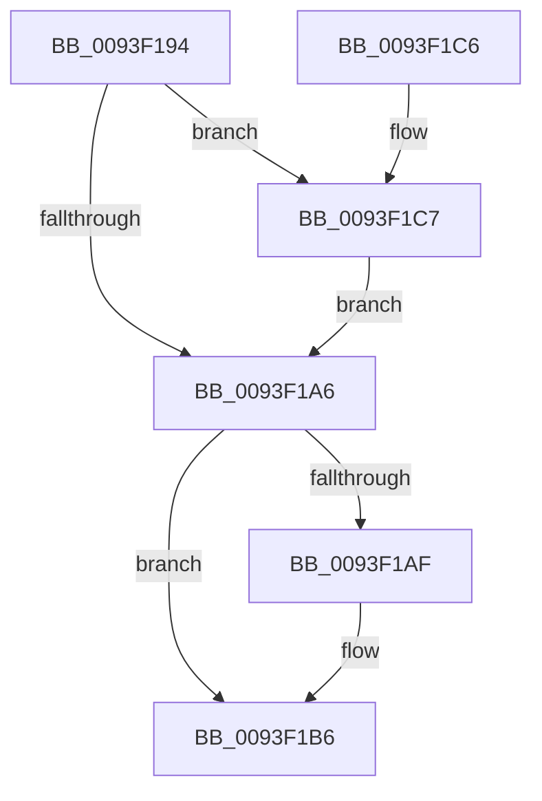

# MiFreeRetpolineRelocationInformation

- RVA: `0x0093F194`–`0x0093F1D0` (길이 `60` bytes)
- VA: `0x000000014093F194`
- 실행 섹션: `PAGE`
- PDB 이름 있음: `예`; PDB Function 태그: `아니요`
- unwind 정보 RVA: `0x00060BD8`
- 디코드: `21`개 명령, `60/60` bytes 표시
- 미해석 바이트: `0` (있으면 어셈블리에 `.byte`로 보존)

> 이 문서는 커널 이미지의 기계어와 PDB 기호를 분석해 생성했습니다. 4번과 5번은 함수 원형과 자료형을 바이너리 사용 방식에서 추정한 C 해석이며 원본 소스 복구 결과는 아닙니다.

## 1. Dependencies

- 직접 호출 지점: **3**; 고유 호출 대상: **1**
- 직접 호출자로 확인된 함수: **3**
- RIP 상대 이미지 참조: **0**

### Outgoing calls
- `0x0093F1B1` → [ExFreePoolWithTag](../../poolcode/B8/ExFreePoolWithTag_function_00B82870.md) (function, `0x00B82870`)
- `0x0093F1BB` → [ExFreePoolWithTag](../../poolcode/B8/ExFreePoolWithTag_function_00B82870.md) (function, `0x00B82870`)
- `0x0093F1C9` → [ExFreePoolWithTag](../../poolcode/B8/ExFreePoolWithTag_function_00B82870.md) (function, `0x00B82870`)

### Direct callers
- [MiFreeImageLoadConfig](MiFreeImageLoadConfig_function_0093F144.md) at `0x0093F16E`
- [MiCreateRetpolineRelocationInformation](MiCreateRetpolineRelocationInformation_function_0093FE10.md) at `0x0093FF2A`
- [MiUnloadSystemImage](../AA/MiUnloadSystemImage_function_00AA2FD4.md) at `0x00AA317E`

### Static image references
- 디코드된 RIP-relative 메모리 참조가 없습니다.

## 2. Other-region calls and transfers

- 다른 실행 섹션으로 향하는 call: **3**
  - `0x0093F1B1` → [ExFreePoolWithTag](../../poolcode/B8/ExFreePoolWithTag_function_00B82870.md) (`PAGE` → `POOLCODE`)
  - `0x0093F1BB` → [ExFreePoolWithTag](../../poolcode/B8/ExFreePoolWithTag_function_00B82870.md) (`PAGE` → `POOLCODE`)
  - `0x0093F1C9` → [ExFreePoolWithTag](../../poolcode/B8/ExFreePoolWithTag_function_00B82870.md) (`PAGE` → `POOLCODE`)
- 별도 외부 분기/꼬리 이동을 확인하지 못했습니다.

## 3. Assembly (complete function range)

```asm
0093F194  40 53                           push rbx
0093F196  48 83 EC 20                     sub rsp, 0x20
0093F19A  48 8B D9                        mov rbx, rcx
0093F19D  48 8B 49 10                     mov rcx, qword ptr [rcx + 0x10]
0093F1A1  48 85 C9                        test rcx, rcx
0093F1A4  75 21                           jne 0x14093f1c7
0093F1A6  48 8B 4B 38                     mov rcx, qword ptr [rbx + 0x38]
0093F1AA  48 85 C9                        test rcx, rcx
0093F1AD  74 07                           je 0x14093f1b6
0093F1AF  33 D2                           xor edx, edx
0093F1B1  E8 BA 36 24 00                  call 0x140b82870
0093F1B6  33 D2                           xor edx, edx
0093F1B8  48 8B CB                        mov rcx, rbx
0093F1BB  E8 B0 36 24 00                  call 0x140b82870
0093F1C0  48 83 C4 20                     add rsp, 0x20
0093F1C4  5B                              pop rbx
0093F1C5  C3                              ret
0093F1C6  CC                              int3
0093F1C7  33 D2                           xor edx, edx
0093F1C9  E8 A2 36 24 00                  call 0x140b82870
0093F1CE  EB D6                           jmp 0x14093f1a6
```

## 4. C-style interpretation (structured pseudocode)

```c
__int64 __fastcall MiFreeRetpolineRelocationInformation(__int64 a1, int a2)
{
    __int64 result;
    __int64 v_rsp;

    v_rsp = (v_rsp) - (32);
    if (*(unsigned __int64 *)(a1 + 16) != 0) goto loc_0093F1C7;
loc_0093F1A6:
    if (*(unsigned __int64 *)(a1 + 56) != 0) {
        a2 = 0;
        result = ExFreePoolWithTag(*(unsigned __int64 *)(a1 + 56), a2, a3, a4);
    }
    a2 = 0;
    result = ExFreePoolWithTag(a1, a2, a3, a4);
    v_rsp = (v_rsp) + (32);
    return result;
loc_0093F1C7:
    a2 = 0;
    result = ExFreePoolWithTag(a1, a2, a3, a4);
    goto loc_0093F1A6;
}
```

## 5. (Beta) C Style

```c
int64_t MiFreeRetpolineRelocationInformation(void *Arg1, int32_t Arg2)
{
    uint8_t *arg1 = (uint8_t *)Arg1;

    int64_t result;
    int64_t local_rsp;

    local_rsp = (local_rsp) - (32);
    if (*(uint64_t *)(arg1 + 0x10) != 0) goto loc_0093F1C7;
loc_0093F1A6:
    if (*(uint64_t *)(arg1 + 0x38) != 0) {
        Arg2 = 0;
        result = ExFreePoolWithTag(*(uint64_t *)(arg1 + 0x38), Arg2, a3, a4);
    }
    Arg2 = 0;
    result = ExFreePoolWithTag(Arg1, Arg2, a3, a4);
    local_rsp = (local_rsp) + (32);
    return result;
loc_0093F1C7:
    Arg2 = 0;
    result = ExFreePoolWithTag(Arg1, Arg2, a3, a4);
    goto loc_0093F1A6;
}
```

### 관측된 메모리 오프셋

구조체 형식이 확인되지 않은 접근은 인자 기준의 오프셋으로만 기록했습니다.

| 기준 인자 | 오프셋 표현 | 폭 (bit) | 접근 |
|---|---:|---:|---|
| `Arg1` | `+ 0x10` | `64` | `R` |
| `Arg1` | `+ 0x38` | `64` | `R` |

## 6. Execution-region graph

[열기: 2D/3D 그래프와 함수 탐색 컨트롤 패널](../../../control-panel.html?section=page&rva=0x0093F194&view=graph)

- 2D 그래프는 위에서 아래로 흐르고, 3D 그래프는 빈 공간을 드래그해 회전합니다. Shift+드래그는 이동, 휠은 확대·축소, 함수 노드 선택은 대상 보고서 이동입니다.

### Static fallback


