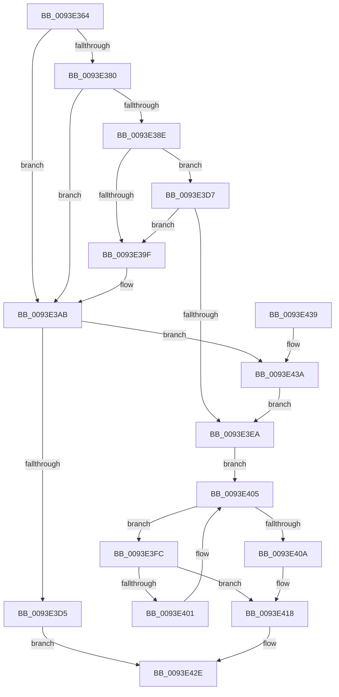

# MiGetCcAccessLog

- RVA: `0x0093E364`–`0x0093E455` (길이 `241` bytes)
- VA: `0x000000014093E364`
- 실행 섹션: `PAGE`
- PDB 이름 있음: `예`; PDB Function 태그: `아니요`
- unwind 정보 RVA: `0x0007CED0`
- 디코드: `66`개 명령, `241/241` bytes 표시
- 미해석 바이트: `0` (있으면 어셈블리에 `.byte`로 보존)

> 이 문서는 커널 이미지의 기계어와 PDB 기호를 분석해 생성했습니다. 4번과 5번은 함수 원형과 자료형을 바이너리 사용 방식에서 추정한 C 해석이며 원본 소스 복구 결과는 아닙니다.

## 1. Dependencies

- 직접 호출 지점: **4**; 고유 호출 대상: **4**
- 직접 호출자로 확인된 함수: **1**
- RIP 상대 이미지 참조: **3**

### Outgoing calls
- `0x0093E3A6` → [MiQueuePageAccessLog](../../text/34/MiQueuePageAccessLog_function_00348EB0.md) (function, `0x00348EB0`)
- `0x0093E3C8` → [MiAllocatePool](../../text/35/MiAllocatePool_function_0035B540.md) (function, `0x0035B540`)
- `0x0093E43C` → [MiGetAnyMultiplexedVm](../../text/44/MiGetAnyMultiplexedVm_function_00448BD0.md) (function, `0x00448BD0`)
- `0x0093E447` → [MiInitializePageAccessLogging](../../text/47/MiInitializePageAccessLogging_function_0047B150.md) (function, `0x0047B150`)

### Direct callers
- [MmPrefetchForCacheManager](MmPrefetchForCacheManager_function_0093D714.md) at `0x0093D8D5`

### Static image references
- `0x0093E36E` → RVA `0x00E3D100` (`.data`; read)
- `0x0093E382` → RVA `0x00E3D100` (`.data`; read/write)
- `0x0093E39F` → RVA `0x00E38D00` (`.data`; read)

## 2. Other-region calls and transfers

- 다른 실행 섹션으로 향하는 call: **4**
  - `0x0093E3A6` → [MiQueuePageAccessLog](../../text/34/MiQueuePageAccessLog_function_00348EB0.md) (`PAGE` → `.text`)
  - `0x0093E3C8` → [MiAllocatePool](../../text/35/MiAllocatePool_function_0035B540.md) (`PAGE` → `.text`)
  - `0x0093E43C` → [MiGetAnyMultiplexedVm](../../text/44/MiGetAnyMultiplexedVm_function_00448BD0.md) (`PAGE` → `.text`)
  - `0x0093E447` → [MiInitializePageAccessLogging](../../text/47/MiInitializePageAccessLogging_function_0047B150.md) (`PAGE` → `.text`)
- 별도 외부 분기/꼬리 이동을 확인하지 못했습니다.

## 3. Assembly (complete function range)

```asm
0093E364  48 89 5C 24 08                  mov qword ptr [rsp + 8], rbx
0093E369  57                              push rdi
0093E36A  48 83 EC 20                     sub rsp, 0x20
0093E36E  48 8B 05 8B ED 4F 00            mov rax, qword ptr [rip + 0x4fed8b]
0093E375  49 8B D8                        mov rbx, r8
0093E378  48 8B FA                        mov rdi, rdx
0093E37B  48 85 C0                        test rax, rax
0093E37E  74 2B                           je 0x14093e3ab
0093E380  33 D2                           xor edx, edx
0093E382  48 87 15 77 ED 4F 00            xchg qword ptr [rip + 0x4fed77], rdx
0093E389  48 85 D2                        test rdx, rdx
0093E38C  74 1D                           je 0x14093e3ab
0093E38E  48 8B 42 20                     mov rax, qword ptr [rdx + 0x20]
0093E392  4C 8B 42 28                     mov r8, qword ptr [rdx + 0x28]
0093E396  48 8D 0C D8                     lea rcx, [rax + rbx*8]
0093E39A  49 3B C8                        cmp rcx, r8
0093E39D  76 38                           jbe 0x14093e3d7
0093E39F  48 8D 0D 5A A9 4F 00            lea rcx, [rip + 0x4fa95a]
0093E3A6  E8 05 AB A0 FF                  call 0x140348eb0
0093E3AB  48 8D 1C DD 4F 10 00 00         lea rbx, [rbx*8 + 0x104f]
0093E3B3  41 B8 4D 6D 41 63               mov r8d, 0x63416d4d
0093E3B9  48 81 E3 00 F0 FF FF            and rbx, 0xfffffffffffff000
0093E3C0  B9 40 00 00 00                  mov ecx, 0x40
0093E3C5  48 8B D3                        mov rdx, rbx
0093E3C8  E8 73 D1 A1 FF                  call 0x14035b540
0093E3CD  48 8B D0                        mov rdx, rax
0093E3D0  48 85 C0                        test rax, rax
0093E3D3  75 65                           jne 0x14093e43a
0093E3D5  EB 57                           jmp 0x14093e42e
0093E3D7  48 8B 42 30                     mov rax, qword ptr [rdx + 0x30]
0093E3DB  49 2B C0                        sub rax, r8
0093E3DE  48 83 E0 F8                     and rax, 0xfffffffffffffff8
0093E3E2  48 3D 00 10 00 00               cmp rax, 0x1000
0093E3E8  7D B5                           jge 0x14093e39f
0093E3EA  48 8B 42 28                     mov rax, qword ptr [rdx + 0x28]
0093E3EE  4C 8B 4F 18                     mov r9, qword ptr [rdi + 0x18]
0093E3F2  4C 8B 42 30                     mov r8, qword ptr [rdx + 0x30]
0093E3F6  48 8D 48 08                     lea rcx, [rax + 8]
0093E3FA  EB 09                           jmp 0x14093e405
0093E3FC  4C 39 09                        cmp qword ptr [rcx], r9
0093E3FF  74 17                           je 0x14093e418
0093E401  48 83 C1 08                     add rcx, 8
0093E405  49 3B C8                        cmp rcx, r8
0093E408  72 F2                           jb 0x14093e3fc
0093E40A  48 8B C8                        mov rcx, rax
0093E40D  48 83 C0 F8                     add rax, -8
0093E411  48 89 42 28                     mov qword ptr [rdx + 0x28], rax
0093E415  4C 89 09                        mov qword ptr [rcx], r9
0093E418  48 8B 42 20                     mov rax, qword ptr [rdx + 0x20]
0093E41C  4C 2B C1                        sub r8, rcx
0093E41F  49 C1 F8 03                     sar r8, 3
0093E423  48 89 42 18                     mov qword ptr [rdx + 0x18], rax
0093E427  48 8B C2                        mov rax, rdx
0093E42A  44 89 42 0C                     mov dword ptr [rdx + 0xc], r8d
0093E42E  48 8B 5C 24 30                  mov rbx, qword ptr [rsp + 0x30]
0093E433  48 83 C4 20                     add rsp, 0x20
0093E437  5F                              pop rdi
0093E438  C3                              ret
0093E439  CC                              int3
0093E43A  33 C9                           xor ecx, ecx
0093E43C  E8 8F A7 B0 FF                  call 0x140448bd0
0093E441  48 8B C8                        mov rcx, rax
0093E444  4C 8B C3                        mov r8, rbx
0093E447  E8 04 CD B3 FF                  call 0x14047b150
0093E44C  C7 42 08 01 00 00 00            mov dword ptr [rdx + 8], 1
0093E453  EB 95                           jmp 0x14093e3ea
```

## 4. C-style interpretation (structured pseudocode)

```c
__int64 __fastcall MiGetCcAccessLog(__int64 a1, __int64 a2, __int64 a3)
{
    __int64 result;
    __int64 v_rbx;
    __int64 v_rsp;
    unsigned __int64 v_stack_p8;

    v_stack_p8 = v_rbx;
    v_rsp = (v_rsp) - (32);
    if (*(unsigned __int64 *)(v_rip + 5238155) == 0) goto loc_0093E3AB;
    a2 = 0;
    if (0 == 0) goto loc_0093E3AB;
    if ((*(unsigned __int64 *)(a2 + 32) + a3 * 8) <= (*(unsigned __int64 *)(a2 + 40))) goto loc_0093E3D7;
loc_0093E39F:
    result = MiQueuePageAccessLog(v_rip + 5220698, a2, *(unsigned __int64 *)(a2 + 40), a4);
loc_0093E3AB:
    v_rbx = (a3 * 8 + 4175) & (0xFFFFFFFFFFFFF000ULL);
    result = MiAllocatePool(64, v_rbx, (unsigned int)(0x63416D4DULL), a4);
    if (result != 0) goto loc_0093E43A;
    goto loc_0093E42E;
loc_0093E3D7:
    result = (*(unsigned __int64 *)(result + 48)) - ((unsigned int)(0x63416D4DULL));
    result = (result) & (-8);
    if (result >= 0x1000ULL) goto loc_0093E39F;
loc_0093E3EA:
    goto loc_0093E405;
loc_0093E3FC:
    if ((*(unsigned __int64 *)(*(unsigned __int64 *)(result + 40) + 8)) == (*(unsigned __int64 *)(a2 + 24))) goto loc_0093E418;
    a1 = (*(unsigned __int64 *)(result + 40) + 8) + (8);
loc_0093E405:
    if (a1 < (*(unsigned __int64 *)(result + 48))) goto loc_0093E3FC;
    result = (*(unsigned __int64 *)(result + 40)) + (-8);
    *(unsigned __int64 *)(result + 40) = result;
    *(unsigned __int64 *)(*(unsigned __int64 *)(result + 40)) = *(unsigned __int64 *)(a2 + 24);
loc_0093E418:
    a3 = (*(unsigned __int64 *)(result + 48)) - (*(unsigned __int64 *)(result + 40));
    a3 = (a3) >> (3);
    *(unsigned __int64 *)(result + 24) = *(unsigned __int64 *)(result + 32);
    *(unsigned int *)(result + 12) = (unsigned int)(a3);
loc_0093E42E:
    v_rsp = (v_rsp) + (32);
    return result;
loc_0093E43A:
    a1 = 0;
    result = MiGetAnyMultiplexedVm(a1, result, a3, *(unsigned __int64 *)(a2 + 24));
    result = MiInitializePageAccessLogging(result, result, v_stack_p8, *(unsigned __int64 *)(a2 + 24));
    *(unsigned int *)(result + 8) = 1;
    goto loc_0093E3EA;
}
```

## 5. (Beta) C Style

```c
int64_t MiGetCcAccessLog(int64_t Arg1, void *Arg2, int64_t Arg3)
{
    uint8_t *arg2 = (uint8_t *)Arg2;

    int64_t result;
    int64_t local_rbx;
    int64_t local_rsp;
    uint64_t v_stack_p8;

    v_stack_p8 = local_rbx;
    local_rsp = (local_rsp) - (32);
    if (*(uint64_t *)(v_rip + 0x4FED8B) == 0) goto loc_0093E3AB;
    Arg2 = 0;
    if (0 == 0) goto loc_0093E3AB;
    if ((*(uint64_t *)(arg2 + 0x20) + Arg3 * 8) <= (*(uint64_t *)(arg2 + 0x28))) goto loc_0093E3D7;
loc_0093E39F:
    result = MiQueuePageAccessLog(v_rip + 5220698, Arg2, *(uint64_t *)(arg2 + 0x28), a4);
loc_0093E3AB:
    local_rbx = (Arg3 * 8 + 4175) & (0xFFFFFFFFFFFFF000ULL);
    result = MiAllocatePool(64, local_rbx, (uint32_t)(0x63416D4DULL), a4);
    if (result != 0) goto loc_0093E43A;
    goto loc_0093E42E;
loc_0093E3D7:
    result = (*(uint64_t *)(result + 0x30)) - ((uint32_t)(0x63416D4DULL));
    result = (result) & (-8);
    if (result >= 0x1000ULL) goto loc_0093E39F;
loc_0093E3EA:
    goto loc_0093E405;
loc_0093E3FC:
    if ((*(uint64_t *)(*(uint64_t *)(result + 0x28) + 0x8)) == (*(uint64_t *)(arg2 + 0x18))) goto loc_0093E418;
    Arg1 = (*(uint64_t *)(result + 0x28) + 8) + (8);
loc_0093E405:
    if (Arg1 < (*(uint64_t *)(result + 0x30))) goto loc_0093E3FC;
    result = (*(uint64_t *)(result + 0x28)) + (-8);
    *(uint64_t *)(result + 0x28) = result;
    *(uint64_t *)(*(uint64_t *)(result + 0x28)) = *(uint64_t *)(arg2 + 0x18);
loc_0093E418:
    Arg3 = (*(uint64_t *)(result + 0x30)) - (*(uint64_t *)(result + 0x28));
    Arg3 = (Arg3) >> (3);
    *(uint64_t *)(result + 0x18) = *(uint64_t *)(result + 0x20);
    *(uint32_t *)(result + 0xC) = (uint32_t)(Arg3);
loc_0093E42E:
    local_rsp = (local_rsp) + (32);
    return result;
loc_0093E43A:
    Arg1 = 0;
    result = MiGetAnyMultiplexedVm(Arg1, result, Arg3, *(uint64_t *)(arg2 + 0x18));
    result = MiInitializePageAccessLogging(result, result, v_stack_p8, *(uint64_t *)(arg2 + 0x18));
    *(uint32_t *)(result + 0x8) = 1;
    goto loc_0093E3EA;
}
```

### 관측된 메모리 오프셋

구조체 형식이 확인되지 않은 접근은 인자 기준의 오프셋으로만 기록했습니다.

| 기준 인자 | 오프셋 표현 | 폭 (bit) | 접근 |
|---|---:|---:|---|
| `Arg2` | `+ 0x18` | `64` | `R` |

## 6. Execution-region graph

[열기: 2D/3D 그래프와 함수 탐색 컨트롤 패널](../../../control-panel.html?section=page&rva=0x0093E364&view=graph)

- 2D 그래프는 위에서 아래로 흐르고, 3D 그래프는 빈 공간을 드래그해 회전합니다. Shift+드래그는 이동, 휠은 확대·축소, 함수 노드 선택은 대상 보고서 이동입니다.

### Static fallback


