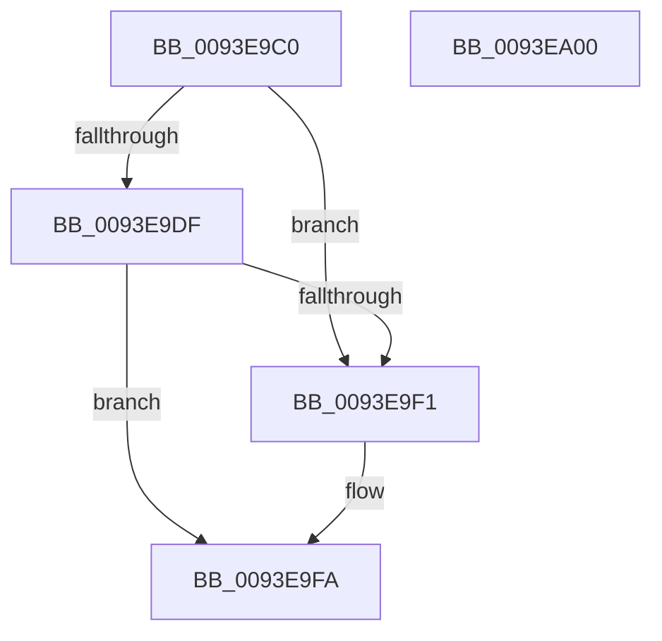

# MiGetSectionStrongImageReference

- RVA: `0x0093E9C0`–`0x0093EA01` (길이 `65` bytes)
- VA: `0x000000014093E9C0`
- 실행 섹션: `PAGE`
- PDB 이름 있음: `예`; PDB Function 태그: `아니요`
- unwind 정보 RVA: `0x0005CF00`
- 디코드: `19`개 명령, `65/65` bytes 표시
- 미해석 바이트: `0` (있으면 어셈블리에 `.byte`로 보존)

> 이 문서는 커널 이미지의 기계어와 PDB 기호를 분석해 생성했습니다. 4번과 5번은 함수 원형과 자료형을 바이너리 사용 방식에서 추정한 C 해석이며 원본 소스 복구 결과는 아닙니다.

## 1. Dependencies

- 직접 호출 지점: **1**; 고유 호출 대상: **1**
- 직접 호출자로 확인된 함수: **6**
- RIP 상대 이미지 참조: **1**

### Outgoing calls
- `0x0093E9E8` → [guard_dispatch_icall](../../text/6B/guard_dispatch_icall_function_006BAAD0.md) (function, `0x006BAAD0`)

### Direct callers
- [MiWalkEntireImage](../../text/36/MiWalkEntireImage_function_00365D70.md) at `0x00365EE8`
- [MiValidateInPage](../../text/38/MiValidateInPage_function_00382E0C.md) at `0x003833AC`
- [MmGetSectionStrongImageReference](../70/MmGetSectionStrongImageReference_function_00701DF0.md) at `0x00701E74`
- [MiApplyDriverHotPatch](../80/MiApplyDriverHotPatch_function_008018EC.md) at `0x00801B8F`
- [MiPromoteControlAreaToStrongCode](../80/MiPromoteControlAreaToStrongCode_function_0080720C.md) at `0x00807254`
- [MiValidateImagePfn](MiValidateImagePfn_function_0093EA08.md) at `0x0093EC80`

### Static image references
- `0x0093E9D3` → RVA `0x00F04EB8` (`.data`; read)

## 2. Other-region calls and transfers

- 다른 실행 섹션으로 향하는 call: **1**
  - `0x0093E9E8` → [guard_dispatch_icall](../../text/6B/guard_dispatch_icall_function_006BAAD0.md) (`PAGE` → `.text`)
- 별도 외부 분기/꼬리 이동을 확인하지 못했습니다.

## 3. Assembly (complete function range)

```asm
0093E9C0  40 53                           push rbx
0093E9C2  48 83 EC 20                     sub rsp, 0x20
0093E9C6  48 83 64 24 38 00               and qword ptr [rsp + 0x38], 0
0093E9CC  48 8B D9                        mov rbx, rcx
0093E9CF  48 8B 49 28                     mov rcx, qword ptr [rcx + 0x28]
0093E9D3  48 8B 05 DE 64 5C 00            mov rax, qword ptr [rip + 0x5c64de]
0093E9DA  48 85 C0                        test rax, rax
0093E9DD  74 12                           je 0x14093e9f1
0093E9DF  48 83 E1 F8                     and rcx, 0xfffffffffffffff8
0093E9E3  48 8D 54 24 38                  lea rdx, [rsp + 0x38]
0093E9E8  E8 E3 C0 D7 FF                  call 0x1406baad0
0093E9ED  85 C0                           test eax, eax
0093E9EF  78 09                           js 0x14093e9fa
0093E9F1  48 8B 4C 24 38                  mov rcx, qword ptr [rsp + 0x38]
0093E9F6  48 89 4B 40                     mov qword ptr [rbx + 0x40], rcx
0093E9FA  48 83 C4 20                     add rsp, 0x20
0093E9FE  5B                              pop rbx
0093E9FF  C3                              ret
0093EA00  CC                              int3
```

## 4. C-style interpretation (structured pseudocode)

```c
__int64 __fastcall MiGetSectionStrongImageReference(__int64 a1)
{
    __int64 result;
    __int64 v_rsp;
    unsigned __int64 v_stack_p10;

    v_rsp = (v_rsp) - (32);
    if (*(unsigned __int64 *)(v_rip + 6055134) == 0) goto loc_0093E9F1;
    a1 = (*(unsigned __int64 *)(a1 + 40)) & (-8);
    result = guard_dispatch_icall(a1, v_stack_p10, a3, a4);
    if (!(sign_flag)) {
        a1 = v_stack_p10;
        *(unsigned __int64 *)(a1 + 64) = a1;
    }
    v_rsp = (v_rsp) + (32);
    return result;
}
```

## 5. (Beta) C Style

```c
int64_t MiGetSectionStrongImageReference(void *Arg1)
{
    uint8_t *arg1 = (uint8_t *)Arg1;

    int64_t result;
    int64_t local_rsp;
    uint64_t v_stack_p10;

    local_rsp = (local_rsp) - (32);
    if (*(uint64_t *)(v_rip + 0x5C64DE) == 0) goto loc_0093E9F1;
    Arg1 = (*(uint64_t *)(arg1 + 0x28)) & (-8);
    result = guard_dispatch_icall(Arg1, v_stack_p10, a3, a4);
    if (!(sign_flag)) {
        Arg1 = v_stack_p10;
        *(void **)(arg1 + 0x40) = Arg1;
    }
    local_rsp = (local_rsp) + (32);
    return result;
}
```

### 관측된 메모리 오프셋

구조체 형식이 확인되지 않은 접근은 인자 기준의 오프셋으로만 기록했습니다.

| 기준 인자 | 오프셋 표현 | 폭 (bit) | 접근 |
|---|---:|---:|---|
| `Arg1` | `+ 0x28` | `64` | `R` |
| `Arg1` | `+ 0x40` | `64` | `W` |

## 6. Execution-region graph

[열기: 2D/3D 그래프와 함수 탐색 컨트롤 패널](../../../control-panel.html?section=page&rva=0x0093E9C0&view=graph)

- 2D 그래프는 위에서 아래로 흐르고, 3D 그래프는 빈 공간을 드래그해 회전합니다. Shift+드래그는 이동, 휠은 확대·축소, 함수 노드 선택은 대상 보고서 이동입니다.

### Static fallback


