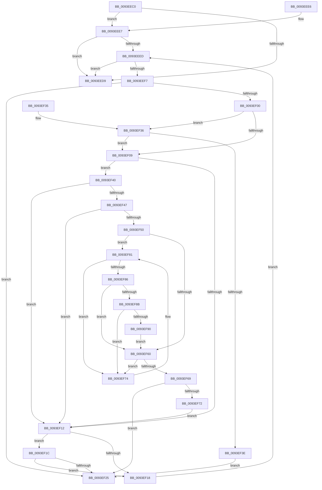

# MiPageHasRelocations

- RVA: `0x0093EEC0`–`0x0093EF92` (길이 `210` bytes)
- VA: `0x000000014093EEC0`
- 실행 섹션: `PAGE`
- PDB 이름 있음: `예`; PDB Function 태그: `아니요`
- unwind 정보 RVA: `0x00090090`
- 디코드: `74`개 명령, `210/210` bytes 표시
- 미해석 바이트: `0` (있으면 어셈블리에 `.byte`로 보존)

> 이 문서는 커널 이미지의 기계어와 PDB 기호를 분석해 생성했습니다. 4번과 5번은 함수 원형과 자료형을 바이너리 사용 방식에서 추정한 C 해석이며 원본 소스 복구 결과는 아닙니다.

## 1. Dependencies

- 직접 호출 지점: **2**; 고유 호출 대상: **2**
- 직접 호출자로 확인된 함수: **4**
- RIP 상대 이미지 참조: **1**

### Outgoing calls
- `0x0093EF1C` → [HalAdjustResourceList](../../text/48/HalAdjustResourceList_function_0048FDC0.md) (function, `0x0048FDC0`)
- `0x0093EF7B` → [guard_dispatch_icall](../../text/6B/guard_dispatch_icall_function_006BAAD0.md) (function, `0x006BAAD0`)

### Direct callers
- [MiWalkEntireImage](../../text/36/MiWalkEntireImage_function_00365D70.md) at `0x0036677E`
- [MiWalkEntireImage](../../text/36/MiWalkEntireImage_function_00365D70.md) at `0x00366BC6`
- [MiWalkEntireImagePageNeedsProcessing](../../text/4D/MiWalkEntireImagePageNeedsProcessing_function_004DC2BC.md) at `0x004DC2EE`
- [MiRevertRelocatedImagePfn](MiRevertRelocatedImagePfn_function_0093EDD8.md) at `0x0093EE1A`
- [MiCreateFileOnlyImageFixupList](../98/MiCreateFileOnlyImageFixupList_function_00989AD0.md) at `0x00989B0F`
- [MiCreateFileOnlyImageFixupList](../98/MiCreateFileOnlyImageFixupList_function_00989AD0.md) at `0x00989BB0`

### Static image references
- `0x0093EF74` → RVA `0x00E01EA0` (`.data`; read)

## 2. Other-region calls and transfers

- 다른 실행 섹션으로 향하는 call: **2**
  - `0x0093EF1C` → [HalAdjustResourceList](../../text/48/HalAdjustResourceList_function_0048FDC0.md) (`PAGE` → `.text`)
  - `0x0093EF7B` → [guard_dispatch_icall](../../text/6B/guard_dispatch_icall_function_006BAAD0.md) (`PAGE` → `.text`)
- 별도 외부 분기/꼬리 이동을 확인하지 못했습니다.

## 3. Assembly (complete function range)

```asm
0093EEC0  48 89 5C 24 08                  mov qword ptr [rsp + 8], rbx
0093EEC5  57                              push rdi
0093EEC6  48 83 EC 20                     sub rsp, 0x20
0093EECA  4C 8B 19                        mov r11, qword ptr [rcx]
0093EECD  45 8B D0                        mov r10d, r8d
0093EED0  44 8B CA                        mov r9d, edx
0093EED3  41 F6 C0 01                     test r8b, 1
0093EED7  75 0E                           jne 0x14093eee7
0093EED9  33 C0                           xor eax, eax
0093EEDB  48 8B 5C 24 30                  mov rbx, qword ptr [rsp + 0x30]
0093EEE0  48 83 C4 20                     add rsp, 0x20
0093EEE4  5F                              pop rdi
0093EEE5  C3                              ret
0093EEE6  CC                              int3
0093EEE7  44 3B 49 38                     cmp r9d, dword ptr [rcx + 0x38]
0093EEEB  73 EC                           jae 0x14093eed9
0093EEED  8B C2                           mov eax, edx
0093EEEF  41 2B C1                        sub eax, r9d
0093EEF2  83 F8 01                        cmp eax, 1
0093EEF5  73 E2                           jae 0x14093eed9
0093EEF7  8B C2                           mov eax, edx
0093EEF9  49 83 3C C3 00                  cmp qword ptr [r11 + rax*8], 0
0093EEFE  75 25                           jne 0x14093ef25
0093EF00  4C 8B 41 58                     mov r8, qword ptr [rcx + 0x58]
0093EF04  4D 85 C0                        test r8, r8
0093EF07  75 2D                           jne 0x14093ef36
0093EF09  48 8B 41 60                     mov rax, qword ptr [rcx + 0x60]
0093EF0D  48 85 C0                        test rax, rax
0093EF10  75 2E                           jne 0x14093ef40
0093EF12  41 F6 C2 02                     test r10b, 2
0093EF16  75 04                           jne 0x14093ef1c
0093EF18  FF C2                           inc edx
0093EF1A  EB D1                           jmp 0x14093eeed
0093EF1C  E8 9F 0E B5 FF                  call 0x14048fdc0
0093EF21  85 C0                           test eax, eax
0093EF23  74 F3                           je 0x14093ef18
0093EF25  48 8B 5C 24 30                  mov rbx, qword ptr [rsp + 0x30]
0093EF2A  B8 01 00 00 00                  mov eax, 1
0093EF2F  48 83 C4 20                     add rsp, 0x20
0093EF33  5F                              pop rdi
0093EF34  C3                              ret
0093EF35  CC                              int3
0093EF36  49 83 7C C0 40 00               cmp qword ptr [r8 + rax*8 + 0x40], 0
0093EF3C  74 CB                           je 0x14093ef09
0093EF3E  EB E5                           jmp 0x14093ef25
0093EF40  8B 58 20                        mov ebx, dword ptr [rax + 0x20]
0093EF43  3B D3                           cmp edx, ebx
0093EF45  72 CB                           jb 0x14093ef12
0093EF47  44 8B 40 24                     mov r8d, dword ptr [rax + 0x24]
0093EF4B  41 3B D0                        cmp edx, r8d
0093EF4E  77 C2                           ja 0x14093ef12
0093EF50  44 2B C3                        sub r8d, ebx
0093EF53  41 8D 78 01                     lea edi, [r8 + 1]
0093EF57  4C 8B 40 18                     mov r8, qword ptr [rax + 0x18]
0093EF5B  4D 85 C0                        test r8, r8
0093EF5E  74 21                           je 0x14093ef81
0093EF60  8B C2                           mov eax, edx
0093EF62  2B C3                           sub eax, ebx
0093EF64  48 3B C7                        cmp rax, rdi
0093EF67  73 0B                           jae 0x14093ef74
0093EF69  49 8B 04 C0                     mov rax, qword ptr [r8 + rax*8]
0093EF6D  48 85 C0                        test rax, rax
0093EF70  75 B3                           jne 0x14093ef25
0093EF72  EB 9E                           jmp 0x14093ef12
0093EF74  48 8B 05 25 2F 4C 00            mov rax, qword ptr [rip + 0x4c2f25]
0093EF7B  E8 50 BB D7 FF                  call 0x1406baad0
0093EF80  CC                              int3
0093EF81  48 85 FF                        test rdi, rdi
0093EF84  75 EE                           jne 0x14093ef74
0093EF86  4D 85 C0                        test r8, r8
0093EF89  75 D5                           jne 0x14093ef60
0093EF8B  48 85 FF                        test rdi, rdi
0093EF8E  75 E4                           jne 0x14093ef74
0093EF90  EB CE                           jmp 0x14093ef60
```

## 4. C-style interpretation (structured pseudocode)

```c
__int64 __fastcall MiPageHasRelocations(__int64 a1, int a2, int a3)
{
    __int64 result;
    __int64 v_rsp;
    unsigned __int64 v_stack_p30;
    unsigned __int64 v_stack_p8;

    v_stack_p8 = v_rbx;
    v_rsp = (v_rsp) - (32);
    if ((((unsigned __int8)(a3)) & (1)) != 0) goto loc_0093EEE7;
loc_0093EED9:
    result = 0;
    v_rsp = (v_rsp) + (32);
    return result;
loc_0093EEE7:
    if (((unsigned int)((unsigned int)(a2))) >= (*(unsigned int *)(a1 + 56))) goto loc_0093EED9;
loc_0093EEED:
    result = (unsigned int)(((unsigned int)(a2)) - ((unsigned int)((unsigned int)(a2))));
    if (((unsigned int)(result)) >= 1) goto loc_0093EED9;
    if ((*(unsigned __int64 *)(*(unsigned __int64 *)(a1) + (unsigned int)(a2) * 8)) != 0) goto loc_0093EF25;
    if (*(unsigned __int64 *)(a1 + 88) != 0) goto loc_0093EF36;
loc_0093EF09:
    if (*(unsigned __int64 *)(a1 + 96) != 0) goto loc_0093EF40;
loc_0093EF12:
    if ((((unsigned __int8)((unsigned int)(a3))) & (2)) != 0) goto loc_0093EF1C;
loc_0093EF18:
    a2 = (unsigned int)((a2) + 1);
    goto loc_0093EEED;
loc_0093EF1C:
    result = HalAdjustResourceList(a1, a2, *(unsigned __int64 *)(a1 + 88), (unsigned int)(a2));
    if ((unsigned int)(result) == 0) goto loc_0093EF18;
loc_0093EF25:
    v_rsp = (v_rsp) + (32);
    return 1;
loc_0093EF36:
    if ((*(unsigned __int64 *)(*(unsigned __int64 *)(a1 + 88) + 1 * 8 + 64)) == 0) goto loc_0093EF09;
    goto loc_0093EF25;
loc_0093EF40:
    if (a2 < ((unsigned int)((unsigned int)(*(unsigned int *)(1 + 32))))) goto loc_0093EF12;
    if (a2 > ((unsigned int)((unsigned int)(*(unsigned int *)(1 + 36))))) goto loc_0093EF12;
    a3 = (unsigned int)(((unsigned int)(*(unsigned int *)(1 + 36))) - ((unsigned int)((unsigned int)(*(unsigned int *)(1 + 32)))));
    if (*(unsigned __int64 *)(1 + 24) == 0) goto loc_0093EF81;
loc_0093EF60:
    result = (unsigned int)(((unsigned int)(a2)) - ((unsigned int)((unsigned int)(*(unsigned int *)(1 + 32)))));
    if (result >= (a3 + 1)) goto loc_0093EF74;
    if (*(unsigned __int64 *)(*(unsigned __int64 *)(1 + 24) + result * 8) != 0) goto loc_0093EF25;
    goto loc_0093EF12;
loc_0093EF74:
    result = guard_dispatch_icall(a1, a2, *(unsigned __int64 *)(1 + 24), (unsigned int)(a2));
loc_0093EF81:
    if (a3 + 1 != 0) goto loc_0093EF74;
    if (*(unsigned __int64 *)(1 + 24) != 0) goto loc_0093EF60;
    if (a3 + 1 != 0) goto loc_0093EF74;
    goto loc_0093EF60;
}
```

## 5. (Beta) C Style

```c
int64_t MiPageHasRelocations(void *Arg1, int32_t Arg2, int32_t Arg3)
{
    uint8_t *arg1 = (uint8_t *)Arg1;

    int64_t result;
    int64_t local_rsp;
    uint64_t v_stack_p30;
    uint64_t v_stack_p8;

    v_stack_p8 = local_rbx;
    local_rsp = (local_rsp) - (32);
    if ((((uint8_t)(Arg3)) & (1)) != 0) goto loc_0093EEE7;
loc_0093EED9:
    result = 0;
    local_rsp = (local_rsp) + (32);
    return result;
loc_0093EEE7:
    if (((uint32_t)((uint32_t)(Arg2))) >= (*(uint32_t *)(arg1 + 0x38))) goto loc_0093EED9;
loc_0093EEED:
    result = (uint32_t)(((uint32_t)(Arg2)) - ((uint32_t)((uint32_t)(Arg2))));
    if (((uint32_t)(result)) >= 1) goto loc_0093EED9;
    if ((*(uint64_t *)(*(uint64_t *)(arg1) + (uint32_t)(Arg2) * 8)) != 0) goto loc_0093EF25;
    if (*(uint64_t *)(arg1 + 0x58) != 0) goto loc_0093EF36;
loc_0093EF09:
    if (*(uint64_t *)(arg1 + 0x60) != 0) goto loc_0093EF40;
loc_0093EF12:
    if ((((uint8_t)((uint32_t)(Arg3))) & (2)) != 0) goto loc_0093EF1C;
loc_0093EF18:
    Arg2 = (uint32_t)((Arg2) + 1);
    goto loc_0093EEED;
loc_0093EF1C:
    result = HalAdjustResourceList(Arg1, Arg2, *(uint64_t *)(arg1 + 0x58), (uint32_t)(Arg2));
    if ((uint32_t)(result) == 0) goto loc_0093EF18;
loc_0093EF25:
    local_rsp = (local_rsp) + (32);
    return 1;
loc_0093EF36:
    if ((*(uint64_t *)(*(uint64_t *)(arg1 + 0x58) + 0x1 * 8 + 0x40)) == 0) goto loc_0093EF09;
    goto loc_0093EF25;
loc_0093EF40:
    if (Arg2 < ((uint32_t)((uint32_t)(*(uint32_t *)(1 + 0x20))))) goto loc_0093EF12;
    if (Arg2 > ((uint32_t)((uint32_t)(*(uint32_t *)(1 + 0x24))))) goto loc_0093EF12;
    Arg3 = (uint32_t)(((uint32_t)(*(uint32_t *)(1 + 0x24))) - ((uint32_t)((uint32_t)(*(uint32_t *)(1 + 0x20)))));
    if (*(uint64_t *)(1 + 0x18) == 0) goto loc_0093EF81;
loc_0093EF60:
    result = (uint32_t)(((uint32_t)(Arg2)) - ((uint32_t)((uint32_t)(*(uint32_t *)(1 + 0x20)))));
    if (result >= (Arg3 + 1)) goto loc_0093EF74;
    if (*(uint64_t *)(*(uint64_t *)(1 + 0x18) + result * 8) != 0) goto loc_0093EF25;
    goto loc_0093EF12;
loc_0093EF74:
    result = guard_dispatch_icall(Arg1, Arg2, *(uint64_t *)(1 + 0x18), (uint32_t)(Arg2));
loc_0093EF81:
    if (Arg3 + 1 != 0) goto loc_0093EF74;
    if (*(uint64_t *)(1 + 0x18) != 0) goto loc_0093EF60;
    if (Arg3 + 1 != 0) goto loc_0093EF74;
    goto loc_0093EF60;
}
```

### 관측된 메모리 오프셋

구조체 형식이 확인되지 않은 접근은 인자 기준의 오프셋으로만 기록했습니다.

| 기준 인자 | 오프셋 표현 | 폭 (bit) | 접근 |
|---|---:|---:|---|
| `Arg1` | `+ 0x0` | `64` | `R` |
| `Arg1` | `+ 0x38` | `32` | `R` |

## 6. Execution-region graph

[열기: 2D/3D 그래프와 함수 탐색 컨트롤 패널](../../../control-panel.html?section=page&rva=0x0093EEC0&view=graph)

- 2D 그래프는 위에서 아래로 흐르고, 3D 그래프는 빈 공간을 드래그해 회전합니다. Shift+드래그는 이동, 휠은 확대·축소, 함수 노드 선택은 대상 보고서 이동입니다.

### Static fallback


