# MiPerformFixups

- RVA: `0x0093F5F4`–`0x0093F976` (길이 `898` bytes)
- VA: `0x000000014093F5F4`
- 실행 섹션: `PAGE`
- PDB 이름 있음: `예`; PDB Function 태그: `아니요`
- unwind 정보 RVA: `0x0009011C`
- 디코드: `223`개 명령, `898/898` bytes 표시
- 미해석 바이트: `0` (있으면 어셈블리에 `.byte`로 보존)

> 이 문서는 커널 이미지의 기계어와 PDB 기호를 분석해 생성했습니다. 4번과 5번은 함수 원형과 자료형을 바이너리 사용 방식에서 추정한 C 해석이며 원본 소스 복구 결과는 아닙니다.

## 1. Dependencies

- 직접 호출 지점: **9**; 고유 호출 대상: **8**
- 직접 호출자로 확인된 함수: **3**
- RIP 상대 이미지 참조: **0**

### Outgoing calls
- `0x0093F6D8` → [RtlDoesRequireFunctionOverrideFixups](RtlDoesRequireFunctionOverrideFixups_function_0093F97C.md) (function, `0x0093F97C`)
- `0x0093F725` → [MiApplyCompressedFixups](MiApplyCompressedFixups_function_0093F9E0.md) (function, `0x0093F9E0`)
- `0x0093F753` → [MiApplyStraddleFixups](../../text/43/MiApplyStraddleFixups_function_0043E280.md) (function, `0x0043E280`)
- `0x0093F8AC` → [RtlApplyFunctionOverrideFixups](RtlApplyFunctionOverrideFixups_function_0093FB44.md) (function, `0x0093FB44`)
- `0x0093F8B9` → [MiApplyRawFixups](MiApplyRawFixups_function_0093EF98.md) (function, `0x0093EF98`)
- `0x0093F904` → [KeIsRetpolineEnabled](../../text/44/KeIsRetpolineEnabled_function_0044EE20.md) (function, `0x0044EE20`)
- `0x0093F919` → [MiGetSystemRegionType](../../text/28/MiGetSystemRegionType_function_0028EC80.md) (function, `0x0028EC80`)
- `0x0093F93E` → [MiApplyDynamicRelocationFixups](../../text/44/MiApplyDynamicRelocationFixups_function_0044A1CC.md) (function, `0x0044A1CC`)
- `0x0093F94E` → [MiGetSystemRegionType](../../text/28/MiGetSystemRegionType_function_0028EC80.md) (function, `0x0028EC80`)

### Direct callers
- [MiRevertRelocatedImagePfn](MiRevertRelocatedImagePfn_function_0093EDD8.md) at `0x0093EE88`
- [MiRevertRelocations](MiRevertRelocations_function_0093F1D8.md) at `0x0093F279`
- [MiRelocateImagePfn](MiRelocateImagePfn_function_0093F2A8.md) at `0x0093F3E9`

### Static image references
- 디코드된 RIP-relative 메모리 참조가 없습니다.

## 2. Other-region calls and transfers

- 다른 실행 섹션으로 향하는 call: **5**
  - `0x0093F753` → [MiApplyStraddleFixups](../../text/43/MiApplyStraddleFixups_function_0043E280.md) (`PAGE` → `.text`)
  - `0x0093F904` → [KeIsRetpolineEnabled](../../text/44/KeIsRetpolineEnabled_function_0044EE20.md) (`PAGE` → `.text`)
  - `0x0093F919` → [MiGetSystemRegionType](../../text/28/MiGetSystemRegionType_function_0028EC80.md) (`PAGE` → `.text`)
  - `0x0093F93E` → [MiApplyDynamicRelocationFixups](../../text/44/MiApplyDynamicRelocationFixups_function_0044A1CC.md) (`PAGE` → `.text`)
  - `0x0093F94E` → [MiGetSystemRegionType](../../text/28/MiGetSystemRegionType_function_0028EC80.md) (`PAGE` → `.text`)
- 별도 외부 분기/꼬리 이동을 확인하지 못했습니다.

## 3. Assembly (complete function range)

```asm
0093F5F4  48 89 5C 24 20                  mov qword ptr [rsp + 0x20], rbx
0093F5F9  48 89 54 24 10                  mov qword ptr [rsp + 0x10], rdx
0093F5FE  55                              push rbp
0093F5FF  56                              push rsi
0093F600  57                              push rdi
0093F601  41 54                           push r12
0093F603  41 55                           push r13
0093F605  41 56                           push r14
0093F607  41 57                           push r15
0093F609  48 81 EC 80 00 00 00            sub rsp, 0x80
0093F610  48 8B 42 60                     mov rax, qword ptr [rdx + 0x60]
0093F614  48 8B F9                        mov rdi, rcx
0093F617  8B 8C 24 E8 00 00 00            mov ecx, dword ptr [rsp + 0xe8]
0093F61E  48 83 E0 F8                     and rax, 0xfffffffffffffff8
0093F622  41 BB 01 00 00 00               mov r11d, 1
0093F628  4D 8B F9                        mov r15, r9
0093F62B  41 8B F0                        mov esi, r8d
0093F62E  4C 8B D2                        mov r10, rdx
0093F631  4C 8B 60 20                     mov r12, qword ptr [rax + 0x20]
0093F635  41 84 CB                        test r11b, cl
0093F638  75 1C                           jne 0x14093f656
0093F63A  48 8B 9C 24 D8 00 00 00         mov rbx, qword ptr [rsp + 0xd8]
0093F642  48 81 C4 80 00 00 00            add rsp, 0x80
0093F649  41 5F                           pop r15
0093F64B  41 5E                           pop r14
0093F64D  41 5D                           pop r13
0093F64F  41 5C                           pop r12
0093F651  5F                              pop rdi
0093F652  5E                              pop rsi
0093F653  5D                              pop rbp
0093F654  C3                              ret
0093F655  CC                              int3
0093F656  41 3B 74 24 38                  cmp esi, dword ptr [r12 + 0x38]
0093F65B  73 DD                           jae 0x14093f63a
0093F65D  48 8B 02                        mov rax, qword ptr [rdx]
0093F660  44 8B E9                        mov r13d, ecx
0093F663  49 8B 54 24 58                  mov rdx, qword ptr [r12 + 0x58]
0093F668  41 83 E5 FE                     and r13d, 0xfffffffe
0093F66C  4D 8B 44 24 60                  mov r8, qword ptr [r12 + 0x60]
0093F671  45 33 C9                        xor r9d, r9d
0093F674  4D 85 FF                        test r15, r15
0093F677  48 89 44 24 40                  mov qword ptr [rsp + 0x40], rax
0093F67C  8B EE                           mov ebp, esi
0093F67E  48 89 94 24 C0 00 00 00         mov qword ptr [rsp + 0xc0], rdx
0093F686  44 0F 45 E9                     cmovne r13d, ecx
0093F68A  4C 89 44 24 30                  mov qword ptr [rsp + 0x30], r8
0093F68F  41 8B CD                        mov ecx, r13d
0093F692  41 23 CB                        and ecx, r11d
0093F695  89 8C 24 D0 00 00 00            mov dword ptr [rsp + 0xd0], ecx
0093F69C  C1 E5 0C                        shl ebp, 0xc
0093F69F  4C 89 4C 24 38                  mov qword ptr [rsp + 0x38], r9
0093F6A4  41 8A C1                        mov al, r9b
0093F6A7  88 84 24 E8 00 00 00            mov byte ptr [rsp + 0xe8], al
0093F6AE  49 8B D9                        mov rbx, r9
0093F6B1  4D 8B F1                        mov r14, r9
0093F6B4  85 C9                           test ecx, ecx
0093F6B6  74 16                           je 0x14093f6ce
0093F6B8  49 8B 04 24                     mov rax, qword ptr [r12]
0093F6BC  8B CE                           mov ecx, esi
0093F6BE  48 8B 1C C8                     mov rbx, qword ptr [rax + rcx*8]
0093F6C2  41 8A C1                        mov al, r9b
0093F6C5  48 85 D2                        test rdx, rdx
0093F6C8  0F 85 75 01 00 00               jne 0x14093f843
0093F6CE  4D 85 C0                        test r8, r8
0093F6D1  74 2D                           je 0x14093f700
0093F6D3  8B D6                           mov edx, esi
0093F6D5  49 8B C8                        mov rcx, r8
0093F6D8  E8 9F 02 00 00                  call 0x14093f97c
0093F6DD  4C 8B 94 24 C8 00 00 00         mov r10, qword ptr [rsp + 0xc8]
0093F6E5  45 33 C9                        xor r9d, r9d
0093F6E8  48 8B 94 24 C0 00 00 00         mov rdx, qword ptr [rsp + 0xc0]
0093F6F0  4C 8B 44 24 30                  mov r8, qword ptr [rsp + 0x30]
0093F6F5  88 84 24 E8 00 00 00            mov byte ptr [rsp + 0xe8], al
0093F6FC  45 8D 59 01                     lea r11d, [r9 + 1]
0093F700  48 85 DB                        test rbx, rbx
0093F703  0F 84 04 01 00 00               je 0x14093f80d
0093F709  49 3B DB                        cmp rbx, r11
0093F70C  76 22                           jbe 0x14093f730
0093F70E  45 38 4C 24 40                  cmp byte ptr [r12 + 0x40], r9b
0093F713  4C 8B C3                        mov r8, rbx
0093F716  4D 8B CF                        mov r9, r15
0093F719  48 8B D7                        mov rdx, rdi
0093F71C  49 8B CA                        mov rcx, r10
0093F71F  0F 84 94 01 00 00               je 0x14093f8b9
0093F725  E8 B6 02 00 00                  call 0x14093f9e0
0093F72A  41 BB 01 00 00 00               mov r11d, 1
0093F730  41 84 DB                        test r11b, bl
0093F733  74 23                           je 0x14093f758
0093F735  48 8B 84 24 E0 00 00 00         mov rax, qword ptr [rsp + 0xe0]
0093F73D  4D 8B CF                        mov r9, r15
0093F740  44 89 6C 24 28                  mov dword ptr [rsp + 0x28], r13d
0093F745  44 8B C5                        mov r8d, ebp
0093F748  48 8B D7                        mov rdx, rdi
0093F74B  48 89 44 24 20                  mov qword ptr [rsp + 0x20], rax
0093F750  49 8B CC                        mov rcx, r12
0093F753  E8 28 EB AF FF                  call 0x14043e280
0093F758  48 8B 4C 24 40                  mov rcx, qword ptr [rsp + 0x40]
0093F75D  41 8B C5                        mov eax, r13d
0093F760  48 8B 94 24 E0 00 00 00         mov rdx, qword ptr [rsp + 0xe0]
0093F768  83 E0 08                        and eax, 8
0093F76B  45 33 C9                        xor r9d, r9d
0093F76E  48 8B 49 20                     mov rcx, qword ptr [rcx + 0x20]
0093F772  41 F6 C5 04                     test r13b, 4
0093F776  0F 84 82 00 00 00               je 0x14093f7fe
0093F77C  85 C0                           test eax, eax
0093F77E  48 8B DA                        mov rbx, rdx
0093F781  49 0F 44 DF                     cmove rbx, r15
0093F785  48 03 D9                        add rbx, rcx
0093F788  4D 85 F6                        test r14, r14
0093F78B  0F 85 32 01 00 00               jne 0x14093f8c3
0093F791  44 38 8C 24 E8 00 00 00         cmp byte ptr [rsp + 0xe8], r9b
0093F799  0F 85 D5 00 00 00               jne 0x14093f874
0093F79F  8B 8C 24 D0 00 00 00            mov ecx, dword ptr [rsp + 0xd0]
0093F7A6  85 C9                           test ecx, ecx
0093F7A8  74 1B                           je 0x14093f7c5
0093F7AA  41 8B 4C 24 3C                  mov ecx, dword ptr [r12 + 0x3c]
0093F7AF  8B C1                           mov eax, ecx
0093F7B1  25 00 F0 FF FF                  and eax, 0xfffff000
0093F7B6  3B C5                           cmp eax, ebp
0093F7B8  0F 84 94 00 00 00               je 0x14093f852
0093F7BE  8B 8C 24 D0 00 00 00            mov ecx, dword ptr [rsp + 0xd0]
0093F7C5  B8 00 10 00 00                  mov eax, 0x1000
0093F7CA  48 03 F8                        add rdi, rax
0093F7CD  F7 C7 FF 0F 00 00               test edi, 0xfff
0093F7D3  0F 84 61 FE FF FF               je 0x14093f63a
0093F7D9  4C 8B 94 24 C8 00 00 00         mov r10, qword ptr [rsp + 0xc8]
0093F7E1  41 BB 01 00 00 00               mov r11d, 1
0093F7E7  48 8B 94 24 C0 00 00 00         mov rdx, qword ptr [rsp + 0xc0]
0093F7EF  41 03 F3                        add esi, r11d
0093F7F2  4C 8B 44 24 30                  mov r8, qword ptr [rsp + 0x30]
0093F7F7  03 E8                           add ebp, eax
0093F7F9  E9 A1 FE FF FF                  jmp 0x14093f69f
0093F7FE  48 8B D9                        mov rbx, rcx
0093F801  85 C0                           test eax, eax
0093F803  74 83                           je 0x14093f788
0093F805  49 03 DF                        add rbx, r15
0093F808  E9 7B FF FF FF                  jmp 0x14093f788
0093F80D  4D 85 F6                        test r14, r14
0093F810  0F 85 42 FF FF FF               jne 0x14093f758
0093F816  84 C0                           test al, al
0093F818  0F 85 3A FF FF FF               jne 0x14093f758
0093F81E  B8 00 10 00 00                  mov eax, 0x1000
0093F823  48 03 F8                        add rdi, rax
0093F826  F7 C7 FF 0F 00 00               test edi, 0xfff
0093F82C  0F 84 08 FE FF FF               je 0x14093f63a
0093F832  8B 8C 24 D0 00 00 00            mov ecx, dword ptr [rsp + 0xd0]
0093F839  41 03 F3                        add esi, r11d
0093F83C  03 E8                           add ebp, eax
0093F83E  E9 5C FE FF FF                  jmp 0x14093f69f
0093F843  4C 8B 74 CA 40                  mov r14, qword ptr [rdx + rcx*8 + 0x40]
0093F848  4C 89 74 24 38                  mov qword ptr [rsp + 0x38], r14
0093F84D  E9 7C FE FF FF                  jmp 0x14093f6ce
0093F852  48 8B 44 24 40                  mov rax, qword ptr [rsp + 0x40]
0093F857  81 E1 FF 0F 00 00               and ecx, 0xfff
0093F85D  48 03 CF                        add rcx, rdi
0093F860  66 0F BA 60 0C 0F               bt word ptr [rax + 0xc], 0xf
0093F866  0F 83 02 01 00 00               jae 0x14093f96e
0093F86C  44 01 39                        add dword ptr [rcx], r15d
0093F86F  E9 4A FF FF FF                  jmp 0x14093f7be
0093F874  48 B8 FF FF FE FF FF 7F 00 00   movabs rax, 0x7ffffffeffff
0093F87E  45 8A F1                        mov r14b, r9b
0093F881  48 3B D8                        cmp rbx, rax
0093F884  0F 87 C1 00 00 00               ja 0x14093f94b
0093F88A  41 8A C1                        mov al, r9b
0093F88D  B9 01 00 00 00                  mov ecx, 1
0093F892  45 0F B6 CE                     movzx r9d, r14b
0093F896  41 F6 C5 0C                     test r13b, 0xc
0093F89A  4C 8B C7                        mov r8, rdi
0093F89D  88 44 24 20                     mov byte ptr [rsp + 0x20], al
0093F8A1  44 0F 45 C9                     cmovne r9d, ecx
0093F8A5  8B D6                           mov edx, esi
0093F8A7  48 8B 4C 24 30                  mov rcx, qword ptr [rsp + 0x30]
0093F8AC  E8 93 02 00 00                  call 0x14093fb44
0093F8B1  45 33 C9                        xor r9d, r9d
0093F8B4  E9 E6 FE FF FF                  jmp 0x14093f79f
0093F8B9  E8 DA F6 FF FF                  call 0x14093ef98
0093F8BE  E9 67 FE FF FF                  jmp 0x14093f72a
0093F8C3  48 8B 84 24 C0 00 00 00         mov rax, qword ptr [rsp + 0xc0]
0093F8CB  48 85 D2                        test rdx, rdx
0093F8CE  45 8B F5                        mov r14d, r13d
0093F8D1  0F 10 00                        movups xmm0, xmmword ptr [rax]
0093F8D4  0F 10 50 10                     movups xmm2, xmmword ptr [rax + 0x10]
0093F8D8  F2 0F 10 48 30                  movsd xmm1, qword ptr [rax + 0x30]
0093F8DD  0F 11 44 24 48                  movups xmmword ptr [rsp + 0x48], xmm0
0093F8E2  0F 10 40 20                     movups xmm0, xmmword ptr [rax + 0x20]
0093F8E6  66 48 0F 7E D1                  movq rcx, xmm2
0093F8EB  F2 0F 11 4C 24 78               movsd qword ptr [rsp + 0x78], xmm1
0093F8F1  49 0F 45 C9                     cmovne rcx, r9
0093F8F5  0F 11 54 24 58                  movups xmmword ptr [rsp + 0x58], xmm2
0093F8FA  48 89 4C 24 58                  mov qword ptr [rsp + 0x58], rcx
0093F8FF  0F 11 44 24 68                  movups xmmword ptr [rsp + 0x68], xmm0
0093F904  E8 17 F5 B0 FF                  call 0x14044ee20
0093F909  84 C0                           test al, al
0093F90B  75 09                           jne 0x14093f916
0093F90D  48 85 C9                        test rcx, rcx
0093F910  75 04                           jne 0x14093f916
0093F912  41 83 CE 08                     or r14d, 8
0093F916  48 8B CB                        mov rcx, rbx
0093F919  E8 62 F3 94 FF                  call 0x14028ec80
0093F91E  4C 8B 4C 24 38                  mov r9, qword ptr [rsp + 0x38]
0093F923  4C 8D 44 24 48                  lea r8, [rsp + 0x48]
0093F928  41 8B CE                        mov ecx, r14d
0093F92B  8B D5                           mov edx, ebp
0093F92D  83 C9 08                        or ecx, 8
0093F930  83 F8 0B                        cmp eax, 0xb
0093F933  41 0F 44 CE                     cmove ecx, r14d
0093F937  89 4C 24 20                     mov dword ptr [rsp + 0x20], ecx
0093F93B  48 8B CF                        mov rcx, rdi
0093F93E  E8 89 A8 B0 FF                  call 0x14044a1cc
0093F943  45 33 C9                        xor r9d, r9d
0093F946  E9 46 FE FF FF                  jmp 0x14093f791
0093F94B  48 8B CB                        mov rcx, rbx
0093F94E  E8 2D F3 94 FF                  call 0x14028ec80
0093F953  B9 01 00 00 00                  mov ecx, 1
0093F958  83 F8 0B                        cmp eax, 0xb
0093F95B  75 07                           jne 0x14093f964
0093F95D  8A C1                           mov al, cl
0093F95F  E9 2E FF FF FF                  jmp 0x14093f892
0093F964  32 C0                           xor al, al
0093F966  44 8A F1                        mov r14b, cl
0093F969  E9 24 FF FF FF                  jmp 0x14093f892
0093F96E  4C 01 39                        add qword ptr [rcx], r15
0093F971  E9 48 FE FF FF                  jmp 0x14093f7be
```

## 4. C-style interpretation (structured pseudocode)

```c
__int64 __fastcall MiPerformFixups(__int64 a1, __int64 a2, int a3, __int64 a4, __int64 a5, unsigned __int8 a6)
{
    __int64 result;
    __int64 v_r10;
    __int64 v_r11;
    __int64 v_r13;
    __int64 v_r14;
    __int64 v_rbp;
    __int64 v_rbx;
    __int64 v_rdi;
    __int64 v_rsi;
    __int64 v_rsp;
    unsigned __int64 v_stack_p10;
    unsigned __int64 v_stack_p20;
    unsigned int v_stack_p28;
    unsigned __int64 v_stack_p30;
    unsigned __int64 v_stack_p38;
    unsigned __int64 v_stack_p40;
    unsigned __int64 v_stack_p48;
    unsigned __int64 v_stack_p58;
    unsigned __int64 v_stack_p68;
    unsigned __int64 v_stack_p78;
    unsigned __int64 v_stack_pC0;
    unsigned __int64 v_stack_pC8;
    unsigned int v_stack_pD0;
    unsigned __int8 v_stack_pE8;

    v_stack_p20 = v_rbx;
    v_stack_p10 = a2;
    v_rsp = (v_rsp) - (128);
    result = (*(unsigned __int64 *)(a2 + 96)) & (-8);
    if (((1) & ((unsigned __int8)((unsigned int)(a6)))) != 0) goto loc_0093F656;
loc_0093F63A:
    v_rsp = (v_rsp) + (128);
    return result;
loc_0093F656:
    if (((unsigned int)((unsigned int)(a3))) >= (*(unsigned int *)(*(unsigned __int64 *)(result + 32) + 56))) goto loc_0093F63A;
    v_r13 = (unsigned int)(((unsigned int)((unsigned int)((unsigned int)(a6)))) & (0xFFFFFFFEULL));
    a4 = 0;
    v_stack_p40 = *(unsigned __int64 *)(a2);
    v_stack_pC0 = *(unsigned __int64 *)(*(unsigned __int64 *)(result + 32) + 88);
    if (0 != 0) { v_r13 = (unsigned int)((unsigned int)(a6)); }
    v_stack_p30 = *(unsigned __int64 *)(*(unsigned __int64 *)(result + 32) + 96);
    a1 = (unsigned int)(((unsigned int)((unsigned int)(v_r13))) & (1));
    v_stack_pD0 = (unsigned int)(a1);
    v_rbp = (unsigned int)(((unsigned int)((unsigned int)((unsigned int)(a3)))) << (12));
loc_0093F69F:
    v_stack_p38 = 0;
    v_stack_pE8 = 0;
    if ((unsigned int)(a1) == 0) goto loc_0093F6CE;
    if (*(unsigned __int64 *)(*(unsigned __int64 *)(result + 32) + 88) != 0) goto loc_0093F843;
loc_0093F6CE:
    result = 0;
    v_r10 = a2;
    v_r11 = 1;
    if (*(unsigned __int64 *)(*(unsigned __int64 *)(result + 32) + 96) != 0) {
        a2 = (unsigned int)((unsigned int)(a3));
        a1 = *(unsigned __int64 *)(*(unsigned __int64 *)(result + 32) + 96);
        result = RtlDoesRequireFunctionOverrideFixups(a1, a2, *(unsigned __int64 *)(*(unsigned __int64 *)(result + 32) + 96), a4);
        v_r10 = v_stack_pC8;
        a4 = 0;
        a2 = v_stack_pC0;
        a3 = v_stack_p30;
        v_stack_pE8 = (unsigned __int8)(result);
        v_r11 = a4 + 1;
    }
    if (*(unsigned __int64 *)(*(unsigned __int64 *)(*(unsigned __int64 *)(result + 32)) + (unsigned int)((unsigned int)((unsigned int)(a3))) * 8) == 0) goto loc_0093F80D;
    if ((*(unsigned __int64 *)(*(unsigned __int64 *)(*(unsigned __int64 *)(result + 32)) + (unsigned int)((unsigned int)((unsigned int)(a3))) * 8)) <= v_r11) goto loc_0093F730;
    if ((*(unsigned __int8 *)(*(unsigned __int64 *)(result + 32) + 64)) == 0) goto loc_0093F8B9;
    result = MiApplyCompressedFixups(v_r10, a1, *(unsigned __int64 *)(*(unsigned __int64 *)(*(unsigned __int64 *)(result + 32)) + (unsigned int)((unsigned int)((unsigned int)(a3))) * 8), 0);
loc_0093F72A:
loc_0093F730:
    if (((1) & ((unsigned __int8)(*(unsigned __int64 *)(*(unsigned __int64 *)(*(unsigned __int64 *)(result + 32)) + (unsigned int)((unsigned int)((unsigned int)(a3))) * 8)))) != 0) {
        result = a5;
        a4 = 0;
        v_stack_p28 = (unsigned int)(v_r13);
        a3 = (unsigned int)(v_rbp);
        a2 = a1;
        v_stack_p20 = result;
        a1 = *(unsigned __int64 *)(result + 32);
        result = MiApplyStraddleFixups(a1, a2, a3, a4);
    }
    result = (unsigned int)(((unsigned int)((unsigned int)(v_r13))) & (8));
    a4 = 0;
    if ((((unsigned __int8)(v_r13)) & (4)) == 0) goto loc_0093F7FE;
    if ((unsigned int)(result) == 0) { a5 = 0; }
    v_rbx = (a5) + (*(unsigned __int64 *)(v_stack_p40 + 32));
loc_0093F788:
    if (0 != 0) goto loc_0093F8C3;
loc_0093F791:
    if (a6 != 0) goto loc_0093F874;
loc_0093F79F:
    if ((unsigned int)((unsigned int)(v_stack_pD0)) == 0) goto loc_0093F7C5;
    result = (unsigned int)(((unsigned int)((unsigned int)((unsigned int)(*(unsigned int *)(*(unsigned __int64 *)(result + 32) + 60))))) & (0xFFFFF000ULL));
    if (((unsigned int)(result)) == ((unsigned int)(v_rbp))) goto loc_0093F852;
loc_0093F7BE:
loc_0093F7C5:
    v_rdi = (a1) + ((unsigned int)(0x1000ULL));
    if ((((unsigned int)(v_rdi)) & (0xFFFULL)) == 0) goto loc_0093F63A;
    v_rsi = (unsigned int)(((unsigned int)(a3)) + (1));
    v_rbp = (unsigned int)((v_rbp) + ((unsigned int)((unsigned int)(0x1000ULL))));
    goto loc_0093F69F;
loc_0093F7FE:
    if ((unsigned int)((unsigned int)(0x1000ULL)) == 0) goto loc_0093F788;
    v_rbx = ((unsigned int)(v_stack_pD0)) + (0);
    goto loc_0093F788;
loc_0093F80D:
    if (0 != 0) goto loc_0093F758;
    if ((unsigned __int8)((unsigned int)(0x1000ULL)) != 0) goto loc_0093F758;
    v_rdi = (v_rdi) + ((unsigned int)(0x1000ULL));
    if ((((unsigned int)(v_rdi)) & (0xFFFULL)) == 0) goto loc_0093F63A;
    v_rsi = (unsigned int)((v_rsi) + (1));
    v_rbp = (unsigned int)((v_rbp) + ((unsigned int)((unsigned int)(0x1000ULL))));
    goto loc_0093F69F;
loc_0093F843:
    v_stack_p38 = *(unsigned __int64 *)(v_stack_pC0 + (unsigned int)(v_stack_pD0) * 8 + 64);
    goto loc_0093F6CE;
loc_0093F852:
    a1 = (unsigned int)(((unsigned int)(v_stack_pD0)) & (0xFFFULL));
    a1 = (a1) + (v_rdi);
    if (condition_is_above_or_equal) goto loc_0093F96E;
    goto loc_0093F7BE;
loc_0093F874:
    if (v_rbx > v_stack_p40) goto loc_0093F94B;
loc_0093F892:
    v_stack_p20 = 0;
    a4 = 0;
    if ((((unsigned __int8)(v_r13)) & (12)) != 0) { a4 = 1; }
    result = RtlApplyFunctionOverrideFixups(v_stack_p30, (unsigned int)((unsigned int)(v_rsi)), v_rdi, a4);
    a4 = 0;
    goto loc_0093F79F;
loc_0093F8B9:
    result = MiApplyRawFixups(v_stack_p30, (unsigned int)((unsigned int)(v_rsi)), v_rdi, a4);
    goto loc_0093F72A;
loc_0093F8C3:
    v_stack_p48 = v_xmm0;
    v_stack_p78 = v_xmm1;
    a1 = v_stack_p30;
    if ((unsigned int)((unsigned int)(v_rsi)) != 0) { a1 = 0; }
    v_stack_p58 = v_xmm2;
    v_stack_p58 = a1;
    v_stack_p68 = v_xmm0;
    result = KeIsRetpolineEnabled(a1, (unsigned int)((unsigned int)(v_rsi)), v_rdi, a4);
    if ((unsigned __int8)(result) != 0) goto loc_0093F916;
    v_r14 = (unsigned int)((unsigned int)(v_r13));
    if (a1 == 0) {
        v_r14 = (unsigned int)(((unsigned int)((unsigned int)(v_r13))) | (8));
    }
    result = MiGetSystemRegionType(v_rbx, (unsigned int)((unsigned int)(v_rsi)), v_rdi, a4);
    a1 = (unsigned int)(((unsigned int)((unsigned int)(v_r14))) | (8));
    if (((unsigned int)(result)) == 11) { a1 = (unsigned int)(v_r14); }
    v_stack_p20 = (unsigned int)(a1);
    result = MiApplyDynamicRelocationFixups(v_rdi, (unsigned int)((unsigned int)(v_rbp)), v_stack_p48, v_stack_p38);
    a4 = 0;
    goto loc_0093F791;
loc_0093F94B:
    result = MiGetSystemRegionType(v_rbx, (unsigned int)((unsigned int)(v_rbp)), v_stack_p48, a4);
    if (((unsigned int)(result)) != 11) goto loc_0093F964;
    goto loc_0093F892;
loc_0093F964:
    result = 0;
    goto loc_0093F892;
loc_0093F96E:
    goto loc_0093F7BE;
}
```

## 5. (Beta) C Style

```c
int64_t MiPerformFixups(int64_t Arg1, void *Arg2, int32_t Arg3, int64_t Arg4, int64_t Arg5, uint8_t Arg6)
{
    uint8_t *arg2 = (uint8_t *)Arg2;

    int64_t result;
    int64_t local_r10;
    int64_t local_r11;
    int64_t local_r13;
    int64_t local_r14;
    int64_t local_rbp;
    int64_t local_rbx;
    int64_t local_rdi;
    int64_t local_rsi;
    int64_t local_rsp;
    uint64_t v_stack_p10;
    uint64_t v_stack_p20;
    uint32_t v_stack_p28;
    uint64_t v_stack_p30;
    uint64_t v_stack_p38;
    uint64_t v_stack_p40;
    uint64_t v_stack_p48;
    uint64_t v_stack_p58;
    uint64_t v_stack_p68;
    uint64_t v_stack_p78;
    uint64_t v_stack_pC0;
    uint64_t v_stack_pC8;
    uint32_t v_stack_pD0;
    uint8_t v_stack_pE8;

    v_stack_p20 = local_rbx;
    v_stack_p10 = Arg2;
    local_rsp = (local_rsp) - (128);
    result = (*(uint64_t *)(arg2 + 0x60)) & (-8);
    if (((1) & ((uint8_t)((uint32_t)(Arg6)))) != 0) goto loc_0093F656;
loc_0093F63A:
    local_rsp = (local_rsp) + (128);
    return result;
loc_0093F656:
    if (((uint32_t)((uint32_t)(Arg3))) >= (*(uint32_t *)(*(uint64_t *)(result + 0x20) + 0x38))) goto loc_0093F63A;
    local_r13 = (uint32_t)(((uint32_t)((uint32_t)((uint32_t)(Arg6)))) & (0xFFFFFFFEULL));
    Arg4 = 0;
    v_stack_p40 = *(uint64_t *)(arg2);
    v_stack_pC0 = *(uint64_t *)(*(uint64_t *)(result + 0x20) + 0x58);
    if (0 != 0) { local_r13 = (uint32_t)((uint32_t)(Arg6)); }
    v_stack_p30 = *(uint64_t *)(*(uint64_t *)(result + 0x20) + 0x60);
    Arg1 = (uint32_t)(((uint32_t)((uint32_t)(local_r13))) & (1));
    v_stack_pD0 = (uint32_t)(Arg1);
    local_rbp = (uint32_t)(((uint32_t)((uint32_t)((uint32_t)(Arg3)))) << (12));
loc_0093F69F:
    v_stack_p38 = 0;
    v_stack_pE8 = 0;
    if ((uint32_t)(Arg1) == 0) goto loc_0093F6CE;
    if (*(uint64_t *)(*(uint64_t *)(result + 0x20) + 0x58) != 0) goto loc_0093F843;
loc_0093F6CE:
    result = 0;
    local_r10 = Arg2;
    local_r11 = 1;
    if (*(uint64_t *)(*(uint64_t *)(result + 0x20) + 0x60) != 0) {
        Arg2 = (uint32_t)((uint32_t)(Arg3));
        Arg1 = *(uint64_t *)(*(uint64_t *)(result + 0x20) + 0x60);
        result = RtlDoesRequireFunctionOverrideFixups(Arg1, Arg2, *(uint64_t *)(*(uint64_t *)(result + 0x20) + 0x60), Arg4);
        local_r10 = v_stack_pC8;
        Arg4 = 0;
        Arg2 = v_stack_pC0;
        Arg3 = v_stack_p30;
        v_stack_pE8 = (uint8_t)(result);
        local_r11 = Arg4 + 1;
    }
    if (*(uint64_t *)(*(uint64_t *)(*(uint64_t *)(result + 0x20)) + (uint32_t)((uint32_t)((uint32_t)(Arg3))) * 8) == 0) goto loc_0093F80D;
    if ((*(uint64_t *)(*(uint64_t *)(*(uint64_t *)(result + 0x20)) + (uint32_t)((uint32_t)((uint32_t)(Arg3))) * 8)) <= local_r11) goto loc_0093F730;
    if ((*(uint8_t *)(*(uint64_t *)(result + 0x20) + 0x40)) == 0) goto loc_0093F8B9;
    result = MiApplyCompressedFixups(local_r10, Arg1, *(uint64_t *)(*(uint64_t *)(*(uint64_t *)(result + 0x20)) + (uint32_t)((uint32_t)((uint32_t)(Arg3))) * 8), 0);
loc_0093F72A:
loc_0093F730:
    if (((1) & ((uint8_t)(*(uint64_t *)(*(uint64_t *)(*(uint64_t *)(result + 0x20)) + (uint32_t)((uint32_t)((uint32_t)(Arg3))) * 8)))) != 0) {
        result = Arg5;
        Arg4 = 0;
        v_stack_p28 = (uint32_t)(local_r13);
        Arg3 = (uint32_t)(local_rbp);
        Arg2 = Arg1;
        v_stack_p20 = result;
        Arg1 = *(uint64_t *)(result + 0x20);
        result = MiApplyStraddleFixups(Arg1, Arg2, Arg3, Arg4);
    }
    result = (uint32_t)(((uint32_t)((uint32_t)(local_r13))) & (8));
    Arg4 = 0;
    if ((((uint8_t)(local_r13)) & (4)) == 0) goto loc_0093F7FE;
    if ((uint32_t)(result) == 0) { Arg5 = 0; }
    local_rbx = (Arg5) + (*(uint64_t *)(v_stack_p40 + 0x20));
loc_0093F788:
    if (0 != 0) goto loc_0093F8C3;
loc_0093F791:
    if (Arg6 != 0) goto loc_0093F874;
loc_0093F79F:
    if ((uint32_t)((uint32_t)(v_stack_pD0)) == 0) goto loc_0093F7C5;
    result = (uint32_t)(((uint32_t)((uint32_t)((uint32_t)(*(uint32_t *)(*(uint64_t *)(result + 0x20) + 0x3C))))) & (0xFFFFF000ULL));
    if (((uint32_t)(result)) == ((uint32_t)(local_rbp))) goto loc_0093F852;
loc_0093F7BE:
loc_0093F7C5:
    local_rdi = (Arg1) + ((uint32_t)(0x1000ULL));
    if ((((uint32_t)(local_rdi)) & (0xFFFULL)) == 0) goto loc_0093F63A;
    local_rsi = (uint32_t)(((uint32_t)(Arg3)) + (1));
    local_rbp = (uint32_t)((local_rbp) + ((uint32_t)((uint32_t)(0x1000ULL))));
    goto loc_0093F69F;
loc_0093F7FE:
    if ((uint32_t)((uint32_t)(0x1000ULL)) == 0) goto loc_0093F788;
    local_rbx = ((uint32_t)(v_stack_pD0)) + (0);
    goto loc_0093F788;
loc_0093F80D:
    if (0 != 0) goto loc_0093F758;
    if ((uint8_t)((uint32_t)(0x1000ULL)) != 0) goto loc_0093F758;
    local_rdi = (local_rdi) + ((uint32_t)(0x1000ULL));
    if ((((uint32_t)(local_rdi)) & (0xFFFULL)) == 0) goto loc_0093F63A;
    local_rsi = (uint32_t)((local_rsi) + (1));
    local_rbp = (uint32_t)((local_rbp) + ((uint32_t)((uint32_t)(0x1000ULL))));
    goto loc_0093F69F;
loc_0093F843:
    v_stack_p38 = *(uint64_t *)(v_stack_pC0 + (uint32_t)(v_stack_pD0) * 8 + 0x40);
    goto loc_0093F6CE;
loc_0093F852:
    Arg1 = (uint32_t)(((uint32_t)(v_stack_pD0)) & (0xFFFULL));
    Arg1 = (Arg1) + (local_rdi);
    if (condition_is_above_or_equal) goto loc_0093F96E;
    goto loc_0093F7BE;
loc_0093F874:
    if (local_rbx > v_stack_p40) goto loc_0093F94B;
loc_0093F892:
    v_stack_p20 = 0;
    Arg4 = 0;
    if ((((uint8_t)(local_r13)) & (12)) != 0) { Arg4 = 1; }
    result = RtlApplyFunctionOverrideFixups(v_stack_p30, (uint32_t)((uint32_t)(local_rsi)), local_rdi, Arg4);
    Arg4 = 0;
    goto loc_0093F79F;
loc_0093F8B9:
    result = MiApplyRawFixups(v_stack_p30, (uint32_t)((uint32_t)(local_rsi)), local_rdi, Arg4);
    goto loc_0093F72A;
loc_0093F8C3:
    v_stack_p48 = v_xmm0;
    v_stack_p78 = v_xmm1;
    Arg1 = v_stack_p30;
    if ((uint32_t)((uint32_t)(local_rsi)) != 0) { Arg1 = 0; }
    v_stack_p58 = v_xmm2;
    v_stack_p58 = Arg1;
    v_stack_p68 = v_xmm0;
    result = KeIsRetpolineEnabled(Arg1, (uint32_t)((uint32_t)(local_rsi)), local_rdi, Arg4);
    if ((uint8_t)(result) != 0) goto loc_0093F916;
    local_r14 = (uint32_t)((uint32_t)(local_r13));
    if (Arg1 == 0) {
        local_r14 = (uint32_t)(((uint32_t)((uint32_t)(local_r13))) | (8));
    }
    result = MiGetSystemRegionType(local_rbx, (uint32_t)((uint32_t)(local_rsi)), local_rdi, Arg4);
    Arg1 = (uint32_t)(((uint32_t)((uint32_t)(local_r14))) | (8));
    if (((uint32_t)(result)) == 11) { Arg1 = (uint32_t)(local_r14); }
    v_stack_p20 = (uint32_t)(Arg1);
    result = MiApplyDynamicRelocationFixups(local_rdi, (uint32_t)((uint32_t)(local_rbp)), v_stack_p48, v_stack_p38);
    Arg4 = 0;
    goto loc_0093F791;
loc_0093F94B:
    result = MiGetSystemRegionType(local_rbx, (uint32_t)((uint32_t)(local_rbp)), v_stack_p48, Arg4);
    if (((uint32_t)(result)) != 11) goto loc_0093F964;
    goto loc_0093F892;
loc_0093F964:
    result = 0;
    goto loc_0093F892;
loc_0093F96E:
    goto loc_0093F7BE;
}
```

### 관측된 메모리 오프셋

구조체 형식이 확인되지 않은 접근은 인자 기준의 오프셋으로만 기록했습니다.

| 기준 인자 | 오프셋 표현 | 폭 (bit) | 접근 |
|---|---:|---:|---|
| `Arg2` | `+ 0x0` | `64` | `R` |
| `Arg2` | `+ 0x60` | `64` | `R` |

## 6. Execution-region graph

[열기: 2D/3D 그래프와 함수 탐색 컨트롤 패널](../../../control-panel.html?section=page&rva=0x0093F5F4&view=graph)

- 2D 그래프는 위에서 아래로 흐르고, 3D 그래프는 빈 공간을 드래그해 회전합니다. Shift+드래그는 이동, 휠은 확대·축소, 함수 노드 선택은 대상 보고서 이동입니다.

### Static fallback

```mermaid
flowchart TD
  bb_0093F5F4[BB_0093F5F4]
  bb_0093F63A[BB_0093F63A]
  bb_0093F655[BB_0093F655]
  bb_0093F656[BB_0093F656]
  bb_0093F65D[BB_0093F65D]
  bb_0093F69F[BB_0093F69F]
  bb_0093F6B8[BB_0093F6B8]
  bb_0093F6CE[BB_0093F6CE]
  bb_0093F6D3[BB_0093F6D3]
  bb_0093F700[BB_0093F700]
  bb_0093F709[BB_0093F709]
  bb_0093F70E[BB_0093F70E]
  bb_0093F725[BB_0093F725]
  bb_0093F72A[BB_0093F72A]
  bb_0093F730[BB_0093F730]
  bb_0093F735[BB_0093F735]
  bb_0093F758[BB_0093F758]
  bb_0093F77C[BB_0093F77C]
  bb_0093F788[BB_0093F788]
  bb_0093F791[BB_0093F791]
  bb_0093F79F[BB_0093F79F]
  bb_0093F7AA[BB_0093F7AA]
  bb_0093F7BE[BB_0093F7BE]
  bb_0093F7C5[BB_0093F7C5]
  bb_0093F7D9[BB_0093F7D9]
  bb_0093F7FE[BB_0093F7FE]
  bb_0093F805[BB_0093F805]
  bb_0093F80D[BB_0093F80D]
  bb_0093F816[BB_0093F816]
  bb_0093F81E[BB_0093F81E]
  bb_0093F832[BB_0093F832]
  bb_0093F843[BB_0093F843]
  bb_0093F852[BB_0093F852]
  bb_0093F86C[BB_0093F86C]
  bb_0093F874[BB_0093F874]
  bb_0093F88A[BB_0093F88A]
  bb_0093F892[BB_0093F892]
  bb_0093F8B9[BB_0093F8B9]
  bb_0093F8C3[BB_0093F8C3]
  bb_0093F90D[BB_0093F90D]
  bb_0093F912[BB_0093F912]
  bb_0093F916[BB_0093F916]
  bb_0093F94B[BB_0093F94B]
  bb_0093F95D[BB_0093F95D]
  bb_0093F964[BB_0093F964]
  bb_0093F96E[BB_0093F96E]
  bb_0093F5F4 -->|branch| bb_0093F656
  bb_0093F5F4 -->|fallthrough| bb_0093F63A
  bb_0093F655 -->|flow| bb_0093F656
  bb_0093F656 -->|branch| bb_0093F63A
  bb_0093F656 -->|fallthrough| bb_0093F65D
  bb_0093F65D -->|flow| bb_0093F69F
  bb_0093F69F -->|branch| bb_0093F6CE
  bb_0093F69F -->|fallthrough| bb_0093F6B8
  bb_0093F6B8 -->|branch| bb_0093F843
  bb_0093F6B8 -->|fallthrough| bb_0093F6CE
  bb_0093F6CE -->|branch| bb_0093F700
  bb_0093F6CE -->|fallthrough| bb_0093F6D3
  bb_0093F6D3 -->|flow| bb_0093F700
  bb_0093F700 -->|branch| bb_0093F80D
  bb_0093F700 -->|fallthrough| bb_0093F709
  bb_0093F709 -->|branch| bb_0093F730
  bb_0093F709 -->|fallthrough| bb_0093F70E
  bb_0093F70E -->|branch| bb_0093F8B9
  bb_0093F70E -->|fallthrough| bb_0093F725
  bb_0093F725 -->|flow| bb_0093F72A
  bb_0093F72A -->|flow| bb_0093F730
  bb_0093F730 -->|branch| bb_0093F758
  bb_0093F730 -->|fallthrough| bb_0093F735
  bb_0093F735 -->|flow| bb_0093F758
  bb_0093F758 -->|branch| bb_0093F7FE
  bb_0093F758 -->|fallthrough| bb_0093F77C
  bb_0093F77C -->|flow| bb_0093F788
  bb_0093F788 -->|branch| bb_0093F8C3
  bb_0093F788 -->|fallthrough| bb_0093F791
  bb_0093F791 -->|branch| bb_0093F874
  bb_0093F791 -->|fallthrough| bb_0093F79F
  bb_0093F79F -->|branch| bb_0093F7C5
  bb_0093F79F -->|fallthrough| bb_0093F7AA
  bb_0093F7AA -->|branch| bb_0093F852
  bb_0093F7AA -->|fallthrough| bb_0093F7BE
  bb_0093F7BE -->|flow| bb_0093F7C5
  bb_0093F7C5 -->|branch| bb_0093F63A
  bb_0093F7C5 -->|fallthrough| bb_0093F7D9
  bb_0093F7D9 -->|branch| bb_0093F69F
  bb_0093F7FE -->|branch| bb_0093F788
  bb_0093F7FE -->|fallthrough| bb_0093F805
  bb_0093F805 -->|branch| bb_0093F788
  bb_0093F80D -->|branch| bb_0093F758
  bb_0093F80D -->|fallthrough| bb_0093F816
  bb_0093F816 -->|branch| bb_0093F758
  bb_0093F816 -->|fallthrough| bb_0093F81E
  bb_0093F81E -->|branch| bb_0093F63A
  bb_0093F81E -->|fallthrough| bb_0093F832
  bb_0093F832 -->|branch| bb_0093F69F
  bb_0093F843 -->|branch| bb_0093F6CE
  bb_0093F852 -->|branch| bb_0093F96E
  bb_0093F852 -->|fallthrough| bb_0093F86C
  bb_0093F86C -->|branch| bb_0093F7BE
  bb_0093F874 -->|branch| bb_0093F94B
  bb_0093F874 -->|fallthrough| bb_0093F88A
  bb_0093F88A -->|flow| bb_0093F892
  bb_0093F892 -->|branch| bb_0093F79F
  bb_0093F8B9 -->|branch| bb_0093F72A
  bb_0093F8C3 -->|branch| bb_0093F916
  bb_0093F8C3 -->|fallthrough| bb_0093F90D
  bb_0093F90D -->|branch| bb_0093F916
  bb_0093F90D -->|fallthrough| bb_0093F912
  bb_0093F912 -->|flow| bb_0093F916
  bb_0093F916 -->|branch| bb_0093F791
  bb_0093F94B -->|branch| bb_0093F964
  bb_0093F94B -->|fallthrough| bb_0093F95D
  bb_0093F95D -->|branch| bb_0093F892
  bb_0093F964 -->|branch| bb_0093F892
  bb_0093F96E -->|branch| bb_0093F7BE
```


