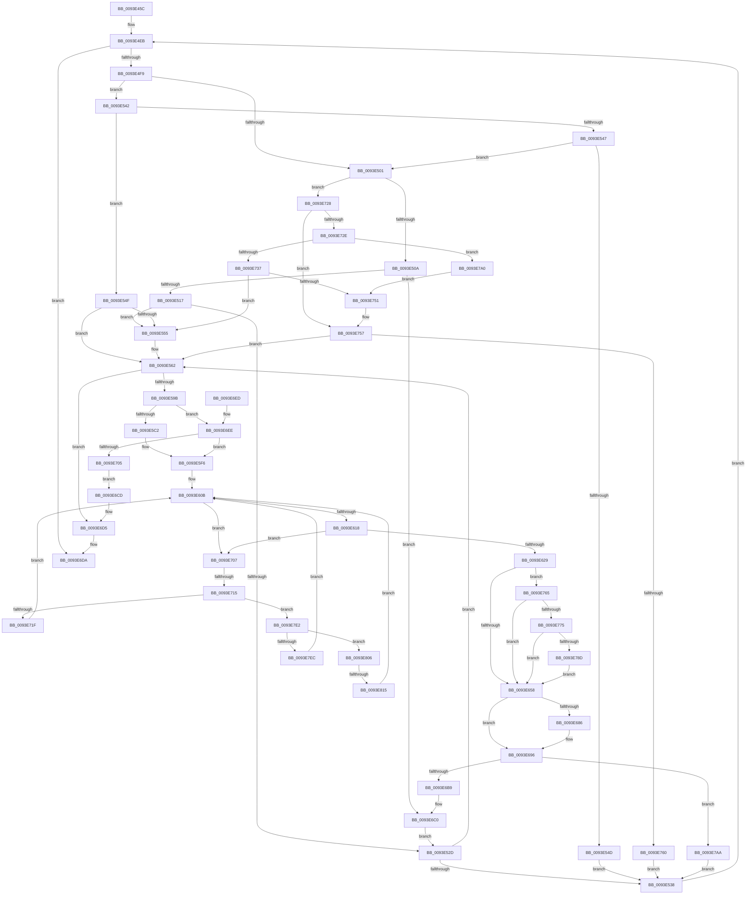

# MiPfAllocateMdls

- RVA: `0x0093E45C`–`0x0093E827` (길이 `971` bytes)
- VA: `0x000000014093E45C`
- 실행 섹션: `PAGE`
- PDB 이름 있음: `예`; PDB Function 태그: `예`
- unwind 정보 RVA: `0x0008FFFC`
- 디코드: `240`개 명령, `971/971` bytes 표시
- 미해석 바이트: `0` (있으면 어셈블리에 `.byte`로 보존)

> 이 문서는 커널 이미지의 기계어와 PDB 기호를 분석해 생성했습니다. 4번과 5번은 함수 원형과 자료형을 바이너리 사용 방식에서 추정한 C 해석이며 원본 소스 복구 결과는 아닙니다.

## 1. Dependencies

- 직접 호출 지점: **6**; 고유 호출 대상: **6**
- 직접 호출자로 확인된 함수: **2**
- RIP 상대 이미지 참조: **1**

### Outgoing calls
- `0x0093E585` → [MiGetInPageSupportBlock](../../text/36/MiGetInPageSupportBlock_function_00362500.md) (function, `0x00362500`)
- `0x0093E5AC` → [MiSetInPagePriority](../../text/36/MiSetInPagePriority_function_0036A9A4.md) (function, `0x0036A9A4`)
- `0x0093E637` → [MiStartingOffset](../../text/34/MiStartingOffset_function_003482E0.md) (function, `0x003482E0`)
- `0x0093E6D0` → [MiFreeInPageSupportBlock](../../text/2B/MiFreeInPageSupportBlock_function_002B5900.md) (function, `0x002B5900`)
- `0x0093E6F2` → [MmCreateMdl](../../text/46/MmCreateMdl_function_00463E20.md) (function, `0x00463E20`)
- `0x0093E77C` → [MiEndingOffsetWithLock](../../text/40/MiEndingOffsetWithLock_function_00404718.md) (function, `0x00404718`)

### Direct callers
- [MiPfPrepareReadList](MiPfPrepareReadList_function_0093CD5C.md) at `0x0093D3B4`
- [MiPfPrepareSequentialReadList](MiPfPrepareSequentialReadList_function_0093D8E8.md) at `0x0093DAC5`

### Static image references
- `0x0093E51D` → RVA `0x00E37394` (`.data`; read)

## 2. Other-region calls and transfers

- 다른 실행 섹션으로 향하는 call: **6**
  - `0x0093E585` → [MiGetInPageSupportBlock](../../text/36/MiGetInPageSupportBlock_function_00362500.md) (`PAGE` → `.text`)
  - `0x0093E5AC` → [MiSetInPagePriority](../../text/36/MiSetInPagePriority_function_0036A9A4.md) (`PAGE` → `.text`)
  - `0x0093E637` → [MiStartingOffset](../../text/34/MiStartingOffset_function_003482E0.md) (`PAGE` → `.text`)
  - `0x0093E6D0` → [MiFreeInPageSupportBlock](../../text/2B/MiFreeInPageSupportBlock_function_002B5900.md) (`PAGE` → `.text`)
  - `0x0093E6F2` → [MmCreateMdl](../../text/46/MmCreateMdl_function_00463E20.md) (`PAGE` → `.text`)
  - `0x0093E77C` → [MiEndingOffsetWithLock](../../text/40/MiEndingOffsetWithLock_function_00404718.md) (`PAGE` → `.text`)
- call이 아닌 외부 분기/꼬리 이동: **2**
  - `0x0093E70F` → [sub_00B252B0](../B2/Unknown_function_00B252B0.md) (`tail-transfer`)
  - `0x0093E80F` → [sub_00B252B0 + 0x51](../B2/Unknown_function_00B252B0.md) (`tail-transfer`)

## 3. Assembly (complete function range)

```asm
0093E45C  48 8B C4                        mov rax, rsp
0093E45F  4C 89 48 20                     mov qword ptr [rax + 0x20], r9
0093E463  4C 89 40 18                     mov qword ptr [rax + 0x18], r8
0093E467  89 50 10                        mov dword ptr [rax + 0x10], edx
0093E46A  48 89 48 08                     mov qword ptr [rax + 8], rcx
0093E46E  53                              push rbx
0093E46F  55                              push rbp
0093E470  56                              push rsi
0093E471  57                              push rdi
0093E472  41 54                           push r12
0093E474  41 55                           push r13
0093E476  41 56                           push r14
0093E478  41 57                           push r15
0093E47A  48 83 EC 78                     sub rsp, 0x78
0093E47E  8B 81 BC 00 00 00               mov eax, dword ptr [rcx + 0xbc]
0093E484  33 DB                           xor ebx, ebx
0093E486  44 8B B9 B8 00 00 00            mov r15d, dword ptr [rcx + 0xb8]
0093E48D  48 8B D1                        mov rdx, rcx
0093E490  48 8B B1 C8 00 00 00            mov rsi, qword ptr [rcx + 0xc8]
0093E497  49 8B F9                        mov rdi, r9
0093E49A  89 44 24 30                     mov dword ptr [rsp + 0x30], eax
0093E49E  44 8B EB                        mov r13d, ebx
0093E4A1  8B 81 C4 00 00 00               mov eax, dword ptr [rcx + 0xc4]
0093E4A7  44 8B CB                        mov r9d, ebx
0093E4AA  48 8B 49 08                     mov rcx, qword ptr [rcx + 8]
0093E4AE  48 83 C0 1E                     add rax, 0x1e
0093E4B2  4C 8B 52 10                     mov r10, qword ptr [rdx + 0x10]
0093E4B6  4C 8D 46 08                     lea r8, [rsi + 8]
0093E4BA  4D 85 D2                        test r10, r10
0093E4BD  44 89 7C 24 34                  mov dword ptr [rsp + 0x34], r15d
0093E4C2  48 89 4C 24 50                  mov qword ptr [rsp + 0x50], rcx
0093E4C7  4C 8D 1C C2                     lea r11, [rdx + rax*8]
0093E4CB  89 5C 24 20                     mov dword ptr [rsp + 0x20], ebx
0093E4CF  4C 8D B1 80 00 00 00            lea r14, [rcx + 0x80]
0093E4D6  4C 89 5C 24 68                  mov qword ptr [rsp + 0x68], r11
0093E4DB  48 89 5C 24 38                  mov qword ptr [rsp + 0x38], rbx
0093E4E0  8B C3                           mov eax, ebx
0093E4E2  48 89 5C 24 40                  mov qword ptr [rsp + 0x40], rbx
0093E4E7  4D 0F 45 F2                     cmovne r14, r10
0093E4EB  4C 89 44 24 28                  mov qword ptr [rsp + 0x28], r8
0093E4F0  49 3B F3                        cmp rsi, r11
0093E4F3  0F 83 E1 01 00 00               jae 0x14093e6da
0093E4F9  48 8B 16                        mov rdx, qword ptr [rsi]
0093E4FC  F6 C2 02                        test dl, 2
0093E4FF  75 41                           jne 0x14093e542
0093E501  F6 C2 01                        test dl, 1
0093E504  0F 85 1E 02 00 00               jne 0x14093e728
0093E50A  48 83 E2 FC                     and rdx, 0xfffffffffffffffc
0093E50E  4D 85 ED                        test r13, r13
0093E511  0F 84 A9 01 00 00               je 0x14093e6c0
0093E517  48 8B CA                        mov rcx, rdx
0093E51A  48 2B C8                        sub rcx, rax
0093E51D  48 63 05 70 8E 4F 00            movsxd rax, dword ptr [rip + 0x4f8e70]
0093E524  48 C1 F9 03                     sar rcx, 3
0093E528  48 3B C8                        cmp rcx, rax
0093E52B  7F 28                           jg 0x14093e555
0093E52D  4C 8B EE                        mov r13, rsi
0093E530  48 8B C2                        mov rax, rdx
0093E533  4D 3B C3                        cmp r8, r11
0093E536  74 2A                           je 0x14093e562
0093E538  48 83 C6 08                     add rsi, 8
0093E53C  49 83 C0 08                     add r8, 8
0093E540  EB A9                           jmp 0x14093e4eb
0093E542  4D 85 ED                        test r13, r13
0093E545  75 08                           jne 0x14093e54f
0093E547  48 83 FA 04                     cmp rdx, 4
0093E54B  73 B4                           jae 0x14093e501
0093E54D  EB E9                           jmp 0x14093e538
0093E54F  48 83 FA 04                     cmp rdx, 4
0093E553  72 0D                           jb 0x14093e562
0093E555  48 83 EE 08                     sub rsi, 8
0093E559  49 83 E8 08                     sub r8, 8
0093E55D  4C 89 44 24 28                  mov qword ptr [rsp + 0x28], r8
0093E562  49 8B 6D 00                     mov rbp, qword ptr [r13]
0093E566  48 8B D7                        mov rdx, rdi
0093E569  4D 8B 21                        mov r12, qword ptr [r9]
0093E56C  48 83 E5 FC                     and rbp, 0xfffffffffffffffc
0093E570  48 89 6C 24 60                  mov qword ptr [rsp + 0x60], rbp
0093E575  49 83 E4 FC                     and r12, 0xfffffffffffffffc
0093E579  49 2B EC                        sub rbp, r12
0093E57C  33 C9                           xor ecx, ecx
0093E57E  48 C1 FD 03                     sar rbp, 3
0093E582  48 FF C5                        inc rbp
0093E585  E8 76 3F A2 FF                  call 0x140362500
0093E58A  48 89 44 24 58                  mov qword ptr [rsp + 0x58], rax
0093E58F  48 8B F8                        mov rdi, rax
0093E592  48 85 C0                        test rax, rax
0093E595  0F 84 3A 01 00 00               je 0x14093e6d5
0093E59B  8B 54 24 30                     mov edx, dword ptr [rsp + 0x30]
0093E59F  45 8B C7                        mov r8d, r15d
0093E5A2  48 8B C8                        mov rcx, rax
0093E5A5  48 89 98 F8 00 00 00            mov qword ptr [rax + 0xf8], rbx
0093E5AC  E8 F3 C3 A2 FF                  call 0x14036a9a4
0093E5B1  4C 8B C5                        mov r8, rbp
0093E5B4  49 C1 E0 0C                     shl r8, 0xc
0093E5B8  48 83 FD 10                     cmp rbp, 0x10
0093E5BC  0F 87 2C 01 00 00               ja 0x14093e6ee
0093E5C2  4C 8D BF 10 01 00 00            lea r15, [rdi + 0x110]
0093E5C9  49 8B C0                        mov rax, r8
0093E5CC  48 C1 E8 0C                     shr rax, 0xc
0093E5D0  66 83 C0 06                     add ax, 6
0093E5D4  4C 89 7C 24 48                  mov qword ptr [rsp + 0x48], r15
0093E5D9  66 C1 E0 03                     shl ax, 3
0093E5DD  66 41 89 47 08                  mov word ptr [r15 + 8], ax
0093E5E2  49 89 1F                        mov qword ptr [r15], rbx
0093E5E5  66 41 89 5F 0A                  mov word ptr [r15 + 0xa], bx
0093E5EA  49 89 5F 20                     mov qword ptr [r15 + 0x20], rbx
0093E5EE  41 89 5F 2C                     mov dword ptr [r15 + 0x2c], ebx
0093E5F2  45 89 47 28                     mov dword ptr [r15 + 0x28], r8d
0093E5F6  48 8B AC 24 C0 00 00 00         mov rbp, qword ptr [rsp + 0xc0]
0093E5FE  48 8B 7C 24 50                  mov rdi, qword ptr [rsp + 0x50]
0093E603  44 8B BC 24 C8 00 00 00         mov r15d, dword ptr [rsp + 0xc8]
0093E60B  49 8B 4E 08                     mov rcx, qword ptr [r14 + 8]
0093E60F  4C 3B E1                        cmp r12, rcx
0093E612  0F 82 EF 00 00 00               jb 0x14093e707
0093E618  41 8B 46 2C                     mov eax, dword ptr [r14 + 0x2c]
0093E61C  48 8D 0C C1                     lea rcx, [rcx + rax*8]
0093E620  4C 3B E1                        cmp r12, rcx
0093E623  0F 83 DE 00 00 00               jae 0x14093e707
0093E629  44 8B 84 24 C8 00 00 00         mov r8d, dword ptr [rsp + 0xc8]
0093E631  49 8B D4                        mov rdx, r12
0093E634  49 8B CE                        mov rcx, r14
0093E637  E8 A4 9C A0 FF                  call 0x1403482e0
0093E63C  48 8B 7C 24 58                  mov rdi, qword ptr [rsp + 0x58]
0093E641  48 8B E8                        mov rbp, rax
0093E644  4C 8B 7C 24 48                  mov r15, qword ptr [rsp + 0x48]
0093E649  48 89 47 60                     mov qword ptr [rdi + 0x60], rax
0093E64D  41 F6 45 00 01                  test byte ptr [r13], 1
0093E652  0F 85 0D 01 00 00               jne 0x14093e765
0093E658  48 8B AC 24 D0 00 00 00         mov rbp, qword ptr [rsp + 0xd0]
0093E660  4C 8B 4C 24 40                  mov r9, qword ptr [rsp + 0x40]
0093E665  4C 89 8F F0 00 00 00            mov qword ptr [rdi + 0xf0], r9
0093E66C  4C 89 AF C8 00 00 00            mov qword ptr [rdi + 0xc8], r13
0093E673  4C 89 B7 D0 00 00 00            mov qword ptr [rdi + 0xd0], r14
0093E67A  48 89 AF E0 00 00 00            mov qword ptr [rdi + 0xe0], rbp
0093E681  48 85 ED                        test rbp, rbp
0093E684  74 10                           je 0x14093e696
0093E686  8B 87 C0 00 00 00               mov eax, dword ptr [rdi + 0xc0]
0093E68C  0F BA E8 11                     bts eax, 0x11
0093E690  89 87 C0 00 00 00               mov dword ptr [rdi + 0xc0], eax
0093E696  48 8B 94 24 C0 00 00 00         mov rdx, qword ptr [rsp + 0xc0]
0093E69E  4C 89 BF 00 01 00 00            mov qword ptr [rdi + 0x100], r15
0093E6A5  48 8D 82 E0 00 00 00            lea rax, [rdx + 0xe0]
0093E6AC  48 8B 48 08                     mov rcx, qword ptr [rax + 8]
0093E6B0  48 39 01                        cmp qword ptr [rcx], rax
0093E6B3  0F 84 F1 00 00 00               je 0x14093e7aa
0093E6B9  B9 03 00 00 00                  mov ecx, 3
0093E6BE  CD 29                           int 0x29
0093E6C0  4C 8B CE                        mov r9, rsi
0093E6C3  48 89 74 24 40                  mov qword ptr [rsp + 0x40], rsi
0093E6C8  E9 60 FE FF FF                  jmp 0x14093e52d
0093E6CD  48 8B CF                        mov rcx, rdi
0093E6D0  E8 2B 72 97 FF                  call 0x1402b5900
0093E6D5  BB 9A 00 00 C0                  mov ebx, 0xc000009a
0093E6DA  8B C3                           mov eax, ebx
0093E6DC  48 83 C4 78                     add rsp, 0x78
0093E6E0  41 5F                           pop r15
0093E6E2  41 5E                           pop r14
0093E6E4  41 5D                           pop r13
0093E6E6  41 5C                           pop r12
0093E6E8  5F                              pop rdi
0093E6E9  5E                              pop rsi
0093E6EA  5D                              pop rbp
0093E6EB  5B                              pop rbx
0093E6EC  C3                              ret
0093E6ED  CC                              int3
0093E6EE  33 D2                           xor edx, edx
0093E6F0  33 C9                           xor ecx, ecx
0093E6F2  E8 29 57 B2 FF                  call 0x140463e20
0093E6F7  48 89 44 24 48                  mov qword ptr [rsp + 0x48], rax
0093E6FC  48 85 C0                        test rax, rax
0093E6FF  0F 85 F1 FE FF FF               jne 0x14093e5f6
0093E705  EB C6                           jmp 0x14093e6cd
0093E707  41 8B 46 20                     mov eax, dword ptr [r14 + 0x20]
0093E70B  0F BA E0 11                     bt eax, 0x11
0093E70F  0F 82 9B 6B 1E 00               jb 0x140b252b0
0093E715  48 39 5D 10                     cmp qword ptr [rbp + 0x10], rbx
0093E719  0F 85 C3 00 00 00               jne 0x14093e7e2
0093E71F  4D 8B 76 10                     mov r14, qword ptr [r14 + 0x10]
0093E723  E9 E3 FE FF FF                  jmp 0x14093e60b
0093E728  48 83 FA 04                     cmp rdx, 4
0093E72C  72 29                           jb 0x14093e757
0093E72E  48 83 E2 FC                     and rdx, 0xfffffffffffffffc
0093E732  4D 85 ED                        test r13, r13
0093E735  74 69                           je 0x14093e7a0
0093E737  48 8B CA                        mov rcx, rdx
0093E73A  48 2B C8                        sub rcx, rax
0093E73D  48 63 05 50 8C 4F 00            movsxd rax, dword ptr [rip + 0x4f8c50]
0093E744  48 C1 F9 03                     sar rcx, 3
0093E748  48 3B C8                        cmp rcx, rax
0093E74B  0F 8F 04 FE FF FF               jg 0x14093e555
0093E751  4C 8B EE                        mov r13, rsi
0093E754  48 8B C2                        mov rax, rdx
0093E757  4D 85 ED                        test r13, r13
0093E75A  0F 85 02 FE FF FF               jne 0x14093e562
0093E760  E9 D3 FD FF FF                  jmp 0x14093e538
0093E765  48 8B 44 24 50                  mov rax, qword ptr [rsp + 0x50]
0093E76A  8B 40 38                        mov eax, dword ptr [rax + 0x38]
0093E76D  A8 20                           test al, 0x20
0093E76F  0F 84 E3 FE FF FF               je 0x14093e658
0093E775  41 8B 46 20                     mov eax, dword ptr [r14 + 0x20]
0093E779  49 8B CE                        mov rcx, r14
0093E77C  E8 97 5F AC FF                  call 0x140404718
0093E781  2B C5                           sub eax, ebp
0093E783  41 3B 47 28                     cmp eax, dword ptr [r15 + 0x28]
0093E787  0F 87 CB FE FF FF               ja 0x14093e658
0093E78D  05 FF 01 00 00                  add eax, 0x1ff
0093E792  25 00 FE FF FF                  and eax, 0xfffffe00
0093E797  41 89 47 28                     mov dword ptr [r15 + 0x28], eax
0093E79B  E9 B8 FE FF FF                  jmp 0x14093e658
0093E7A0  4C 8B CE                        mov r9, rsi
0093E7A3  48 89 74 24 40                  mov qword ptr [rsp + 0x40], rsi
0093E7A8  EB A7                           jmp 0x14093e751
0093E7AA  4C 8B 44 24 28                  mov r8, qword ptr [rsp + 0x28]
0093E7AF  4C 8B EB                        mov r13, rbx
0093E7B2  4C 8B 5C 24 68                  mov r11, qword ptr [rsp + 0x68]
0093E7B7  44 8B 7C 24 34                  mov r15d, dword ptr [rsp + 0x34]
0093E7BC  48 89 07                        mov qword ptr [rdi], rax
0093E7BF  48 89 4F 08                     mov qword ptr [rdi + 8], rcx
0093E7C3  48 89 39                        mov qword ptr [rcx], rdi
0093E7C6  48 89 78 08                     mov qword ptr [rax + 8], rdi
0093E7CA  FF 82 D4 00 00 00               inc dword ptr [rdx + 0xd4]
0093E7D0  48 8B 44 24 60                  mov rax, qword ptr [rsp + 0x60]
0093E7D5  48 8B BC 24 D8 00 00 00         mov rdi, qword ptr [rsp + 0xd8]
0093E7DD  E9 56 FD FF FF                  jmp 0x14093e538
0093E7E2  48 8B 54 24 38                  mov rdx, qword ptr [rsp + 0x38]
0093E7E7  48 85 D2                        test rdx, rdx
0093E7EA  75 1A                           jne 0x14093e806
0093E7EC  4C 8B 75 18                     mov r14, qword ptr [rbp + 0x18]
0093E7F0  4C 89 74 24 38                  mov qword ptr [rsp + 0x38], r14
0093E7F5  4D 8B 76 18                     mov r14, qword ptr [r14 + 0x18]
0093E7F9  C7 44 24 20 01 00 00 00         mov dword ptr [rsp + 0x20], 1
0093E801  E9 05 FE FF FF                  jmp 0x14093e60b
0093E806  44 8B 44 24 20                  mov r8d, dword ptr [rsp + 0x20]
0093E80B  44 3B 42 10                     cmp r8d, dword ptr [rdx + 0x10]
0093E80F  0F 83 EC 6A 1E 00               jae 0x140b25301
0093E815  4E 8B 74 C2 18                  mov r14, qword ptr [rdx + r8*8 + 0x18]
0093E81A  41 FF C0                        inc r8d
0093E81D  44 89 44 24 20                  mov dword ptr [rsp + 0x20], r8d
0093E822  E9 E4 FD FF FF                  jmp 0x14093e60b
```

## 4. C-style interpretation (structured pseudocode)

```c
__int64 __fastcall MiPfAllocateMdls(__int64 a1, int a2, __int64 a3, __int64 a4)
{
    __int64 result;
    __int64 v_r12;
    __int64 v_r14;
    __int64 v_rbp;
    __int64 v_rbx;
    __int64 v_rsi;
    __int64 v_rsp;
    unsigned __int64 v_stack_m50;
    unsigned __int64 v_stack_m58;
    unsigned __int64 v_stack_m60;
    unsigned __int64 v_stack_m68;
    unsigned __int64 v_stack_m70;
    unsigned __int64 v_stack_m78;
    unsigned __int64 v_stack_m80;
    unsigned int v_stack_m84;
    unsigned int v_stack_m88;
    unsigned __int64 v_stack_m90;
    unsigned int v_stack_m98;
    unsigned int v_stack_p10;
    unsigned __int64 v_stack_p18;
    unsigned int v_stack_p20;
    unsigned __int64 v_stack_p28;
    unsigned int v_stack_p34;
    unsigned __int64 v_stack_p38;
    unsigned __int64 v_stack_p40;
    unsigned __int64 v_stack_p48;
    unsigned __int64 v_stack_p50;
    unsigned __int64 v_stack_p60;
    unsigned __int64 v_stack_p68;
    unsigned __int64 v_stack_p8;
    unsigned __int64 v_stack_pD8;

    *(unsigned __int64 *)(v_rsp + 32) = a4;
    *(unsigned __int64 *)(v_rsp + 24) = a3;
    *(unsigned int *)(v_rsp + 16) = a2;
    *(unsigned __int64 *)(v_rsp + 8) = a1;
    v_rsp = (v_rsp) - (120);
    v_rbx = 0;
    v_stack_m88 = (unsigned int)((unsigned int)(*(unsigned int *)(a1 + 188)));
    result = ((unsigned int)(*(unsigned int *)(a1 + 196))) + (30);
    v_stack_m84 = (unsigned int)((unsigned int)(*(unsigned int *)(a1 + 184)));
    v_stack_m68 = *(unsigned __int64 *)(a1 + 8);
    v_stack_m98 = 0;
    v_stack_m50 = a1 + result * 8;
    v_stack_m80 = 0;
    v_stack_m78 = 0;
    v_r14 = *(unsigned __int64 *)(a1 + 8) + 128;
    if (*(unsigned __int64 *)(a1 + 16) != 0) { v_r14 = *(unsigned __int64 *)(a1 + 16); }
loc_0093E4EB:
    v_stack_m90 = *(unsigned __int64 *)(a1 + 200) + 8;
    if ((*(unsigned __int64 *)(a1 + 200)) >= (a1 + result * 8)) goto loc_0093E6DA;
    if ((((unsigned __int8)(*(unsigned __int64 *)(*(unsigned __int64 *)(a1 + 200)))) & (2)) != 0) goto loc_0093E542;
loc_0093E501:
    if ((((unsigned __int8)(*(unsigned __int64 *)(*(unsigned __int64 *)(a1 + 200)))) & (1)) != 0) goto loc_0093E728;
    a2 = (*(unsigned __int64 *)(*(unsigned __int64 *)(a1 + 200))) & (-4);
    if (0 == 0) goto loc_0093E6C0;
    a1 = (a2) - (0);
    a1 = (a1) >> (3);
    if (a1 > ((int)(*(unsigned int *)(v_rip + 5213808)))) goto loc_0093E555;
loc_0093E52D:
    if ((*(unsigned __int64 *)(a1 + 200) + 8) == (a1 + result * 8)) goto loc_0093E562;
loc_0093E538:
    v_rsi = (*(unsigned __int64 *)(a1 + 200)) + (8);
    a3 = (*(unsigned __int64 *)(a1 + 200) + 8) + (8);
    goto loc_0093E4EB;
loc_0093E542:
    if (*(unsigned __int64 *)(a1 + 200) != 0) goto loc_0093E54F;
    if (a2 >= 4) goto loc_0093E501;
    goto loc_0093E538;
loc_0093E54F:
    if (a2 >= 4) {
        v_rsi = (v_rsi) - (8);
        a3 = (a3) - (8);
        v_stack_m90 = a3;
    }
    v_rbp = (*(unsigned __int64 *)(*(unsigned __int64 *)(a1 + 200))) & (-4);
    v_stack_m58 = v_rbp;
    v_r12 = (*(unsigned __int64 *)(0)) & (-4);
    v_rbp = (v_rbp) - (v_r12);
    a1 = 0;
    v_rbp = (v_rbp) >> (3);
    v_rbp = (v_rbp) + 1;
    result = MiGetInPageSupportBlock(a1, a4, a3, 0);
    v_stack_m60 = result;
    if (result == 0) goto loc_0093E6D5;
    *(unsigned __int64 *)(result + 248) = 0;
    result = MiSetInPagePriority(result, (unsigned int)(v_stack_m88), (unsigned int)((unsigned int)((unsigned int)(*(unsigned int *)(a1 + 184)))), 0);
    a3 = (v_rbp) << (12);
    if (v_rbp > 16) goto loc_0093E6EE;
    result = (a3) >> (12);
    result = (unsigned __int16)((result) + (6));
    v_stack_m70 = result + 272;
    result = (unsigned __int16)((result) << (3));
    *(unsigned __int16 *)(result + 272 + 8) = (unsigned __int16)(result);
    *(unsigned __int64 *)(result + 272) = 0;
    *(unsigned __int16 *)(result + 272 + 10) = 0;
    *(unsigned __int64 *)(result + 272 + 32) = 0;
    *(unsigned int *)(result + 272 + 44) = 0;
    *(unsigned int *)(result + 272 + 40) = (unsigned int)(a3);
loc_0093E5F6:
loc_0093E60B:
    if (v_r12 < (*(unsigned __int64 *)(v_r14 + 8))) goto loc_0093E707;
    if (v_r12 >= (*(unsigned __int64 *)(v_r14 + 8) + (unsigned int)(*(unsigned int *)(v_r14 + 44)) * 8)) goto loc_0093E707;
    result = MiStartingOffset(v_r14, v_r12, (unsigned int)(v_stack_p10), 0);
    *(unsigned __int64 *)(v_stack_m60 + 96) = result;
    if (((*(unsigned __int8 *)(*(unsigned __int64 *)(a1 + 200))) & (1)) != 0) goto loc_0093E765;
loc_0093E658:
    *(unsigned __int64 *)(v_stack_m60 + 240) = v_stack_m78;
    *(unsigned __int64 *)(v_stack_m60 + 200) = *(unsigned __int64 *)(a1 + 200);
    *(unsigned __int64 *)(v_stack_m60 + 208) = v_r14;
    *(unsigned __int64 *)(v_stack_m60 + 224) = v_stack_p18;
    if (v_stack_p18 != 0) {
        result = *(unsigned int *)(v_stack_m60 + 192);
        *(unsigned int *)(v_stack_m60 + 192) = (unsigned int)(result);
    }
    *(unsigned __int64 *)(v_stack_m60 + 256) = v_stack_m70;
    if ((*(unsigned __int64 *)(*(unsigned __int64 *)(v_stack_p8 + 224 + 8))) == (v_stack_p8 + 224)) goto loc_0093E7AA;
loc_0093E6C0:
    v_stack_m78 = v_rsi;
    goto loc_0093E52D;
loc_0093E6CD:
    result = MiFreeInPageSupportBlock(v_stack_m60, v_stack_p8, (unsigned int)(v_stack_p10), v_rsi);
loc_0093E6D5:
loc_0093E6DA:
    v_rsp = (v_rsp) + (120);
    return (unsigned int)((unsigned int)((unsigned int)(0xC000009AULL)));
loc_0093E6EE:
    a2 = 0;
    a1 = 0;
    result = MmCreateMdl(a1, a2, (unsigned int)(v_stack_p10), v_rsi);
    v_stack_p48 = result;
    if (result != 0) goto loc_0093E5F6;
    goto loc_0093E6CD;
loc_0093E707:
    if ((*(unsigned __int64 *)(v_stack_p18 + 16)) != ((unsigned int)(0xC000009AULL))) goto loc_0093E7E2;
    goto loc_0093E60B;
loc_0093E728:
    if (0 < 4) goto loc_0093E757;
    a2 = (a2) & (-4);
    if (*(unsigned __int64 *)(a1 + 200) == 0) goto loc_0093E7A0;
    a1 = (a2) - ((unsigned int)(*(unsigned int *)(v_r14 + 32)));
    a1 = (a1) >> (3);
    if (a1 > ((int)(*(unsigned int *)(v_rip + 5213264)))) goto loc_0093E555;
loc_0093E751:
loc_0093E757:
    if (v_rsi != 0) goto loc_0093E562;
    goto loc_0093E538;
loc_0093E765:
    if ((((unsigned __int8)((unsigned int)(*(unsigned int *)(v_stack_p50 + 56)))) & (32)) == 0) goto loc_0093E658;
    result = MiEndingOffsetWithLock(*(unsigned __int64 *)(v_r14 + 16), a2, (unsigned int)(v_stack_p10), v_rsi);
    result = (unsigned int)((result) - ((unsigned int)(v_stack_p18)));
    if (((unsigned int)(result)) > (*(unsigned int *)(v_stack_m70 + 40))) goto loc_0093E658;
    result = (unsigned int)((result) + (511));
    result = (unsigned int)((result) & (0xFFFFFE00ULL));
    *(unsigned int *)(v_stack_m70 + 40) = (unsigned int)(result);
    goto loc_0093E658;
loc_0093E7A0:
    v_stack_p40 = v_rsi;
    goto loc_0093E751;
loc_0093E7AA:
    *(unsigned __int64 *)(v_stack_m60) = result;
    *(unsigned __int64 *)(v_stack_m60 + 8) = *(unsigned __int64 *)(v_r14 + 16);
    *(unsigned __int64 *)(*(unsigned __int64 *)(v_r14 + 16)) = v_stack_m60;
    *(unsigned __int64 *)(result + 8) = v_stack_m60;
    goto loc_0093E538;
loc_0093E7E2:
    if (v_stack_p38 != 0) goto loc_0093E806;
    v_stack_p38 = *(unsigned __int64 *)(v_stack_p18 + 24);
    v_stack_p20 = 1;
    goto loc_0093E60B;
loc_0093E806:
    a3 = (unsigned int)(((unsigned int)(v_stack_p20)) + 1);
    v_stack_p20 = (unsigned int)(a3);
    goto loc_0093E60B;
}
```

## 5. (Beta) C Style

```c
int64_t MiPfAllocateMdls(void *Arg1, int32_t Arg2, int64_t Arg3, int64_t Arg4)
{
    uint8_t *arg1 = (uint8_t *)Arg1;

    int64_t result;
    int64_t local_r12;
    int64_t local_r14;
    int64_t local_rbp;
    int64_t local_rbx;
    int64_t local_rsi;
    int64_t local_rsp;
    uint64_t v_stack_m50;
    uint64_t v_stack_m58;
    uint64_t v_stack_m60;
    uint64_t v_stack_m68;
    uint64_t v_stack_m70;
    uint64_t v_stack_m78;
    uint64_t v_stack_m80;
    uint32_t v_stack_m84;
    uint32_t v_stack_m88;
    uint64_t v_stack_m90;
    uint32_t v_stack_m98;
    uint32_t v_stack_p10;
    uint64_t v_stack_p18;
    uint32_t v_stack_p20;
    uint64_t v_stack_p28;
    uint32_t v_stack_p34;
    uint64_t v_stack_p38;
    uint64_t v_stack_p40;
    uint64_t v_stack_p48;
    uint64_t v_stack_p50;
    uint64_t v_stack_p60;
    uint64_t v_stack_p68;
    uint64_t v_stack_p8;
    uint64_t v_stack_pD8;

    *(uint64_t *)(local_rsp + 0x20) = Arg4;
    *(uint64_t *)(local_rsp + 0x18) = Arg3;
    *(uint32_t *)(local_rsp + 0x10) = Arg2;
    *(void **)(local_rsp + 0x8) = Arg1;
    local_rsp = (local_rsp) - (120);
    local_rbx = 0;
    v_stack_m88 = (uint32_t)((uint32_t)(*(uint32_t *)(arg1 + 0xBC)));
    result = ((uint32_t)(*(uint32_t *)(arg1 + 0xC4))) + (30);
    v_stack_m84 = (uint32_t)((uint32_t)(*(uint32_t *)(arg1 + 0xB8)));
    v_stack_m68 = *(uint64_t *)(arg1 + 0x8);
    v_stack_m98 = 0;
    v_stack_m50 = Arg1 + result * 8;
    v_stack_m80 = 0;
    v_stack_m78 = 0;
    local_r14 = *(uint64_t *)(arg1 + 0x8) + 128;
    if (*(uint64_t *)(arg1 + 0x10) != 0) { local_r14 = *(uint64_t *)(arg1 + 0x10); }
loc_0093E4EB:
    v_stack_m90 = *(uint64_t *)(arg1 + 0xC8) + 8;
    if ((*(uint64_t *)(arg1 + 0xC8)) >= (Arg1 + result * 8)) goto loc_0093E6DA;
    if ((((uint8_t)(*(uint64_t *)(*(uint64_t *)(arg1 + 0xC8)))) & (2)) != 0) goto loc_0093E542;
loc_0093E501:
    if ((((uint8_t)(*(uint64_t *)(*(uint64_t *)(arg1 + 0xC8)))) & (1)) != 0) goto loc_0093E728;
    Arg2 = (*(uint64_t *)(*(uint64_t *)(arg1 + 0xC8))) & (-4);
    if (0 == 0) goto loc_0093E6C0;
    Arg1 = (Arg2) - (0);
    Arg1 = (Arg1) >> (3);
    if (Arg1 > ((int32_t)(*(uint32_t *)(v_rip + 0x4F8E70)))) goto loc_0093E555;
loc_0093E52D:
    if ((*(uint64_t *)(arg1 + 0xC8) + 8) == (Arg1 + result * 8)) goto loc_0093E562;
loc_0093E538:
    local_rsi = (*(uint64_t *)(arg1 + 0xC8)) + (8);
    Arg3 = (*(uint64_t *)(arg1 + 0xC8) + 8) + (8);
    goto loc_0093E4EB;
loc_0093E542:
    if (*(uint64_t *)(arg1 + 0xC8) != 0) goto loc_0093E54F;
    if (Arg2 >= 4) goto loc_0093E501;
    goto loc_0093E538;
loc_0093E54F:
    if (Arg2 >= 4) {
        local_rsi = (local_rsi) - (8);
        Arg3 = (Arg3) - (8);
        v_stack_m90 = Arg3;
    }
    local_rbp = (*(uint64_t *)(*(uint64_t *)(arg1 + 0xC8))) & (-4);
    v_stack_m58 = local_rbp;
    local_r12 = (*(uint64_t *)(0)) & (-4);
    local_rbp = (local_rbp) - (local_r12);
    Arg1 = 0;
    local_rbp = (local_rbp) >> (3);
    local_rbp = (local_rbp) + 1;
    result = MiGetInPageSupportBlock(Arg1, Arg4, Arg3, 0);
    v_stack_m60 = result;
    if (result == 0) goto loc_0093E6D5;
    *(uint64_t *)(result + 0xF8) = 0;
    result = MiSetInPagePriority(result, (uint32_t)(v_stack_m88), (uint32_t)((uint32_t)((uint32_t)(*(uint32_t *)(arg1 + 0xB8)))), 0);
    Arg3 = (local_rbp) << (12);
    if (local_rbp > 16) goto loc_0093E6EE;
    result = (Arg3) >> (12);
    result = (uint16_t)((result) + (6));
    v_stack_m70 = result + 272;
    result = (uint16_t)((result) << (3));
    *(uint16_t *)(result + 0x110 + 0x8) = (uint16_t)(result);
    *(uint64_t *)(result + 0x110) = 0;
    *(uint16_t *)(result + 0x110 + 0xA) = 0;
    *(uint64_t *)(result + 0x110 + 0x20) = 0;
    *(uint32_t *)(result + 0x110 + 0x2C) = 0;
    *(uint32_t *)(result + 0x110 + 0x28) = (uint32_t)(Arg3);
loc_0093E5F6:
loc_0093E60B:
    if (local_r12 < (*(uint64_t *)(local_r14 + 0x8))) goto loc_0093E707;
    if (local_r12 >= (*(uint64_t *)(local_r14 + 0x8) + (uint32_t)(*(uint32_t *)(local_r14 + 0x2C)) * 8)) goto loc_0093E707;
    result = MiStartingOffset(local_r14, local_r12, (uint32_t)(v_stack_p10), 0);
    *(uint64_t *)(v_stack_m60 + 0x60) = result;
    if (((*(uint8_t *)(*(uint64_t *)(arg1 + 0xC8))) & (1)) != 0) goto loc_0093E765;
loc_0093E658:
    *(uint64_t *)(v_stack_m60 + 0xF0) = v_stack_m78;
    *(uint64_t *)(v_stack_m60 + 0xC8) = *(uint64_t *)(arg1 + 0xC8);
    *(uint64_t *)(v_stack_m60 + 0xD0) = local_r14;
    *(uint64_t *)(v_stack_m60 + 0xE0) = v_stack_p18;
    if (v_stack_p18 != 0) {
        result = *(uint32_t *)(v_stack_m60 + 0xC0);
        *(uint32_t *)(v_stack_m60 + 0xC0) = (uint32_t)(result);
    }
    *(uint64_t *)(v_stack_m60 + 0x100) = v_stack_m70;
    if ((*(uint64_t *)(*(uint64_t *)(v_stack_p8 + 0xE0 + 0x8))) == (v_stack_p8 + 224)) goto loc_0093E7AA;
loc_0093E6C0:
    v_stack_m78 = local_rsi;
    goto loc_0093E52D;
loc_0093E6CD:
    result = MiFreeInPageSupportBlock(v_stack_m60, v_stack_p8, (uint32_t)(v_stack_p10), local_rsi);
loc_0093E6D5:
loc_0093E6DA:
    local_rsp = (local_rsp) + (120);
    return (uint32_t)((uint32_t)((uint32_t)(0xC000009AULL)));
loc_0093E6EE:
    Arg2 = 0;
    Arg1 = 0;
    result = MmCreateMdl(Arg1, Arg2, (uint32_t)(v_stack_p10), local_rsi);
    v_stack_p48 = result;
    if (result != 0) goto loc_0093E5F6;
    goto loc_0093E6CD;
loc_0093E707:
    if ((*(uint64_t *)(v_stack_p18 + 0x10)) != ((uint32_t)(0xC000009AULL))) goto loc_0093E7E2;
    goto loc_0093E60B;
loc_0093E728:
    if (0 < 4) goto loc_0093E757;
    Arg2 = (Arg2) & (-4);
    if (*(uint64_t *)(arg1 + 0xC8) == 0) goto loc_0093E7A0;
    Arg1 = (Arg2) - ((uint32_t)(*(uint32_t *)(local_r14 + 0x20)));
    Arg1 = (Arg1) >> (3);
    if (Arg1 > ((int32_t)(*(uint32_t *)(v_rip + 0x4F8C50)))) goto loc_0093E555;
loc_0093E751:
loc_0093E757:
    if (local_rsi != 0) goto loc_0093E562;
    goto loc_0093E538;
loc_0093E765:
    if ((((uint8_t)((uint32_t)(*(uint32_t *)(v_stack_p50 + 0x38)))) & (32)) == 0) goto loc_0093E658;
    result = MiEndingOffsetWithLock(*(uint64_t *)(local_r14 + 0x10), Arg2, (uint32_t)(v_stack_p10), local_rsi);
    result = (uint32_t)((result) - ((uint32_t)(v_stack_p18)));
    if (((uint32_t)(result)) > (*(uint32_t *)(v_stack_m70 + 0x28))) goto loc_0093E658;
    result = (uint32_t)((result) + (511));
    result = (uint32_t)((result) & (0xFFFFFE00ULL));
    *(uint32_t *)(v_stack_m70 + 0x28) = (uint32_t)(result);
    goto loc_0093E658;
loc_0093E7A0:
    v_stack_p40 = local_rsi;
    goto loc_0093E751;
loc_0093E7AA:
    *(uint64_t *)(v_stack_m60) = result;
    *(uint64_t *)(v_stack_m60 + 0x8) = *(uint64_t *)(local_r14 + 0x10);
    *(uint64_t *)(*(uint64_t *)(local_r14 + 0x10)) = v_stack_m60;
    *(uint64_t *)(result + 0x8) = v_stack_m60;
    goto loc_0093E538;
loc_0093E7E2:
    if (v_stack_p38 != 0) goto loc_0093E806;
    v_stack_p38 = *(uint64_t *)(v_stack_p18 + 0x18);
    v_stack_p20 = 1;
    goto loc_0093E60B;
loc_0093E806:
    Arg3 = (uint32_t)(((uint32_t)(v_stack_p20)) + 1);
    v_stack_p20 = (uint32_t)(Arg3);
    goto loc_0093E60B;
}
```

### 관측된 메모리 오프셋

구조체 형식이 확인되지 않은 접근은 인자 기준의 오프셋으로만 기록했습니다.

| 기준 인자 | 오프셋 표현 | 폭 (bit) | 접근 |
|---|---:|---:|---|
| `Arg1` | `+ 0x0 + rax*8` | `64` | `R` |
| `Arg1` | `+ 0x8` | `64` | `R` |
| `Arg1` | `+ 0x10` | `64` | `R` |
| `Arg1` | `+ 0xB8` | `32` | `R` |
| `Arg1` | `+ 0xBC` | `32` | `R` |
| `Arg1` | `+ 0xC4` | `32` | `R` |
| `Arg1` | `+ 0xC8` | `64` | `R` |

## 6. Execution-region graph

[열기: 2D/3D 그래프와 함수 탐색 컨트롤 패널](../../../control-panel.html?section=page&rva=0x0093E45C&view=graph)

- 2D 그래프는 위에서 아래로 흐르고, 3D 그래프는 빈 공간을 드래그해 회전합니다. Shift+드래그는 이동, 휠은 확대·축소, 함수 노드 선택은 대상 보고서 이동입니다.

### Static fallback


