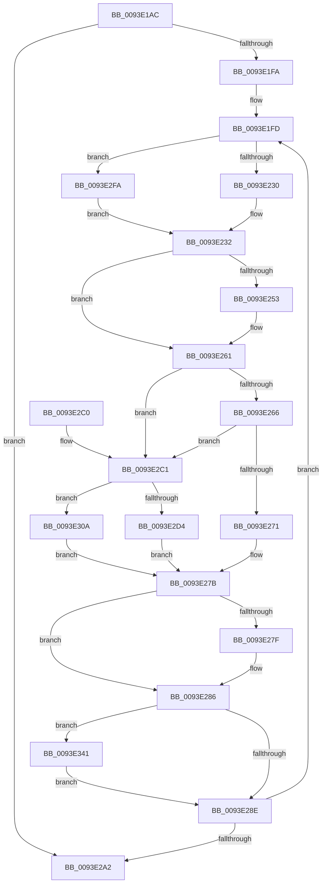

# MiPfExecuteReadList

- RVA: `0x0093E1AC`–`0x0093E35C` (길이 `432` bytes)
- VA: `0x000000014093E1AC`
- 실행 섹션: `PAGE`
- PDB 이름 있음: `예`; PDB Function 태그: `아니요`
- unwind 정보 RVA: `0x0008FFDC`
- 디코드: `106`개 명령, `432/432` bytes 표시
- 미해석 바이트: `0` (있으면 어셈블리에 `.byte`로 보존)

> 이 문서는 커널 이미지의 기계어와 PDB 기호를 분석해 생성했습니다. 4번과 5번은 함수 원형과 자료형을 바이너리 사용 방식에서 추정한 C 해석이며 원본 소스 복구 결과는 아닙니다.

## 1. Dependencies

- 직접 호출 지점: **5**; 고유 호출 대상: **5**
- 직접 호출자로 확인된 함수: **3**
- RIP 상대 이미지 참조: **0**

### Outgoing calls
- `0x0093E21B` → [MiReferenceInPageFile](../../text/38/MiReferenceInPageFile_function_00380880.md) (function, `0x00380880`)
- `0x0093E274` → [MiReadFromMemoryPagefile](../../text/4D/MiReadFromMemoryPagefile_function_004DB6B0.md) (function, `0x004DB6B0`)
- `0x0093E2F3` → [MiPageRead](../../text/29/MiPageRead_function_0029A554.md) (function, `0x0029A554`)
- `0x0093E337` → [SmPageRead](../../text/34/SmPageRead_function_0034C1A0.md) (function, `0x0034C1A0`)
- `0x0093E352` → [KeSetEvent](../../text/33/KeSetEvent_function_0033F310.md) (function, `0x0033F310`)

### Direct callers
- [MmPrefetchPagesEx](MmPrefetchPagesEx_function_0093C9A0.md) at `0x0093CC00`
- [MmPrefetchForCacheManager](MmPrefetchForCacheManager_function_0093D714.md) at `0x0093D82C`
- [MiPrefetchControlArea](MiPrefetchControlArea_function_0093E830.md) at `0x0093E971`

### Static image references
- 디코드된 RIP-relative 메모리 참조가 없습니다.

## 2. Other-region calls and transfers

- 다른 실행 섹션으로 향하는 call: **5**
  - `0x0093E21B` → [MiReferenceInPageFile](../../text/38/MiReferenceInPageFile_function_00380880.md) (`PAGE` → `.text`)
  - `0x0093E274` → [MiReadFromMemoryPagefile](../../text/4D/MiReadFromMemoryPagefile_function_004DB6B0.md) (`PAGE` → `.text`)
  - `0x0093E2F3` → [MiPageRead](../../text/29/MiPageRead_function_0029A554.md) (`PAGE` → `.text`)
  - `0x0093E337` → [SmPageRead](../../text/34/SmPageRead_function_0034C1A0.md) (`PAGE` → `.text`)
  - `0x0093E352` → [KeSetEvent](../../text/33/KeSetEvent_function_0033F310.md) (`PAGE` → `.text`)
- 별도 외부 분기/꼬리 이동을 확인하지 못했습니다.

## 3. Assembly (complete function range)

```asm
0093E1AC  48 8B C4                        mov rax, rsp
0093E1AF  48 89 58 08                     mov qword ptr [rax + 8], rbx
0093E1B3  48 89 68 10                     mov qword ptr [rax + 0x10], rbp
0093E1B7  48 89 70 20                     mov qword ptr [rax + 0x20], rsi
0093E1BB  44 89 40 18                     mov dword ptr [rax + 0x18], r8d
0093E1BF  57                              push rdi
0093E1C0  41 54                           push r12
0093E1C2  41 55                           push r13
0093E1C4  41 56                           push r14
0093E1C6  41 57                           push r15
0093E1C8  48 83 EC 40                     sub rsp, 0x40
0093E1CC  65 48 8B 34 25 88 01 00 00      mov rsi, qword ptr gs:[0x188]
0093E1D5  4C 8D B1 E0 00 00 00            lea r14, [rcx + 0xe0]
0093E1DC  49 8B 1E                        mov rbx, qword ptr [r14]
0093E1DF  44 8B E2                        mov r12d, edx
0093E1E2  41 83 E4 02                     and r12d, 2
0093E1E6  45 32 FF                        xor r15b, r15b
0093E1E9  4D 8B E9                        mov r13, r9
0093E1EC  45 8B C8                        mov r9d, r8d
0093E1EF  8B FA                           mov edi, edx
0093E1F1  49 3B DE                        cmp rbx, r14
0093E1F4  0F 84 A8 00 00 00               je 0x14093e2a2
0093E1FA  83 E7 01                        and edi, 1
0093E1FD  48 8B AB 00 01 00 00            mov rbp, qword ptr [rbx + 0x100]
0093E204  45 33 C0                        xor r8d, r8d
0093E207  41 8B D1                        mov edx, r9d
0093E20A  48 8B CB                        mov rcx, rbx
0093E20D  66 83 4D 0A 42                  or word ptr [rbp + 0xa], 0x42
0093E212  8B 45 28                        mov eax, dword ptr [rbp + 0x28]
0093E215  89 83 B8 00 00 00               mov dword ptr [rbx + 0xb8], eax
0093E21B  E8 60 26 A4 FF                  call 0x140380880
0093E220  44 8B 83 C0 00 00 00            mov r8d, dword ptr [rbx + 0xc0]
0093E227  48 85 C0                        test rax, rax
0093E22A  0F 84 CA 00 00 00               je 0x14093e2fa
0093E230  33 C9                           xor ecx, ecx
0093E232  48 89 83 C8 00 00 00            mov qword ptr [rbx + 0xc8], rax
0093E239  48 83 A3 A8 00 00 00 00         and qword ptr [rbx + 0xa8], 0
0093E241  48 8B 83 F0 00 00 00            mov rax, qword ptr [rbx + 0xf0]
0093E248  48 89 83 E8 00 00 00            mov qword ptr [rbx + 0xe8], rax
0093E24F  85 FF                           test edi, edi
0093E251  74 0E                           je 0x14093e261
0093E253  44 8A BE AC 05 00 00            mov r15b, byte ptr [rsi + 0x5ac]
0093E25A  C6 86 AC 05 00 00 01            mov byte ptr [rsi + 0x5ac], 1
0093E261  48 85 C9                        test rcx, rcx
0093E264  74 5B                           je 0x14093e2c1
0093E266  66 0F BA A1 AC 00 00 00 0B      bt word ptr [rcx + 0xac], 0xb
0093E26F  73 50                           jae 0x14093e2c1
0093E271  48 8B D3                        mov rdx, rbx
0093E274  E8 37 D4 B9 FF                  call 0x1404db6b0
0093E279  33 C0                           xor eax, eax
0093E27B  85 FF                           test edi, edi
0093E27D  74 07                           je 0x14093e286
0093E27F  44 88 BE AC 05 00 00            mov byte ptr [rsi + 0x5ac], r15b
0093E286  85 C0                           test eax, eax
0093E288  0F 88 B3 00 00 00               js 0x14093e341
0093E28E  48 8B 1B                        mov rbx, qword ptr [rbx]
0093E291  44 8B 8C 24 80 00 00 00         mov r9d, dword ptr [rsp + 0x80]
0093E299  49 3B DE                        cmp rbx, r14
0093E29C  0F 85 5B FF FF FF               jne 0x14093e1fd
0093E2A2  4C 8D 5C 24 40                  lea r11, [rsp + 0x40]
0093E2A7  49 8B 5B 30                     mov rbx, qword ptr [r11 + 0x30]
0093E2AB  49 8B 6B 38                     mov rbp, qword ptr [r11 + 0x38]
0093E2AF  49 8B 73 48                     mov rsi, qword ptr [r11 + 0x48]
0093E2B3  49 8B E3                        mov rsp, r11
0093E2B6  41 5F                           pop r15
0093E2B8  41 5E                           pop r14
0093E2BA  41 5D                           pop r13
0093E2BC  41 5C                           pop r12
0093E2BE  5F                              pop rdi
0093E2BF  C3                              ret
0093E2C0  CC                              int3
0093E2C1  4C 8D 53 50                     lea r10, [rbx + 0x50]
0093E2C5  4C 8D 4B 20                     lea r9, [rbx + 0x20]
0093E2C9  48 8D 53 60                     lea rdx, [rbx + 0x60]
0093E2CD  41 0F BA E0 0A                  bt r8d, 0xa
0093E2D2  72 36                           jb 0x14093e30a
0093E2D4  48 8B 8B C8 00 00 00            mov rcx, qword ptr [rbx + 0xc8]
0093E2DB  4C 8B C2                        mov r8, rdx
0093E2DE  4C 89 6C 24 30                  mov qword ptr [rsp + 0x30], r13
0093E2E3  48 8B D5                        mov rdx, rbp
0093E2E6  C7 44 24 28 06 00 00 00         mov dword ptr [rsp + 0x28], 6
0093E2EE  4C 89 54 24 20                  mov qword ptr [rsp + 0x20], r10
0093E2F3  E8 5C C2 95 FF                  call 0x14029a554
0093E2F8  EB 81                           jmp 0x14093e27b
0093E2FA  48 8B 8B C8 00 00 00            mov rcx, qword ptr [rbx + 0xc8]
0093E301  48 8B 41 18                     mov rax, qword ptr [rcx + 0x18]
0093E305  E9 28 FF FF FF                  jmp 0x14093e232
0093E30A  48 8B 89 D8 00 00 00            mov rcx, qword ptr [rcx + 0xd8]
0093E311  41 8B C4                        mov eax, r12d
0093E314  F7 D8                           neg eax
0093E316  4C 89 54 24 20                  mov qword ptr [rsp + 0x20], r10
0093E31B  48 8D 83 10 01 00 00            lea rax, [rbx + 0x110]
0093E322  4D 1B C0                        sbb r8, r8
0093E325  48 8B 89 B8 00 00 00            mov rcx, qword ptr [rcx + 0xb8]
0093E32C  49 83 E0 FE                     and r8, 0xfffffffffffffffe
0093E330  49 83 C0 03                     add r8, 3
0093E334  4C 0B C0                        or r8, rax
0093E337  E8 64 DE A0 FF                  call 0x14034c1a0
0093E33C  E9 3A FF FF FF                  jmp 0x14093e27b
0093E341  48 83 63 58 00                  and qword ptr [rbx + 0x58], 0
0093E346  48 8D 4B 20                     lea rcx, [rbx + 0x20]
0093E34A  45 33 C0                        xor r8d, r8d
0093E34D  89 43 50                        mov dword ptr [rbx + 0x50], eax
0093E350  33 D2                           xor edx, edx
0093E352  E8 B9 0F A0 FF                  call 0x14033f310
0093E357  E9 32 FF FF FF                  jmp 0x14093e28e
```

## 4. C-style interpretation (structured pseudocode)

```c
__int64 __fastcall MiPfExecuteReadList(__int64 a1, int a2, int a3, __int64 a4)
{
    __int64 result;
    __int64 v_r12;
    __int64 v_r15;
    __int64 v_rdi;
    __int64 v_rsp;
    unsigned __int64 v_stack_m10;
    unsigned int v_stack_m18;
    unsigned __int64 v_stack_m20;
    unsigned __int64 v_stack_m28;
    unsigned int v_stack_p18;

    *(unsigned __int64 *)(v_rsp + 8) = v_rbx;
    *(unsigned __int64 *)(v_rsp + 16) = v_rbp;
    *(unsigned __int64 *)(v_rsp + 32) = v_rsi;
    *(unsigned int *)(v_rsp + 24) = a3;
    v_rsp = (v_rsp) - (64);
    v_r12 = (unsigned int)(((unsigned int)(a2)) & (2));
    v_r15 = 0;
    if ((*(unsigned __int64 *)(a1 + 224)) == (a1 + 224)) goto loc_0093E2A2;
    v_rdi = (unsigned int)(((unsigned int)(a2)) & (1));
loc_0093E1FD:
    a3 = 0;
    *(unsigned int *)(*(unsigned __int64 *)(a1 + 224) + 184) = (unsigned int)((unsigned int)(*(unsigned int *)(*(unsigned __int64 *)(*(unsigned __int64 *)(a1 + 224) + 256) + 40)));
    result = MiReferenceInPageFile(*(unsigned __int64 *)(a1 + 224), (unsigned int)((unsigned int)((unsigned int)(a3))), a3, (unsigned int)(a3));
    if (result == 0) goto loc_0093E2FA;
    a1 = 0;
loc_0093E232:
    *(unsigned __int64 *)(*(unsigned __int64 *)(a1 + 224) + 200) = result;
    *(unsigned __int64 *)(*(unsigned __int64 *)(a1 + 224) + 232) = *(unsigned __int64 *)(*(unsigned __int64 *)(a1 + 224) + 240);
    if ((unsigned int)(v_rdi) != 0) {
        v_r15 = *(unsigned __int8 *)(*(unsigned __int64 *)(gs_base + (0 + 392)) + 1452);
        *(unsigned __int8 *)(*(unsigned __int64 *)(gs_base + (0 + 392)) + 1452) = 1;
    }
    if (0 == 0) goto loc_0093E2C1;
    if (condition_is_above_or_equal) goto loc_0093E2C1;
    result = MiReadFromMemoryPagefile(a1, *(unsigned __int64 *)(a1 + 224), (unsigned int)(*(unsigned int *)(*(unsigned __int64 *)(a1 + 224) + 192)), (unsigned int)(a3));
    result = 0;
loc_0093E27B:
    if ((unsigned int)(v_rdi) != 0) {
        *(unsigned __int8 *)(*(unsigned __int64 *)(gs_base + (0 + 392)) + 1452) = (unsigned __int8)(v_r15);
    }
    if (sign_flag) goto loc_0093E341;
loc_0093E28E:
    if ((*(unsigned __int64 *)(*(unsigned __int64 *)(a1 + 224))) != (a1 + 224)) goto loc_0093E1FD;
loc_0093E2A2:
    return result;
loc_0093E2C1:
    if ((*(unsigned __int64 *)(*(unsigned __int64 *)(a1 + 224))) < (a1 + 224)) goto loc_0093E30A;
    v_stack_m10 = a4;
    v_stack_m18 = 6;
    v_stack_m20 = *(unsigned __int64 *)(v_stack_m28 + 48) + 80;
    result = MiPageRead(*(unsigned __int64 *)(*(unsigned __int64 *)(v_stack_m28 + 48) + 200), *(unsigned __int64 *)(v_stack_m28 + 56), *(unsigned __int64 *)(v_stack_m28 + 48) + 96, *(unsigned __int64 *)(v_stack_m28 + 48) + 32);
    goto loc_0093E27B;
loc_0093E2FA:
    goto loc_0093E232;
loc_0093E30A:
    result = (unsigned int)(-((unsigned int)((unsigned int)(v_r12))));
    v_stack_m20 = *(unsigned __int64 *)(v_stack_m28 + 48) + 80;
    a3 = (*(unsigned __int64 *)(v_stack_m28 + 48) + 96) & (-2);
    a3 = (a3) + (3);
    a3 = (a3) | (*(unsigned __int64 *)(v_stack_m28 + 48) + 272);
    result = SmPageRead(*(unsigned __int64 *)(*(unsigned __int64 *)(*(unsigned __int64 *)(*(unsigned __int64 *)(v_stack_m28 + 48) + 200) + 216) + 184), *(unsigned __int64 *)(v_stack_m28 + 56), a3, *(unsigned __int64 *)(v_stack_m28 + 48) + 32);
    goto loc_0093E27B;
loc_0093E341:
    a3 = 0;
    *(unsigned int *)(*(unsigned __int64 *)(v_stack_m28 + 48) + 80) = (unsigned int)(result);
    a2 = 0;
    result = KeSetEvent(*(unsigned __int64 *)(v_stack_m28 + 48) + 32, a2, a3, *(unsigned __int64 *)(v_stack_m28 + 48) + 32);
    goto loc_0093E28E;
}
```

## 5. (Beta) C Style

```c
int64_t MiPfExecuteReadList(void *Arg1, int32_t Arg2, int32_t Arg3, int64_t Arg4)
{
    uint8_t *arg1 = (uint8_t *)Arg1;

    int64_t result;
    int64_t local_r12;
    int64_t local_r15;
    int64_t local_rdi;
    int64_t local_rsp;
    uint64_t v_stack_m10;
    uint32_t v_stack_m18;
    uint64_t v_stack_m20;
    uint64_t v_stack_m28;
    uint32_t v_stack_p18;

    *(uint64_t *)(local_rsp + 0x8) = local_rbx;
    *(uint64_t *)(local_rsp + 0x10) = local_rbp;
    *(uint64_t *)(local_rsp + 0x20) = local_rsi;
    *(uint32_t *)(local_rsp + 0x18) = Arg3;
    local_rsp = (local_rsp) - (64);
    local_r12 = (uint32_t)(((uint32_t)(Arg2)) & (2));
    local_r15 = 0;
    if ((*(uint64_t *)(arg1 + 0xE0)) == (Arg1 + 224)) goto loc_0093E2A2;
    local_rdi = (uint32_t)(((uint32_t)(Arg2)) & (1));
loc_0093E1FD:
    Arg3 = 0;
    *(uint32_t *)(*(uint64_t *)(arg1 + 0xE0) + 0xB8) = (uint32_t)((uint32_t)(*(uint32_t *)(*(uint64_t *)(*(uint64_t *)(arg1 + 0xE0) + 0x100) + 0x28)));
    result = MiReferenceInPageFile(*(uint64_t *)(arg1 + 0xE0), (uint32_t)((uint32_t)((uint32_t)(Arg3))), Arg3, (uint32_t)(Arg3));
    if (result == 0) goto loc_0093E2FA;
    Arg1 = 0;
loc_0093E232:
    *(uint64_t *)(*(uint64_t *)(arg1 + 0xE0) + 0xC8) = result;
    *(uint64_t *)(*(uint64_t *)(arg1 + 0xE0) + 0xE8) = *(uint64_t *)(*(uint64_t *)(arg1 + 0xE0) + 0xF0);
    if ((uint32_t)(local_rdi) != 0) {
        local_r15 = *(uint8_t *)(*(uint64_t *)(gs_base + (0 + 0x188)) + 0x5AC);
        *(uint8_t *)(*(uint64_t *)(gs_base + (0 + 0x188)) + 0x5AC) = 1;
    }
    if (0 == 0) goto loc_0093E2C1;
    if (condition_is_above_or_equal) goto loc_0093E2C1;
    result = MiReadFromMemoryPagefile(Arg1, *(uint64_t *)(arg1 + 0xE0), (uint32_t)(*(uint32_t *)(*(uint64_t *)(arg1 + 0xE0) + 0xC0)), (uint32_t)(Arg3));
    result = 0;
loc_0093E27B:
    if ((uint32_t)(local_rdi) != 0) {
        *(uint8_t *)(*(uint64_t *)(gs_base + (0 + 0x188)) + 0x5AC) = (uint8_t)(local_r15);
    }
    if (sign_flag) goto loc_0093E341;
loc_0093E28E:
    if ((*(uint64_t *)(*(uint64_t *)(arg1 + 0xE0))) != (Arg1 + 224)) goto loc_0093E1FD;
loc_0093E2A2:
    return result;
loc_0093E2C1:
    if ((*(uint64_t *)(*(uint64_t *)(arg1 + 0xE0))) < (Arg1 + 224)) goto loc_0093E30A;
    v_stack_m10 = Arg4;
    v_stack_m18 = 6;
    v_stack_m20 = *(uint64_t *)(v_stack_m28 + 0x30) + 80;
    result = MiPageRead(*(uint64_t *)(*(uint64_t *)(v_stack_m28 + 0x30) + 0xC8), *(uint64_t *)(v_stack_m28 + 0x38), *(uint64_t *)(v_stack_m28 + 0x30) + 96, *(uint64_t *)(v_stack_m28 + 0x30) + 32);
    goto loc_0093E27B;
loc_0093E2FA:
    goto loc_0093E232;
loc_0093E30A:
    result = (uint32_t)(-((uint32_t)((uint32_t)(local_r12))));
    v_stack_m20 = *(uint64_t *)(v_stack_m28 + 0x30) + 80;
    Arg3 = (*(uint64_t *)(v_stack_m28 + 0x30) + 96) & (-2);
    Arg3 = (Arg3) + (3);
    Arg3 = (Arg3) | (*(uint64_t *)(v_stack_m28 + 0x30) + 272);
    result = SmPageRead(*(uint64_t *)(*(uint64_t *)(*(uint64_t *)(*(uint64_t *)(v_stack_m28 + 0x30) + 0xC8) + 0xD8) + 0xB8), *(uint64_t *)(v_stack_m28 + 0x38), Arg3, *(uint64_t *)(v_stack_m28 + 0x30) + 32);
    goto loc_0093E27B;
loc_0093E341:
    Arg3 = 0;
    *(uint32_t *)(*(uint64_t *)(v_stack_m28 + 0x30) + 0x50) = (uint32_t)(result);
    Arg2 = 0;
    result = KeSetEvent(*(uint64_t *)(v_stack_m28 + 0x30) + 32, Arg2, Arg3, *(uint64_t *)(v_stack_m28 + 0x30) + 32);
    goto loc_0093E28E;
}
```

### 관측된 메모리 오프셋

구조체 형식이 확인되지 않은 접근은 인자 기준의 오프셋으로만 기록했습니다.

| 기준 인자 | 오프셋 표현 | 폭 (bit) | 접근 |
|---|---:|---:|---|
| `Arg1` | `+ 0x0` | `64` | `R` |
| `Arg1` | `+ 0xE0` | `64` | `R` |

## 6. Execution-region graph

[열기: 2D/3D 그래프와 함수 탐색 컨트롤 패널](../../../control-panel.html?section=page&rva=0x0093E1AC&view=graph)

- 2D 그래프는 위에서 아래로 흐르고, 3D 그래프는 빈 공간을 드래그해 회전합니다. Shift+드래그는 이동, 휠은 확대·축소, 함수 노드 선택은 대상 보고서 이동입니다.

### Static fallback


