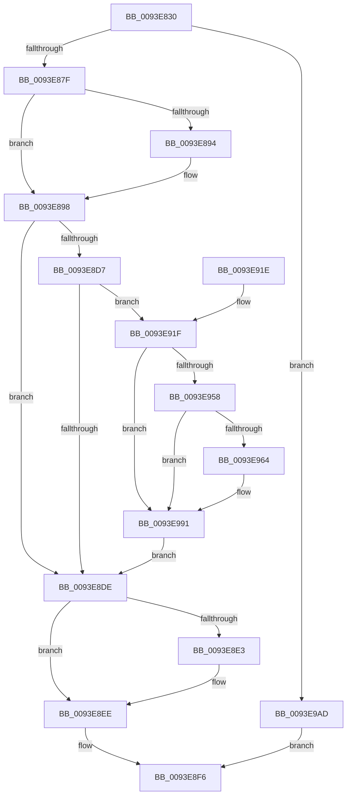

# MiPrefetchControlArea

- RVA: `0x0093E830`–`0x0093E9B7` (길이 `391` bytes)
- VA: `0x000000014093E830`
- 실행 섹션: `PAGE`
- PDB 이름 있음: `예`; PDB Function 태그: `아니요`
- unwind 정보 RVA: `0x00090028`
- 디코드: `104`개 명령, `391/391` bytes 표시
- 미해석 바이트: `0` (있으면 어셈블리에 `.byte`로 보존)

> 이 문서는 커널 이미지의 기계어와 PDB 기호를 분석해 생성했습니다. 4번과 5번은 함수 원형과 자료형을 바이너리 사용 방식에서 추정한 C 해석이며 원본 소스 복구 결과는 아닙니다.

## 1. Dependencies

- 직접 호출 지점: **11**; 고유 호출 대상: **11**
- 직접 호출자로 확인된 함수: **4**
- RIP 상대 이미지 참조: **0**

### Outgoing calls
- `0x0093E86E` → [MiGetInPageAutoBoostLock](../../text/36/MiGetInPageAutoBoostLock_function_0036D3CC.md) (function, `0x0036D3CC`)
- `0x0093E887` → [KeAbPreAcquire](../../text/21/KeAbPreAcquire_function_00210230.md) (function, `0x00210230`)
- `0x0093E8C9` → [MiPfPrepareSequentialReadList](MiPfPrepareSequentialReadList_function_0093D8E8.md) (function, `0x0093D8E8`)
- `0x0093E8E9` → [KeAbPostReleaseEx](../../text/26/KeAbPostReleaseEx_function_00262210.md) (function, `0x00262210`)
- `0x0093E8F1` → [MiDereferenceInPageAutoBoostLock](../../text/36/MiDereferenceInPageAutoBoostLock_function_0036D398.md) (function, `0x0036D398`)
- `0x0093E8F9` → [KeLeaveCriticalRegionThread](../../text/25/KeLeaveCriticalRegionThread_function_0025EFF0.md) (function, `0x0025EFF0`)
- `0x0093E948` → [MiPfPutPagesInTransition](../../text/36/MiPfPutPagesInTransition_function_003640EC.md) (function, `0x003640EC`)
- `0x0093E971` → [MiPfExecuteReadList](MiPfExecuteReadList_function_0093E1AC.md) (function, `0x0093E1AC`)
- `0x0093E987` → [MiPfCompletePrefetchIos](../../text/36/MiPfCompletePrefetchIos_function_0036C4B0.md) (function, `0x0036C4B0`)
- `0x0093E991` → [MiReleaseReadListResources](MiReleaseReadListResources_function_0093D570.md) (function, `0x0093D570`)
- `0x0093E9A3` → [ExFreePoolWithTag](../../poolcode/B8/ExFreePoolWithTag_function_00B82870.md) (function, `0x00B82870`)

### Direct callers
- [MiWalkEntireImage](../../text/36/MiWalkEntireImage_function_00365D70.md) at `0x00366C16`
- [MiSetPagesModified](../../text/49/MiSetPagesModified_function_0049DC2C.md) at `0x0049DD56`
- [MiValidateSectionCreate](../94/MiValidateSectionCreate_function_00940190.md) at `0x0094052C`
- [MiLoadSectionIntoVsmEnclave](../AB/MiLoadSectionIntoVsmEnclave_function_00AB1D4C.md) at `0x00AB1F4D`

### Static image references
- 디코드된 RIP-relative 메모리 참조가 없습니다.

## 2. Other-region calls and transfers

- 다른 실행 섹션으로 향하는 call: **8**
  - `0x0093E86E` → [MiGetInPageAutoBoostLock](../../text/36/MiGetInPageAutoBoostLock_function_0036D3CC.md) (`PAGE` → `.text`)
  - `0x0093E887` → [KeAbPreAcquire](../../text/21/KeAbPreAcquire_function_00210230.md) (`PAGE` → `.text`)
  - `0x0093E8E9` → [KeAbPostReleaseEx](../../text/26/KeAbPostReleaseEx_function_00262210.md) (`PAGE` → `.text`)
  - `0x0093E8F1` → [MiDereferenceInPageAutoBoostLock](../../text/36/MiDereferenceInPageAutoBoostLock_function_0036D398.md) (`PAGE` → `.text`)
  - `0x0093E8F9` → [KeLeaveCriticalRegionThread](../../text/25/KeLeaveCriticalRegionThread_function_0025EFF0.md) (`PAGE` → `.text`)
  - `0x0093E948` → [MiPfPutPagesInTransition](../../text/36/MiPfPutPagesInTransition_function_003640EC.md) (`PAGE` → `.text`)
  - `0x0093E987` → [MiPfCompletePrefetchIos](../../text/36/MiPfCompletePrefetchIos_function_0036C4B0.md) (`PAGE` → `.text`)
  - `0x0093E9A3` → [ExFreePoolWithTag](../../poolcode/B8/ExFreePoolWithTag_function_00B82870.md) (`PAGE` → `POOLCODE`)
- 별도 외부 분기/꼬리 이동을 확인하지 못했습니다.

## 3. Assembly (complete function range)

```asm
0093E830  48 8B C4                        mov rax, rsp
0093E833  48 89 58 08                     mov qword ptr [rax + 8], rbx
0093E837  48 89 68 10                     mov qword ptr [rax + 0x10], rbp
0093E83B  48 89 70 18                     mov qword ptr [rax + 0x18], rsi
0093E83F  57                              push rdi
0093E840  41 54                           push r12
0093E842  41 55                           push r13
0093E844  41 56                           push r14
0093E846  41 57                           push r15
0093E848  48 83 EC 60                     sub rsp, 0x60
0093E84C  48 83 60 C8 00                  and qword ptr [rax - 0x38], 0
0093E851  45 8B F9                        mov r15d, r9d
0093E854  65 48 8B 3C 25 88 01 00 00      mov rdi, qword ptr gs:[0x188]
0093E85D  4D 8B E0                        mov r12, r8
0093E860  48 8B DA                        mov rbx, rdx
0093E863  4C 8B E9                        mov r13, rcx
0093E866  66 FF 8F E4 01 00 00            dec word ptr [rdi + 0x1e4]
0093E86D  90                              nop
0093E86E  E8 59 EB A2 FF                  call 0x14036d3cc
0093E873  48 8B F0                        mov rsi, rax
0093E876  48 85 C0                        test rax, rax
0093E879  0F 84 2E 01 00 00               je 0x14093e9ad
0093E87F  45 33 C0                        xor r8d, r8d
0093E882  33 D2                           xor edx, edx
0093E884  48 8B C8                        mov rcx, rax
0093E887  E8 A4 19 8D FF                  call 0x140210230
0093E88C  48 8B E8                        mov rbp, rax
0093E88F  48 85 C0                        test rax, rax
0093E892  74 04                           je 0x14093e898
0093E894  C6 40 0A 01                     mov byte ptr [rax + 0xa], 1
0093E898  44 8B B4 24 B8 00 00 00         mov r14d, dword ptr [rsp + 0xb8]
0093E8A0  48 8D 44 24 50                  lea rax, [rsp + 0x50]
0093E8A5  48 89 44 24 40                  mov qword ptr [rsp + 0x40], rax
0093E8AA  45 33 C9                        xor r9d, r9d
0093E8AD  48 89 74 24 38                  mov qword ptr [rsp + 0x38], rsi
0093E8B2  4C 8B C3                        mov r8, rbx
0093E8B5  44 89 74 24 30                  mov dword ptr [rsp + 0x30], r14d
0093E8BA  49 8B D5                        mov rdx, r13
0093E8BD  44 89 7C 24 28                  mov dword ptr [rsp + 0x28], r15d
0093E8C2  33 C9                           xor ecx, ecx
0093E8C4  4C 89 64 24 20                  mov qword ptr [rsp + 0x20], r12
0093E8C9  E8 1A F0 FF FF                  call 0x14093d8e8
0093E8CE  45 33 FF                        xor r15d, r15d
0093E8D1  8B D8                           mov ebx, eax
0093E8D3  85 C0                           test eax, eax
0093E8D5  78 07                           js 0x14093e8de
0093E8D7  4C 39 7C 24 50                  cmp qword ptr [rsp + 0x50], r15
0093E8DC  75 41                           jne 0x14093e91f
0093E8DE  48 85 ED                        test rbp, rbp
0093E8E1  74 0B                           je 0x14093e8ee
0093E8E3  48 8B D5                        mov rdx, rbp
0093E8E6  48 8B CE                        mov rcx, rsi
0093E8E9  E8 22 39 92 FF                  call 0x140262210
0093E8EE  48 8B CE                        mov rcx, rsi
0093E8F1  E8 A2 EA A2 FF                  call 0x14036d398
0093E8F6  48 8B CF                        mov rcx, rdi
0093E8F9  E8 F2 06 92 FF                  call 0x14025eff0
0093E8FE  4C 8D 5C 24 60                  lea r11, [rsp + 0x60]
0093E903  8B C3                           mov eax, ebx
0093E905  49 8B 5B 30                     mov rbx, qword ptr [r11 + 0x30]
0093E909  49 8B 6B 38                     mov rbp, qword ptr [r11 + 0x38]
0093E90D  49 8B 73 40                     mov rsi, qword ptr [r11 + 0x40]
0093E911  49 8B E3                        mov rsp, r11
0093E914  41 5F                           pop r15
0093E916  41 5E                           pop r14
0093E918  41 5D                           pop r13
0093E91A  41 5C                           pop r12
0093E91C  5F                              pop rdi
0093E91D  C3                              ret
0093E91E  CC                              int3
0093E91F  FE 87 AE 05 00 00               inc byte ptr [rdi + 0x5ae]
0093E925  45 8B CE                        mov r9d, r14d
0093E928  48 8B 44 24 50                  mov rax, qword ptr [rsp + 0x50]
0093E92D  33 D2                           xor edx, edx
0093E92F  44 8B 84 24 B0 00 00 00         mov r8d, dword ptr [rsp + 0xb0]
0093E937  4C 89 7C 24 20                  mov qword ptr [rsp + 0x20], r15
0093E93C  44 89 B8 D0 00 00 00            mov dword ptr [rax + 0xd0], r15d
0093E943  48 8B 4C 24 50                  mov rcx, qword ptr [rsp + 0x50]
0093E948  E8 9F 57 A2 FF                  call 0x1403640ec
0093E94D  48 8B 4C 24 50                  mov rcx, qword ptr [rsp + 0x50]
0093E952  8B D8                           mov ebx, eax
0093E954  85 C0                           test eax, eax
0093E956  78 39                           js 0x14093e991
0093E958  48 8D 81 E0 00 00 00            lea rax, [rcx + 0xe0]
0093E95F  48 39 00                        cmp qword ptr [rax], rax
0093E962  74 2D                           je 0x14093e991
0093E964  8B 94 24 B0 00 00 00            mov edx, dword ptr [rsp + 0xb0]
0093E96B  45 33 C9                        xor r9d, r9d
0093E96E  45 8B C6                        mov r8d, r14d
0093E971  E8 36 F8 FF FF                  call 0x14093e1ac
0093E976  48 8B 4C 24 50                  mov rcx, qword ptr [rsp + 0x50]
0093E97B  45 33 C0                        xor r8d, r8d
0093E97E  48 81 C1 E0 00 00 00            add rcx, 0xe0
0093E985  33 D2                           xor edx, edx
0093E987  E8 24 DB A2 FF                  call 0x14036c4b0
0093E98C  48 8B 4C 24 50                  mov rcx, qword ptr [rsp + 0x50]
0093E991  E8 DA EB FF FF                  call 0x14093d570
0093E996  FE 8F AE 05 00 00               dec byte ptr [rdi + 0x5ae]
0093E99C  33 D2                           xor edx, edx
0093E99E  48 8B 4C 24 50                  mov rcx, qword ptr [rsp + 0x50]
0093E9A3  E8 C8 3E 24 00                  call 0x140b82870
0093E9A8  E9 31 FF FF FF                  jmp 0x14093e8de
0093E9AD  BB 9A 00 00 C0                  mov ebx, 0xc000009a
0093E9B2  E9 3F FF FF FF                  jmp 0x14093e8f6
```

## 4. C-style interpretation (structured pseudocode)

```c
__int64 __fastcall MiPrefetchControlArea(__int64 a1, __int64 a2, __int64 a3, int a4, unsigned int a5, unsigned int a6)
{
    __int64 result;
    __int64 v_r15;
    __int64 v_rsp;
    unsigned __int64 v_stack_m10;
    unsigned __int64 v_stack_m28;
    unsigned __int64 v_stack_m38;
    unsigned __int64 v_stack_m40;
    unsigned __int64 v_stack_m48;
    unsigned __int64 v_stack_m50;
    unsigned int v_stack_m58;
    unsigned int v_stack_m60;
    unsigned __int64 v_stack_m68;

    *(unsigned __int64 *)(v_rsp + 8) = v_rbx;
    *(unsigned __int64 *)(v_rsp + 16) = v_rbp;
    *(unsigned __int64 *)(v_rsp + 24) = v_rsi;
    v_rsp = (v_rsp) - (96);
    result = MiGetInPageAutoBoostLock(a1, a2, a3, a4);
    if (result == 0) goto loc_0093E9AD;
    a3 = 0;
    a2 = 0;
    result = KeAbPreAcquire(result, a2, a3, a4);
    if (result != 0) {
        *(unsigned __int8 *)(result + 10) = 1;
    }
    v_stack_m48 = v_stack_m38;
    a4 = 0;
    v_stack_m50 = result;
    v_stack_m58 = (unsigned int)((unsigned int)(a6));
    v_stack_m60 = (unsigned int)((unsigned int)(a4));
    a1 = 0;
    v_stack_m68 = 0;
    result = MiPfPrepareSequentialReadList(a1, a1, 0, a4);
    v_r15 = 0;
    if (sign_flag) goto loc_0093E8DE;
    if (v_stack_m38 != 0) goto loc_0093E91F;
loc_0093E8DE:
    if (result != 0) {
        a2 = result;
        a1 = result;
        result = KeAbPostReleaseEx(a1, a2, 0, a4);
    }
    result = MiDereferenceInPageAutoBoostLock(result, a2, 0, a4);
loc_0093E8F6:
    result = KeLeaveCriticalRegionThread(*(unsigned __int64 *)(gs_base + (0 + 392)), a2, 0, a4);
    return (unsigned int)((unsigned int)((unsigned int)((unsigned int)(result))));
loc_0093E91F:
    a2 = 0;
    v_stack_m40 = 0;
    *(unsigned int *)(v_stack_m10 + 208) = 0;
    result = MiPfPutPagesInTransition(v_stack_m10, a2, (unsigned int)(a5), (unsigned int)((unsigned int)((unsigned int)(a6))));
    if (sign_flag) goto loc_0093E991;
    result = v_stack_m10 + 224;
    if ((*(unsigned __int64 *)(v_stack_m10 + 224)) != (v_stack_m10 + 224)) {
        a2 = a5;
        a4 = 0;
        a3 = (unsigned int)((unsigned int)(a6));
        result = MiPfExecuteReadList(v_stack_m10, a2, a3, a4);
        a1 = v_stack_m10;
        a3 = 0;
        a1 = (a1) + (224);
        a2 = 0;
        result = MiPfCompletePrefetchIos(a1, a2, a3, a4);
        a1 = v_stack_m10;
    }
    result = MiReleaseReadListResources(a1, a2, a3, a4);
    a2 = 0;
    result = ExFreePoolWithTag(v_stack_m10, a2, a3, a4);
    goto loc_0093E8DE;
loc_0093E9AD:
    goto loc_0093E8F6;
}
```

## 5. (Beta) C Style

```c
int64_t MiPrefetchControlArea(int64_t Arg1, int64_t Arg2, int64_t Arg3, int32_t Arg4, uint32_t Arg5, uint32_t Arg6)
{
    int64_t result;
    int64_t local_r15;
    int64_t local_rsp;
    uint64_t v_stack_m10;
    uint64_t v_stack_m28;
    uint64_t v_stack_m38;
    uint64_t v_stack_m40;
    uint64_t v_stack_m48;
    uint64_t v_stack_m50;
    uint32_t v_stack_m58;
    uint32_t v_stack_m60;
    uint64_t v_stack_m68;

    *(uint64_t *)(local_rsp + 0x8) = local_rbx;
    *(uint64_t *)(local_rsp + 0x10) = local_rbp;
    *(uint64_t *)(local_rsp + 0x18) = local_rsi;
    local_rsp = (local_rsp) - (96);
    result = MiGetInPageAutoBoostLock(Arg1, Arg2, Arg3, Arg4);
    if (result == 0) goto loc_0093E9AD;
    Arg3 = 0;
    Arg2 = 0;
    result = KeAbPreAcquire(result, Arg2, Arg3, Arg4);
    if (result != 0) {
        *(uint8_t *)(result + 0xA) = 1;
    }
    v_stack_m48 = v_stack_m38;
    Arg4 = 0;
    v_stack_m50 = result;
    v_stack_m58 = (uint32_t)((uint32_t)(Arg6));
    v_stack_m60 = (uint32_t)((uint32_t)(Arg4));
    Arg1 = 0;
    v_stack_m68 = 0;
    result = MiPfPrepareSequentialReadList(Arg1, Arg1, 0, Arg4);
    local_r15 = 0;
    if (sign_flag) goto loc_0093E8DE;
    if (v_stack_m38 != 0) goto loc_0093E91F;
loc_0093E8DE:
    if (result != 0) {
        Arg2 = result;
        Arg1 = result;
        result = KeAbPostReleaseEx(Arg1, Arg2, 0, Arg4);
    }
    result = MiDereferenceInPageAutoBoostLock(result, Arg2, 0, Arg4);
loc_0093E8F6:
    result = KeLeaveCriticalRegionThread(*(uint64_t *)(gs_base + (0 + 0x188)), Arg2, 0, Arg4);
    return (uint32_t)((uint32_t)((uint32_t)((uint32_t)(result))));
loc_0093E91F:
    Arg2 = 0;
    v_stack_m40 = 0;
    *(uint32_t *)(v_stack_m10 + 0xD0) = 0;
    result = MiPfPutPagesInTransition(v_stack_m10, Arg2, (uint32_t)(Arg5), (uint32_t)((uint32_t)((uint32_t)(Arg6))));
    if (sign_flag) goto loc_0093E991;
    result = v_stack_m10 + 224;
    if ((*(uint64_t *)(v_stack_m10 + 0xE0)) != (v_stack_m10 + 224)) {
        Arg2 = Arg5;
        Arg4 = 0;
        Arg3 = (uint32_t)((uint32_t)(Arg6));
        result = MiPfExecuteReadList(v_stack_m10, Arg2, Arg3, Arg4);
        Arg1 = v_stack_m10;
        Arg3 = 0;
        Arg1 = (Arg1) + (224);
        Arg2 = 0;
        result = MiPfCompletePrefetchIos(Arg1, Arg2, Arg3, Arg4);
        Arg1 = v_stack_m10;
    }
    result = MiReleaseReadListResources(Arg1, Arg2, Arg3, Arg4);
    Arg2 = 0;
    result = ExFreePoolWithTag(v_stack_m10, Arg2, Arg3, Arg4);
    goto loc_0093E8DE;
loc_0093E9AD:
    goto loc_0093E8F6;
}
```

## 6. Execution-region graph

[열기: 2D/3D 그래프와 함수 탐색 컨트롤 패널](../../../control-panel.html?section=page&rva=0x0093E830&view=graph)

- 2D 그래프는 위에서 아래로 흐르고, 3D 그래프는 빈 공간을 드래그해 회전합니다. Shift+드래그는 이동, 휠은 확대·축소, 함수 노드 선택은 대상 보고서 이동입니다.

### Static fallback


