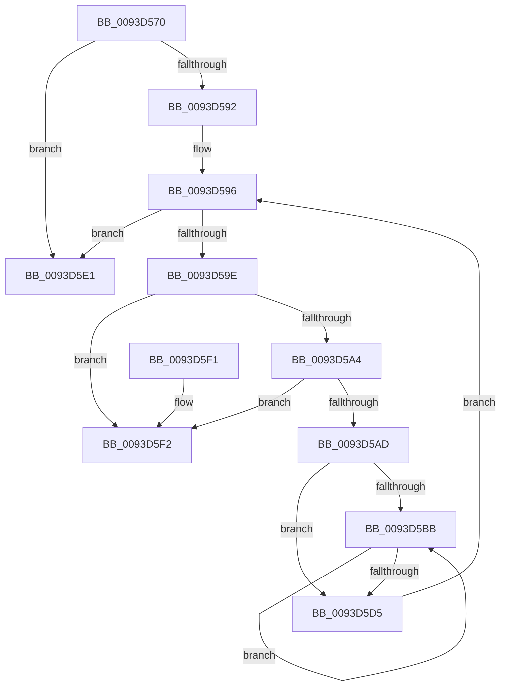

# MiReleaseReadListResources

- RVA: `0x0093D570`–`0x0093D5F9` (길이 `137` bytes)
- VA: `0x000000014093D570`
- 실행 섹션: `PAGE`
- PDB 이름 있음: `예`; PDB Function 태그: `아니요`
- unwind 정보 RVA: `0x0006383C`
- 디코드: `43`개 명령, `137/137` bytes 표시
- 미해석 바이트: `0` (있으면 어셈블리에 `.byte`로 보존)

> 이 문서는 커널 이미지의 기계어와 PDB 기호를 분석해 생성했습니다. 4번과 5번은 함수 원형과 자료형을 바이너리 사용 방식에서 추정한 C 해석이며 원본 소스 복구 결과는 아닙니다.

## 1. Dependencies

- 직접 호출 지점: **3**; 고유 호출 대상: **3**
- 직접 호출자로 확인된 함수: **7**
- RIP 상대 이미지 참조: **0**

### Outgoing calls
- `0x0093D586` → [MiFreeReadListPages](MiFreeReadListPages_function_0093D600.md) (function, `0x0093D600`)
- `0x0093D5C9` → [MiRemoveViewsFromSectionWithPfn](../../text/29/MiRemoveViewsFromSectionWithPfn_function_002986D4.md) (function, `0x002986D4`)
- `0x0093D5DA` → [ExFreePoolWithTag](../../poolcode/B8/ExFreePoolWithTag_function_00B82870.md) (function, `0x00B82870`)

### Direct callers
- [MmWaitForCacheManagerPrefetch](../../text/36/MmWaitForCacheManagerPrefetch_function_0036D644.md) at `0x0036D68F`
- [MmPrefetchPagesEx](MmPrefetchPagesEx_function_0093C9A0.md) at `0x0093CC4C`
- [MmPrefetchPagesEx](MmPrefetchPagesEx_function_0093C9A0.md) at `0x0093CCAB`
- [MiPfPrepareReadList](MiPfPrepareReadList_function_0093CD5C.md) at `0x0093CE0E`
- [MiPfPrepareReadList](MiPfPrepareReadList_function_0093CD5C.md) at `0x0093D457`
- [MmPrefetchForCacheManager](MmPrefetchForCacheManager_function_0093D714.md) at `0x0093D890`
- [MiPfPrepareSequentialReadList](MiPfPrepareSequentialReadList_function_0093D8E8.md) at `0x0093DAFB`
- [MiPrefetchControlArea](MiPrefetchControlArea_function_0093E830.md) at `0x0093E991`
- [sub_00B25182](../B2/Unknown_function_00B25182.md) at `0x00B251D1`

### Static image references
- 디코드된 RIP-relative 메모리 참조가 없습니다.

## 2. Other-region calls and transfers

- 다른 실행 섹션으로 향하는 call: **2**
  - `0x0093D5C9` → [MiRemoveViewsFromSectionWithPfn](../../text/29/MiRemoveViewsFromSectionWithPfn_function_002986D4.md) (`PAGE` → `.text`)
  - `0x0093D5DA` → [ExFreePoolWithTag](../../poolcode/B8/ExFreePoolWithTag_function_00B82870.md) (`PAGE` → `POOLCODE`)
- 별도 외부 분기/꼬리 이동을 확인하지 못했습니다.

## 3. Assembly (complete function range)

```asm
0093D570  48 89 5C 24 08                  mov qword ptr [rsp + 8], rbx
0093D575  48 89 74 24 10                  mov qword ptr [rsp + 0x10], rsi
0093D57A  57                              push rdi
0093D57B  48 83 EC 20                     sub rsp, 0x20
0093D57F  48 8B 59 08                     mov rbx, qword ptr [rcx + 8]
0093D583  48 8B F9                        mov rdi, rcx
0093D586  E8 75 00 00 00                  call 0x14093d600
0093D58B  8B 43 38                        mov eax, dword ptr [rbx + 0x38]
0093D58E  A8 20                           test al, 0x20
0093D590  75 4F                           jne 0x14093d5e1
0093D592  48 83 C7 18                     add rdi, 0x18
0093D596  48 8B 1F                        mov rbx, qword ptr [rdi]
0093D599  48 3B DF                        cmp rbx, rdi
0093D59C  74 43                           je 0x14093d5e1
0093D59E  48 39 7B 08                     cmp qword ptr [rbx + 8], rdi
0093D5A2  75 4E                           jne 0x14093d5f2
0093D5A4  48 8B 03                        mov rax, qword ptr [rbx]
0093D5A7  48 39 58 08                     cmp qword ptr [rax + 8], rbx
0093D5AB  75 45                           jne 0x14093d5f2
0093D5AD  48 89 07                        mov qword ptr [rdi], rax
0093D5B0  33 F6                           xor esi, esi
0093D5B2  48 89 78 08                     mov qword ptr [rax + 8], rdi
0093D5B6  39 73 10                        cmp dword ptr [rbx + 0x10], esi
0093D5B9  76 1A                           jbe 0x14093d5d5
0093D5BB  48 8B 4C F3 18                  mov rcx, qword ptr [rbx + rsi*8 + 0x18]
0093D5C0  41 B8 04 00 00 00               mov r8d, 4
0093D5C6  8B 51 2C                        mov edx, dword ptr [rcx + 0x2c]
0093D5C9  E8 06 B1 95 FF                  call 0x1402986d4
0093D5CE  FF C6                           inc esi
0093D5D0  3B 73 10                        cmp esi, dword ptr [rbx + 0x10]
0093D5D3  72 E6                           jb 0x14093d5bb
0093D5D5  33 D2                           xor edx, edx
0093D5D7  48 8B CB                        mov rcx, rbx
0093D5DA  E8 91 52 24 00                  call 0x140b82870
0093D5DF  EB B5                           jmp 0x14093d596
0093D5E1  48 8B 5C 24 30                  mov rbx, qword ptr [rsp + 0x30]
0093D5E6  48 8B 74 24 38                  mov rsi, qword ptr [rsp + 0x38]
0093D5EB  48 83 C4 20                     add rsp, 0x20
0093D5EF  5F                              pop rdi
0093D5F0  C3                              ret
0093D5F1  CC                              int3
0093D5F2  B9 03 00 00 00                  mov ecx, 3
0093D5F7  CD 29                           int 0x29
```

## 4. C-style interpretation (structured pseudocode)

```c
__int64 __fastcall MiReleaseReadListResources(__int64 a1)
{
    __int64 result;
    __int64 v_rdi;
    __int64 v_rsi;
    __int64 v_rsp;
    unsigned __int64 v_stack_p10;
    unsigned __int64 v_stack_p8;

    v_stack_p8 = v_rbx;
    v_stack_p10 = v_rsi;
    v_rsp = (v_rsp) - (32);
    result = MiFreeReadListPages(a1, a2, a3, a4);
    if ((((unsigned __int8)((unsigned int)(*(unsigned int *)(*(unsigned __int64 *)(a1 + 8) + 56)))) & (32)) != 0) goto loc_0093D5E1;
    v_rdi = (a1) + (24);
loc_0093D596:
    if ((*(unsigned __int64 *)(v_rdi)) == v_rdi) goto loc_0093D5E1;
    if ((*(unsigned __int64 *)(*(unsigned __int64 *)(v_rdi) + 8)) != v_rdi) goto loc_0093D5F2;
    if ((*(unsigned __int64 *)(*(unsigned __int64 *)(*(unsigned __int64 *)(v_rdi)) + 8)) != (*(unsigned __int64 *)(v_rdi))) goto loc_0093D5F2;
    *(unsigned __int64 *)(v_rdi) = *(unsigned __int64 *)(*(unsigned __int64 *)(v_rdi));
    v_rsi = 0;
    *(unsigned __int64 *)(*(unsigned __int64 *)(*(unsigned __int64 *)(v_rdi)) + 8) = v_rdi;
    if ((*(unsigned int *)(*(unsigned __int64 *)(v_rdi) + 16)) <= 0) goto loc_0093D5D5;
loc_0093D5BB:
    result = MiRemoveViewsFromSectionWithPfn(*(unsigned __int64 *)(*(unsigned __int64 *)(v_rdi) + v_rsi * 8 + 24), (unsigned int)(*(unsigned int *)(*(unsigned __int64 *)(*(unsigned __int64 *)(v_rdi) + v_rsi * 8 + 24) + 44)), 4, a4);
    v_rsi = (unsigned int)((v_rsi) + 1);
    if (((unsigned int)(v_rsi)) < (*(unsigned int *)(*(unsigned __int64 *)(v_rdi) + 16))) goto loc_0093D5BB;
loc_0093D5D5:
    a2 = 0;
    result = ExFreePoolWithTag(*(unsigned __int64 *)(v_rdi), a2, 4, a4);
    goto loc_0093D596;
loc_0093D5E1:
    v_rsp = (v_rsp) + (32);
    return result;
loc_0093D5F2:
    return result;
}
```

## 5. (Beta) C Style

```c
int64_t MiReleaseReadListResources(void *Arg1)
{
    uint8_t *arg1 = (uint8_t *)Arg1;

    int64_t result;
    int64_t local_rdi;
    int64_t local_rsi;
    int64_t local_rsp;
    uint64_t v_stack_p10;
    uint64_t v_stack_p8;

    v_stack_p8 = local_rbx;
    v_stack_p10 = local_rsi;
    local_rsp = (local_rsp) - (32);
    result = MiFreeReadListPages(Arg1, a2, a3, a4);
    if ((((uint8_t)((uint32_t)(*(uint32_t *)(*(uint64_t *)(arg1 + 0x8) + 0x38)))) & (32)) != 0) goto loc_0093D5E1;
    local_rdi = (Arg1) + (24);
loc_0093D596:
    if ((*(uint64_t *)(local_rdi)) == local_rdi) goto loc_0093D5E1;
    if ((*(uint64_t *)(*(uint64_t *)(local_rdi) + 0x8)) != local_rdi) goto loc_0093D5F2;
    if ((*(uint64_t *)(*(uint64_t *)(*(uint64_t *)(local_rdi)) + 0x8)) != (*(uint64_t *)(local_rdi))) goto loc_0093D5F2;
    *(uint64_t *)(local_rdi) = *(uint64_t *)(*(uint64_t *)(local_rdi));
    local_rsi = 0;
    *(uint64_t *)(*(uint64_t *)(*(uint64_t *)(local_rdi)) + 0x8) = local_rdi;
    if ((*(uint32_t *)(*(uint64_t *)(local_rdi) + 0x10)) <= 0) goto loc_0093D5D5;
loc_0093D5BB:
    result = MiRemoveViewsFromSectionWithPfn(*(uint64_t *)(*(uint64_t *)(local_rdi) + local_rsi * 8 + 0x18), (uint32_t)(*(uint32_t *)(*(uint64_t *)(*(uint64_t *)(local_rdi) + local_rsi * 8 + 0x18) + 0x2C)), 4, a4);
    local_rsi = (uint32_t)((local_rsi) + 1);
    if (((uint32_t)(local_rsi)) < (*(uint32_t *)(*(uint64_t *)(local_rdi) + 0x10))) goto loc_0093D5BB;
loc_0093D5D5:
    a2 = 0;
    result = ExFreePoolWithTag(*(uint64_t *)(local_rdi), a2, 4, a4);
    goto loc_0093D596;
loc_0093D5E1:
    local_rsp = (local_rsp) + (32);
    return result;
loc_0093D5F2:
    return result;
}
```

### 관측된 메모리 오프셋

구조체 형식이 확인되지 않은 접근은 인자 기준의 오프셋으로만 기록했습니다.

| 기준 인자 | 오프셋 표현 | 폭 (bit) | 접근 |
|---|---:|---:|---|
| `Arg1` | `+ 0x0` | `64` | `R` |
| `Arg1` | `+ 0x0` | `64` | `W` |
| `Arg1` | `+ 0x8` | `64` | `R` |

## 6. Execution-region graph

[열기: 2D/3D 그래프와 함수 탐색 컨트롤 패널](../../../control-panel.html?section=page&rva=0x0093D570&view=graph)

- 2D 그래프는 위에서 아래로 흐르고, 3D 그래프는 빈 공간을 드래그해 회전합니다. Shift+드래그는 이동, 휠은 확대·축소, 함수 노드 선택은 대상 보고서 이동입니다.

### Static fallback


