# MiRelocateImagePfn

- RVA: `0x0093F2A8`–`0x0093F5ED` (길이 `837` bytes)
- VA: `0x000000014093F2A8`
- 실행 섹션: `PAGE`
- PDB 이름 있음: `예`; PDB Function 태그: `아니요`
- unwind 정보 RVA: `0x000900FC`
- 디코드: `210`개 명령, `837/837` bytes 표시
- 미해석 바이트: `0` (있으면 어셈블리에 `.byte`로 보존)

> 이 문서는 커널 이미지의 기계어와 PDB 기호를 분석해 생성했습니다. 4번과 5번은 함수 원형과 자료형을 바이너리 사용 방식에서 추정한 C 해석이며 원본 소스 복구 결과는 아닙니다.

## 1. Dependencies

- 직접 호출 지점: **15**; 고유 호출 대상: **15**
- 직접 호출자로 확인된 함수: **3**
- RIP 상대 이미지 참조: **3**

### Outgoing calls
- `0x0093F358` → [HalAdjustResourceList](../../text/48/HalAdjustResourceList_function_0048FDC0.md) (function, `0x0048FDC0`)
- `0x0093F3E9` → [MiPerformFixups](MiPerformFixups_function_0093F5F4.md) (function, `0x0093F5F4`)
- `0x0093F42F` → [KeAbPreAcquire](../../text/21/KeAbPreAcquire_function_00210230.md) (function, `0x00210230`)
- `0x0093F44E` → [ExfAcquirePushLockSharedEx](../../text/21/ExfAcquirePushLockSharedEx_function_0021044C.md) (function, `0x0021044C`)
- `0x0093F476` → [MiReservePtes](../../text/31/MiReservePtes_function_00318D20.md) (function, `0x00318D20`)
- `0x0093F4AE` → [MiMakeProtectionPfnCompatible](../../text/22/MiMakeProtectionPfnCompatible_function_00229CD0.md) (function, `0x00229CD0`)
- `0x0093F4C1` → [MiMakeValidPte](../../text/2C/MiMakeValidPte_function_002C5590.md) (function, `0x002C5590`)
- `0x0093F4E4` → [RtlDoesRequireFunctionOverrideFixups](RtlDoesRequireFunctionOverrideFixups_function_0093F97C.md) (function, `0x0093F97C`)
- `0x0093F50E` → [MiReleasePtes](../../text/24/MiReleasePtes_function_00247240.md) (function, `0x00247240`)
- `0x0093F52B` → [KeAbPostRelease](../../text/2E/KeAbPostRelease_function_002E1600.md) (function, `0x002E1600`)
- `0x0093F554` → [KiCheckForKernelApcDelivery](../../text/2E/KiCheckForKernelApcDelivery_function_002E2C80.md) (function, `0x002E2C80`)
- `0x0093F598` → [MiGetPteAddress](../../text/43/MiGetPteAddress_function_0043E130.md) (function, `0x0043E130`)
- `0x0093F5B2` → [MiCheckLinearProtectedPteAccessedBit](../../text/29/MiCheckLinearProtectedPteAccessedBit_function_00292D80.md) (function, `0x00292D80`)
- `0x0093F5C7` → [ExfReleasePushLockShared](../../text/26/ExfReleasePushLockShared_function_00263440.md) (function, `0x00263440`)
- `0x0093F5E3` → [MiFlushSingleTbEntry](../../text/28/MiFlushSingleTbEntry_function_0028E730.md) (function, `0x0028E730`)

### Direct callers
- [MiWalkEntireImage](../../text/36/MiWalkEntireImage_function_00365D70.md) at `0x0036623D`
- [MiPrivateFixup](../../text/36/MiPrivateFixup_function_003693E8.md) at `0x00369728`
- [MiValidateInPage](../../text/38/MiValidateInPage_function_00382E0C.md) at `0x0038303F`

### Static image references
- `0x0093F46F` → RVA `0x00E37668` (`.data`; read)
- `0x0093F4C6` → RVA `0x00FC6A88` (`ALMOSTRO`; read)
- `0x0093F5D1` → RVA `0x00010880` (`.rdata`; read)

## 2. Other-region calls and transfers

- 다른 실행 섹션으로 향하는 call: **13**
  - `0x0093F358` → [HalAdjustResourceList](../../text/48/HalAdjustResourceList_function_0048FDC0.md) (`PAGE` → `.text`)
  - `0x0093F42F` → [KeAbPreAcquire](../../text/21/KeAbPreAcquire_function_00210230.md) (`PAGE` → `.text`)
  - `0x0093F44E` → [ExfAcquirePushLockSharedEx](../../text/21/ExfAcquirePushLockSharedEx_function_0021044C.md) (`PAGE` → `.text`)
  - `0x0093F476` → [MiReservePtes](../../text/31/MiReservePtes_function_00318D20.md) (`PAGE` → `.text`)
  - `0x0093F4AE` → [MiMakeProtectionPfnCompatible](../../text/22/MiMakeProtectionPfnCompatible_function_00229CD0.md) (`PAGE` → `.text`)
  - `0x0093F4C1` → [MiMakeValidPte](../../text/2C/MiMakeValidPte_function_002C5590.md) (`PAGE` → `.text`)
  - `0x0093F50E` → [MiReleasePtes](../../text/24/MiReleasePtes_function_00247240.md) (`PAGE` → `.text`)
  - `0x0093F52B` → [KeAbPostRelease](../../text/2E/KeAbPostRelease_function_002E1600.md) (`PAGE` → `.text`)
  - `0x0093F554` → [KiCheckForKernelApcDelivery](../../text/2E/KiCheckForKernelApcDelivery_function_002E2C80.md) (`PAGE` → `.text`)
  - `0x0093F598` → [MiGetPteAddress](../../text/43/MiGetPteAddress_function_0043E130.md) (`PAGE` → `.text`)
  - `0x0093F5B2` → [MiCheckLinearProtectedPteAccessedBit](../../text/29/MiCheckLinearProtectedPteAccessedBit_function_00292D80.md) (`PAGE` → `.text`)
  - `0x0093F5C7` → [ExfReleasePushLockShared](../../text/26/ExfReleasePushLockShared_function_00263440.md) (`PAGE` → `.text`)
  - `0x0093F5E3` → [MiFlushSingleTbEntry](../../text/28/MiFlushSingleTbEntry_function_0028E730.md) (`PAGE` → `.text`)
- 별도 외부 분기/꼬리 이동을 확인하지 못했습니다.

## 3. Assembly (complete function range)

```asm
0093F2A8  48 8B C4                        mov rax, rsp
0093F2AB  48 89 58 10                     mov qword ptr [rax + 0x10], rbx
0093F2AF  48 89 68 18                     mov qword ptr [rax + 0x18], rbp
0093F2B3  48 89 70 20                     mov qword ptr [rax + 0x20], rsi
0093F2B7  48 89 48 08                     mov qword ptr [rax + 8], rcx
0093F2BB  57                              push rdi
0093F2BC  41 54                           push r12
0093F2BE  41 55                           push r13
0093F2C0  41 56                           push r14
0093F2C2  41 57                           push r15
0093F2C4  48 83 EC 40                     sub rsp, 0x40
0093F2C8  48 8B 41 60                     mov rax, qword ptr [rcx + 0x60]
0093F2CC  49 8B F1                        mov rsi, r9
0093F2CF  44 8B BC 24 A0 00 00 00         mov r15d, dword ptr [rsp + 0xa0]
0093F2D7  48 83 E0 F8                     and rax, 0xfffffffffffffff8
0093F2DB  B9 01 00 00 00                  mov ecx, 1
0093F2E0  45 8B E0                        mov r12d, r8d
0093F2E3  48 8B EA                        mov rbp, rdx
0093F2E6  4C 8B 70 20                     mov r14, qword ptr [rax + 0x20]
0093F2EA  49 8B 3E                        mov rdi, qword ptr [r14]
0093F2ED  44 84 F9                        test cl, r15b
0093F2F0  75 21                           jne 0x14093f313
0093F2F2  8B C1                           mov eax, ecx
0093F2F4  4C 8D 5C 24 40                  lea r11, [rsp + 0x40]
0093F2F9  49 8B 5B 38                     mov rbx, qword ptr [r11 + 0x38]
0093F2FD  49 8B 6B 40                     mov rbp, qword ptr [r11 + 0x40]
0093F301  49 8B 73 48                     mov rsi, qword ptr [r11 + 0x48]
0093F305  49 8B E3                        mov rsp, r11
0093F308  41 5F                           pop r15
0093F30A  41 5E                           pop r14
0093F30C  41 5D                           pop r13
0093F30E  41 5C                           pop r12
0093F310  5F                              pop rdi
0093F311  C3                              ret
0093F312  CC                              int3
0093F313  45 3B 66 38                     cmp r12d, dword ptr [r14 + 0x38]
0093F317  73 D9                           jae 0x14093f2f2
0093F319  41 8B DC                        mov ebx, r12d
0093F31C  33 D2                           xor edx, edx
0093F31E  8B C3                           mov eax, ebx
0093F320  41 2B C4                        sub eax, r12d
0093F323  3B C1                           cmp eax, ecx
0093F325  73 CB                           jae 0x14093f2f2
0093F327  8B C3                           mov eax, ebx
0093F329  48 39 14 C7                     cmp qword ptr [rdi + rax*8], rdx
0093F32D  75 37                           jne 0x14093f366
0093F32F  49 8B 4E 58                     mov rcx, qword ptr [r14 + 0x58]
0093F333  48 85 C9                        test rcx, rcx
0093F336  0F 85 D3 00 00 00               jne 0x14093f40f
0093F33C  49 8B 4E 60                     mov rcx, qword ptr [r14 + 0x60]
0093F340  48 85 C9                        test rcx, rcx
0093F343  0F 85 99 01 00 00               jne 0x14093f4e2
0093F349  41 F6 C7 02                     test r15b, 2
0093F34D  75 09                           jne 0x14093f358
0093F34F  B9 01 00 00 00                  mov ecx, 1
0093F354  03 D9                           add ebx, ecx
0093F356  EB C6                           jmp 0x14093f31e
0093F358  E8 63 0A B5 FF                  call 0x14048fdc0
0093F35D  85 C0                           test eax, eax
0093F35F  74 EE                           je 0x14093f34f
0093F361  B9 01 00 00 00                  mov ecx, 1
0093F366  48 8D 1C 76                     lea rbx, [rsi + rsi*2]
0093F36A  48 C1 E3 04                     shl rbx, 4
0093F36E  48 B8 00 00 00 00 00 DE FF FF   movabs rax, 0xffffde0000000000
0093F378  48 03 D8                        add rbx, rax
0093F37B  48 B8 00 00 00 00 80 F6 FF FF   movabs rax, 0xfffff68000000000
0093F385  48 85 ED                        test rbp, rbp
0093F388  0F 84 DC 00 00 00               je 0x14093f46a
0093F38E  48 8B C0                        mov rax, rax
0093F391  48 3B E8                        cmp rbp, rax
0093F394  0F 83 C4 01 00 00               jae 0x14093f55e
0093F39A  48 8B FA                        mov rdi, rdx
0093F39D  4C 8B EA                        mov r13, rdx
0093F3A0  65 48 8B 34 25 88 01 00 00      mov rsi, qword ptr gs:[0x188]
0093F3A9  49 8D 5E 18                     lea rbx, [r14 + 0x18]
0093F3AD  49 39 76 08                     cmp qword ptr [r14 + 8], rsi
0093F3B1  75 6C                           jne 0x14093f41f
0093F3B3  48 8B F2                        mov rsi, rdx
0093F3B6  49 8B 56 28                     mov rdx, qword ptr [r14 + 0x28]
0093F3BA  41 8B C7                        mov eax, r15d
0093F3BD  83 E0 04                        and eax, 4
0093F3C0  44 89 7C 24 28                  mov dword ptr [rsp + 0x28], r15d
0093F3C5  4C 8B CA                        mov r9, rdx
0093F3C8  45 8B C4                        mov r8d, r12d
0093F3CB  4C 0F 45 8C 24 90 00 00 00      cmovne r9, qword ptr [rsp + 0x90]
0093F3D4  F7 D8                           neg eax
0093F3D6  48 1B C9                        sbb rcx, rcx
0093F3D9  48 23 CA                        and rcx, rdx
0093F3DC  48 8B 54 24 70                  mov rdx, qword ptr [rsp + 0x70]
0093F3E1  48 89 4C 24 20                  mov qword ptr [rsp + 0x20], rcx
0093F3E6  48 8B CD                        mov rcx, rbp
0093F3E9  E8 06 02 00 00                  call 0x14093f5f4
0093F3EE  45 33 F6                        xor r14d, r14d
0093F3F1  48 85 F6                        test rsi, rsi
0093F3F4  0F 85 1E 01 00 00               jne 0x14093f518
0093F3FA  B9 01 00 00 00                  mov ecx, 1
0093F3FF  48 85 FF                        test rdi, rdi
0093F402  0F 85 F0 00 00 00               jne 0x14093f4f8
0093F408  33 C0                           xor eax, eax
0093F40A  E9 E5 FE FF FF                  jmp 0x14093f2f4
0093F40F  48 39 54 C1 40                  cmp qword ptr [rcx + rax*8 + 0x40], rdx
0093F414  0F 84 22 FF FF FF               je 0x14093f33c
0093F41A  E9 42 FF FF FF                  jmp 0x14093f361
0093F41F  66 FF 8E E6 01 00 00            dec word ptr [rsi + 0x1e6]
0093F426  45 33 C0                        xor r8d, r8d
0093F429  33 D2                           xor edx, edx
0093F42B  48 8B CB                        mov rcx, rbx
0093F42E  90                              nop
0093F42F  E8 FC 0D 8D FF                  call 0x140210230
0093F434  4C 8B F8                        mov r15, rax
0093F437  33 C0                           xor eax, eax
0093F439  8D 48 11                        lea ecx, [rax + 0x11]
0093F43C  F0 48 0F B1 0B                  lock cmpxchg qword ptr [rbx], rcx
0093F441  74 10                           je 0x14093f453
0093F443  4C 8B CB                        mov r9, rbx
0093F446  4D 8B C7                        mov r8, r15
0093F449  33 D2                           xor edx, edx
0093F44B  48 8B CB                        mov rcx, rbx
0093F44E  E8 F9 0F 8D FF                  call 0x14021044c
0093F453  4D 85 FF                        test r15, r15
0093F456  74 05                           je 0x14093f45d
0093F458  41 C6 47 0A 01                  mov byte ptr [r15 + 0xa], 1
0093F45D  44 8B BC 24 A0 00 00 00         mov r15d, dword ptr [rsp + 0xa0]
0093F465  E9 4C FF FF FF                  jmp 0x14093f3b6
0093F46A  8B D1                           mov edx, ecx
0093F46C  4C 8B ED                        mov r13, rbp
0093F46F  48 8D 0D F2 81 4F 00            lea rcx, [rip + 0x4f81f2]
0093F476  E8 A5 98 9D FF                  call 0x140318d20
0093F47B  48 8B F8                        mov rdi, rax
0093F47E  48 85 C0                        test rax, rax
0093F481  0F 84 EF 00 00 00               je 0x14093f576
0093F487  48 8B EF                        mov rbp, rdi
0093F48A  48 B8 00 00 00 00 80 F6 FF FF   movabs rax, 0xfffff68000000000
0093F494  48 C1 E5 19                     shl rbp, 0x19
0093F498  48 8B C0                        mov rax, rax
0093F49B  48 C1 E0 19                     shl rax, 0x19
0093F49F  48 8B D3                        mov rdx, rbx
0093F4A2  48 2B E8                        sub rbp, rax
0093F4A5  B9 04 00 00 00                  mov ecx, 4
0093F4AA  48 C1 FD 10                     sar rbp, 0x10
0093F4AE  E8 1D A8 8E FF                  call 0x140229cd0
0093F4B3  0D 00 00 00 A0                  or eax, 0xa0000000
0093F4B8  48 8B D6                        mov rdx, rsi
0093F4BB  44 8B C0                        mov r8d, eax
0093F4BE  48 8B CF                        mov rcx, rdi
0093F4C1  E8 CA 60 98 FF                  call 0x1402c5590
0093F4C6  48 0F BA 25 B9 75 68 00 24      bt qword ptr [rip + 0x6875b9], 0x24
0093F4CF  48 8B D8                        mov rbx, rax
0093F4D2  0F 82 AD 00 00 00               jb 0x14093f585
0093F4D8  48 89 1F                        mov qword ptr [rdi], rbx
0093F4DB  33 D2                           xor edx, edx
0093F4DD  E9 BE FE FF FF                  jmp 0x14093f3a0
0093F4E2  8B D3                           mov edx, ebx
0093F4E4  E8 93 04 00 00                  call 0x14093f97c
0093F4E9  33 D2                           xor edx, edx
0093F4EB  84 C0                           test al, al
0093F4ED  0F 85 6E FE FF FF               jne 0x14093f361
0093F4F3  E9 51 FE FF FF                  jmp 0x14093f349
0093F4F8  44 8B C1                        mov r8d, ecx
0093F4FB  49 3B FD                        cmp rdi, r13
0093F4FE  0F 84 CD 00 00 00               je 0x14093f5d1
0093F504  48 8B D7                        mov rdx, rdi
0093F507  48 8D 0D 5A 81 4F 00            lea rcx, [rip + 0x4f815a]
0093F50E  E8 2D 7D 90 FF                  call 0x140247240
0093F513  E9 F0 FE FF FF                  jmp 0x14093f408
0093F518  B8 11 00 00 00                  mov eax, 0x11
0093F51D  F0 4C 0F B1 33                  lock cmpxchg qword ptr [rbx], r14
0093F522  0F 85 9C 00 00 00               jne 0x14093f5c4
0093F528  48 8B CB                        mov rcx, rbx
0093F52B  E8 D0 20 9A FF                  call 0x1402e1600
0093F530  B9 01 00 00 00                  mov ecx, 1
0093F535  90                              nop
0093F536  66 01 8E E6 01 00 00            add word ptr [rsi + 0x1e6], cx
0093F53D  0F 85 BC FE FF FF               jne 0x14093f3ff
0093F543  48 8D 86 98 00 00 00            lea rax, [rsi + 0x98]
0093F54A  90                              nop
0093F54B  48 39 00                        cmp qword ptr [rax], rax
0093F54E  0F 84 AB FE FF FF               je 0x14093f3ff
0093F554  E8 27 37 9A FF                  call 0x1402e2c80
0093F559  E9 9C FE FF FF                  jmp 0x14093f3fa
0093F55E  48 B8 FF FF FF FF FF F6 FF FF   movabs rax, 0xfffff6ffffffffff
0093F568  48 3B E8                        cmp rbp, rax
0093F56B  0F 87 29 FE FF FF               ja 0x14093f39a
0093F571  E9 F4 FE FF FF                  jmp 0x14093f46a
0093F576  48 85 ED                        test rbp, rbp
0093F579  75 41                           jne 0x14093f5bc
0093F57B  B8 9A 00 00 C0                  mov eax, 0xc000009a
0093F580  E9 6F FD FF FF                  jmp 0x14093f2f4
0093F585  F6 C3 20                        test bl, 0x20
0093F588  0F 85 4A FF FF FF               jne 0x14093f4d8
0093F58E  48 B9 00 00 00 00 00 80 FF FF   movabs rcx, 0xffff800000000000
0093F598  E8 93 EB AF FF                  call 0x14043e130
0093F59D  48 3B F8                        cmp rdi, rax
0093F5A0  0F 82 32 FF FF FF               jb 0x14093f4d8
0093F5A6  41 B8 80 00 00 00               mov r8d, 0x80
0093F5AC  48 8B D3                        mov rdx, rbx
0093F5AF  48 8B CF                        mov rcx, rdi
0093F5B2  E8 C9 37 95 FF                  call 0x140292d80
0093F5B7  E9 1C FF FF FF                  jmp 0x14093f4d8
0093F5BC  48 8B FD                        mov rdi, rbp
0093F5BF  E9 C3 FE FF FF                  jmp 0x14093f487
0093F5C4  48 8B CB                        mov rcx, rbx
0093F5C7  E8 74 3E 92 FF                  call 0x140263440
0093F5CC  E9 57 FF FF FF                  jmp 0x14093f528
0093F5D1  48 8B 05 A8 12 6D FF            mov rax, qword ptr [rip - 0x92ed58]
0093F5D8  BA 02 00 00 00                  mov edx, 2
0093F5DD  48 8B CD                        mov rcx, rbp
0093F5E0  48 89 07                        mov qword ptr [rdi], rax
0093F5E3  E8 48 F1 94 FF                  call 0x14028e730
0093F5E8  E9 1B FE FF FF                  jmp 0x14093f408
```

## 4. C-style interpretation (structured pseudocode)

```c
__int64 __fastcall MiRelocateImagePfn(__int64 a1, __int64 a2, int a3, __int64 a4, __int64 a5, __int64 a6, unsigned int a7)
{
    __int64 result;
    __int64 v_r14;
    __int64 v_rbp;
    __int64 v_rbx;
    __int64 v_rsp;
    unsigned int v_stack_m18;
    unsigned __int64 v_stack_m20;
    unsigned __int64 v_stack_m28;
    unsigned __int64 v_stack_p30;

    *(unsigned __int64 *)(v_rsp + 16) = v_rbx;
    *(unsigned __int64 *)(v_rsp + 24) = v_rbp;
    *(unsigned __int64 *)(v_rsp + 32) = v_rsi;
    *(unsigned __int64 *)(v_rsp + 8) = a1;
    v_rsp = (v_rsp) - (64);
    result = (*(unsigned __int64 *)(a1 + 96)) & (-8);
    if (((1) & ((unsigned __int8)((unsigned int)(a7)))) != 0) goto loc_0093F313;
loc_0093F2F2:
loc_0093F2F4:
    return 1;
loc_0093F313:
    if (((unsigned int)((unsigned int)(a3))) >= (*(unsigned int *)(*(unsigned __int64 *)(result + 32) + 56))) goto loc_0093F2F2;
    a2 = 0;
loc_0093F31E:
    result = (unsigned int)(((unsigned int)((unsigned int)((unsigned int)((unsigned int)((unsigned int)(a3)))))) - ((unsigned int)((unsigned int)(a3))));
    if (((unsigned int)(result)) >= 1) goto loc_0093F2F2;
    if ((*(unsigned __int64 *)(*(unsigned __int64 *)(*(unsigned __int64 *)(result + 32)) + (unsigned int)((unsigned int)((unsigned int)((unsigned int)((unsigned int)(a3))))) * 8)) != 0) goto loc_0093F366;
    if (*(unsigned __int64 *)(*(unsigned __int64 *)(result + 32) + 88) != 0) goto loc_0093F40F;
loc_0093F33C:
    if (*(unsigned __int64 *)(*(unsigned __int64 *)(result + 32) + 96) != 0) goto loc_0093F4E2;
loc_0093F349:
    if ((((unsigned __int8)((unsigned int)(a7))) & (2)) != 0) goto loc_0093F358;
loc_0093F34F:
    v_rbx = (unsigned int)(((unsigned int)((unsigned int)((unsigned int)(a3)))) + (1));
    goto loc_0093F31E;
loc_0093F358:
    result = HalAdjustResourceList(1, a2, a3, a4);
    if ((unsigned int)(result) == 0) goto loc_0093F34F;
loc_0093F361:
loc_0093F366:
    v_rbx = (*(unsigned __int64 *)(v_stack_m28 + 72) + *(unsigned __int64 *)(v_stack_m28 + 72) * 2) << (4);
    v_rbx = (v_rbx) + (result);
    if (*(unsigned __int64 *)(v_stack_m28 + 64) == 0) goto loc_0093F46A;
    if ((*(unsigned __int64 *)(v_stack_m28 + 64)) >= result) goto loc_0093F55E;
loc_0093F39A:
loc_0093F3A0:
    if ((*(unsigned __int64 *)(*(unsigned __int64 *)(result + 32) + 8)) != (*(unsigned __int64 *)(gs_base + (0 + 392)))) goto loc_0093F41F;
loc_0093F3B6:
    result = (unsigned int)(((unsigned int)((unsigned int)((unsigned int)(a7)))) & (4));
    v_stack_m18 = (unsigned int)((unsigned int)(a7));
    a4 = *(unsigned __int64 *)(*(unsigned __int64 *)(result + 32) + 40);
    if (condition_is_not_equal) { a4 = a5; }
    result = (unsigned int)(-(result));
    a1 = (1) & (*(unsigned __int64 *)(*(unsigned __int64 *)(result + 32) + 40));
    v_stack_m20 = a1;
    result = MiPerformFixups(*(unsigned __int64 *)(v_stack_m28 + 64), v_stack_p30, (unsigned int)((unsigned int)((unsigned int)(a3))), a4);
    v_r14 = 0;
    if (0 != 0) goto loc_0093F518;
loc_0093F3FA:
loc_0093F3FF:
    if (0 != 0) goto loc_0093F4F8;
loc_0093F408:
    result = 0;
    goto loc_0093F2F4;
loc_0093F40F:
    if ((*(unsigned __int64 *)(1 + result * 8 + 64)) == v_stack_p30) goto loc_0093F33C;
    goto loc_0093F361;
loc_0093F41F:
    a3 = 0;
    a2 = 0;
    result = KeAbPreAcquire(*(unsigned __int64 *)(result + 32) + 24, a2, a3, a4);
    result = 0;
    if (!(condition_is_equal)) {
        a4 = *(unsigned __int64 *)(result + 32) + 24;
        a3 = 0;
        a2 = 0;
        a1 = *(unsigned __int64 *)(result + 32) + 24;
        result = ExfAcquirePushLockSharedEx(a1, a2, a3, a4);
    }
    if (result != 0) {
        *(unsigned __int8 *)(result + 10) = 1;
    }
    goto loc_0093F3B6;
loc_0093F46A:
    result = MiReservePtes(v_rip + 5210610, (unsigned int)((unsigned int)(a1)), a3, a4);
    if (result == 0) goto loc_0093F576;
loc_0093F487:
    v_rbp = (result) << (25);
    result = (result) << (25);
    v_rbp = (v_rbp) - (result);
    v_rbp = (v_rbp) >> (16);
    result = MiMakeProtectionPfnCompatible(4, *(unsigned __int64 *)(result + 32) + 24, a3, a4);
    result = (unsigned int)((result) | (0xA0000000ULL));
    result = MiMakeValidPte(result, 0, (unsigned int)((unsigned int)(result)), a4);
    if (condition_is_below) goto loc_0093F585;
loc_0093F4D8:
    *(unsigned __int64 *)(result) = result;
    a2 = 0;
    goto loc_0093F3A0;
loc_0093F4E2:
    result = RtlDoesRequireFunctionOverrideFixups(result, (unsigned int)((unsigned int)(result)), (unsigned int)((unsigned int)(result)), a4);
    a2 = 0;
    if ((unsigned __int8)(result) != 0) goto loc_0093F361;
    goto loc_0093F349;
loc_0093F4F8:
    if (result == (*(unsigned __int64 *)(v_stack_m28 + 64))) goto loc_0093F5D1;
    result = MiReleasePtes(v_rip + 5210458, result, (unsigned int)((unsigned int)(result)), a4);
    goto loc_0093F408;
loc_0093F518:
    if (result != (*(unsigned __int64 *)(v_stack_m28 + 64))) goto loc_0093F5C4;
loc_0093F528:
    result = KeAbPostRelease(result, result, (unsigned int)((unsigned int)(result)), a4);
    if (result != (*(unsigned __int64 *)(v_stack_m28 + 64))) goto loc_0093F3FF;
    if ((*(unsigned __int64 *)(0 + 152)) == (0 + 152)) goto loc_0093F3FF;
    result = KiCheckForKernelApcDelivery(1, result, (unsigned int)((unsigned int)(result)), a4);
    goto loc_0093F3FA;
loc_0093F55E:
    if (v_rbp > result) goto loc_0093F39A;
    goto loc_0093F46A;
loc_0093F576:
    if (v_rbp != 0) goto loc_0093F5BC;
    goto loc_0093F2F4;
loc_0093F585:
    if ((((unsigned __int8)(result)) & (32)) != 0) goto loc_0093F4D8;
    result = MiGetPteAddress(1, result, (unsigned int)((unsigned int)(result)), a4);
    if (result < result) goto loc_0093F4D8;
    result = MiCheckLinearProtectedPteAccessedBit(result, result, 128, a4);
    goto loc_0093F4D8;
loc_0093F5BC:
    goto loc_0093F487;
loc_0093F5C4:
    result = ExfReleasePushLockShared(result, result, 128, a4);
    goto loc_0093F528;
loc_0093F5D1:
    *(unsigned __int64 *)(v_rbp) = *(unsigned __int64 *)(v_rip - 9629016);
    result = MiFlushSingleTbEntry(v_rbp, 2, 128, a4);
    goto loc_0093F408;
}
```

## 5. (Beta) C Style

```c
int64_t MiRelocateImagePfn(void *Arg1, int64_t Arg2, int32_t Arg3, void *Arg4, int64_t Arg5, uint64_t Arg6, uint32_t Arg7)
{
    uint8_t *arg1 = (uint8_t *)Arg1;
    uint8_t *arg4 = (uint8_t *)Arg4;

    int64_t result;
    int64_t local_r14;
    int64_t local_rbp;
    int64_t local_rbx;
    int64_t local_rsp;
    uint32_t v_stack_m18;
    uint64_t v_stack_m20;
    uint64_t v_stack_m28;
    uint64_t v_stack_p30;

    *(uint64_t *)(local_rsp + 0x10) = local_rbx;
    *(uint64_t *)(local_rsp + 0x18) = local_rbp;
    *(uint64_t *)(local_rsp + 0x20) = local_rsi;
    *(void **)(local_rsp + 0x8) = Arg1;
    local_rsp = (local_rsp) - (64);
    result = (*(uint64_t *)(arg1 + 0x60)) & (-8);
    if (((1) & ((uint8_t)((uint32_t)(Arg7)))) != 0) goto loc_0093F313;
loc_0093F2F2:
loc_0093F2F4:
    return 1;
loc_0093F313:
    if (((uint32_t)((uint32_t)(Arg3))) >= (*(uint32_t *)(*(uint64_t *)(result + 0x20) + 0x38))) goto loc_0093F2F2;
    Arg2 = 0;
loc_0093F31E:
    result = (uint32_t)(((uint32_t)((uint32_t)((uint32_t)((uint32_t)((uint32_t)(Arg3)))))) - ((uint32_t)((uint32_t)(Arg3))));
    if (((uint32_t)(result)) >= 1) goto loc_0093F2F2;
    if ((*(uint64_t *)(*(uint64_t *)(*(uint64_t *)(result + 0x20)) + (uint32_t)((uint32_t)((uint32_t)((uint32_t)((uint32_t)(Arg3))))) * 8)) != 0) goto loc_0093F366;
    if (*(uint64_t *)(*(uint64_t *)(result + 0x20) + 0x58) != 0) goto loc_0093F40F;
loc_0093F33C:
    if (*(uint64_t *)(*(uint64_t *)(result + 0x20) + 0x60) != 0) goto loc_0093F4E2;
loc_0093F349:
    if ((((uint8_t)((uint32_t)(Arg7))) & (2)) != 0) goto loc_0093F358;
loc_0093F34F:
    local_rbx = (uint32_t)(((uint32_t)((uint32_t)((uint32_t)(Arg3)))) + (1));
    goto loc_0093F31E;
loc_0093F358:
    result = HalAdjustResourceList(1, Arg2, Arg3, Arg4);
    if ((uint32_t)(result) == 0) goto loc_0093F34F;
loc_0093F361:
loc_0093F366:
    local_rbx = (*(uint64_t *)(v_stack_m28 + 0x48) + *(uint64_t *)(v_stack_m28 + 0x48) * 2) << (4);
    local_rbx = (local_rbx) + (result);
    if (*(uint64_t *)(v_stack_m28 + 0x40) == 0) goto loc_0093F46A;
    if ((*(uint64_t *)(v_stack_m28 + 0x40)) >= result) goto loc_0093F55E;
loc_0093F39A:
loc_0093F3A0:
    if ((*(uint64_t *)(*(uint64_t *)(result + 0x20) + 0x8)) != (*(uint64_t *)(gs_base + (0 + 0x188)))) goto loc_0093F41F;
loc_0093F3B6:
    result = (uint32_t)(((uint32_t)((uint32_t)((uint32_t)(Arg7)))) & (4));
    v_stack_m18 = (uint32_t)((uint32_t)(Arg7));
    Arg4 = *(uint64_t *)(*(uint64_t *)(result + 0x20) + 0x28);
    if (condition_is_not_equal) { Arg4 = Arg5; }
    result = (uint32_t)(-(result));
    Arg1 = (1) & (*(uint64_t *)(*(uint64_t *)(result + 0x20) + 0x28));
    v_stack_m20 = Arg1;
    result = MiPerformFixups(*(uint64_t *)(v_stack_m28 + 0x40), v_stack_p30, (uint32_t)((uint32_t)((uint32_t)(Arg3))), Arg4);
    local_r14 = 0;
    if (0 != 0) goto loc_0093F518;
loc_0093F3FA:
loc_0093F3FF:
    if (0 != 0) goto loc_0093F4F8;
loc_0093F408:
    result = 0;
    goto loc_0093F2F4;
loc_0093F40F:
    if ((*(uint64_t *)(1 + result * 8 + 0x40)) == v_stack_p30) goto loc_0093F33C;
    goto loc_0093F361;
loc_0093F41F:
    Arg3 = 0;
    Arg2 = 0;
    result = KeAbPreAcquire(*(uint64_t *)(result + 0x20) + 24, Arg2, Arg3, Arg4);
    result = 0;
    if (!(condition_is_equal)) {
        Arg4 = *(uint64_t *)(result + 0x20) + 24;
        Arg3 = 0;
        Arg2 = 0;
        Arg1 = *(uint64_t *)(result + 0x20) + 24;
        result = ExfAcquirePushLockSharedEx(Arg1, Arg2, Arg3, Arg4);
    }
    if (result != 0) {
        *(uint8_t *)(result + 0xA) = 1;
    }
    goto loc_0093F3B6;
loc_0093F46A:
    result = MiReservePtes(v_rip + 5210610, (uint32_t)((uint32_t)(Arg1)), Arg3, Arg4);
    if (result == 0) goto loc_0093F576;
loc_0093F487:
    local_rbp = (result) << (25);
    result = (result) << (25);
    local_rbp = (local_rbp) - (result);
    local_rbp = (local_rbp) >> (16);
    result = MiMakeProtectionPfnCompatible(4, *(uint64_t *)(result + 0x20) + 24, Arg3, Arg4);
    result = (uint32_t)((result) | (0xA0000000ULL));
    result = MiMakeValidPte(result, 0, (uint32_t)((uint32_t)(result)), Arg4);
    if (condition_is_below) goto loc_0093F585;
loc_0093F4D8:
    *(uint64_t *)(result) = result;
    Arg2 = 0;
    goto loc_0093F3A0;
loc_0093F4E2:
    result = RtlDoesRequireFunctionOverrideFixups(result, (uint32_t)((uint32_t)(result)), (uint32_t)((uint32_t)(result)), Arg4);
    Arg2 = 0;
    if ((uint8_t)(result) != 0) goto loc_0093F361;
    goto loc_0093F349;
loc_0093F4F8:
    if (result == (*(uint64_t *)(v_stack_m28 + 0x40))) goto loc_0093F5D1;
    result = MiReleasePtes(v_rip + 5210458, result, (uint32_t)((uint32_t)(result)), Arg4);
    goto loc_0093F408;
loc_0093F518:
    if (result != (*(uint64_t *)(v_stack_m28 + 0x40))) goto loc_0093F5C4;
loc_0093F528:
    result = KeAbPostRelease(result, result, (uint32_t)((uint32_t)(result)), Arg4);
    if (result != (*(uint64_t *)(v_stack_m28 + 0x40))) goto loc_0093F3FF;
    if ((*(uint64_t *)(0 + 0x98)) == (0 + 152)) goto loc_0093F3FF;
    result = KiCheckForKernelApcDelivery(1, result, (uint32_t)((uint32_t)(result)), Arg4);
    goto loc_0093F3FA;
loc_0093F55E:
    if (local_rbp > result) goto loc_0093F39A;
    goto loc_0093F46A;
loc_0093F576:
    if (local_rbp != 0) goto loc_0093F5BC;
    goto loc_0093F2F4;
loc_0093F585:
    if ((((uint8_t)(result)) & (32)) != 0) goto loc_0093F4D8;
    result = MiGetPteAddress(1, result, (uint32_t)((uint32_t)(result)), Arg4);
    if (result < result) goto loc_0093F4D8;
    result = MiCheckLinearProtectedPteAccessedBit(result, result, 128, Arg4);
    goto loc_0093F4D8;
loc_0093F5BC:
    goto loc_0093F487;
loc_0093F5C4:
    result = ExfReleasePushLockShared(result, result, 128, Arg4);
    goto loc_0093F528;
loc_0093F5D1:
    *(uint64_t *)(local_rbp) = *(uint64_t *)(v_rip - 0x92ED58);
    result = MiFlushSingleTbEntry(local_rbp, 2, 128, Arg4);
    goto loc_0093F408;
}
```

### 관측된 메모리 오프셋

구조체 형식이 확인되지 않은 접근은 인자 기준의 오프셋으로만 기록했습니다.

| 기준 인자 | 오프셋 표현 | 폭 (bit) | 접근 |
|---|---:|---:|---|
| `Arg1` | `+ 0x60` | `64` | `R` |
| `Arg4` | `+ 0x0 + rsi*2` | `64` | `R` |

## 6. Execution-region graph

[열기: 2D/3D 그래프와 함수 탐색 컨트롤 패널](../../../control-panel.html?section=page&rva=0x0093F2A8&view=graph)

- 2D 그래프는 위에서 아래로 흐르고, 3D 그래프는 빈 공간을 드래그해 회전합니다. Shift+드래그는 이동, 휠은 확대·축소, 함수 노드 선택은 대상 보고서 이동입니다.

### Static fallback

```mermaid
flowchart TD
  bb_0093F2A8[BB_0093F2A8]
  bb_0093F2F2[BB_0093F2F2]
  bb_0093F2F4[BB_0093F2F4]
  bb_0093F312[BB_0093F312]
  bb_0093F313[BB_0093F313]
  bb_0093F319[BB_0093F319]
  bb_0093F31E[BB_0093F31E]
  bb_0093F327[BB_0093F327]
  bb_0093F32F[BB_0093F32F]
  bb_0093F33C[BB_0093F33C]
  bb_0093F349[BB_0093F349]
  bb_0093F34F[BB_0093F34F]
  bb_0093F358[BB_0093F358]
  bb_0093F361[BB_0093F361]
  bb_0093F366[BB_0093F366]
  bb_0093F38E[BB_0093F38E]
  bb_0093F39A[BB_0093F39A]
  bb_0093F3A0[BB_0093F3A0]
  bb_0093F3B3[BB_0093F3B3]
  bb_0093F3B6[BB_0093F3B6]
  bb_0093F3FA[BB_0093F3FA]
  bb_0093F3FF[BB_0093F3FF]
  bb_0093F408[BB_0093F408]
  bb_0093F40F[BB_0093F40F]
  bb_0093F41A[BB_0093F41A]
  bb_0093F41F[BB_0093F41F]
  bb_0093F443[BB_0093F443]
  bb_0093F453[BB_0093F453]
  bb_0093F458[BB_0093F458]
  bb_0093F45D[BB_0093F45D]
  bb_0093F46A[BB_0093F46A]
  bb_0093F487[BB_0093F487]
  bb_0093F4D8[BB_0093F4D8]
  bb_0093F4E2[BB_0093F4E2]
  bb_0093F4F3[BB_0093F4F3]
  bb_0093F4F8[BB_0093F4F8]
  bb_0093F504[BB_0093F504]
  bb_0093F518[BB_0093F518]
  bb_0093F528[BB_0093F528]
  bb_0093F543[BB_0093F543]
  bb_0093F554[BB_0093F554]
  bb_0093F55E[BB_0093F55E]
  bb_0093F571[BB_0093F571]
  bb_0093F576[BB_0093F576]
  bb_0093F57B[BB_0093F57B]
  bb_0093F585[BB_0093F585]
  bb_0093F58E[BB_0093F58E]
  bb_0093F5A6[BB_0093F5A6]
  bb_0093F5BC[BB_0093F5BC]
  bb_0093F5C4[BB_0093F5C4]
  bb_0093F5D1[BB_0093F5D1]
  bb_0093F2A8 -->|branch| bb_0093F313
  bb_0093F2A8 -->|fallthrough| bb_0093F2F2
  bb_0093F2F2 -->|flow| bb_0093F2F4
  bb_0093F312 -->|flow| bb_0093F313
  bb_0093F313 -->|branch| bb_0093F2F2
  bb_0093F313 -->|fallthrough| bb_0093F319
  bb_0093F319 -->|flow| bb_0093F31E
  bb_0093F31E -->|branch| bb_0093F2F2
  bb_0093F31E -->|fallthrough| bb_0093F327
  bb_0093F327 -->|branch| bb_0093F366
  bb_0093F327 -->|fallthrough| bb_0093F32F
  bb_0093F32F -->|branch| bb_0093F40F
  bb_0093F32F -->|fallthrough| bb_0093F33C
  bb_0093F33C -->|branch| bb_0093F4E2
  bb_0093F33C -->|fallthrough| bb_0093F349
  bb_0093F349 -->|branch| bb_0093F358
  bb_0093F349 -->|fallthrough| bb_0093F34F
  bb_0093F34F -->|branch| bb_0093F31E
  bb_0093F358 -->|branch| bb_0093F34F
  bb_0093F358 -->|fallthrough| bb_0093F361
  bb_0093F361 -->|flow| bb_0093F366
  bb_0093F366 -->|branch| bb_0093F46A
  bb_0093F366 -->|fallthrough| bb_0093F38E
  bb_0093F38E -->|branch| bb_0093F55E
  bb_0093F38E -->|fallthrough| bb_0093F39A
  bb_0093F39A -->|flow| bb_0093F3A0
  bb_0093F3A0 -->|branch| bb_0093F41F
  bb_0093F3A0 -->|fallthrough| bb_0093F3B3
  bb_0093F3B3 -->|flow| bb_0093F3B6
  bb_0093F3B6 -->|branch| bb_0093F518
  bb_0093F3B6 -->|fallthrough| bb_0093F3FA
  bb_0093F3FA -->|flow| bb_0093F3FF
  bb_0093F3FF -->|branch| bb_0093F4F8
  bb_0093F3FF -->|fallthrough| bb_0093F408
  bb_0093F408 -->|branch| bb_0093F2F4
  bb_0093F40F -->|branch| bb_0093F33C
  bb_0093F40F -->|fallthrough| bb_0093F41A
  bb_0093F41A -->|branch| bb_0093F361
  bb_0093F41F -->|branch| bb_0093F453
  bb_0093F41F -->|fallthrough| bb_0093F443
  bb_0093F443 -->|flow| bb_0093F453
  bb_0093F453 -->|branch| bb_0093F45D
  bb_0093F453 -->|fallthrough| bb_0093F458
  bb_0093F458 -->|flow| bb_0093F45D
  bb_0093F45D -->|branch| bb_0093F3B6
  bb_0093F46A -->|branch| bb_0093F576
  bb_0093F46A -->|fallthrough| bb_0093F487
  bb_0093F487 -->|branch| bb_0093F585
  bb_0093F487 -->|fallthrough| bb_0093F4D8
  bb_0093F4D8 -->|branch| bb_0093F3A0
  bb_0093F4E2 -->|branch| bb_0093F361
  bb_0093F4E2 -->|fallthrough| bb_0093F4F3
  bb_0093F4F3 -->|branch| bb_0093F349
  bb_0093F4F8 -->|branch| bb_0093F5D1
  bb_0093F4F8 -->|fallthrough| bb_0093F504
  bb_0093F504 -->|branch| bb_0093F408
  bb_0093F518 -->|branch| bb_0093F5C4
  bb_0093F518 -->|fallthrough| bb_0093F528
  bb_0093F528 -->|branch| bb_0093F3FF
  bb_0093F528 -->|fallthrough| bb_0093F543
  bb_0093F543 -->|branch| bb_0093F3FF
  bb_0093F543 -->|fallthrough| bb_0093F554
  bb_0093F554 -->|branch| bb_0093F3FA
  bb_0093F55E -->|branch| bb_0093F39A
  bb_0093F55E -->|fallthrough| bb_0093F571
  bb_0093F571 -->|branch| bb_0093F46A
  bb_0093F576 -->|branch| bb_0093F5BC
  bb_0093F576 -->|fallthrough| bb_0093F57B
  bb_0093F57B -->|branch| bb_0093F2F4
  bb_0093F585 -->|branch| bb_0093F4D8
  bb_0093F585 -->|fallthrough| bb_0093F58E
  bb_0093F58E -->|branch| bb_0093F4D8
  bb_0093F58E -->|fallthrough| bb_0093F5A6
  bb_0093F5A6 -->|branch| bb_0093F4D8
  bb_0093F5BC -->|branch| bb_0093F487
  bb_0093F5C4 -->|branch| bb_0093F528
  bb_0093F5D1 -->|branch| bb_0093F408
```


