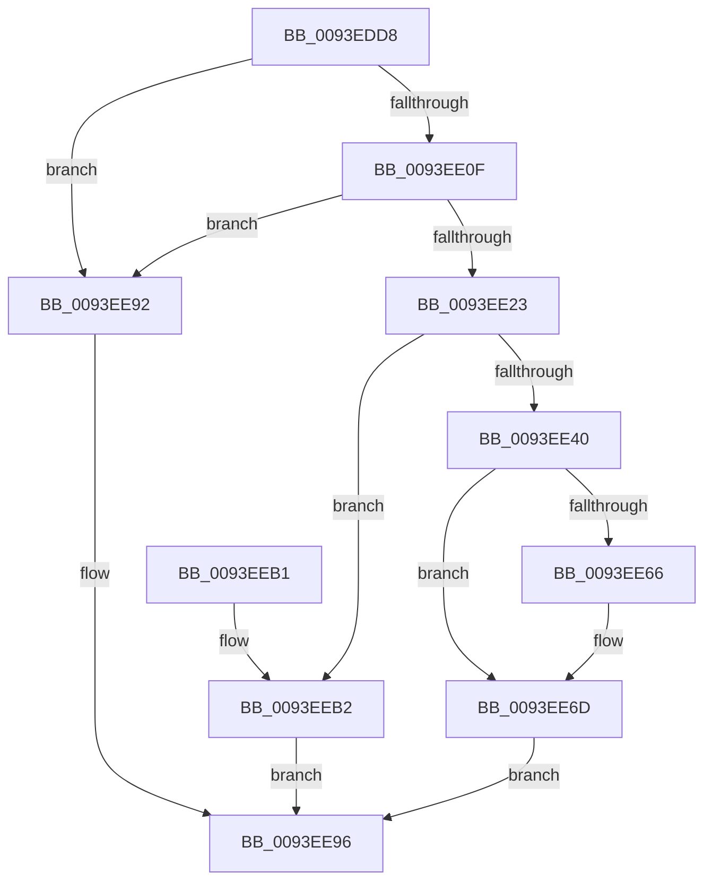

# MiRevertRelocatedImagePfn

- RVA: `0x0093EDD8`–`0x0093EEB4` (길이 `220` bytes)
- VA: `0x000000014093EDD8`
- 실행 섹션: `PAGE`
- PDB 이름 있음: `예`; PDB Function 태그: `아니요`
- unwind 정보 RVA: `0x00090074`
- 디코드: `59`개 명령, `220/220` bytes 표시
- 미해석 바이트: `0` (있으면 어셈블리에 `.byte`로 보존)

> 이 문서는 커널 이미지의 기계어와 PDB 기호를 분석해 생성했습니다. 4번과 5번은 함수 원형과 자료형을 바이너리 사용 방식에서 추정한 C 해석이며 원본 소스 복구 결과는 아닙니다.

## 1. Dependencies

- 직접 호출 지점: **4**; 고유 호출 대상: **4**
- 직접 호출자로 확인된 함수: **1**
- RIP 상대 이미지 참조: **0**

### Outgoing calls
- `0x0093EE1A` → [MiPageHasRelocations](MiPageHasRelocations_function_0093EEC0.md) (function, `0x0093EEC0`)
- `0x0093EE33` → [MiAllocatePool](../../text/35/MiAllocatePool_function_0035B540.md) (function, `0x0035B540`)
- `0x0093EE4C` → [KeCopyPage](../../text/6B/KeCopyPage_function_006BA0F0.md) (function, `0x006BA0F0`)
- `0x0093EE88` → [MiPerformFixups](MiPerformFixups_function_0093F5F4.md) (function, `0x0093F5F4`)

### Direct callers
- [MiValidateImagePfn](MiValidateImagePfn_function_0093EA08.md) at `0x0093EC1A`

### Static image references
- 디코드된 RIP-relative 메모리 참조가 없습니다.

## 2. Other-region calls and transfers

- 다른 실행 섹션으로 향하는 call: **2**
  - `0x0093EE33` → [MiAllocatePool](../../text/35/MiAllocatePool_function_0035B540.md) (`PAGE` → `.text`)
  - `0x0093EE4C` → [KeCopyPage](../../text/6B/KeCopyPage_function_006BA0F0.md) (`PAGE` → `.text`)
- 별도 외부 분기/꼬리 이동을 확인하지 못했습니다.

## 3. Assembly (complete function range)

```asm
0093EDD8  48 8B C4                        mov rax, rsp
0093EDDB  48 89 58 08                     mov qword ptr [rax + 8], rbx
0093EDDF  48 89 68 10                     mov qword ptr [rax + 0x10], rbp
0093EDE3  48 89 70 18                     mov qword ptr [rax + 0x18], rsi
0093EDE7  48 89 78 20                     mov qword ptr [rax + 0x20], rdi
0093EDEB  41 56                           push r14
0093EDED  48 83 EC 30                     sub rsp, 0x30
0093EDF1  48 8B 42 60                     mov rax, qword ptr [rdx + 0x60]
0093EDF5  41 8B F0                        mov esi, r8d
0093EDF8  48 83 E0 F8                     and rax, 0xfffffffffffffff8
0093EDFC  48 8B EA                        mov rbp, rdx
0093EDFF  4C 8B F1                        mov r14, rcx
0093EE02  48 8B 58 20                     mov rbx, qword ptr [rax + 0x20]
0093EE06  48 85 DB                        test rbx, rbx
0093EE09  0F 84 83 00 00 00               je 0x14093ee92
0093EE0F  41 B8 01 00 00 00               mov r8d, 1
0093EE15  8B D6                           mov edx, esi
0093EE17  48 8B CB                        mov rcx, rbx
0093EE1A  E8 A1 00 00 00                  call 0x14093eec0
0093EE1F  85 C0                           test eax, eax
0093EE21  74 6F                           je 0x14093ee92
0093EE23  BA 00 10 00 00                  mov edx, 0x1000
0093EE28  B9 00 01 00 00                  mov ecx, 0x100
0093EE2D  41 B8 4D 6D 49 68               mov r8d, 0x68496d4d
0093EE33  E8 08 C7 A1 FF                  call 0x14035b540
0093EE38  48 8B F8                        mov rdi, rax
0093EE3B  48 85 C0                        test rax, rax
0093EE3E  74 72                           je 0x14093eeb2
0093EE40  41 B8 01 00 00 00               mov r8d, 1
0093EE46  49 8B D6                        mov rdx, r14
0093EE49  48 8B C8                        mov rcx, rax
0093EE4C  E8 9F B2 D7 FF                  call 0x1406ba0f0
0093EE51  F6 44 24 60 02                  test byte ptr [rsp + 0x60], 2
0093EE56  48 8B CF                        mov rcx, rdi
0093EE59  49 0F 45 CE                     cmovne rcx, r14
0093EE5D  33 D2                           xor edx, edx
0093EE5F  F6 44 24 60 01                  test byte ptr [rsp + 0x60], 1
0093EE64  75 07                           jne 0x14093ee6d
0093EE66  48 8B 53 28                     mov rdx, qword ptr [rbx + 0x28]
0093EE6A  48 F7 DA                        neg rdx
0093EE6D  4C 8B 4B 30                     mov r9, qword ptr [rbx + 0x30]
0093EE71  44 8B C6                        mov r8d, esi
0093EE74  4C 03 CA                        add r9, rdx
0093EE77  C7 44 24 28 29 00 00 00         mov dword ptr [rsp + 0x28], 0x29
0093EE7F  48 83 64 24 20 00               and qword ptr [rsp + 0x20], 0
0093EE85  48 8B D5                        mov rdx, rbp
0093EE88  E8 67 07 00 00                  call 0x14093f5f4
0093EE8D  48 8B C7                        mov rax, rdi
0093EE90  EB 04                           jmp 0x14093ee96
0093EE92  48 83 C8 FF                     or rax, 0xffffffffffffffff
0093EE96  48 8B 5C 24 40                  mov rbx, qword ptr [rsp + 0x40]
0093EE9B  48 8B 6C 24 48                  mov rbp, qword ptr [rsp + 0x48]
0093EEA0  48 8B 74 24 50                  mov rsi, qword ptr [rsp + 0x50]
0093EEA5  48 8B 7C 24 58                  mov rdi, qword ptr [rsp + 0x58]
0093EEAA  48 83 C4 30                     add rsp, 0x30
0093EEAE  41 5E                           pop r14
0093EEB0  C3                              ret
0093EEB1  CC                              int3
0093EEB2  EB E2                           jmp 0x14093ee96
```

## 4. C-style interpretation (structured pseudocode)

```c
__int64 __fastcall MiRevertRelocatedImagePfn(__int64 a1, __int64 a2, int a3, __int64 a4, unsigned __int8 a5)
{
    __int64 result;
    __int64 v_rsp;
    unsigned int v_stack_m10;
    unsigned __int64 v_stack_m18;
    unsigned __int64 v_stack_p10;
    unsigned __int64 v_stack_p18;
    unsigned __int64 v_stack_p20;
    unsigned __int64 v_stack_p8;

    *(unsigned __int64 *)(v_rsp + 8) = v_rbx;
    *(unsigned __int64 *)(v_rsp + 16) = v_rbp;
    *(unsigned __int64 *)(v_rsp + 24) = v_rsi;
    *(unsigned __int64 *)(v_rsp + 32) = v_rdi;
    v_rsp = (v_rsp) - (48);
    result = (*(unsigned __int64 *)(a2 + 96)) & (-8);
    if (*(unsigned __int64 *)(result + 32) == 0) goto loc_0093EE92;
    result = MiPageHasRelocations(*(unsigned __int64 *)(result + 32), (unsigned int)((unsigned int)((unsigned int)(a3))), 1, a4);
    if ((unsigned int)(result) == 0) goto loc_0093EE92;
    result = MiAllocatePool(256, (unsigned int)(0x1000ULL), (unsigned int)(0x68496D4DULL), a4);
    if (result == 0) goto loc_0093EEB2;
    result = KeCopyPage(result, a1, 1, a4);
    a1 = result;
    if (((a5) & (2)) != 0) { a1 = a1; }
    a2 = 0;
    if (((a5) & (1)) == 0) {
        a2 = *(unsigned __int64 *)(*(unsigned __int64 *)(result + 32) + 40);
        a2 = -(a2);
    }
    a4 = (*(unsigned __int64 *)(*(unsigned __int64 *)(result + 32) + 48)) + (a2);
    v_stack_m10 = 41;
    result = MiPerformFixups(a1, a2, (unsigned int)((unsigned int)((unsigned int)(a3))), a4);
    goto loc_0093EE96;
loc_0093EE92:
    result = (result) | (-1);
loc_0093EE96:
    v_rsp = (v_rsp) + (48);
    return result;
loc_0093EEB2:
    goto loc_0093EE96;
}
```

## 5. (Beta) C Style

```c
int64_t MiRevertRelocatedImagePfn(int64_t Arg1, void *Arg2, int32_t Arg3, int64_t Arg4, uint8_t Arg5)
{
    uint8_t *arg2 = (uint8_t *)Arg2;

    int64_t result;
    int64_t local_rsp;
    uint32_t v_stack_m10;
    uint64_t v_stack_m18;
    uint64_t v_stack_p10;
    uint64_t v_stack_p18;
    uint64_t v_stack_p20;
    uint64_t v_stack_p8;

    *(uint64_t *)(local_rsp + 0x8) = local_rbx;
    *(uint64_t *)(local_rsp + 0x10) = local_rbp;
    *(uint64_t *)(local_rsp + 0x18) = local_rsi;
    *(uint64_t *)(local_rsp + 0x20) = local_rdi;
    local_rsp = (local_rsp) - (48);
    result = (*(uint64_t *)(arg2 + 0x60)) & (-8);
    if (*(uint64_t *)(result + 0x20) == 0) goto loc_0093EE92;
    result = MiPageHasRelocations(*(uint64_t *)(result + 0x20), (uint32_t)((uint32_t)((uint32_t)(Arg3))), 1, Arg4);
    if ((uint32_t)(result) == 0) goto loc_0093EE92;
    result = MiAllocatePool(256, (uint32_t)(0x1000ULL), (uint32_t)(0x68496D4DULL), Arg4);
    if (result == 0) goto loc_0093EEB2;
    result = KeCopyPage(result, Arg1, 1, Arg4);
    Arg1 = result;
    if (((Arg5) & (2)) != 0) { Arg1 = Arg1; }
    Arg2 = 0;
    if (((Arg5) & (1)) == 0) {
        Arg2 = *(uint64_t *)(*(uint64_t *)(result + 0x20) + 0x28);
        Arg2 = -(Arg2);
    }
    Arg4 = (*(uint64_t *)(*(uint64_t *)(result + 0x20) + 0x30)) + (Arg2);
    v_stack_m10 = 41;
    result = MiPerformFixups(Arg1, Arg2, (uint32_t)((uint32_t)((uint32_t)(Arg3))), Arg4);
    goto loc_0093EE96;
loc_0093EE92:
    result = (result) | (-1);
loc_0093EE96:
    local_rsp = (local_rsp) + (48);
    return result;
loc_0093EEB2:
    goto loc_0093EE96;
}
```

### 관측된 메모리 오프셋

구조체 형식이 확인되지 않은 접근은 인자 기준의 오프셋으로만 기록했습니다.

| 기준 인자 | 오프셋 표현 | 폭 (bit) | 접근 |
|---|---:|---:|---|
| `Arg2` | `+ 0x60` | `64` | `R` |

## 6. Execution-region graph

[열기: 2D/3D 그래프와 함수 탐색 컨트롤 패널](../../../control-panel.html?section=page&rva=0x0093EDD8&view=graph)

- 2D 그래프는 위에서 아래로 흐르고, 3D 그래프는 빈 공간을 드래그해 회전합니다. Shift+드래그는 이동, 휠은 확대·축소, 함수 노드 선택은 대상 보고서 이동입니다.

### Static fallback


