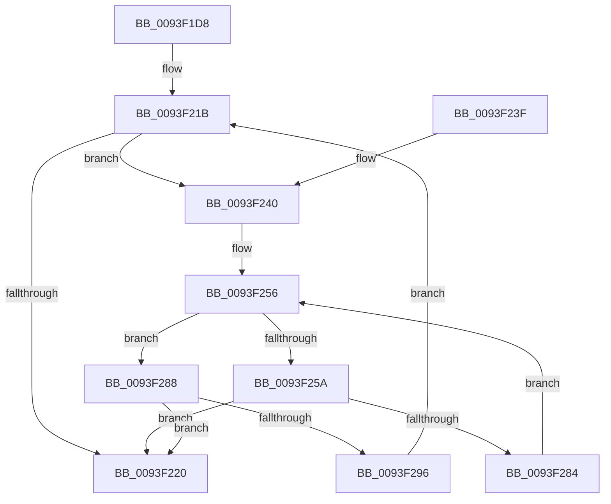

# MiRevertRelocations

- RVA: `0x0093F1D8`–`0x0093F29F` (길이 `199` bytes)
- VA: `0x000000014093F1D8`
- 실행 섹션: `PAGE`
- PDB 이름 있음: `예`; PDB Function 태그: `아니요`
- unwind 정보 RVA: `0x000900DC`
- 디코드: `62`개 명령, `199/199` bytes 표시
- 미해석 바이트: `0` (있으면 어셈블리에 `.byte`로 보존)

> 이 문서는 커널 이미지의 기계어와 PDB 기호를 분석해 생성했습니다. 4번과 5번은 함수 원형과 자료형을 바이너리 사용 방식에서 추정한 C 해석이며 원본 소스 복구 결과는 아닙니다.

## 1. Dependencies

- 직접 호출 지점: **1**; 고유 호출 대상: **1**
- 직접 호출자로 확인된 함수: **1**
- RIP 상대 이미지 참조: **0**

### Outgoing calls
- `0x0093F279` → [MiPerformFixups](MiPerformFixups_function_0093F5F4.md) (function, `0x0093F5F4`)

### Direct callers
- [MiValidateSectionCreate](../94/MiValidateSectionCreate_function_00940190.md) at `0x0094083D`

### Static image references
- 디코드된 RIP-relative 메모리 참조가 없습니다.

## 2. Other-region calls and transfers

- 다른 실행 섹션으로 향하는 call: **0**
- 별도 외부 분기/꼬리 이동을 확인하지 못했습니다.

## 3. Assembly (complete function range)

```asm
0093F1D8  48 8B C4                        mov rax, rsp
0093F1DB  48 89 58 08                     mov qword ptr [rax + 8], rbx
0093F1DF  48 89 68 10                     mov qword ptr [rax + 0x10], rbp
0093F1E3  48 89 70 18                     mov qword ptr [rax + 0x18], rsi
0093F1E7  48 89 78 20                     mov qword ptr [rax + 0x20], rdi
0093F1EB  41 54                           push r12
0093F1ED  41 56                           push r14
0093F1EF  41 57                           push r15
0093F1F1  48 83 EC 30                     sub rsp, 0x30
0093F1F5  48 8B 42 60                     mov rax, qword ptr [rdx + 0x60]
0093F1F9  48 8D BA 80 00 00 00            lea rdi, [rdx + 0x80]
0093F200  48 83 E0 F8                     and rax, 0xfffffffffffffff8
0093F204  33 DB                           xor ebx, ebx
0093F206  41 8B E8                        mov ebp, r8d
0093F209  4C 8B F2                        mov r14, rdx
0093F20C  4C 8B E1                        mov r12, rcx
0093F20F  4C 8B 48 20                     mov r9, qword ptr [rax + 0x20]
0093F213  4D 8B 79 30                     mov r15, qword ptr [r9 + 0x30]
0093F217  4D 2B 79 28                     sub r15, qword ptr [r9 + 0x28]
0093F21B  48 85 FF                        test rdi, rdi
0093F21E  75 20                           jne 0x14093f240
0093F220  48 8B 5C 24 50                  mov rbx, qword ptr [rsp + 0x50]
0093F225  48 8B 6C 24 58                  mov rbp, qword ptr [rsp + 0x58]
0093F22A  48 8B 74 24 60                  mov rsi, qword ptr [rsp + 0x60]
0093F22F  48 8B 7C 24 68                  mov rdi, qword ptr [rsp + 0x68]
0093F234  48 83 C4 30                     add rsp, 0x30
0093F238  41 5F                           pop r15
0093F23A  41 5E                           pop r14
0093F23C  41 5C                           pop r12
0093F23E  C3                              ret
0093F23F  CC                              int3
0093F240  8B 47 34                        mov eax, dword ptr [rdi + 0x34]
0093F243  8B F5                           mov esi, ebp
0093F245  8B 4F 2C                        mov ecx, dword ptr [rdi + 0x2c]
0093F248  25 FF FF FF 3F                  and eax, 0x3fffffff
0093F24D  2B C8                           sub ecx, eax
0093F24F  2B F3                           sub esi, ebx
0093F251  3B CE                           cmp ecx, esi
0093F253  0F 46 F1                        cmovbe esi, ecx
0093F256  85 F6                           test esi, esi
0093F258  74 2E                           je 0x14093f288
0093F25A  8B CB                           mov ecx, ebx
0093F25C  C7 44 24 28 29 00 00 00         mov dword ptr [rsp + 0x28], 0x29
0093F264  48 83 64 24 20 00               and qword ptr [rsp + 0x20], 0
0093F26A  4D 8B CF                        mov r9, r15
0093F26D  C1 E1 0C                        shl ecx, 0xc
0093F270  44 8B C3                        mov r8d, ebx
0093F273  49 03 CC                        add rcx, r12
0093F276  49 8B D6                        mov rdx, r14
0093F279  E8 76 03 00 00                  call 0x14093f5f4
0093F27E  FF C3                           inc ebx
0093F280  3B DD                           cmp ebx, ebp
0093F282  73 9C                           jae 0x14093f220
0093F284  FF CE                           dec esi
0093F286  EB CE                           jmp 0x14093f256
0093F288  8B 47 34                        mov eax, dword ptr [rdi + 0x34]
0093F28B  25 FF FF FF 3F                  and eax, 0x3fffffff
0093F290  03 D8                           add ebx, eax
0093F292  3B DD                           cmp ebx, ebp
0093F294  73 8A                           jae 0x14093f220
0093F296  48 8B 7F 10                     mov rdi, qword ptr [rdi + 0x10]
0093F29A  E9 7C FF FF FF                  jmp 0x14093f21b
```

## 4. C-style interpretation (structured pseudocode)

```c
__int64 __fastcall MiRevertRelocations(__int64 a1, __int64 a2, int a3)
{
    __int64 result;
    __int64 v_r15;
    __int64 v_rbx;
    __int64 v_rsi;
    __int64 v_rsp;
    unsigned __int64 v_stack_p10;
    unsigned __int64 v_stack_p18;
    unsigned __int64 v_stack_p20;
    unsigned int v_stack_p28;
    unsigned __int64 v_stack_p8;

    *(unsigned __int64 *)(v_rsp + 8) = v_rbx;
    *(unsigned __int64 *)(v_rsp + 16) = v_rbp;
    *(unsigned __int64 *)(v_rsp + 24) = v_rsi;
    *(unsigned __int64 *)(v_rsp + 32) = v_rdi;
    v_rsp = (v_rsp) - (48);
    result = (*(unsigned __int64 *)(a2 + 96)) & (-8);
    v_rbx = 0;
    v_r15 = (*(unsigned __int64 *)(*(unsigned __int64 *)(result + 32) + 48)) - (*(unsigned __int64 *)(*(unsigned __int64 *)(result + 32) + 40));
loc_0093F21B:
    if (a2 + 128 != 0) goto loc_0093F240;
loc_0093F220:
    v_rsp = (v_rsp) + (48);
    return result;
loc_0093F240:
    result = (unsigned int)(((unsigned int)(*(unsigned int *)(v_stack_p20 + 52))) & (0x3FFFFFFFULL));
    a1 = (unsigned int)(((unsigned int)(*(unsigned int *)(v_stack_p20 + 44))) - ((unsigned int)(result)));
    v_rsi = (unsigned int)(((unsigned int)((unsigned int)(v_stack_p10))) - ((unsigned int)(v_stack_p8)));
    if (((unsigned int)(a1)) <= ((unsigned int)(v_rsi))) { v_rsi = (unsigned int)(a1); }
loc_0093F256:
    if ((unsigned int)(v_rsi) == 0) goto loc_0093F288;
    v_stack_p28 = 41;
    a1 = (unsigned int)(((unsigned int)((unsigned int)(v_stack_p8))) << (12));
    a1 = (a1) + (a1);
    result = MiPerformFixups(a1, a2, (unsigned int)((unsigned int)(v_stack_p8)), v_r15);
    v_rbx = (unsigned int)((v_stack_p8) + 1);
    if (((unsigned int)(v_rbx)) >= ((unsigned int)(v_stack_p10))) goto loc_0093F220;
    v_rsi = (unsigned int)((v_rsi) - 1);
    goto loc_0093F256;
loc_0093F288:
    result = (unsigned int)(((unsigned int)(*(unsigned int *)(v_stack_p20 + 52))) & (0x3FFFFFFFULL));
    v_rbx = (unsigned int)((v_rbx) + ((unsigned int)(result)));
    if (((unsigned int)(v_rbx)) >= ((unsigned int)(v_stack_p10))) goto loc_0093F220;
    goto loc_0093F21B;
}
```

## 5. (Beta) C Style

```c
int64_t MiRevertRelocations(int64_t Arg1, void *Arg2, int32_t Arg3)
{
    uint8_t *arg2 = (uint8_t *)Arg2;

    int64_t result;
    int64_t local_r15;
    int64_t local_rbx;
    int64_t local_rsi;
    int64_t local_rsp;
    uint64_t v_stack_p10;
    uint64_t v_stack_p18;
    uint64_t v_stack_p20;
    uint32_t v_stack_p28;
    uint64_t v_stack_p8;

    *(uint64_t *)(local_rsp + 0x8) = local_rbx;
    *(uint64_t *)(local_rsp + 0x10) = local_rbp;
    *(uint64_t *)(local_rsp + 0x18) = local_rsi;
    *(uint64_t *)(local_rsp + 0x20) = local_rdi;
    local_rsp = (local_rsp) - (48);
    result = (*(uint64_t *)(arg2 + 0x60)) & (-8);
    local_rbx = 0;
    local_r15 = (*(uint64_t *)(*(uint64_t *)(result + 0x20) + 0x30)) - (*(uint64_t *)(*(uint64_t *)(result + 0x20) + 0x28));
loc_0093F21B:
    if (Arg2 + 128 != 0) goto loc_0093F240;
loc_0093F220:
    local_rsp = (local_rsp) + (48);
    return result;
loc_0093F240:
    result = (uint32_t)(((uint32_t)(*(uint32_t *)(v_stack_p20 + 0x34))) & (0x3FFFFFFFULL));
    Arg1 = (uint32_t)(((uint32_t)(*(uint32_t *)(v_stack_p20 + 0x2C))) - ((uint32_t)(result)));
    local_rsi = (uint32_t)(((uint32_t)((uint32_t)(v_stack_p10))) - ((uint32_t)(v_stack_p8)));
    if (((uint32_t)(Arg1)) <= ((uint32_t)(local_rsi))) { local_rsi = (uint32_t)(Arg1); }
loc_0093F256:
    if ((uint32_t)(local_rsi) == 0) goto loc_0093F288;
    v_stack_p28 = 41;
    Arg1 = (uint32_t)(((uint32_t)((uint32_t)(v_stack_p8))) << (12));
    Arg1 = (Arg1) + (Arg1);
    result = MiPerformFixups(Arg1, Arg2, (uint32_t)((uint32_t)(v_stack_p8)), local_r15);
    local_rbx = (uint32_t)((v_stack_p8) + 1);
    if (((uint32_t)(local_rbx)) >= ((uint32_t)(v_stack_p10))) goto loc_0093F220;
    local_rsi = (uint32_t)((local_rsi) - 1);
    goto loc_0093F256;
loc_0093F288:
    result = (uint32_t)(((uint32_t)(*(uint32_t *)(v_stack_p20 + 0x34))) & (0x3FFFFFFFULL));
    local_rbx = (uint32_t)((local_rbx) + ((uint32_t)(result)));
    if (((uint32_t)(local_rbx)) >= ((uint32_t)(v_stack_p10))) goto loc_0093F220;
    goto loc_0093F21B;
}
```

### 관측된 메모리 오프셋

구조체 형식이 확인되지 않은 접근은 인자 기준의 오프셋으로만 기록했습니다.

| 기준 인자 | 오프셋 표현 | 폭 (bit) | 접근 |
|---|---:|---:|---|
| `Arg2` | `+ 0x60` | `64` | `R` |
| `Arg2` | `+ 0x80` | `64` | `R` |

## 6. Execution-region graph

[열기: 2D/3D 그래프와 함수 탐색 컨트롤 패널](../../../control-panel.html?section=page&rva=0x0093F1D8&view=graph)

- 2D 그래프는 위에서 아래로 흐르고, 3D 그래프는 빈 공간을 드래그해 회전합니다. Shift+드래그는 이동, 휠은 확대·축소, 함수 노드 선택은 대상 보고서 이동입니다.

### Static fallback


