# MiValidateImagePfn

- RVA: `0x0093EA08`–`0x0093ED92` (길이 `906` bytes)
- VA: `0x000000014093EA08`
- 실행 섹션: `PAGE`
- PDB 이름 있음: `예`; PDB Function 태그: `예`
- unwind 정보 RVA: `0x00090048`
- 디코드: `208`개 명령, `906/906` bytes 표시
- 미해석 바이트: `0` (있으면 어셈블리에 `.byte`로 보존)

> 이 문서는 커널 이미지의 기계어와 PDB 기호를 분석해 생성했습니다. 4번과 5번은 함수 원형과 자료형을 바이너리 사용 방식에서 추정한 C 해석이며 원본 소스 복구 결과는 아닙니다.

## 1. Dependencies

- 직접 호출 지점: **15**; 고유 호출 대상: **15**
- 직접 호출자로 확인된 함수: **2**
- RIP 상대 이미지 참조: **3**

### Outgoing calls
- `0x0093EA74` → [MiReservePtes](../../text/31/MiReservePtes_function_00318D20.md) (function, `0x00318D20`)
- `0x0093EAF1` → [MiControlAreaHasHostRelocationsApplied](../../text/38/MiControlAreaHasHostRelocationsApplied_function_003843A4.md) (function, `0x003843A4`)
- `0x0093EB2C` → [MiMakeProtectionPfnCompatible](../../text/22/MiMakeProtectionPfnCompatible_function_00229CD0.md) (function, `0x00229CD0`)
- `0x0093EB43` → [MiMakeValidPte](../../text/2C/MiMakeValidPte_function_002C5590.md) (function, `0x002C5590`)
- `0x0093EB8F` → [SeValidateImageData](SeValidateImageData_function_0093ED98.md) (function, `0x0093ED98`)
- `0x0093EBBF` → [MiMarkPfnVerified](../../text/38/MiMarkPfnVerified_function_003833C4.md) (function, `0x003833C4`)
- `0x0093EBE2` → [MiReleasePtes](../../text/24/MiReleasePtes_function_00247240.md) (function, `0x00247240`)
- `0x0093EC1A` → [MiRevertRelocatedImagePfn](MiRevertRelocatedImagePfn_function_0093EDD8.md) (function, `0x0093EDD8`)
- `0x0093EC80` → [MiGetSectionStrongImageReference](MiGetSectionStrongImageReference_function_0093E9C0.md) (function, `0x0093E9C0`)
- `0x0093ECC0` → [MiGetPteAddress](../../text/43/MiGetPteAddress_function_0043E130.md) (function, `0x0043E130`)
- `0x0093ECDA` → [MiCheckLinearProtectedPteAccessedBit](../../text/29/MiCheckLinearProtectedPteAccessedBit_function_00292D80.md) (function, `0x00292D80`)
- `0x0093ECF3` → [ExFreePoolWithTag](../../poolcode/B8/ExFreePoolWithTag_function_00B82870.md) (function, `0x00B82870`)
- `0x0093ED03` → [MiReserveFaultPte](../../text/67/MiReserveFaultPte_function_0067E64C.md) (function, `0x0067E64C`)
- `0x0093ED57` → [KeCopyPage](../../text/6B/KeCopyPage_function_006BA0F0.md) (function, `0x006BA0F0`)
- `0x0093ED88` → [MiReleaseFaultPte](../../text/67/MiReleaseFaultPte_function_0067E5B4.md) (function, `0x0067E5B4`)

### Direct callers
- [MiWalkEntireImage](../../text/36/MiWalkEntireImage_function_00365D70.md) at `0x003668B8`
- [MiValidateInPage](../../text/38/MiValidateInPage_function_00382E0C.md) at `0x003831B6`

### Static image references
- `0x0093EA6D` → RVA `0x00E37668` (`.data`; read)
- `0x0093EACD` → RVA `0x00FC6A88` (`ALMOSTRO`; read)
- `0x0093ED30` → RVA `0x00E2D884` (`.data`; read/write)

## 2. Other-region calls and transfers

- 다른 실행 섹션으로 향하는 call: **12**
  - `0x0093EA74` → [MiReservePtes](../../text/31/MiReservePtes_function_00318D20.md) (`PAGE` → `.text`)
  - `0x0093EAF1` → [MiControlAreaHasHostRelocationsApplied](../../text/38/MiControlAreaHasHostRelocationsApplied_function_003843A4.md) (`PAGE` → `.text`)
  - `0x0093EB2C` → [MiMakeProtectionPfnCompatible](../../text/22/MiMakeProtectionPfnCompatible_function_00229CD0.md) (`PAGE` → `.text`)
  - `0x0093EB43` → [MiMakeValidPte](../../text/2C/MiMakeValidPte_function_002C5590.md) (`PAGE` → `.text`)
  - `0x0093EBBF` → [MiMarkPfnVerified](../../text/38/MiMarkPfnVerified_function_003833C4.md) (`PAGE` → `.text`)
  - `0x0093EBE2` → [MiReleasePtes](../../text/24/MiReleasePtes_function_00247240.md) (`PAGE` → `.text`)
  - `0x0093ECC0` → [MiGetPteAddress](../../text/43/MiGetPteAddress_function_0043E130.md) (`PAGE` → `.text`)
  - `0x0093ECDA` → [MiCheckLinearProtectedPteAccessedBit](../../text/29/MiCheckLinearProtectedPteAccessedBit_function_00292D80.md) (`PAGE` → `.text`)
  - `0x0093ECF3` → [ExFreePoolWithTag](../../poolcode/B8/ExFreePoolWithTag_function_00B82870.md) (`PAGE` → `POOLCODE`)
  - `0x0093ED03` → [MiReserveFaultPte](../../text/67/MiReserveFaultPte_function_0067E64C.md) (`PAGE` → `.text`)
  - `0x0093ED57` → [KeCopyPage](../../text/6B/KeCopyPage_function_006BA0F0.md) (`PAGE` → `.text`)
  - `0x0093ED88` → [MiReleaseFaultPte](../../text/67/MiReleaseFaultPte_function_0067E5B4.md) (`PAGE` → `.text`)
- call이 아닌 외부 분기/꼬리 이동: **1**
  - `0x0093EC41` → [sub_00B25312](../B2/Unknown_function_00B25312.md) (`tail-transfer`)

## 3. Assembly (complete function range)

```asm
0093EA08  44 89 4C 24 20                  mov dword ptr [rsp + 0x20], r9d
0093EA0D  4C 89 44 24 18                  mov qword ptr [rsp + 0x18], r8
0093EA12  48 89 54 24 10                  mov qword ptr [rsp + 0x10], rdx
0093EA17  53                              push rbx
0093EA18  55                              push rbp
0093EA19  56                              push rsi
0093EA1A  57                              push rdi
0093EA1B  41 54                           push r12
0093EA1D  41 55                           push r13
0093EA1F  41 56                           push r14
0093EA21  41 57                           push r15
0093EA23  48 83 EC 48                     sub rsp, 0x48
0093EA27  48 8B 84 24 C0 00 00 00         mov rax, qword ptr [rsp + 0xc0]
0093EA2F  4C 8B F9                        mov r15, rcx
0093EA32  4C 8D 2C 40                     lea r13, [rax + rax*2]
0093EA36  49 C1 E5 04                     shl r13, 4
0093EA3A  48 B8 00 00 00 00 00 DE FF FF   movabs rax, 0xffffde0000000000
0093EA44  48 8B 59 60                     mov rbx, qword ptr [rcx + 0x60]
0093EA48  4C 03 E8                        add r13, rax
0093EA4B  48 83 E3 F8                     and rbx, 0xfffffffffffffff8
0093EA4F  45 33 E4                        xor r12d, r12d
0093EA52  BE 00 00 0C 00                  mov esi, 0xc0000
0093EA57  48 8B 7B 28                     mov rdi, qword ptr [rbx + 0x28]
0093EA5B  48 83 E7 F8                     and rdi, 0xfffffffffffffff8
0093EA5F  85 71 5C                        test dword ptr [rcx + 0x5c], esi
0093EA62  0F 85 0B 02 00 00               jne 0x14093ec73
0093EA68  BA 01 00 00 00                  mov edx, 1
0093EA6D  48 8D 0D F4 8B 4F 00            lea rcx, [rip + 0x4f8bf4]
0093EA74  E8 A7 A2 9D FF                  call 0x140318d20
0093EA79  8B AC 24 D0 00 00 00            mov ebp, dword ptr [rsp + 0xd0]
0093EA80  4C 8B F0                        mov r14, rax
0093EA83  48 85 C0                        test rax, rax
0093EA86  0F 84 06 02 00 00               je 0x14093ec92
0093EA8C  44 88 A4 24 B0 00 00 00         mov byte ptr [rsp + 0xb0], r12b
0093EA94  41 B9 01 00 00 00               mov r9d, 1
0093EA9A  8B 94 24 C8 00 00 00            mov edx, dword ptr [rsp + 0xc8]
0093EAA1  49 8B F4                        mov rsi, r12
0093EAA4  83 CA 02                        or edx, 2
0093EAA7  44 89 A4 24 90 00 00 00         mov dword ptr [rsp + 0x90], r12d
0093EAAF  F6 84 24 B8 00 00 00 02         test byte ptr [rsp + 0xb8], 2
0093EAB7  45 8B C4                        mov r8d, r12d
0093EABA  44 89 64 24 30                  mov dword ptr [rsp + 0x30], r12d
0093EABF  41 BA 03 00 00 00               mov r10d, 3
0093EAC5  0F 44 94 24 C8 00 00 00         cmove edx, dword ptr [rsp + 0xc8]
0093EACD  48 F7 05 B0 7F 68 00 00 20 00 00  test qword ptr [rip + 0x687fb0], 0x2000
0093EAD8  0F 85 51 01 00 00               jne 0x14093ec2f
0093EADE  85 ED                           test ebp, ebp
0093EAE0  8B EA                           mov ebp, edx
0093EAE2  75 0A                           jne 0x14093eaee
0093EAE4  44 89 8C 24 90 00 00 00         mov dword ptr [rsp + 0x90], r9d
0093EAEC  EB 10                           jmp 0x14093eafe
0093EAEE  49 8B CF                        mov rcx, r15
0093EAF1  E8 AE 58 A4 FF                  call 0x1403843a4
0093EAF6  85 C0                           test eax, eax
0093EAF8  0F 85 25 02 00 00               jne 0x14093ed23
0093EAFE  4D 8B E6                        mov r12, r14
0093EB01  49 C1 E4 19                     shl r12, 0x19
0093EB05  48 B8 00 00 00 00 80 F6 FF FF   movabs rax, 0xfffff68000000000
0093EB0F  48 C1 E0 19                     shl rax, 0x19
0093EB13  49 8B D5                        mov rdx, r13
0093EB16  4C 2B E0                        sub r12, rax
0093EB19  41 8B C0                        mov eax, r8d
0093EB1C  24 02                           and al, 2
0093EB1E  49 C1 FC 10                     sar r12, 0x10
0093EB22  F6 D8                           neg al
0093EB24  1B C9                           sbb ecx, ecx
0093EB26  41 23 CA                        and ecx, r10d
0093EB29  41 03 C9                        add ecx, r9d
0093EB2C  E8 9F B1 8E FF                  call 0x140229cd0
0093EB31  48 8B 94 24 C0 00 00 00         mov rdx, qword ptr [rsp + 0xc0]
0093EB39  0F BA E8 1D                     bts eax, 0x1d
0093EB3D  44 8B C0                        mov r8d, eax
0093EB40  49 8B CE                        mov rcx, r14
0093EB43  E8 48 6A 98 FF                  call 0x1402c5590
0093EB48  48 0F BA 25 37 7F 68 00 24      bt qword ptr [rip + 0x687f37], 0x24
0093EB51  48 8B D8                        mov rbx, rax
0093EB54  0F 82 53 01 00 00               jb 0x14093ecad
0093EB5A  49 89 1E                        mov qword ptr [r14], rbx
0093EB5D  39 B4 24 90 00 00 00            cmp dword ptr [rsp + 0x90], esi
0093EB64  0F 85 9A 00 00 00               jne 0x14093ec04
0093EB6A  48 8B 84 24 A0 00 00 00         mov rax, qword ptr [rsp + 0xa0]
0093EB72  41 B8 00 10 00 00               mov r8d, 0x1000
0093EB78  4C 8B 8C 24 98 00 00 00         mov r9, qword ptr [rsp + 0x98]
0093EB80  49 8B D4                        mov rdx, r12
0093EB83  48 89 44 24 28                  mov qword ptr [rsp + 0x28], rax
0093EB88  48 8B CF                        mov rcx, rdi
0093EB8B  89 6C 24 20                     mov dword ptr [rsp + 0x20], ebp
0093EB8F  E8 04 02 00 00                  call 0x14093ed98
0093EB94  8B D8                           mov ebx, eax
0093EB96  85 C0                           test eax, eax
0093EB98  0F 88 92 01 00 00               js 0x14093ed30
0093EB9E  33 D2                           xor edx, edx
0093EBA0  48 F7 05 DD 7E 68 00 00 00 02 00  test qword ptr [rip + 0x687edd], 0x20000
0093EBAB  0F 85 B0 01 00 00               jne 0x14093ed61
0093EBB1  41 8B 45 10                     mov eax, dword ptr [r13 + 0x10]
0093EBB5  48 0F BA E0 0A                  bt rax, 0xa
0093EBBA  73 08                           jae 0x14093ebc4
0093EBBC  49 8B CD                        mov rcx, r13
0093EBBF  E8 00 48 A4 FF                  call 0x1403833c4
0093EBC4  80 BC 24 B0 00 00 00 00         cmp byte ptr [rsp + 0xb0], 0
0093EBCC  0F 85 B3 01 00 00               jne 0x14093ed85
0093EBD2  41 B8 01 00 00 00               mov r8d, 1
0093EBD8  48 8D 0D 89 8A 4F 00            lea rcx, [rip + 0x4f8a89]
0093EBDF  49 8B D6                        mov rdx, r14
0093EBE2  E8 59 86 90 FF                  call 0x140247240
0093EBE7  48 85 F6                        test rsi, rsi
0093EBEA  0F 85 FE 00 00 00               jne 0x14093ecee
0093EBF0  8B C3                           mov eax, ebx
0093EBF2  48 83 C4 48                     add rsp, 0x48
0093EBF6  41 5F                           pop r15
0093EBF8  41 5E                           pop r14
0093EBFA  41 5D                           pop r13
0093EBFC  41 5C                           pop r12
0093EBFE  5F                              pop rdi
0093EBFF  5E                              pop rsi
0093EC00  5D                              pop rbp
0093EC01  5B                              pop rbx
0093EC02  C3                              ret
0093EC03  CC                              int3
0093EC04  8B 5C 24 30                     mov ebx, dword ptr [rsp + 0x30]
0093EC08  49 8B D7                        mov rdx, r15
0093EC0B  44 8B 84 24 A8 00 00 00         mov r8d, dword ptr [rsp + 0xa8]
0093EC13  49 8B CC                        mov rcx, r12
0093EC16  89 5C 24 20                     mov dword ptr [rsp + 0x20], ebx
0093EC1A  E8 B9 01 00 00                  call 0x14093edd8
0093EC1F  48 8B F0                        mov rsi, rax
0093EC22  48 83 F8 FF                     cmp rax, -1
0093EC26  75 31                           jne 0x14093ec59
0093EC28  33 F6                           xor esi, esi
0093EC2A  E9 3B FF FF FF                  jmp 0x14093eb6a
0093EC2F  41 F7 47 5C 00 00 0C 00         test dword ptr [r15 + 0x5c], 0xc0000
0093EC37  0F 84 A1 FE FF FF               je 0x14093eade
0093EC3D  85 ED                           test ebp, ebp
0093EC3F  8B EA                           mov ebp, edx
0093EC41  0F 85 CB 66 1E 00               jne 0x140b25312
0093EC47  4C 39 63 20                     cmp qword ptr [rbx + 0x20], r12
0093EC4B  0F 84 AD FE FF FF               je 0x14093eafe
0093EC51  41 0B E9                        or ebp, r9d
0093EC54  E9 A5 FE FF FF                  jmp 0x14093eafe
0093EC59  48 85 C0                        test rax, rax
0093EC5C  0F 84 82 00 00 00               je 0x14093ece4
0093EC62  F6 C3 02                        test bl, 2
0093EC65  0F 85 FF FE FF FF               jne 0x14093eb6a
0093EC6B  4C 8B E0                        mov r12, rax
0093EC6E  E9 F7 FE FF FF                  jmp 0x14093eb6a
0093EC73  4C 39 63 40                     cmp qword ptr [rbx + 0x40], r12
0093EC77  0F 85 EB FD FF FF               jne 0x14093ea68
0093EC7D  48 8B CB                        mov rcx, rbx
0093EC80  E8 3B FD FF FF                  call 0x14093e9c0
0093EC85  85 C0                           test eax, eax
0093EC87  0F 88 65 FF FF FF               js 0x14093ebf2
0093EC8D  E9 D6 FD FF FF                  jmp 0x14093ea68
0093EC92  48 F7 05 EB 7D 68 00 00 20 00 00  test qword ptr [rip + 0x687deb], 0x2000
0093EC9D  75 5E                           jne 0x14093ecfd
0093EC9F  85 ED                           test ebp, ebp
0093ECA1  75 60                           jne 0x14093ed03
0093ECA3  B8 9A 00 00 C0                  mov eax, 0xc000009a
0093ECA8  E9 45 FF FF FF                  jmp 0x14093ebf2
0093ECAD  F6 C3 20                        test bl, 0x20
0093ECB0  0F 85 A4 FE FF FF               jne 0x14093eb5a
0093ECB6  48 B9 00 00 00 00 00 80 FF FF   movabs rcx, 0xffff800000000000
0093ECC0  E8 6B F4 AF FF                  call 0x14043e130
0093ECC5  4C 3B F0                        cmp r14, rax
0093ECC8  0F 82 8C FE FF FF               jb 0x14093eb5a
0093ECCE  41 B8 80 00 00 00               mov r8d, 0x80
0093ECD4  48 8B D3                        mov rdx, rbx
0093ECD7  49 8B CE                        mov rcx, r14
0093ECDA  E8 A1 40 95 FF                  call 0x140292d80
0093ECDF  E9 76 FE FF FF                  jmp 0x14093eb5a
0093ECE4  BB 9A 00 00 C0                  mov ebx, 0xc000009a
0093ECE9  E9 D6 FE FF FF                  jmp 0x14093ebc4
0093ECEE  33 D2                           xor edx, edx
0093ECF0  48 8B CE                        mov rcx, rsi
0093ECF3  E8 78 3B 24 00                  call 0x140b82870
0093ECF8  E9 F3 FE FF FF                  jmp 0x14093ebf0
0093ECFD  41 85 77 5C                     test dword ptr [r15 + 0x5c], esi
0093ED01  74 9C                           je 0x14093ec9f
0093ED03  E8 44 F9 D3 FF                  call 0x14067e64c
0093ED08  4C 8B F0                        mov r14, rax
0093ED0B  48 85 C0                        test rax, rax
0093ED0E  74 93                           je 0x14093eca3
0093ED10  41 B9 01 00 00 00               mov r9d, 1
0093ED16  44 88 8C 24 B0 00 00 00         mov byte ptr [rsp + 0xb0], r9b
0093ED1E  E9 77 FD FF FF                  jmp 0x14093ea9a
0093ED23  45 8B C1                        mov r8d, r9d
0093ED26  44 89 4C 24 30                  mov dword ptr [rsp + 0x30], r9d
0093ED2B  E9 B4 FD FF FF                  jmp 0x14093eae4
0093ED30  F0 FF 05 4D EB 4E 00            lock inc dword ptr [rip + 0x4eeb4d]
0093ED37  48 85 F6                        test rsi, rsi
0093ED3A  0F 84 84 FE FF FF               je 0x14093ebc4
0093ED40  F6 44 24 30 02                  test byte ptr [rsp + 0x30], 2
0093ED45  0F 84 79 FE FF FF               je 0x14093ebc4
0093ED4B  41 B8 01 00 00 00               mov r8d, 1
0093ED51  48 8B D6                        mov rdx, rsi
0093ED54  49 8B CC                        mov rcx, r12
0093ED57  E8 94 B3 D7 FF                  call 0x1406ba0f0
0093ED5C  E9 63 FE FF FF                  jmp 0x14093ebc4
0093ED61  41 F7 47 5C 00 00 0C 00         test dword ptr [r15 + 0x5c], 0xc0000
0093ED69  0F 85 42 FE FF FF               jne 0x14093ebb1
0093ED6F  41 8A 45 10                     mov al, byte ptr [r13 + 0x10]
0093ED73  C0 E8 05                        shr al, 5
0093ED76  A8 02                           test al, 2
0093ED78  B8 03 00 00 00                  mov eax, 3
0093ED7D  0F 45 D0                        cmovne edx, eax
0093ED80  E9 2C FE FF FF                  jmp 0x14093ebb1
0093ED85  49 8B CE                        mov rcx, r14
0093ED88  E8 27 F8 D3 FF                  call 0x14067e5b4
0093ED8D  E9 55 FE FF FF                  jmp 0x14093ebe7
```

## 4. C-style interpretation (structured pseudocode)

```c
__int64 __fastcall MiValidateImagePfn(__int64 a1, __int64 a2, __int64 a3, int a4, unsigned __int8 a5, unsigned __int8 a6, __int64 a7, unsigned int a8, unsigned int a9)
{
    __int64 result;
    __int64 v_r12;
    __int64 v_r13;
    __int64 v_rbp;
    __int64 v_rbx;
    __int64 v_rdi;
    __int64 v_rsi;
    __int64 v_rsp;
    unsigned int v_stack_m58;
    unsigned __int64 v_stack_m60;
    unsigned int v_stack_m68;
    unsigned __int64 v_stack_p10;
    unsigned __int64 v_stack_p18;
    unsigned int v_stack_p20;
    unsigned __int8 v_stack_p28;
    unsigned int v_stack_p30;
    unsigned int v_stack_p8;
    unsigned int v_stack_pA8;
    unsigned __int8 v_stack_pB0;

    v_stack_p20 = a4;
    v_stack_p18 = a3;
    v_stack_p10 = a2;
    v_rsp = (v_rsp) - (72);
    v_r13 = (a7 + a7 * 2) << (4);
    v_r13 = (v_r13) + (a7);
    v_rbx = (*(unsigned __int64 *)(a1 + 96)) & (-8);
    v_r12 = 0;
    v_rdi = (*(unsigned __int64 *)(v_rbx + 40)) & (-8);
    if (((*(unsigned int *)(a1 + 92)) & ((unsigned int)((unsigned int)(0xC0000ULL)))) != 0) goto loc_0093EC73;
loc_0093EA68:
    result = MiReservePtes(v_rip + 5213172, 1, a3, a4);
    if (result == 0) goto loc_0093EC92;
    v_stack_p28 = 0;
loc_0093EA9A:
    a2 = (unsigned int)(((unsigned int)(a8)) | (2));
    v_stack_p8 = 0;
    v_stack_m58 = 0;
    if (((a6) & (2)) == 0) { a2 = a8; }
    if (((*(unsigned __int64 *)(v_rip + 6848432)) & (0x2000ULL)) != 0) goto loc_0093EC2F;
loc_0093EADE:
    if ((unsigned int)((unsigned int)(a9)) != 0) goto loc_0093EAEE;
loc_0093EAE4:
    v_stack_p8 = 1;
    goto loc_0093EAFE;
loc_0093EAEE:
    result = MiControlAreaHasHostRelocationsApplied(a1, a2, 0, 1);
    if ((unsigned int)(result) != 0) goto loc_0093ED23;
loc_0093EAFE:
    v_r12 = (result) << (25);
    result = (result) << (25);
    v_r12 = (v_r12) - (result);
    result = (unsigned __int8)((0) & (2));
    v_r12 = (v_r12) >> (16);
    result = (unsigned __int8)(-(result));
    a1 = (unsigned int)((a1) & (3));
    a1 = (unsigned int)((a1) + (1));
    result = MiMakeProtectionPfnCompatible(a1, v_r13, 0, 1);
    result = MiMakeValidPte(result, a7, (unsigned int)((unsigned int)(result)), 1);
    if (condition_is_below) goto loc_0093ECAD;
loc_0093EB5A:
    *(unsigned __int64 *)(result) = result;
    if (v_stack_p8 != 0) goto loc_0093EC04;
loc_0093EB6A:
    v_stack_m60 = v_stack_p18;
    v_stack_m68 = (unsigned int)((unsigned int)((unsigned int)(a2)));
    result = SeValidateImageData(v_rdi, v_r12, (unsigned int)(0x1000ULL), v_stack_p10);
    if (sign_flag) goto loc_0093ED30;
    a2 = 0;
    if (((*(unsigned __int64 *)(v_rip + 6848221)) & (0x20000ULL)) != 0) goto loc_0093ED61;
loc_0093EBB1:
    result = (unsigned int)(*(unsigned int *)(v_r13 + 16));
    if (!(condition_is_above_or_equal)) {
        a1 = v_r13;
        result = MiMarkPfnVerified(a1, a2, (unsigned int)(0x1000ULL), v_stack_p10);
    }
    if (a5 != 0) goto loc_0093ED85;
    result = MiReleasePtes(v_rip + 5212809, result, 1, v_stack_p10);
loc_0093EBE7:
    if (0 != 0) goto loc_0093ECEE;
loc_0093EBF0:
loc_0093EBF2:
    v_rsp = (v_rsp) + (72);
    return (unsigned int)((unsigned int)((unsigned int)((unsigned int)(result))));
loc_0093EC04:
    v_stack_p20 = (unsigned int)((unsigned int)(v_stack_p30));
    result = MiRevertRelocatedImagePfn(v_r12, a1, (unsigned int)(v_stack_pA8), v_stack_p10);
    if (result != -1) goto loc_0093EC59;
    v_rsi = 0;
    goto loc_0093EB6A;
loc_0093EC2F:
    if (((*(unsigned int *)(a1 + 92)) & (0xC0000ULL)) == 0) goto loc_0093EADE;
    if ((*(unsigned __int64 *)((unsigned int)(v_stack_p30) + 32)) == v_r12) goto loc_0093EAFE;
    v_rbp = (unsigned int)(((unsigned int)((unsigned int)(a1))) | ((unsigned int)(v_stack_p10)));
    goto loc_0093EAFE;
loc_0093EC59:
    if (result == 0) goto loc_0093ECE4;
    if ((((unsigned __int8)((unsigned int)(v_stack_p30))) & (2)) != 0) goto loc_0093EB6A;
    goto loc_0093EB6A;
loc_0093EC73:
    if ((*(unsigned __int64 *)((unsigned int)(v_stack_p30) + 64)) != result) goto loc_0093EA68;
    result = MiGetSectionStrongImageReference((unsigned int)(v_stack_p30), a1, (unsigned int)(v_stack_pA8), v_stack_p10);
    if (sign_flag) goto loc_0093EBF2;
    goto loc_0093EA68;
loc_0093EC92:
    if (((*(unsigned __int64 *)(v_rip + 6847979)) & (0x2000ULL)) != 0) goto loc_0093ECFD;
loc_0093EC9F:
    if ((unsigned int)(v_rbp) != 0) goto loc_0093ED03;
loc_0093ECA3:
    goto loc_0093EBF2;
loc_0093ECAD:
    if ((((unsigned __int8)((unsigned int)(v_stack_p30))) & (32)) != 0) goto loc_0093EB5A;
    result = MiGetPteAddress((unsigned int)(v_stack_p30), a1, (unsigned int)(v_stack_pA8), v_stack_p10);
    if (result < result) goto loc_0093EB5A;
    result = MiCheckLinearProtectedPteAccessedBit(result, (unsigned int)(v_stack_p30), 128, v_stack_p10);
    goto loc_0093EB5A;
loc_0093ECE4:
    goto loc_0093EBC4;
loc_0093ECEE:
    a2 = 0;
    result = ExFreePoolWithTag(0, a2, 128, v_stack_p10);
    goto loc_0093EBF0;
loc_0093ECFD:
    if (((*(unsigned int *)(a1 + 92)) & (0)) == 0) goto loc_0093EC9F;
loc_0093ED03:
    result = MiReserveFaultPte(0, a2, 128, v_stack_p10);
    if (result == 0) goto loc_0093ECA3;
    v_stack_pB0 = 1;
    goto loc_0093EA9A;
loc_0093ED23:
    v_stack_p30 = 1;
    goto loc_0093EAE4;
loc_0093ED30:
    if (0 == 0) goto loc_0093EBC4;
    if (((v_stack_p30) & (2)) == 0) goto loc_0093EBC4;
    result = KeCopyPage(result, 0, 1, 1);
    goto loc_0093EBC4;
loc_0093ED61:
    if (((*(unsigned int *)(a1 + 92)) & (0xC0000ULL)) != 0) goto loc_0093EBB1;
    result = (unsigned __int8)((*(unsigned __int8 *)(v_r13 + 16)) >> (5));
    a2 = 0;
    if ((((unsigned __int8)(result)) & (2)) != 0) { a2 = 3; }
    goto loc_0093EBB1;
loc_0093ED85:
    result = MiReleaseFaultPte(result, a2, 1, 1);
    goto loc_0093EBE7;
}
```

## 5. (Beta) C Style

```c
int64_t MiValidateImagePfn(void *Arg1, int64_t Arg2, int64_t Arg3, int32_t Arg4, uint8_t Arg5, uint8_t Arg6, void *Arg7, uint32_t Arg8, uint32_t Arg9)
{
    uint8_t *arg1 = (uint8_t *)Arg1;
    uint8_t *arg7 = (uint8_t *)Arg7;

    int64_t result;
    int64_t local_r12;
    int64_t local_r13;
    int64_t local_rbp;
    int64_t local_rbx;
    int64_t local_rdi;
    int64_t local_rsi;
    int64_t local_rsp;
    uint32_t v_stack_m58;
    uint64_t v_stack_m60;
    uint32_t v_stack_m68;
    uint64_t v_stack_p10;
    uint64_t v_stack_p18;
    uint32_t v_stack_p20;
    uint8_t v_stack_p28;
    uint32_t v_stack_p30;
    uint32_t v_stack_p8;
    uint32_t v_stack_pA8;
    uint8_t v_stack_pB0;

    v_stack_p20 = Arg4;
    v_stack_p18 = Arg3;
    v_stack_p10 = Arg2;
    local_rsp = (local_rsp) - (72);
    local_r13 = (Arg7 + Arg7 * 2) << (4);
    local_r13 = (local_r13) + (Arg7);
    local_rbx = (*(uint64_t *)(arg1 + 0x60)) & (-8);
    local_r12 = 0;
    local_rdi = (*(uint64_t *)(local_rbx + 0x28)) & (-8);
    if (((*(uint32_t *)(arg1 + 0x5C)) & ((uint32_t)((uint32_t)(0xC0000ULL)))) != 0) goto loc_0093EC73;
loc_0093EA68:
    result = MiReservePtes(v_rip + 5213172, 1, Arg3, Arg4);
    if (result == 0) goto loc_0093EC92;
    v_stack_p28 = 0;
loc_0093EA9A:
    Arg2 = (uint32_t)(((uint32_t)(Arg8)) | (2));
    v_stack_p8 = 0;
    v_stack_m58 = 0;
    if (((Arg6) & (2)) == 0) { Arg2 = Arg8; }
    if (((*(uint64_t *)(v_rip + 0x687FB0)) & (0x2000ULL)) != 0) goto loc_0093EC2F;
loc_0093EADE:
    if ((uint32_t)((uint32_t)(Arg9)) != 0) goto loc_0093EAEE;
loc_0093EAE4:
    v_stack_p8 = 1;
    goto loc_0093EAFE;
loc_0093EAEE:
    result = MiControlAreaHasHostRelocationsApplied(Arg1, Arg2, 0, 1);
    if ((uint32_t)(result) != 0) goto loc_0093ED23;
loc_0093EAFE:
    local_r12 = (result) << (25);
    result = (result) << (25);
    local_r12 = (local_r12) - (result);
    result = (uint8_t)((0) & (2));
    local_r12 = (local_r12) >> (16);
    result = (uint8_t)(-(result));
    Arg1 = (uint32_t)((Arg1) & (3));
    Arg1 = (uint32_t)((Arg1) + (1));
    result = MiMakeProtectionPfnCompatible(Arg1, local_r13, 0, 1);
    result = MiMakeValidPte(result, Arg7, (uint32_t)((uint32_t)(result)), 1);
    if (condition_is_below) goto loc_0093ECAD;
loc_0093EB5A:
    *(uint64_t *)(result) = result;
    if (v_stack_p8 != 0) goto loc_0093EC04;
loc_0093EB6A:
    v_stack_m60 = v_stack_p18;
    v_stack_m68 = (uint32_t)((uint32_t)((uint32_t)(Arg2)));
    result = SeValidateImageData(local_rdi, local_r12, (uint32_t)(0x1000ULL), v_stack_p10);
    if (sign_flag) goto loc_0093ED30;
    Arg2 = 0;
    if (((*(uint64_t *)(v_rip + 0x687EDD)) & (0x20000ULL)) != 0) goto loc_0093ED61;
loc_0093EBB1:
    result = (uint32_t)(*(uint32_t *)(local_r13 + 0x10));
    if (!(condition_is_above_or_equal)) {
        Arg1 = local_r13;
        result = MiMarkPfnVerified(Arg1, Arg2, (uint32_t)(0x1000ULL), v_stack_p10);
    }
    if (Arg5 != 0) goto loc_0093ED85;
    result = MiReleasePtes(v_rip + 5212809, result, 1, v_stack_p10);
loc_0093EBE7:
    if (0 != 0) goto loc_0093ECEE;
loc_0093EBF0:
loc_0093EBF2:
    local_rsp = (local_rsp) + (72);
    return (uint32_t)((uint32_t)((uint32_t)((uint32_t)(result))));
loc_0093EC04:
    v_stack_p20 = (uint32_t)((uint32_t)(v_stack_p30));
    result = MiRevertRelocatedImagePfn(local_r12, Arg1, (uint32_t)(v_stack_pA8), v_stack_p10);
    if (result != -1) goto loc_0093EC59;
    local_rsi = 0;
    goto loc_0093EB6A;
loc_0093EC2F:
    if (((*(uint32_t *)(arg1 + 0x5C)) & (0xC0000ULL)) == 0) goto loc_0093EADE;
    if ((*(uint64_t *)((uint32_t)(v_stack_p30) + 0x20)) == local_r12) goto loc_0093EAFE;
    local_rbp = (uint32_t)(((uint32_t)((uint32_t)(Arg1))) | ((uint32_t)(v_stack_p10)));
    goto loc_0093EAFE;
loc_0093EC59:
    if (result == 0) goto loc_0093ECE4;
    if ((((uint8_t)((uint32_t)(v_stack_p30))) & (2)) != 0) goto loc_0093EB6A;
    goto loc_0093EB6A;
loc_0093EC73:
    if ((*(uint64_t *)((uint32_t)(v_stack_p30) + 0x40)) != result) goto loc_0093EA68;
    result = MiGetSectionStrongImageReference((uint32_t)(v_stack_p30), Arg1, (uint32_t)(v_stack_pA8), v_stack_p10);
    if (sign_flag) goto loc_0093EBF2;
    goto loc_0093EA68;
loc_0093EC92:
    if (((*(uint64_t *)(v_rip + 0x687DEB)) & (0x2000ULL)) != 0) goto loc_0093ECFD;
loc_0093EC9F:
    if ((uint32_t)(local_rbp) != 0) goto loc_0093ED03;
loc_0093ECA3:
    goto loc_0093EBF2;
loc_0093ECAD:
    if ((((uint8_t)((uint32_t)(v_stack_p30))) & (32)) != 0) goto loc_0093EB5A;
    result = MiGetPteAddress((uint32_t)(v_stack_p30), Arg1, (uint32_t)(v_stack_pA8), v_stack_p10);
    if (result < result) goto loc_0093EB5A;
    result = MiCheckLinearProtectedPteAccessedBit(result, (uint32_t)(v_stack_p30), 128, v_stack_p10);
    goto loc_0093EB5A;
loc_0093ECE4:
    goto loc_0093EBC4;
loc_0093ECEE:
    Arg2 = 0;
    result = ExFreePoolWithTag(0, Arg2, 128, v_stack_p10);
    goto loc_0093EBF0;
loc_0093ECFD:
    if (((*(uint32_t *)(arg1 + 0x5C)) & (0)) == 0) goto loc_0093EC9F;
loc_0093ED03:
    result = MiReserveFaultPte(0, Arg2, 128, v_stack_p10);
    if (result == 0) goto loc_0093ECA3;
    v_stack_pB0 = 1;
    goto loc_0093EA9A;
loc_0093ED23:
    v_stack_p30 = 1;
    goto loc_0093EAE4;
loc_0093ED30:
    if (0 == 0) goto loc_0093EBC4;
    if (((v_stack_p30) & (2)) == 0) goto loc_0093EBC4;
    result = KeCopyPage(result, 0, 1, 1);
    goto loc_0093EBC4;
loc_0093ED61:
    if (((*(uint32_t *)(arg1 + 0x5C)) & (0xC0000ULL)) != 0) goto loc_0093EBB1;
    result = (uint8_t)((*(uint8_t *)(local_r13 + 0x10)) >> (5));
    Arg2 = 0;
    if ((((uint8_t)(result)) & (2)) != 0) { Arg2 = 3; }
    goto loc_0093EBB1;
loc_0093ED85:
    result = MiReleaseFaultPte(result, Arg2, 1, 1);
    goto loc_0093EBE7;
}
```

### 관측된 메모리 오프셋

구조체 형식이 확인되지 않은 접근은 인자 기준의 오프셋으로만 기록했습니다.

| 기준 인자 | 오프셋 표현 | 폭 (bit) | 접근 |
|---|---:|---:|---|
| `Arg1` | `+ 0x5C` | `32` | `R` |
| `Arg1` | `+ 0x60` | `64` | `R` |
| `Arg7` | `+ 0x0 + rax*2` | `64` | `R` |

## 6. Execution-region graph

[열기: 2D/3D 그래프와 함수 탐색 컨트롤 패널](../../../control-panel.html?section=page&rva=0x0093EA08&view=graph)

- 2D 그래프는 위에서 아래로 흐르고, 3D 그래프는 빈 공간을 드래그해 회전합니다. Shift+드래그는 이동, 휠은 확대·축소, 함수 노드 선택은 대상 보고서 이동입니다.

### Static fallback

```mermaid
flowchart TD
  bb_0093EA08[BB_0093EA08]
  bb_0093EA68[BB_0093EA68]
  bb_0093EA8C[BB_0093EA8C]
  bb_0093EA9A[BB_0093EA9A]
  bb_0093EADE[BB_0093EADE]
  bb_0093EAE4[BB_0093EAE4]
  bb_0093EAEE[BB_0093EAEE]
  bb_0093EAFE[BB_0093EAFE]
  bb_0093EB5A[BB_0093EB5A]
  bb_0093EB6A[BB_0093EB6A]
  bb_0093EB9E[BB_0093EB9E]
  bb_0093EBB1[BB_0093EBB1]
  bb_0093EBBC[BB_0093EBBC]
  bb_0093EBC4[BB_0093EBC4]
  bb_0093EBD2[BB_0093EBD2]
  bb_0093EBE7[BB_0093EBE7]
  bb_0093EBF0[BB_0093EBF0]
  bb_0093EBF2[BB_0093EBF2]
  bb_0093EC03[BB_0093EC03]
  bb_0093EC04[BB_0093EC04]
  bb_0093EC28[BB_0093EC28]
  bb_0093EC2F[BB_0093EC2F]
  bb_0093EC3D[BB_0093EC3D]
  bb_0093EC47[BB_0093EC47]
  bb_0093EC51[BB_0093EC51]
  bb_0093EC59[BB_0093EC59]
  bb_0093EC62[BB_0093EC62]
  bb_0093EC6B[BB_0093EC6B]
  bb_0093EC73[BB_0093EC73]
  bb_0093EC7D[BB_0093EC7D]
  bb_0093EC8D[BB_0093EC8D]
  bb_0093EC92[BB_0093EC92]
  bb_0093EC9F[BB_0093EC9F]
  bb_0093ECA3[BB_0093ECA3]
  bb_0093ECAD[BB_0093ECAD]
  bb_0093ECB6[BB_0093ECB6]
  bb_0093ECCE[BB_0093ECCE]
  bb_0093ECE4[BB_0093ECE4]
  bb_0093ECEE[BB_0093ECEE]
  bb_0093ECFD[BB_0093ECFD]
  bb_0093ED03[BB_0093ED03]
  bb_0093ED10[BB_0093ED10]
  bb_0093ED23[BB_0093ED23]
  bb_0093ED30[BB_0093ED30]
  bb_0093ED40[BB_0093ED40]
  bb_0093ED4B[BB_0093ED4B]
  bb_0093ED61[BB_0093ED61]
  bb_0093ED6F[BB_0093ED6F]
  bb_0093ED85[BB_0093ED85]
  bb_0093EA08 -->|branch| bb_0093EC73
  bb_0093EA08 -->|fallthrough| bb_0093EA68
  bb_0093EA68 -->|branch| bb_0093EC92
  bb_0093EA68 -->|fallthrough| bb_0093EA8C
  bb_0093EA8C -->|flow| bb_0093EA9A
  bb_0093EA9A -->|branch| bb_0093EC2F
  bb_0093EA9A -->|fallthrough| bb_0093EADE
  bb_0093EADE -->|branch| bb_0093EAEE
  bb_0093EADE -->|fallthrough| bb_0093EAE4
  bb_0093EAE4 -->|branch| bb_0093EAFE
  bb_0093EAEE -->|branch| bb_0093ED23
  bb_0093EAEE -->|fallthrough| bb_0093EAFE
  bb_0093EAFE -->|branch| bb_0093ECAD
  bb_0093EAFE -->|fallthrough| bb_0093EB5A
  bb_0093EB5A -->|branch| bb_0093EC04
  bb_0093EB5A -->|fallthrough| bb_0093EB6A
  bb_0093EB6A -->|branch| bb_0093ED30
  bb_0093EB6A -->|fallthrough| bb_0093EB9E
  bb_0093EB9E -->|branch| bb_0093ED61
  bb_0093EB9E -->|fallthrough| bb_0093EBB1
  bb_0093EBB1 -->|branch| bb_0093EBC4
  bb_0093EBB1 -->|fallthrough| bb_0093EBBC
  bb_0093EBBC -->|flow| bb_0093EBC4
  bb_0093EBC4 -->|branch| bb_0093ED85
  bb_0093EBC4 -->|fallthrough| bb_0093EBD2
  bb_0093EBD2 -->|flow| bb_0093EBE7
  bb_0093EBE7 -->|branch| bb_0093ECEE
  bb_0093EBE7 -->|fallthrough| bb_0093EBF0
  bb_0093EBF0 -->|flow| bb_0093EBF2
  bb_0093EC03 -->|flow| bb_0093EC04
  bb_0093EC04 -->|branch| bb_0093EC59
  bb_0093EC04 -->|fallthrough| bb_0093EC28
  bb_0093EC28 -->|branch| bb_0093EB6A
  bb_0093EC2F -->|branch| bb_0093EADE
  bb_0093EC2F -->|fallthrough| bb_0093EC3D
  bb_0093EC3D -->|fallthrough| bb_0093EC47
  bb_0093EC47 -->|branch| bb_0093EAFE
  bb_0093EC47 -->|fallthrough| bb_0093EC51
  bb_0093EC51 -->|branch| bb_0093EAFE
  bb_0093EC59 -->|branch| bb_0093ECE4
  bb_0093EC59 -->|fallthrough| bb_0093EC62
  bb_0093EC62 -->|branch| bb_0093EB6A
  bb_0093EC62 -->|fallthrough| bb_0093EC6B
  bb_0093EC6B -->|branch| bb_0093EB6A
  bb_0093EC73 -->|branch| bb_0093EA68
  bb_0093EC73 -->|fallthrough| bb_0093EC7D
  bb_0093EC7D -->|branch| bb_0093EBF2
  bb_0093EC7D -->|fallthrough| bb_0093EC8D
  bb_0093EC8D -->|branch| bb_0093EA68
  bb_0093EC92 -->|branch| bb_0093ECFD
  bb_0093EC92 -->|fallthrough| bb_0093EC9F
  bb_0093EC9F -->|branch| bb_0093ED03
  bb_0093EC9F -->|fallthrough| bb_0093ECA3
  bb_0093ECA3 -->|branch| bb_0093EBF2
  bb_0093ECAD -->|branch| bb_0093EB5A
  bb_0093ECAD -->|fallthrough| bb_0093ECB6
  bb_0093ECB6 -->|branch| bb_0093EB5A
  bb_0093ECB6 -->|fallthrough| bb_0093ECCE
  bb_0093ECCE -->|branch| bb_0093EB5A
  bb_0093ECE4 -->|branch| bb_0093EBC4
  bb_0093ECEE -->|branch| bb_0093EBF0
  bb_0093ECFD -->|branch| bb_0093EC9F
  bb_0093ECFD -->|fallthrough| bb_0093ED03
  bb_0093ED03 -->|branch| bb_0093ECA3
  bb_0093ED03 -->|fallthrough| bb_0093ED10
  bb_0093ED10 -->|branch| bb_0093EA9A
  bb_0093ED23 -->|branch| bb_0093EAE4
  bb_0093ED30 -->|branch| bb_0093EBC4
  bb_0093ED30 -->|fallthrough| bb_0093ED40
  bb_0093ED40 -->|branch| bb_0093EBC4
  bb_0093ED40 -->|fallthrough| bb_0093ED4B
  bb_0093ED4B -->|branch| bb_0093EBC4
  bb_0093ED61 -->|branch| bb_0093EBB1
  bb_0093ED61 -->|fallthrough| bb_0093ED6F
  bb_0093ED6F -->|branch| bb_0093EBB1
  bb_0093ED85 -->|branch| bb_0093EBE7
```


