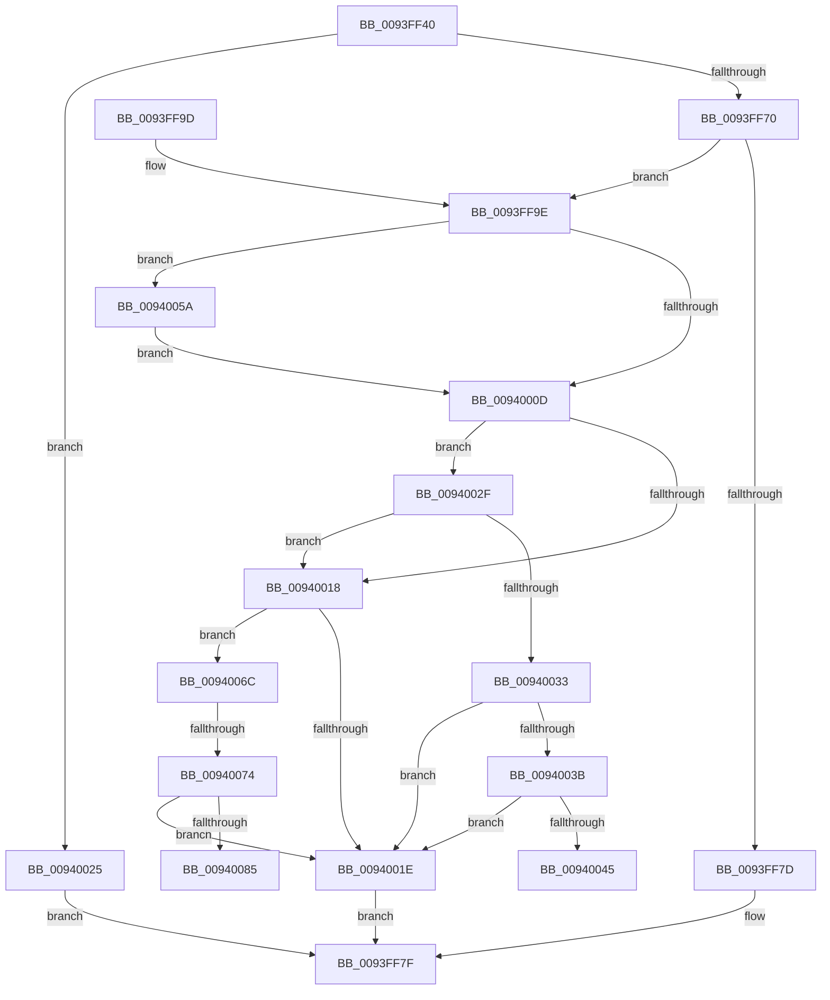

# MiValidateSectionSigningPolicy

- RVA: `0x0093FF40`–`0x00940090` (길이 `336` bytes)
- VA: `0x000000014093FF40`
- 실행 섹션: `PAGE`
- PDB 이름 있음: `예`; PDB Function 태그: `예`
- unwind 정보 RVA: `0x000901B0`
- 디코드: `93`개 명령, `336/336` bytes 표시
- 미해석 바이트: `0` (있으면 어셈블리에 `.byte`로 보존)

> 이 문서는 커널 이미지의 기계어와 PDB 기호를 분석해 생성했습니다. 4번과 5번은 함수 원형과 자료형을 바이너리 사용 방식에서 추정한 C 해석이며 원본 소스 복구 결과는 아닙니다.

## 1. Dependencies

- 직접 호출 지점: **2**; 고유 호출 대상: **2**
- 직접 호출자로 확인된 함수: **2**
- RIP 상대 이미지 참조: **1**

### Outgoing calls
- `0x00940002` → [MiValidateSectionCreate](../94/MiValidateSectionCreate_function_00940190.md) (function, `0x00940190`)
- `0x0094007C` → [SeCompareSigningLevels](../A1/SeCompareSigningLevels_function_00A13760.md) (function, `0x00A13760`)

### Direct callers
- [MiValidateExistingImage](../98/MiValidateExistingImage_function_009864B4.md) at `0x0098670C`
- [sub_00B2AF8E](../B2/Unknown_function_00B2AF8E.md) at `0x00B2B060`

### Static image references
- `0x00940064` → RVA `0x00E2D7F8` (`.data`; write)

## 2. Other-region calls and transfers

- 다른 실행 섹션으로 향하는 call: **0**
- call이 아닌 외부 분기/꼬리 이동: **3**
  - `0x00940055` → [sub_00B2540A](../B2/Unknown_function_00B2540A.md) (`tail-transfer`)
  - `0x0094006E` → [sub_00B2540A + 0x1A](../B2/Unknown_function_00B2540A.md) (`tail-transfer`)
  - `0x0094008B` → [sub_00B2540A](../B2/Unknown_function_00B2540A.md) (`tail-transfer`)

## 3. Assembly (complete function range)

```asm
0093FF40  48 89 5C 24 08                  mov qword ptr [rsp + 8], rbx
0093FF45  48 89 6C 24 10                  mov qword ptr [rsp + 0x10], rbp
0093FF4A  48 89 74 24 18                  mov qword ptr [rsp + 0x18], rsi
0093FF4F  57                              push rdi
0093FF50  41 54                           push r12
0093FF52  41 55                           push r13
0093FF54  41 56                           push r14
0093FF56  41 57                           push r15
0093FF58  48 83 EC 40                     sub rsp, 0x40
0093FF5C  45 8B D1                        mov r10d, r9d
0093FF5F  4D 8B F0                        mov r14, r8
0093FF62  48 8B EA                        mov rbp, rdx
0093FF65  8B D9                           mov ebx, ecx
0093FF67  83 F9 02                        cmp ecx, 2
0093FF6A  0F 83 B5 00 00 00               jae 0x140940025
0093FF70  8B B4 24 A0 00 00 00            mov esi, dword ptr [rsp + 0xa0]
0093FF77  40 F6 C6 06                     test sil, 6
0093FF7B  75 21                           jne 0x14093ff9e
0093FF7D  33 C0                           xor eax, eax
0093FF7F  4C 8D 5C 24 40                  lea r11, [rsp + 0x40]
0093FF84  49 8B 5B 30                     mov rbx, qword ptr [r11 + 0x30]
0093FF88  49 8B 6B 38                     mov rbp, qword ptr [r11 + 0x38]
0093FF8C  49 8B 73 40                     mov rsi, qword ptr [r11 + 0x40]
0093FF90  49 8B E3                        mov rsp, r11
0093FF93  41 5F                           pop r15
0093FF95  41 5E                           pop r14
0093FF97  41 5D                           pop r13
0093FF99  41 5C                           pop r12
0093FF9B  5F                              pop rdi
0093FF9C  C3                              ret
0093FF9D  CC                              int3
0093FF9E  65 48 8B 04 25 88 01 00 00      mov rax, qword ptr gs:[0x188]
0093FFA7  44 8B EE                        mov r13d, esi
0093FFAA  8B 94 24 98 00 00 00            mov edx, dword ptr [rsp + 0x98]
0093FFB1  45 8B C2                        mov r8d, r10d
0093FFB4  44 8A BC 24 B0 00 00 00         mov r15b, byte ptr [rsp + 0xb0]
0093FFBC  0F BA EA 19                     bts edx, 0x19
0093FFC0  4C 8B 8C 24 90 00 00 00         mov r9, qword ptr [rsp + 0x90]
0093FFC8  41 83 E5 02                     and r13d, 2
0093FFCC  4C 8B A0 B8 00 00 00            mov r12, qword ptr [rax + 0xb8]
0093FFD3  0F 45 94 24 98 00 00 00         cmovne edx, dword ptr [rsp + 0x98]
0093FFDB  8A 84 24 A8 00 00 00            mov al, byte ptr [rsp + 0xa8]
0093FFE2  8B CA                           mov ecx, edx
0093FFE4  0F BA E9 17                     bts ecx, 0x17
0093FFE8  44 88 7C 24 30                  mov byte ptr [rsp + 0x30], r15b
0093FFED  88 44 24 28                     mov byte ptr [rsp + 0x28], al
0093FFF1  40 F6 C6 08                     test sil, 8
0093FFF5  0F 44 CA                        cmove ecx, edx
0093FFF8  49 8B D6                        mov rdx, r14
0093FFFB  89 4C 24 20                     mov dword ptr [rsp + 0x20], ecx
0093FFFF  48 8B CD                        mov rcx, rbp
00940002  E8 89 01 00 00                  call 0x140940190
00940007  8B F8                           mov edi, eax
00940009  85 C0                           test eax, eax
0094000B  78 4D                           js 0x14094005a
0094000D  49 8B 1E                        mov rbx, qword ptr [r14]
00940010  8A 5B 0F                        mov bl, byte ptr [rbx + 0xf]
00940013  45 85 ED                        test r13d, r13d
00940016  75 17                           jne 0x14094002f
00940018  40 F6 C6 04                     test sil, 4
0094001C  75 4E                           jne 0x14094006c
0094001E  8B C7                           mov eax, edi
00940020  E9 5A FF FF FF                  jmp 0x14093ff7f
00940025  B8 0D 00 00 C0                  mov eax, 0xc000000d
0094002A  E9 50 FF FF FF                  jmp 0x14093ff7f
0094002F  85 FF                           test edi, edi
00940031  79 E5                           jns 0x140940018
00940033  81 FF 28 04 00 C0               cmp edi, 0xc0000428
00940039  75 E3                           jne 0x14094001e
0094003B  40 80 E6 09                     and sil, 9
0094003F  40 80 FE 01                     cmp sil, 1
00940043  75 D9                           jne 0x14094001e
00940045  44 8A 84 24 A8 00 00 00         mov r8b, byte ptr [rsp + 0xa8]
0094004D  80 E3 0F                        and bl, 0xf
00940050  B9 02 00 00 00                  mov ecx, 2
00940055  E9 B0 53 1E 00                  jmp 0x140b2540a
0094005A  33 C9                           xor ecx, ecx
0094005C  83 FB 01                        cmp ebx, 1
0094005F  0F 95 C1                        setne cl
00940062  FF C1                           inc ecx
00940064  89 0D 8E D7 4E 00               mov dword ptr [rip + 0x4ed78e], ecx
0094006A  EB A1                           jmp 0x14094000d
0094006C  85 FF                           test edi, edi
0094006E  0F 88 B0 53 1E 00               js 0x140b25424
00940074  80 E3 0F                        and bl, 0xf
00940077  41 8A D7                        mov dl, r15b
0094007A  8A CB                           mov cl, bl
0094007C  E8 DF 36 0D 00                  call 0x140a13760
00940081  85 C0                           test eax, eax
00940083  75 99                           jne 0x14094001e
00940085  45 8A C7                        mov r8b, r15b
00940088  8D 48 01                        lea ecx, [rax + 1]
0094008B  E9 7A 53 1E 00                  jmp 0x140b2540a
```

## 4. C-style interpretation (structured pseudocode)

```c
__int64 __fastcall MiValidateSectionSigningPolicy(int a1, __int64 a2, __int64 a3, int a4, __int64 a5, unsigned int a6, unsigned int a7, unsigned __int8 a8, unsigned __int8 a9)
{
    __int64 result;
    __int64 v_r13;
    __int64 v_rbx;
    __int64 v_rsi;
    __int64 v_rsp;
    unsigned __int8 v_stack_m10;
    unsigned __int8 v_stack_m18;
    unsigned int v_stack_m20;
    unsigned __int64 v_stack_m28;
    unsigned __int64 v_stack_p10;
    unsigned __int64 v_stack_p18;
    unsigned __int64 v_stack_p8;

    v_stack_p8 = v_rbx;
    v_stack_p10 = v_rbp;
    v_stack_p18 = v_rsi;
    v_rsp = (v_rsp) - (64);
    if (a1 >= 2) goto loc_00940025;
    if ((((unsigned __int8)((unsigned int)(a7))) & (6)) != 0) goto loc_0093FF9E;
    result = 0;
loc_0093FF7F:
    return result;
loc_0093FF9E:
    v_r13 = (unsigned int)(((unsigned int)((unsigned int)(*(unsigned __int64 *)(v_stack_m28 + 64)))) & (2));
    a2 = (unsigned int)(a6);
    if (condition_is_not_equal) { a2 = a6; }
    v_stack_m10 = a9;
    v_stack_m18 = a8;
    a1 = (unsigned int)((unsigned int)(a2));
    if ((((unsigned __int8)(*(unsigned __int64 *)(v_stack_m28 + 64))) & (8)) == 0) { a1 = (unsigned int)(a2); }
    v_stack_m20 = a1;
    result = MiValidateSectionCreate(*(unsigned __int64 *)(v_stack_m28 + 56), a3, (unsigned int)((unsigned int)((unsigned int)(a4))), a5);
    if (sign_flag) goto loc_0094005A;
loc_0094000D:
    if ((unsigned int)(v_r13) != 0) goto loc_0094002F;
loc_00940018:
    if ((((unsigned __int8)(*(unsigned __int64 *)(v_stack_m28 + 64))) & (4)) != 0) goto loc_0094006C;
loc_0094001E:
    goto loc_0093FF7F;
loc_00940025:
    goto loc_0093FF7F;
loc_0094002F:
    if (!sign_flag) goto loc_00940018;
    if (((unsigned int)((unsigned int)((unsigned int)(result)))) != 0xC0000428ULL) goto loc_0094001E;
    v_rsi = (unsigned __int8)((*(unsigned __int64 *)(v_stack_m28 + 64)) & (9));
    if (((unsigned __int8)(v_rsi)) != 1) goto loc_0094001E;
    v_rbx = (unsigned __int8)((*(unsigned __int8 *)(*(unsigned __int64 *)(a3) + 15)) & (15));
loc_0094005A:
    a1 = 0;
    a1 = (((unsigned int)(v_rbx)) != 1) ? 1 : 0;
    a1 = (unsigned int)((a1) + 1);
    *(unsigned int *)(v_rip + 5166990) = a1;
    goto loc_0094000D;
loc_0094006C:
    v_rbx = (unsigned __int8)((v_rbx) & (15));
    result = SeCompareSigningLevels((unsigned __int8)(v_rbx), a9, a8, a5);
    if ((unsigned int)(result) != 0) goto loc_0094001E;
}
```

## 5. (Beta) C Style

```c
int64_t MiValidateSectionSigningPolicy(int32_t Arg1, int64_t Arg2, void *Arg3, int32_t Arg4, int64_t Arg5, uint32_t Arg6, uint32_t Arg7, uint8_t Arg8, uint8_t Arg9)
{
    uint8_t *arg3 = (uint8_t *)Arg3;

    int64_t result;
    int64_t local_r13;
    int64_t local_rbx;
    int64_t local_rsi;
    int64_t local_rsp;
    uint8_t v_stack_m10;
    uint8_t v_stack_m18;
    uint32_t v_stack_m20;
    uint64_t v_stack_m28;
    uint64_t v_stack_p10;
    uint64_t v_stack_p18;
    uint64_t v_stack_p8;

    v_stack_p8 = local_rbx;
    v_stack_p10 = local_rbp;
    v_stack_p18 = local_rsi;
    local_rsp = (local_rsp) - (64);
    if (Arg1 >= 2) goto loc_00940025;
    if ((((uint8_t)((uint32_t)(Arg7))) & (6)) != 0) goto loc_0093FF9E;
    result = 0;
loc_0093FF7F:
    return result;
loc_0093FF9E:
    local_r13 = (uint32_t)(((uint32_t)((uint32_t)(*(uint64_t *)(v_stack_m28 + 0x40)))) & (2));
    Arg2 = (uint32_t)(Arg6);
    if (condition_is_not_equal) { Arg2 = Arg6; }
    v_stack_m10 = Arg9;
    v_stack_m18 = Arg8;
    Arg1 = (uint32_t)((uint32_t)(Arg2));
    if ((((uint8_t)(*(uint64_t *)(v_stack_m28 + 0x40))) & (8)) == 0) { Arg1 = (uint32_t)(Arg2); }
    v_stack_m20 = Arg1;
    result = MiValidateSectionCreate(*(uint64_t *)(v_stack_m28 + 0x38), Arg3, (uint32_t)((uint32_t)((uint32_t)(Arg4))), Arg5);
    if (sign_flag) goto loc_0094005A;
loc_0094000D:
    if ((uint32_t)(local_r13) != 0) goto loc_0094002F;
loc_00940018:
    if ((((uint8_t)(*(uint64_t *)(v_stack_m28 + 0x40))) & (4)) != 0) goto loc_0094006C;
loc_0094001E:
    goto loc_0093FF7F;
loc_00940025:
    goto loc_0093FF7F;
loc_0094002F:
    if (!sign_flag) goto loc_00940018;
    if (((uint32_t)((uint32_t)((uint32_t)(result)))) != 0xC0000428ULL) goto loc_0094001E;
    local_rsi = (uint8_t)((*(uint64_t *)(v_stack_m28 + 0x40)) & (9));
    if (((uint8_t)(local_rsi)) != 1) goto loc_0094001E;
    local_rbx = (uint8_t)((*(uint8_t *)(*(uint64_t *)(arg3) + 0xF)) & (15));
loc_0094005A:
    Arg1 = 0;
    Arg1 = (((uint32_t)(local_rbx)) != 1) ? 1 : 0;
    Arg1 = (uint32_t)((Arg1) + 1);
    *(uint32_t *)(v_rip + 0x4ED78E) = Arg1;
    goto loc_0094000D;
loc_0094006C:
    local_rbx = (uint8_t)((local_rbx) & (15));
    result = SeCompareSigningLevels((uint8_t)(local_rbx), Arg9, Arg8, Arg5);
    if ((uint32_t)(result) != 0) goto loc_0094001E;
}
```

### 관측된 메모리 오프셋

구조체 형식이 확인되지 않은 접근은 인자 기준의 오프셋으로만 기록했습니다.

| 기준 인자 | 오프셋 표현 | 폭 (bit) | 접근 |
|---|---:|---:|---|
| `Arg3` | `+ 0x0` | `64` | `R` |

## 6. Execution-region graph

[열기: 2D/3D 그래프와 함수 탐색 컨트롤 패널](../../../control-panel.html?section=page&rva=0x0093FF40&view=graph)

- 2D 그래프는 위에서 아래로 흐르고, 3D 그래프는 빈 공간을 드래그해 회전합니다. Shift+드래그는 이동, 휠은 확대·축소, 함수 노드 선택은 대상 보고서 이동입니다.

### Static fallback


