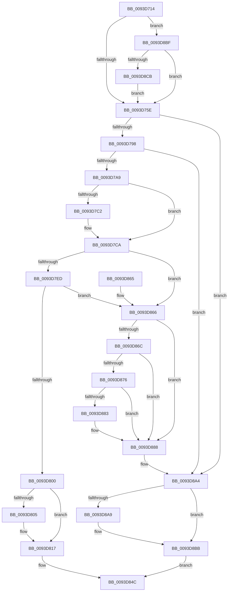

# MmPrefetchForCacheManager

- RVA: `0x0093D714`–`0x0093D8E2` (길이 `462` bytes)
- VA: `0x000000014093D714`
- 실행 섹션: `PAGE`
- PDB 이름 있음: `예`; PDB Function 태그: `아니요`
- unwind 정보 RVA: `0x0008FF88`
- 디코드: `115`개 명령, `462/462` bytes 표시
- 미해석 바이트: `0` (있으면 어셈블리에 `.byte`로 보존)

> 이 문서는 커널 이미지의 기계어와 PDB 기호를 분석해 생성했습니다. 4번과 5번은 함수 원형과 자료형을 바이너리 사용 방식에서 추정한 C 해석이며 원본 소스 복구 결과는 아닙니다.

## 1. Dependencies

- 직접 호출 지점: **9**; 고유 호출 대상: **8**
- 직접 호출자로 확인된 함수: **3**
- RIP 상대 이미지 참조: **3**

### Outgoing calls
- `0x0093D78B` → [MiPfPrepareSequentialReadList](MiPfPrepareSequentialReadList_function_0093D8E8.md) (function, `0x0093D8E8`)
- `0x0093D7E4` → [MiPfPutPagesInTransition](../../text/36/MiPfPutPagesInTransition_function_003640EC.md) (function, `0x003640EC`)
- `0x0093D812` → [MiReturnCcAccessLog](../../text/45/MiReturnCcAccessLog_function_0045D1F8.md) (function, `0x0045D1F8`)
- `0x0093D82C` → [MiPfExecuteReadList](MiPfExecuteReadList_function_0093E1AC.md) (function, `0x0093E1AC`)
- `0x0093D883` → [KiCheckForKernelApcDelivery](../../text/2E/KiCheckForKernelApcDelivery_function_002E2C80.md) (function, `0x002E2C80`)
- `0x0093D890` → [MiReleaseReadListResources](MiReleaseReadListResources_function_0093D570.md) (function, `0x0093D570`)
- `0x0093D89F` → [ExFreePoolWithTag](../../poolcode/B8/ExFreePoolWithTag_function_00B82870.md) (function, `0x00B82870`)
- `0x0093D8B6` → [MiReturnCcAccessLog](../../text/45/MiReturnCcAccessLog_function_0045D1F8.md) (function, `0x0045D1F8`)
- `0x0093D8D5` → [MiGetCcAccessLog](MiGetCcAccessLog_function_0093E364.md) (function, `0x0093E364`)

### Direct callers
- [sub_002F880D](../../text/2F/Unknown_function_002F880D.md) at `0x002F883E`
- [CcAsyncReadPrefetch](../../text/45/CcAsyncReadPrefetch_function_0045E540.md) at `0x0045E694`
- [CcPerformReadAhead](../../text/48/CcPerformReadAhead_function_0048F738.md) at `0x0048FA0A`

### Static image references
- `0x0093D73E` → RVA `0x00E3D12C` (`.data`; read)
- `0x0093D808` → RVA `0x00E38D00` (`.data`; read)
- `0x0093D8BF` → RVA `0x00E3D130` (`.data`; read)

## 2. Other-region calls and transfers

- 다른 실행 섹션으로 향하는 call: **5**
  - `0x0093D7E4` → [MiPfPutPagesInTransition](../../text/36/MiPfPutPagesInTransition_function_003640EC.md) (`PAGE` → `.text`)
  - `0x0093D812` → [MiReturnCcAccessLog](../../text/45/MiReturnCcAccessLog_function_0045D1F8.md) (`PAGE` → `.text`)
  - `0x0093D883` → [KiCheckForKernelApcDelivery](../../text/2E/KiCheckForKernelApcDelivery_function_002E2C80.md) (`PAGE` → `.text`)
  - `0x0093D89F` → [ExFreePoolWithTag](../../poolcode/B8/ExFreePoolWithTag_function_00B82870.md) (`PAGE` → `POOLCODE`)
  - `0x0093D8B6` → [MiReturnCcAccessLog](../../text/45/MiReturnCcAccessLog_function_0045D1F8.md) (`PAGE` → `.text`)
- 별도 외부 분기/꼬리 이동을 확인하지 못했습니다.

## 3. Assembly (complete function range)

```asm
0093D714  48 8B C4                        mov rax, rsp
0093D717  48 89 58 10                     mov qword ptr [rax + 0x10], rbx
0093D71B  48 89 68 18                     mov qword ptr [rax + 0x18], rbp
0093D71F  56                              push rsi
0093D720  57                              push rdi
0093D721  41 54                           push r12
0093D723  41 56                           push r14
0093D725  41 57                           push r15
0093D727  48 83 EC 50                     sub rsp, 0x50
0093D72B  48 83 60 08 00                  and qword ptr [rax + 8], 0
0093D730  33 FF                           xor edi, edi
0093D732  65 48 8B 34 25 88 01 00 00      mov rsi, qword ptr gs:[0x188]
0093D73B  4D 8B F1                        mov r14, r9
0093D73E  39 3D E8 F9 4F 00               cmp dword ptr [rip + 0x4ff9e8], edi
0093D744  4D 8B F8                        mov r15, r8
0093D747  48 8B 41 28                     mov rax, qword ptr [rcx + 0x28]
0093D74B  48 8B DA                        mov rbx, rdx
0093D74E  8B AC 24 A0 00 00 00            mov ebp, dword ptr [rsp + 0xa0]
0093D755  4C 8B 20                        mov r12, qword ptr [rax]
0093D758  0F 85 61 01 00 00               jne 0x14093d8bf
0093D75E  48 8D 84 24 80 00 00 00         lea rax, [rsp + 0x80]
0093D766  4D 8B CF                        mov r9, r15
0093D769  48 89 44 24 40                  mov qword ptr [rsp + 0x40], rax
0093D76E  4C 8B C3                        mov r8, rbx
0093D771  48 83 64 24 38 00               and qword ptr [rsp + 0x38], 0
0093D777  49 8B D4                        mov rdx, r12
0093D77A  83 4C 24 30 FF                  or dword ptr [rsp + 0x30], 0xffffffff
0093D77F  48 8B CF                        mov rcx, rdi
0093D782  89 6C 24 28                     mov dword ptr [rsp + 0x28], ebp
0093D786  4C 89 74 24 20                  mov qword ptr [rsp + 0x20], r14
0093D78B  E8 58 01 00 00                  call 0x14093d8e8
0093D790  85 C0                           test eax, eax
0093D792  0F 88 0C 01 00 00               js 0x14093d8a4
0093D798  48 8B 84 24 80 00 00 00         mov rax, qword ptr [rsp + 0x80]
0093D7A0  48 85 C0                        test rax, rax
0093D7A3  0F 84 FB 00 00 00               je 0x14093d8a4
0093D7A9  48 8B 9C 24 B8 00 00 00         mov rbx, qword ptr [rsp + 0xb8]
0093D7B1  BD 01 00 00 00                  mov ebp, 1
0093D7B6  89 A8 D0 00 00 00               mov dword ptr [rax + 0xd0], ebp
0093D7BC  48 83 3B 00                     cmp qword ptr [rbx], 0
0093D7C0  75 08                           jne 0x14093d7ca
0093D7C2  66 FF 8E E6 01 00 00            dec word ptr [rsi + 0x1e6]
0093D7C9  90                              nop
0093D7CA  48 8B 8C 24 80 00 00 00         mov rcx, qword ptr [rsp + 0x80]
0093D7D2  41 83 CE FF                     or r14d, 0xffffffff
0093D7D6  48 83 64 24 20 00               and qword ptr [rsp + 0x20], 0
0093D7DC  45 8B CE                        mov r9d, r14d
0093D7DF  44 8B C5                        mov r8d, ebp
0093D7E2  33 D2                           xor edx, edx
0093D7E4  E8 03 69 A2 FF                  call 0x1403640ec
0093D7E9  85 C0                           test eax, eax
0093D7EB  78 79                           js 0x14093d866
0093D7ED  48 8B 84 24 80 00 00 00         mov rax, qword ptr [rsp + 0x80]
0093D7F5  48 05 E0 00 00 00               add rax, 0xe0
0093D7FB  48 39 00                        cmp qword ptr [rax], rax
0093D7FE  74 66                           je 0x14093d866
0093D800  48 85 FF                        test rdi, rdi
0093D803  74 12                           je 0x14093d817
0093D805  44 8B C5                        mov r8d, ebp
0093D808  48 8D 0D F1 B4 4F 00            lea rcx, [rip + 0x4fb4f1]
0093D80F  48 8B D7                        mov rdx, rdi
0093D812  E8 E1 F9 B1 FF                  call 0x14045d1f8
0093D817  4C 8B 8C 24 B0 00 00 00         mov r9, qword ptr [rsp + 0xb0]
0093D81F  45 8B C6                        mov r8d, r14d
0093D822  48 8B 8C 24 80 00 00 00         mov rcx, qword ptr [rsp + 0x80]
0093D82A  8B D5                           mov edx, ebp
0093D82C  E8 7B 09 00 00                  call 0x14093e1ac
0093D831  48 8B 8C 24 80 00 00 00         mov rcx, qword ptr [rsp + 0x80]
0093D839  8B C5                           mov eax, ebp
0093D83B  48 8B 13                        mov rdx, qword ptr [rbx]
0093D83E  48 89 11                        mov qword ptr [rcx], rdx
0093D841  48 8B 8C 24 80 00 00 00         mov rcx, qword ptr [rsp + 0x80]
0093D849  48 89 0B                        mov qword ptr [rbx], rcx
0093D84C  4C 8D 5C 24 50                  lea r11, [rsp + 0x50]
0093D851  49 8B 5B 38                     mov rbx, qword ptr [r11 + 0x38]
0093D855  49 8B 6B 40                     mov rbp, qword ptr [r11 + 0x40]
0093D859  49 8B E3                        mov rsp, r11
0093D85C  41 5F                           pop r15
0093D85E  41 5E                           pop r14
0093D860  41 5C                           pop r12
0093D862  5F                              pop rdi
0093D863  5E                              pop rsi
0093D864  C3                              ret
0093D865  CC                              int3
0093D866  48 83 3B 00                     cmp qword ptr [rbx], 0
0093D86A  75 1C                           jne 0x14093d888
0093D86C  90                              nop
0093D86D  66 01 AE E6 01 00 00            add word ptr [rsi + 0x1e6], bp
0093D874  75 12                           jne 0x14093d888
0093D876  48 8D 86 98 00 00 00            lea rax, [rsi + 0x98]
0093D87D  90                              nop
0093D87E  48 39 00                        cmp qword ptr [rax], rax
0093D881  74 05                           je 0x14093d888
0093D883  E8 F8 53 9A FF                  call 0x1402e2c80
0093D888  48 8B 8C 24 80 00 00 00         mov rcx, qword ptr [rsp + 0x80]
0093D890  E8 DB FC FF FF                  call 0x14093d570
0093D895  48 8B 8C 24 80 00 00 00         mov rcx, qword ptr [rsp + 0x80]
0093D89D  33 D2                           xor edx, edx
0093D89F  E8 CC 4F 24 00                  call 0x140b82870
0093D8A4  48 85 FF                        test rdi, rdi
0093D8A7  74 12                           je 0x14093d8bb
0093D8A9  45 33 C0                        xor r8d, r8d
0093D8AC  48 8D 0D 4D B4 4F 00            lea rcx, [rip + 0x4fb44d]
0093D8B3  48 8B D7                        mov rdx, rdi
0093D8B6  E8 3D F9 B1 FF                  call 0x14045d1f8
0093D8BB  33 C0                           xor eax, eax
0093D8BD  EB 8D                           jmp 0x14093d84c
0093D8BF  3B 2D 6B F8 4F 00               cmp ebp, dword ptr [rip + 0x4ff86b]
0093D8C5  0F 82 93 FE FF FF               jb 0x14093d75e
0093D8CB  4D 8B C6                        mov r8, r14
0093D8CE  48 8B D1                        mov rdx, rcx
0093D8D1  49 C1 E8 0C                     shr r8, 0xc
0093D8D5  E8 8A 0A 00 00                  call 0x14093e364
0093D8DA  48 8B F8                        mov rdi, rax
0093D8DD  E9 7C FE FF FF                  jmp 0x14093d75e
```

## 4. C-style interpretation (structured pseudocode)

```c
__int64 __fastcall MmPrefetchForCacheManager(__int64 a1, __int64 a2, __int64 a3, __int64 a4, unsigned int a5, __int64 a6, __int64 a7, __int64 a8)
{
    __int64 result;
    __int64 v_r14;
    __int64 v_rdi;
    __int64 v_rsp;
    unsigned __int64 v_stack_m28;
    unsigned __int64 v_stack_m38;
    unsigned __int64 v_stack_m40;
    unsigned int v_stack_m48;
    unsigned int v_stack_m50;
    unsigned __int64 v_stack_m58;
    unsigned __int64 v_stack_p30;
    unsigned __int64 v_stack_p8;

    *(unsigned __int64 *)(v_rsp + 16) = v_rbx;
    *(unsigned __int64 *)(v_rsp + 24) = v_rbp;
    v_rsp = (v_rsp) - (80);
    v_rdi = 0;
    if ((*(unsigned int *)(v_rip + 5241320)) != 0) goto loc_0093D8BF;
loc_0093D75E:
    v_stack_m38 = v_stack_p8;
    v_stack_m50 = (unsigned int)((unsigned int)(a5));
    v_stack_m58 = a4;
    result = MiPfPrepareSequentialReadList(0, *(unsigned __int64 *)(*(unsigned __int64 *)(a1 + 40)), a2, a3);
    if (sign_flag) goto loc_0093D8A4;
    if (v_stack_p8 == 0) goto loc_0093D8A4;
    *(unsigned int *)(v_stack_p8 + 208) = 1;
    if ((*(unsigned __int64 *)(a8)) == 0) {
    }
    v_r14 = (unsigned int)((a4) | (0xFFFFFFFFULL));
    a2 = 0;
    result = MiPfPutPagesInTransition(v_stack_p8, a2, 1, (unsigned int)((unsigned int)(v_r14)));
    if (sign_flag) goto loc_0093D866;
    result = (v_stack_p8) + (224);
    if ((*(unsigned __int64 *)(result)) == result) goto loc_0093D866;
    if (0 != 0) {
        a3 = 1;
        a1 = v_rip + 5223665;
        a2 = 0;
        result = MiReturnCcAccessLog(a1, a2, a3, (unsigned int)((unsigned int)(v_r14)));
    }
    result = MiPfExecuteReadList(v_stack_p8, 1, (unsigned int)((unsigned int)(v_r14)), a7);
    *(unsigned __int64 *)(v_stack_p8) = *(unsigned __int64 *)(a8);
    *(unsigned __int64 *)(a8) = v_stack_p8;
loc_0093D84C:
    return 1;
loc_0093D866:
    if ((*(unsigned __int64 *)(*(unsigned __int64 *)(v_stack_m28 + 56))) != 0) goto loc_0093D888;
    if ((*(unsigned __int64 *)(*(unsigned __int64 *)(v_stack_m28 + 56))) != 0) goto loc_0093D888;
    result = *(unsigned __int64 *)(gs_base + (0 + 392)) + 152;
    if ((*(unsigned __int64 *)(*(unsigned __int64 *)(gs_base + (0 + 392)) + 152)) != (*(unsigned __int64 *)(gs_base + (0 + 392)) + 152)) {
        result = KiCheckForKernelApcDelivery(v_stack_p8, *(unsigned __int64 *)(a8), (unsigned int)((unsigned int)(v_r14)), a7);
    }
    result = MiReleaseReadListResources(v_stack_p30, *(unsigned __int64 *)(a8), (unsigned int)((unsigned int)(v_r14)), a7);
    a2 = 0;
    result = ExFreePoolWithTag(v_stack_p30, a2, (unsigned int)((unsigned int)(v_r14)), a7);
loc_0093D8A4:
    if (0 != 0) {
        a3 = 0;
        a1 = v_rip + 5223501;
        a2 = 0;
        result = MiReturnCcAccessLog(a1, a2, a3, a7);
    }
    result = 0;
    goto loc_0093D84C;
loc_0093D8BF:
    if (((unsigned int)(*(unsigned __int64 *)(v_stack_m28 + 64))) < (*(unsigned int *)(v_rip + 5240939))) goto loc_0093D75E;
    a3 = (v_r14) >> (12);
    result = MiGetCcAccessLog(a1, a1, a3, a7);
    goto loc_0093D75E;
}
```

## 5. (Beta) C Style

```c
int64_t MmPrefetchForCacheManager(void *Arg1, int64_t Arg2, int64_t Arg3, int64_t Arg4, uint32_t Arg5, uint64_t Arg6, int64_t Arg7, void *Arg8)
{
    uint8_t *arg1 = (uint8_t *)Arg1;
    uint8_t *arg8 = (uint8_t *)Arg8;

    int64_t result;
    int64_t local_r14;
    int64_t local_rdi;
    int64_t local_rsp;
    uint64_t v_stack_m28;
    uint64_t v_stack_m38;
    uint64_t v_stack_m40;
    uint32_t v_stack_m48;
    uint32_t v_stack_m50;
    uint64_t v_stack_m58;
    uint64_t v_stack_p30;
    uint64_t v_stack_p8;

    *(uint64_t *)(local_rsp + 0x10) = local_rbx;
    *(uint64_t *)(local_rsp + 0x18) = local_rbp;
    local_rsp = (local_rsp) - (80);
    local_rdi = 0;
    if ((*(uint32_t *)(v_rip + 0x4FF9E8)) != 0) goto loc_0093D8BF;
loc_0093D75E:
    v_stack_m38 = v_stack_p8;
    v_stack_m50 = (uint32_t)((uint32_t)(Arg5));
    v_stack_m58 = Arg4;
    result = MiPfPrepareSequentialReadList(0, *(uint64_t *)(*(uint64_t *)(arg1 + 0x28)), Arg2, Arg3);
    if (sign_flag) goto loc_0093D8A4;
    if (v_stack_p8 == 0) goto loc_0093D8A4;
    *(uint32_t *)(v_stack_p8 + 0xD0) = 1;
    if ((*(uint64_t *)(arg8)) == 0) {
    }
    local_r14 = (uint32_t)((Arg4) | (0xFFFFFFFFULL));
    Arg2 = 0;
    result = MiPfPutPagesInTransition(v_stack_p8, Arg2, 1, (uint32_t)((uint32_t)(local_r14)));
    if (sign_flag) goto loc_0093D866;
    result = (v_stack_p8) + (224);
    if ((*(uint64_t *)(result)) == result) goto loc_0093D866;
    if (0 != 0) {
        Arg3 = 1;
        Arg1 = v_rip + 5223665;
        Arg2 = 0;
        result = MiReturnCcAccessLog(Arg1, Arg2, Arg3, (uint32_t)((uint32_t)(local_r14)));
    }
    result = MiPfExecuteReadList(v_stack_p8, 1, (uint32_t)((uint32_t)(local_r14)), Arg7);
    *(uint64_t *)(v_stack_p8) = *(uint64_t *)(arg8);
    *(uint64_t *)(arg8) = v_stack_p8;
loc_0093D84C:
    return 1;
loc_0093D866:
    if ((*(uint64_t *)(*(uint64_t *)(v_stack_m28 + 0x38))) != 0) goto loc_0093D888;
    if ((*(uint64_t *)(*(uint64_t *)(v_stack_m28 + 0x38))) != 0) goto loc_0093D888;
    result = *(uint64_t *)(gs_base + (0 + 0x188)) + 152;
    if ((*(uint64_t *)(*(uint64_t *)(gs_base + (0 + 0x188)) + 0x98)) != (*(uint64_t *)(gs_base + (0 + 0x188)) + 152)) {
        result = KiCheckForKernelApcDelivery(v_stack_p8, *(uint64_t *)(arg8), (uint32_t)((uint32_t)(local_r14)), Arg7);
    }
    result = MiReleaseReadListResources(v_stack_p30, *(uint64_t *)(arg8), (uint32_t)((uint32_t)(local_r14)), Arg7);
    Arg2 = 0;
    result = ExFreePoolWithTag(v_stack_p30, Arg2, (uint32_t)((uint32_t)(local_r14)), Arg7);
loc_0093D8A4:
    if (0 != 0) {
        Arg3 = 0;
        Arg1 = v_rip + 5223501;
        Arg2 = 0;
        result = MiReturnCcAccessLog(Arg1, Arg2, Arg3, Arg7);
    }
    result = 0;
    goto loc_0093D84C;
loc_0093D8BF:
    if (((uint32_t)(*(uint64_t *)(v_stack_m28 + 0x40))) < (*(uint32_t *)(v_rip + 0x4FF86B))) goto loc_0093D75E;
    Arg3 = (local_r14) >> (12);
    result = MiGetCcAccessLog(Arg1, Arg1, Arg3, Arg7);
    goto loc_0093D75E;
}
```

### 관측된 메모리 오프셋

구조체 형식이 확인되지 않은 접근은 인자 기준의 오프셋으로만 기록했습니다.

| 기준 인자 | 오프셋 표현 | 폭 (bit) | 접근 |
|---|---:|---:|---|
| `Arg1` | `+ 0x28` | `64` | `R` |
| `Arg8` | `+ 0x0` | `64` | `R` |
| `Arg8` | `+ 0x0` | `64` | `W` |

## 6. Execution-region graph

[열기: 2D/3D 그래프와 함수 탐색 컨트롤 패널](../../../control-panel.html?section=page&rva=0x0093D714&view=graph)

- 2D 그래프는 위에서 아래로 흐르고, 3D 그래프는 빈 공간을 드래그해 회전합니다. Shift+드래그는 이동, 휠은 확대·축소, 함수 노드 선택은 대상 보고서 이동입니다.

### Static fallback


