# MmPrefetchPagesEx

- RVA: `0x0093C9A0`–`0x0093CD56` (길이 `950` bytes)
- VA: `0x000000014093C9A0`
- 실행 섹션: `PAGE`
- PDB 이름 있음: `예`; PDB Function 태그: `예`
- unwind 정보 RVA: `0x0008FF40`
- 디코드: `241`개 명령, `950/950` bytes 표시
- 미해석 바이트: `0` (있으면 어셈블리에 `.byte`로 보존)

> 이 문서는 커널 이미지의 기계어와 PDB 기호를 분석해 생성했습니다. 4번과 5번은 함수 원형과 자료형을 바이너리 사용 방식에서 추정한 C 해석이며 원본 소스 복구 결과는 아닙니다.

## 1. Dependencies

- 직접 호출 지점: **20**; 고유 호출 대상: **16**
- 직접 호출자로 확인된 함수: **4**
- RIP 상대 이미지 참조: **1**

### Outgoing calls
- `0x0093C9E6` → [MmGetCurrentProcessorColor](../../text/41/MmGetCurrentProcessorColor_function_00418930.md) (function, `0x00418930`)
- `0x0093CA03` → [ExAllocatePoolMm](../../text/35/ExAllocatePoolMm_function_0035B690.md) (function, `0x0035B690`)
- `0x0093CA19` → [MiGetInPageAutoBoostLock](../../text/36/MiGetInPageAutoBoostLock_function_0036D3CC.md) (function, `0x0036D3CC`)
- `0x0093CA32` → [KeAbPreAcquire](../../text/21/KeAbPreAcquire_function_00210230.md) (function, `0x00210230`)
- `0x0093CAA2` → [MiPfPrepareReadList](MiPfPrepareReadList_function_0093CD5C.md) (function, `0x0093CD5C`)
- `0x0093CB14` → [KeAbPostReleaseEx](../../text/26/KeAbPostReleaseEx_function_00262210.md) (function, `0x00262210`)
- `0x0093CB1C` → [MiDereferenceInPageAutoBoostLock](../../text/36/MiDereferenceInPageAutoBoostLock_function_0036D398.md) (function, `0x0036D398`)
- `0x0093CB31` → [KiLeaveCriticalRegionUnsafe](../../text/25/KiLeaveCriticalRegionUnsafe_function_0025F010.md) (function, `0x0025F010`)
- `0x0093CB53` → [ExFreePoolWithTag](../../poolcode/B8/ExFreePoolWithTag_function_00B82870.md) (function, `0x00B82870`)
- `0x0093CB67` → [ExFreePoolWithTag](../../poolcode/B8/ExFreePoolWithTag_function_00B82870.md) (function, `0x00B82870`)
- `0x0093CBCD` → [MiPfPutPagesInTransition](../../text/36/MiPfPutPagesInTransition_function_003640EC.md) (function, `0x003640EC`)
- `0x0093CC00` → [MiPfExecuteReadList](MiPfExecuteReadList_function_0093E1AC.md) (function, `0x0093E1AC`)
- `0x0093CC44` → [MiPfCompletePrefetchIos](../../text/36/MiPfCompletePrefetchIos_function_0036C4B0.md) (function, `0x0036C4B0`)
- `0x0093CC4C` → [MiReleaseReadListResources](MiReleaseReadListResources_function_0093D570.md) (function, `0x0093D570`)
- `0x0093CC82` → [MiAllocatePool](../../text/35/MiAllocatePool_function_0035B540.md) (function, `0x0035B540`)
- `0x0093CCAB` → [MiReleaseReadListResources](MiReleaseReadListResources_function_0093D570.md) (function, `0x0093D570`)
- `0x0093CCBA` → [ExFreePoolWithTag](../../poolcode/B8/ExFreePoolWithTag_function_00B82870.md) (function, `0x00B82870`)
- `0x0093CD1D` → [MiInitializePageHeatList](../../text/44/MiInitializePageHeatList_function_00446000.md) (function, `0x00446000`)
- `0x0093CD38` → [MiIssuePageHeatList](../../text/44/MiIssuePageHeatList_function_0044615C.md) (function, `0x0044615C`)
- `0x0093CD4C` → [ExFreePoolWithTag](../../poolcode/B8/ExFreePoolWithTag_function_00B82870.md) (function, `0x00B82870`)

### Direct callers
- [PfpPrefetchFiles](PfpPrefetchFiles_function_0093AD58.md) at `0x0093B059`
- [PfSnPrefetchSections](PfSnPrefetchSections_function_0093BCF4.md) at `0x0093BE9E`
- [PfpPrefetchFilesTrickle](PfpPrefetchFilesTrickle_function_0093C4E8.md) at `0x0093C6EA`
- [MmPrefetchPages](MmPrefetchPages_function_0093C980.md) at `0x0093C987`

### Static image references
- `0x0093CA48` → RVA `0x00FC6AB8` (`ALMOSTRO`; read)

## 2. Other-region calls and transfers

- 다른 실행 섹션으로 향하는 call: **16**
  - `0x0093C9E6` → [MmGetCurrentProcessorColor](../../text/41/MmGetCurrentProcessorColor_function_00418930.md) (`PAGE` → `.text`)
  - `0x0093CA03` → [ExAllocatePoolMm](../../text/35/ExAllocatePoolMm_function_0035B690.md) (`PAGE` → `.text`)
  - `0x0093CA19` → [MiGetInPageAutoBoostLock](../../text/36/MiGetInPageAutoBoostLock_function_0036D3CC.md) (`PAGE` → `.text`)
  - `0x0093CA32` → [KeAbPreAcquire](../../text/21/KeAbPreAcquire_function_00210230.md) (`PAGE` → `.text`)
  - `0x0093CB14` → [KeAbPostReleaseEx](../../text/26/KeAbPostReleaseEx_function_00262210.md) (`PAGE` → `.text`)
  - `0x0093CB1C` → [MiDereferenceInPageAutoBoostLock](../../text/36/MiDereferenceInPageAutoBoostLock_function_0036D398.md) (`PAGE` → `.text`)
  - `0x0093CB31` → [KiLeaveCriticalRegionUnsafe](../../text/25/KiLeaveCriticalRegionUnsafe_function_0025F010.md) (`PAGE` → `.text`)
  - `0x0093CB53` → [ExFreePoolWithTag](../../poolcode/B8/ExFreePoolWithTag_function_00B82870.md) (`PAGE` → `POOLCODE`)
  - `0x0093CB67` → [ExFreePoolWithTag](../../poolcode/B8/ExFreePoolWithTag_function_00B82870.md) (`PAGE` → `POOLCODE`)
  - `0x0093CBCD` → [MiPfPutPagesInTransition](../../text/36/MiPfPutPagesInTransition_function_003640EC.md) (`PAGE` → `.text`)
  - `0x0093CC44` → [MiPfCompletePrefetchIos](../../text/36/MiPfCompletePrefetchIos_function_0036C4B0.md) (`PAGE` → `.text`)
  - `0x0093CC82` → [MiAllocatePool](../../text/35/MiAllocatePool_function_0035B540.md) (`PAGE` → `.text`)
  - `0x0093CCBA` → [ExFreePoolWithTag](../../poolcode/B8/ExFreePoolWithTag_function_00B82870.md) (`PAGE` → `POOLCODE`)
  - `0x0093CD1D` → [MiInitializePageHeatList](../../text/44/MiInitializePageHeatList_function_00446000.md) (`PAGE` → `.text`)
  - `0x0093CD38` → [MiIssuePageHeatList](../../text/44/MiIssuePageHeatList_function_0044615C.md) (`PAGE` → `.text`)
  - `0x0093CD4C` → [ExFreePoolWithTag](../../poolcode/B8/ExFreePoolWithTag_function_00B82870.md) (`PAGE` → `POOLCODE`)
- call이 아닌 외부 분기/꼬리 이동: **4**
  - `0x0093CCF0` → [sub_00B25182 + 0x18](../B2/Unknown_function_00B25182.md) (`tail-transfer`)
  - `0x0093CCF6` → [sub_00B25182 + 0x6D](../B2/Unknown_function_00B25182.md) (`tail-transfer`)
  - `0x0093CD32` → [sub_00B25182](../B2/Unknown_function_00B25182.md) (`tail-transfer`)
  - `0x0093CD45` → [sub_00B25182](../B2/Unknown_function_00B25182.md) (`tail-transfer`)

## 3. Assembly (complete function range)

```asm
0093C9A0  4C 89 44 24 18                  mov qword ptr [rsp + 0x18], r8
0093C9A5  48 89 54 24 10                  mov qword ptr [rsp + 0x10], rdx
0093C9AA  53                              push rbx
0093C9AB  55                              push rbp
0093C9AC  56                              push rsi
0093C9AD  57                              push rdi
0093C9AE  41 54                           push r12
0093C9B0  41 55                           push r13
0093C9B2  41 56                           push r14
0093C9B4  41 57                           push r15
0093C9B6  48 83 EC 58                     sub rsp, 0x58
0093C9BA  65 48 8B 3C 25 88 01 00 00      mov rdi, qword ptr gs:[0x188]
0093C9C3  33 ED                           xor ebp, ebp
0093C9C5  44 8B E1                        mov r12d, ecx
0093C9C8  8B DD                           mov ebx, ebp
0093C9CA  48 89 AC 24 B8 00 00 00         mov qword ptr [rsp + 0xb8], rbp
0093C9D2  48 89 7C 24 40                  mov qword ptr [rsp + 0x40], rdi
0093C9D7  81 F9 FF FF FF 1F               cmp ecx, 0x1fffffff
0093C9DD  0F 87 BE 02 00 00               ja 0x14093cca1
0093C9E3  45 8B FC                        mov r15d, r12d
0093C9E6  E8 45 BF AD FF                  call 0x140418930
0093C9EB  0F BA E8 1F                     bts eax, 0x1f
0093C9EF  4A 8D 14 E5 00 00 00 00         lea rdx, [r12*8]
0093C9F7  44 8B C8                        mov r9d, eax
0093C9FA  8D 4D 40                        lea ecx, [rbp + 0x40]
0093C9FD  41 B8 4D 6D 52 6C               mov r8d, 0x6c526d4d
0093CA03  E8 88 EC A1 FF                  call 0x14035b690
0093CA08  48 89 44 24 38                  mov qword ptr [rsp + 0x38], rax
0093CA0D  48 8B F0                        mov rsi, rax
0093CA10  48 85 C0                        test rax, rax
0093CA13  0F 84 E2 02 00 00               je 0x14093ccfb
0093CA19  E8 AE 09 A3 FF                  call 0x14036d3cc
0093CA1E  4C 8B F0                        mov r14, rax
0093CA21  48 85 C0                        test rax, rax
0093CA24  0F 84 DB 02 00 00               je 0x14093cd05
0093CA2A  45 33 C0                        xor r8d, r8d
0093CA2D  33 D2                           xor edx, edx
0093CA2F  48 8B C8                        mov rcx, rax
0093CA32  E8 F9 37 8D FF                  call 0x140210230
0093CA37  48 89 44 24 48                  mov qword ptr [rsp + 0x48], rax
0093CA3C  4C 8B E8                        mov r13, rax
0093CA3F  48 85 C0                        test rax, rax
0093CA42  74 04                           je 0x14093ca48
0093CA44  C6 40 0A 01                     mov byte ptr [rax + 0xa], 1
0093CA48  F7 05 66 A0 68 00 00 00 20 00   test dword ptr [rip + 0x68a066], 0x200000
0093CA52  0F 85 1A 02 00 00               jne 0x14093cc72
0093CA58  48 8B CB                        mov rcx, rbx
0093CA5B  66 FF 8F E4 01 00 00            dec word ptr [rdi + 0x1e4]
0093CA62  BB 02 00 00 00                  mov ebx, 2
0093CA67  90                              nop
0093CA68  45 85 E4                        test r12d, r12d
0093CA6B  74 7A                           je 0x14093cae7
0093CA6D  48 8B BC 24 A8 00 00 00         mov rdi, qword ptr [rsp + 0xa8]
0093CA75  4C 8B FE                        mov r15, rsi
0093CA78  48 2B FE                        sub rdi, rsi
0093CA7B  4C 89 64 24 30                  mov qword ptr [rsp + 0x30], r12
0093CA80  4C 8B EE                        mov r13, rsi
0093CA83  48 8B B4 24 B8 00 00 00         mov rsi, qword ptr [rsp + 0xb8]
0093CA8B  4C 8B 84 24 B0 00 00 00         mov r8, qword ptr [rsp + 0xb0]
0093CA93  4C 8B CE                        mov r9, rsi
0093CA96  4A 8B 0C 3F                     mov rcx, qword ptr [rdi + r15]
0093CA9A  49 8B D5                        mov rdx, r13
0093CA9D  4C 89 74 24 20                  mov qword ptr [rsp + 0x20], r14
0093CAA2  E8 B5 02 00 00                  call 0x14093cd5c
0093CAA7  85 C0                           test eax, eax
0093CAA9  0F 88 78 02 00 00               js 0x14093cd27
0093CAAF  8B CB                           mov ecx, ebx
0093CAB1  83 C9 01                        or ecx, 1
0093CAB4  49 83 3F 00                     cmp qword ptr [r15], 0
0093CAB8  0F 44 CB                        cmove ecx, ebx
0093CABB  8B D9                           mov ebx, ecx
0093CABD  49 83 C5 08                     add r13, 8
0093CAC1  49 83 C7 08                     add r15, 8
0093CAC5  48 83 6C 24 30 01               sub qword ptr [rsp + 0x30], 1
0093CACB  75 BE                           jne 0x14093ca8b
0093CACD  48 8B 7C 24 40                  mov rdi, qword ptr [rsp + 0x40]
0093CAD2  4D 8B FC                        mov r15, r12
0093CAD5  48 8B 74 24 38                  mov rsi, qword ptr [rsp + 0x38]
0093CADA  4C 8B 6C 24 48                  mov r13, qword ptr [rsp + 0x48]
0093CADF  48 8B 8C 24 B8 00 00 00         mov rcx, qword ptr [rsp + 0xb8]
0093CAE7  48 85 C9                        test rcx, rcx
0093CAEA  0F 85 3E 02 00 00               jne 0x14093cd2e
0093CAF0  33 D2                           xor edx, edx
0093CAF2  F6 C3 01                        test bl, 1
0093CAF5  0F 85 85 00 00 00               jne 0x14093cb80
0093CAFB  85 ED                           test ebp, ebp
0093CAFD  0F 44 EA                        cmove ebp, edx
0093CB00  48 85 C9                        test rcx, rcx
0093CB03  0F 85 41 02 00 00               jne 0x14093cd4a
0093CB09  4D 85 ED                        test r13, r13
0093CB0C  74 0B                           je 0x14093cb19
0093CB0E  49 8B D5                        mov rdx, r13
0093CB11  49 8B CE                        mov rcx, r14
0093CB14  E8 F7 56 92 FF                  call 0x140262210
0093CB19  49 8B CE                        mov rcx, r14
0093CB1C  E8 77 08 A3 FF                  call 0x14036d398
0093CB21  4C 8B 74 24 38                  mov r14, qword ptr [rsp + 0x38]
0093CB26  49 8B F6                        mov rsi, r14
0093CB29  F6 C3 02                        test bl, 2
0093CB2C  74 08                           je 0x14093cb36
0093CB2E  48 8B CF                        mov rcx, rdi
0093CB31  E8 DA 24 92 FF                  call 0x14025f010
0093CB36  F6 C3 04                        test bl, 4
0093CB39  74 06                           je 0x14093cb41
0093CB3B  FE 8F AE 05 00 00               dec byte ptr [rdi + 0x5ae]
0093CB41  45 85 E4                        test r12d, r12d
0093CB44  74 1C                           je 0x14093cb62
0093CB46  48 8B DE                        mov rbx, rsi
0093CB49  48 8B 0B                        mov rcx, qword ptr [rbx]
0093CB4C  48 85 C9                        test rcx, rcx
0093CB4F  74 07                           je 0x14093cb58
0093CB51  33 D2                           xor edx, edx
0093CB53  E8 18 5D 24 00                  call 0x140b82870
0093CB58  48 83 C3 08                     add rbx, 8
0093CB5C  49 83 EF 01                     sub r15, 1
0093CB60  75 E7                           jne 0x14093cb49
0093CB62  33 D2                           xor edx, edx
0093CB64  48 8B CE                        mov rcx, rsi
0093CB67  E8 04 5D 24 00                  call 0x140b82870
0093CB6C  8B C5                           mov eax, ebp
0093CB6E  48 83 C4 58                     add rsp, 0x58
0093CB72  41 5F                           pop r15
0093CB74  41 5E                           pop r14
0093CB76  41 5D                           pop r13
0093CB78  41 5C                           pop r12
0093CB7A  5F                              pop rdi
0093CB7B  5E                              pop rsi
0093CB7C  5D                              pop rbp
0093CB7D  5B                              pop rbx
0093CB7E  C3                              ret
0093CB7F  CC                              int3
0093CB80  FE 87 AE 05 00 00               inc byte ptr [rdi + 0x5ae]
0093CB86  83 E3 FE                        and ebx, 0xfffffffe
0093CB89  83 CB 04                        or ebx, 4
0093CB8C  8B C2                           mov eax, edx
0093CB8E  8B EA                           mov ebp, edx
0093CB90  89 84 24 A0 00 00 00            mov dword ptr [rsp + 0xa0], eax
0093CB97  41 3B C4                        cmp eax, r12d
0093CB9A  73 79                           jae 0x14093cc15
0093CB9C  48 8B 0C C6                     mov rcx, qword ptr [rsi + rax*8]
0093CBA0  48 8D 04 C6                     lea rax, [rsi + rax*8]
0093CBA4  48 89 44 24 30                  mov qword ptr [rsp + 0x30], rax
0093CBA9  48 85 C9                        test rcx, rcx
0093CBAC  74 59                           je 0x14093cc07
0093CBAE  89 91 D0 00 00 00               mov dword ptr [rcx + 0xd0], edx
0093CBB4  41 B9 FF FF FF FF               mov r9d, 0xffffffff
0093CBBA  48 8B 94 24 B0 00 00 00         mov rdx, qword ptr [rsp + 0xb0]
0093CBC2  45 33 C0                        xor r8d, r8d
0093CBC5  48 8B 08                        mov rcx, qword ptr [rax]
0093CBC8  4C 89 74 24 20                  mov qword ptr [rsp + 0x20], r14
0093CBCD  E8 1A 75 A2 FF                  call 0x1403640ec
0093CBD2  85 C0                           test eax, eax
0093CBD4  0F 88 FD 00 00 00               js 0x14093ccd7
0093CBDA  48 8B 44 24 30                  mov rax, qword ptr [rsp + 0x30]
0093CBDF  48 8B 08                        mov rcx, qword ptr [rax]
0093CBE2  48 8D 81 E0 00 00 00            lea rax, [rcx + 0xe0]
0093CBE9  48 39 00                        cmp qword ptr [rax], rax
0093CBEC  0F 84 B9 00 00 00               je 0x14093ccab
0093CBF2  45 33 C9                        xor r9d, r9d
0093CBF5  33 D2                           xor edx, edx
0093CBF7  41 B8 FF FF FF FF               mov r8d, 0xffffffff
0093CBFD  83 CB 01                        or ebx, 1
0093CC00  E8 A7 15 00 00                  call 0x14093e1ac
0093CC05  33 D2                           xor edx, edx
0093CC07  8B 84 24 A0 00 00 00            mov eax, dword ptr [rsp + 0xa0]
0093CC0E  FF C0                           inc eax
0093CC10  E9 7B FF FF FF                  jmp 0x14093cb90
0093CC15  F6 C3 01                        test bl, 1
0093CC18  74 4B                           je 0x14093cc65
0093CC1A  8B EA                           mov ebp, edx
0093CC1C  45 85 E4                        test r12d, r12d
0093CC1F  74 44                           je 0x14093cc65
0093CC21  49 8B C7                        mov rax, r15
0093CC24  48 89 44 24 30                  mov qword ptr [rsp + 0x30], rax
0093CC29  0F 1F 80 00 00 00 00            nop dword ptr [rax]
0093CC30  48 8B 0E                        mov rcx, qword ptr [rsi]
0093CC33  48 85 C9                        test rcx, rcx
0093CC36  74 1E                           je 0x14093cc56
0093CC38  48 81 C1 E0 00 00 00            add rcx, 0xe0
0093CC3F  45 33 C0                        xor r8d, r8d
0093CC42  33 D2                           xor edx, edx
0093CC44  E8 67 F8 A2 FF                  call 0x14036c4b0
0093CC49  48 8B 0E                        mov rcx, qword ptr [rsi]
0093CC4C  E8 1F 09 00 00                  call 0x14093d570
0093CC51  48 8B 44 24 30                  mov rax, qword ptr [rsp + 0x30]
0093CC56  48 83 C6 08                     add rsi, 8
0093CC5A  48 83 E8 01                     sub rax, 1
0093CC5E  48 89 44 24 30                  mov qword ptr [rsp + 0x30], rax
0093CC63  75 CB                           jne 0x14093cc30
0093CC65  48 8B 8C 24 B8 00 00 00         mov rcx, qword ptr [rsp + 0xb8]
0093CC6D  E9 8E FE FF FF                  jmp 0x14093cb00
0093CC72  BA 08 10 00 00                  mov edx, 0x1008
0093CC77  B9 42 00 00 00                  mov ecx, 0x42
0093CC7C  41 B8 4D 69 68 6C               mov r8d, 0x6c68694d
0093CC82  E8 B9 E8 A1 FF                  call 0x14035b540
0093CC87  48 89 84 24 B8 00 00 00         mov qword ptr [rsp + 0xb8], rax
0093CC8F  48 8B C8                        mov rcx, rax
0093CC92  48 85 C0                        test rax, rax
0093CC95  75 78                           jne 0x14093cd0f
0093CC97  BD 9A 00 00 C0                  mov ebp, 0xc000009a
0093CC9C  E9 68 FE FF FF                  jmp 0x14093cb09
0093CCA1  BD EF 00 00 C0                  mov ebp, 0xc00000ef
0093CCA6  E9 C1 FE FF FF                  jmp 0x14093cb6c
0093CCAB  E8 C0 08 00 00                  call 0x14093d570
0093CCB0  48 8B 44 24 30                  mov rax, qword ptr [rsp + 0x30]
0093CCB5  33 D2                           xor edx, edx
0093CCB7  48 8B 08                        mov rcx, qword ptr [rax]
0093CCBA  E8 B1 5B 24 00                  call 0x140b82870
0093CCBF  48 8B 44 24 30                  mov rax, qword ptr [rsp + 0x30]
0093CCC4  33 D2                           xor edx, edx
0093CCC6  48 89 10                        mov qword ptr [rax], rdx
0093CCC9  8B 84 24 A0 00 00 00            mov eax, dword ptr [rsp + 0xa0]
0093CCD0  FF C0                           inc eax
0093CCD2  E9 B9 FE FF FF                  jmp 0x14093cb90
0093CCD7  8B E8                           mov ebp, eax
0093CCD9  33 D2                           xor edx, edx
0093CCDB  8B 84 24 A0 00 00 00            mov eax, dword ptr [rsp + 0xa0]
0093CCE2  48 83 3C C6 00                  cmp qword ptr [rsi + rax*8], 0
0093CCE7  48 8D 04 C6                     lea rax, [rsi + rax*8]
0093CCEB  48 89 44 24 30                  mov qword ptr [rsp + 0x30], rax
0093CCF0  0F 85 A4 84 1E 00               jne 0x140b2519a
0093CCF6  E9 F4 84 1E 00                  jmp 0x140b251ef
0093CCFB  BD 9A 00 00 C0                  mov ebp, 0xc000009a
0093CD00  E9 67 FE FF FF                  jmp 0x14093cb6c
0093CD05  BD 9A 00 00 C0                  mov ebp, 0xc000009a
0093CD0A  E9 32 FE FF FF                  jmp 0x14093cb41
0093CD0F  BA 01 00 00 00                  mov edx, 1
0093CD14  41 B9 FF 01 00 00               mov r9d, 0x1ff
0093CD1A  44 8B C2                        mov r8d, edx
0093CD1D  E8 DE 92 B0 FF                  call 0x140446000
0093CD22  E9 34 FD FF FF                  jmp 0x14093ca5b
0093CD27  8B E8                           mov ebp, eax
0093CD29  E9 8F FD FF FF                  jmp 0x14093cabd
0093CD2E  83 79 04 00                     cmp dword ptr [rcx + 4], 0
0093CD32  0F 84 4A 84 1E 00               je 0x140b25182
0093CD38  E8 1F 94 B0 FF                  call 0x14044615c
0093CD3D  48 8B 8C 24 B8 00 00 00         mov rcx, qword ptr [rsp + 0xb8]
0093CD45  E9 38 84 1E 00                  jmp 0x140b25182
0093CD4A  33 D2                           xor edx, edx
0093CD4C  E8 1F 5B 24 00                  call 0x140b82870
0093CD51  E9 B3 FD FF FF                  jmp 0x14093cb09
```

## 4. C-style interpretation (structured pseudocode)

```c
__int64 __fastcall MmPrefetchPagesEx(int a1, __int64 a2, __int64 a3)
{
    __int64 result;
    __int64 v_r13;
    __int64 v_r15;
    __int64 v_rbp;
    __int64 v_rbx;
    __int64 v_rdi;
    __int64 v_rsi;
    __int64 v_rsp;
    unsigned __int64 v_stack_m50;
    unsigned __int64 v_stack_m58;
    unsigned __int64 v_stack_m60;
    unsigned __int64 v_stack_m68;
    unsigned __int64 v_stack_m78;
    unsigned __int64 v_stack_p10;
    unsigned __int64 v_stack_p18;
    unsigned __int64 v_stack_p20;
    unsigned __int64 v_stack_p30;
    unsigned int v_stack_pA0;
    unsigned __int64 v_stack_pB0;
    unsigned __int64 v_stack_pB8;

    v_stack_p18 = a3;
    v_stack_p10 = a2;
    v_rsp = (v_rsp) - (88);
    v_rbp = 0;
    v_stack_p20 = 0;
    v_stack_m58 = *(unsigned __int64 *)(gs_base + (0 + 392));
    if (a1 > 0x1FFFFFFFULL) goto loc_0093CCA1;
    result = MmGetCurrentProcessorColor(a1, a2, a3, a4);
    result = ExAllocatePoolMm(v_rbp + 64, (unsigned int)(a1) * 8, (unsigned int)(0x6C526D4DULL), (unsigned int)((unsigned int)(result)));
    v_stack_m60 = result;
    if (result == 0) goto loc_0093CCFB;
    result = MiGetInPageAutoBoostLock(v_rbp + 64, (unsigned int)(a1) * 8, (unsigned int)(0x6C526D4DULL), (unsigned int)((unsigned int)(result)));
    if (result == 0) goto loc_0093CD05;
    a3 = 0;
    a2 = 0;
    result = KeAbPreAcquire(result, a2, a3, (unsigned int)((unsigned int)(result)));
    v_stack_m50 = result;
    if (result != 0) {
        *(unsigned __int8 *)(result + 10) = 1;
    }
    if (((*(unsigned int *)(v_rip + 6856806)) & (0x200000ULL)) != 0) goto loc_0093CC72;
loc_0093CA5B:
    if ((unsigned int)((unsigned int)(a1)) == 0) goto loc_0093CAE7;
    v_rdi = (v_stack_p10) - (result);
    v_stack_m68 = (unsigned int)(a1);
loc_0093CA8B:
    v_stack_m78 = result;
    result = MiPfPrepareReadList(*(unsigned __int64 *)(v_rdi + result * 1), result, v_stack_p18, v_stack_p20);
    if (sign_flag) goto loc_0093CD27;
    a1 = (unsigned int)((2) | (1));
    if ((*(unsigned __int64 *)(result)) == 0) { a1 = 2; }
loc_0093CABD:
    v_r13 = (result) + (8);
    v_r15 = (result) + (8);
    if (condition_is_not_equal) goto loc_0093CA8B;
loc_0093CAE7:
    if (v_stack_p20 != 0) goto loc_0093CD2E;
    a2 = 0;
    if ((((unsigned __int8)((unsigned int)(a1))) & (1)) != 0) goto loc_0093CB80;
    if (0 == 0) { v_rbp = 0; }
loc_0093CB00:
    if (v_stack_p20 != 0) goto loc_0093CD4A;
loc_0093CB09:
    if (v_stack_m50 != 0) {
        a2 = v_stack_m50;
        a1 = result;
        result = KeAbPostReleaseEx(a1, a2, v_stack_p18, v_stack_p20);
    }
    result = MiDereferenceInPageAutoBoostLock(result, a2, v_stack_p18, v_stack_p20);
    if ((((unsigned __int8)((unsigned int)(a1))) & (2)) != 0) {
        a1 = v_stack_m58;
        result = KiLeaveCriticalRegionUnsafe(a1, a2, v_stack_p18, v_stack_p20);
    }
    if ((((unsigned __int8)((unsigned int)(a1))) & (4)) != 0) {
    }
    if ((unsigned int)((unsigned int)(a1)) == 0) goto loc_0093CB62;
loc_0093CB49:
    if (*(unsigned __int64 *)(v_stack_m60) != 0) {
        a2 = 0;
        result = ExFreePoolWithTag(*(unsigned __int64 *)(v_stack_m60), a2, v_stack_p18, v_stack_p20);
    }
    v_rbx = (v_stack_m60) + (8);
    v_r15 = ((unsigned int)(a1)) - (1);
    if (condition_is_not_equal) goto loc_0093CB49;
loc_0093CB62:
    a2 = 0;
    result = ExFreePoolWithTag(v_stack_m60, a2, v_stack_p18, v_stack_p20);
loc_0093CB6C:
    v_rsp = (v_rsp) + (88);
    return (unsigned int)((unsigned int)(v_rbp));
loc_0093CB80:
    v_rbx = (unsigned int)((v_rbx) & (0xFFFFFFFEULL));
    v_rbx = (unsigned int)((v_rbx) | (4));
loc_0093CB90:
    v_stack_pA0 = 0;
    if (0 >= ((unsigned int)((unsigned int)(a1)))) goto loc_0093CC15;
    v_stack_p30 = v_stack_m60 + 0 * 8;
    if (*(unsigned __int64 *)(v_stack_m60 + 0 * 8) == 0) goto loc_0093CC07;
    *(unsigned int *)(*(unsigned __int64 *)(v_stack_m60 + 0 * 8) + 208) = 0;
    a3 = 0;
    v_stack_p20 = v_stack_m60;
    result = MiPfPutPagesInTransition(*(unsigned __int64 *)(v_stack_m60 + 0 * 8), v_stack_pB0, a3, (unsigned int)(0xFFFFFFFFULL));
    if (sign_flag) goto loc_0093CCD7;
    if ((*(unsigned __int64 *)(*(unsigned __int64 *)(v_stack_p30) + 224)) == (*(unsigned __int64 *)(v_stack_p30) + 224)) goto loc_0093CCAB;
    a4 = 0;
    a2 = 0;
    v_rbx = (unsigned int)((v_rbx) | (1));
    result = MiPfExecuteReadList(*(unsigned __int64 *)(v_stack_p30), a2, (unsigned int)(0xFFFFFFFFULL), a4);
    a2 = 0;
loc_0093CC07:
    result = (unsigned int)(((unsigned int)(v_stack_pA0)) + 1);
    goto loc_0093CB90;
loc_0093CC15:
    if ((((unsigned __int8)(v_rbx)) & (1)) == 0) goto loc_0093CC65;
    if ((unsigned int)((unsigned int)(a1)) == 0) goto loc_0093CC65;
    v_stack_p30 = v_r15;
loc_0093CC30:
    result = v_r15;
    if (*(unsigned __int64 *)(v_stack_m60) != 0) {
        a1 = (*(unsigned __int64 *)(v_stack_m60)) + (224);
        a3 = 0;
        a2 = 0;
        result = MiPfCompletePrefetchIos(a1, a2, a3, a4);
        a1 = *(unsigned __int64 *)(v_stack_m60);
        result = MiReleaseReadListResources(a1, a2, a3, a4);
        result = v_stack_p30;
    }
    v_rsi = (v_stack_m60) + (8);
    result = (result) - (1);
    v_stack_p30 = result;
    if (condition_is_not_equal) goto loc_0093CC30;
loc_0093CC65:
    goto loc_0093CB00;
loc_0093CC72:
    result = MiAllocatePool(66, (unsigned int)(0x1008ULL), (unsigned int)(0x6C68694DULL), a4);
    v_stack_pB8 = result;
    if (result != 0) goto loc_0093CD0F;
    goto loc_0093CB09;
loc_0093CCA1:
    goto loc_0093CB6C;
loc_0093CCAB:
    result = MiReleaseReadListResources(result, (unsigned int)(0x1008ULL), (unsigned int)(0x6C68694DULL), a4);
    a2 = 0;
    result = ExFreePoolWithTag(*(unsigned __int64 *)(v_stack_p30), a2, (unsigned int)(0x6C68694DULL), a4);
    a2 = 0;
    *(unsigned __int64 *)(v_stack_p30) = 0;
    result = (unsigned int)(((unsigned int)(v_stack_pA0)) + 1);
    goto loc_0093CB90;
loc_0093CCD7:
    a2 = 0;
    v_stack_p30 = v_rsi + (unsigned int)(v_stack_pA0) * 8;
loc_0093CCFB:
    goto loc_0093CB6C;
loc_0093CD05:
    goto loc_0093CB41;
loc_0093CD0F:
    result = MiInitializePageHeatList(*(unsigned __int64 *)(v_stack_p30), 1, 1, 511);
    goto loc_0093CA5B;
loc_0093CD27:
    goto loc_0093CABD;
loc_0093CD2E:
    result = MiIssuePageHeatList(*(unsigned __int64 *)(v_stack_p30), 1, 1, 511);
loc_0093CD4A:
    a2 = 0;
    result = ExFreePoolWithTag(v_stack_pB8, a2, 1, 511);
    goto loc_0093CB09;
}
```

## 5. (Beta) C Style

```c
int64_t MmPrefetchPagesEx(int32_t Arg1, int64_t Arg2, int64_t Arg3)
{
    int64_t result;
    int64_t local_r13;
    int64_t local_r15;
    int64_t local_rbp;
    int64_t local_rbx;
    int64_t local_rdi;
    int64_t local_rsi;
    int64_t local_rsp;
    uint64_t v_stack_m50;
    uint64_t v_stack_m58;
    uint64_t v_stack_m60;
    uint64_t v_stack_m68;
    uint64_t v_stack_m78;
    uint64_t v_stack_p10;
    uint64_t v_stack_p18;
    uint64_t v_stack_p20;
    uint64_t v_stack_p30;
    uint32_t v_stack_pA0;
    uint64_t v_stack_pB0;
    uint64_t v_stack_pB8;

    v_stack_p18 = Arg3;
    v_stack_p10 = Arg2;
    local_rsp = (local_rsp) - (88);
    local_rbp = 0;
    v_stack_p20 = 0;
    v_stack_m58 = *(uint64_t *)(gs_base + (0 + 0x188));
    if (Arg1 > 0x1FFFFFFFULL) goto loc_0093CCA1;
    result = MmGetCurrentProcessorColor(Arg1, Arg2, Arg3, a4);
    result = ExAllocatePoolMm(local_rbp + 64, (uint32_t)(Arg1) * 8, (uint32_t)(0x6C526D4DULL), (uint32_t)((uint32_t)(result)));
    v_stack_m60 = result;
    if (result == 0) goto loc_0093CCFB;
    result = MiGetInPageAutoBoostLock(local_rbp + 64, (uint32_t)(Arg1) * 8, (uint32_t)(0x6C526D4DULL), (uint32_t)((uint32_t)(result)));
    if (result == 0) goto loc_0093CD05;
    Arg3 = 0;
    Arg2 = 0;
    result = KeAbPreAcquire(result, Arg2, Arg3, (uint32_t)((uint32_t)(result)));
    v_stack_m50 = result;
    if (result != 0) {
        *(uint8_t *)(result + 0xA) = 1;
    }
    if (((*(uint32_t *)(v_rip + 0x68A066)) & (0x200000ULL)) != 0) goto loc_0093CC72;
loc_0093CA5B:
    if ((uint32_t)((uint32_t)(Arg1)) == 0) goto loc_0093CAE7;
    local_rdi = (v_stack_p10) - (result);
    v_stack_m68 = (uint32_t)(Arg1);
loc_0093CA8B:
    v_stack_m78 = result;
    result = MiPfPrepareReadList(*(uint64_t *)(local_rdi + result * 1), result, v_stack_p18, v_stack_p20);
    if (sign_flag) goto loc_0093CD27;
    Arg1 = (uint32_t)((2) | (1));
    if ((*(uint64_t *)(result)) == 0) { Arg1 = 2; }
loc_0093CABD:
    local_r13 = (result) + (8);
    local_r15 = (result) + (8);
    if (condition_is_not_equal) goto loc_0093CA8B;
loc_0093CAE7:
    if (v_stack_p20 != 0) goto loc_0093CD2E;
    Arg2 = 0;
    if ((((uint8_t)((uint32_t)(Arg1))) & (1)) != 0) goto loc_0093CB80;
    if (0 == 0) { local_rbp = 0; }
loc_0093CB00:
    if (v_stack_p20 != 0) goto loc_0093CD4A;
loc_0093CB09:
    if (v_stack_m50 != 0) {
        Arg2 = v_stack_m50;
        Arg1 = result;
        result = KeAbPostReleaseEx(Arg1, Arg2, v_stack_p18, v_stack_p20);
    }
    result = MiDereferenceInPageAutoBoostLock(result, Arg2, v_stack_p18, v_stack_p20);
    if ((((uint8_t)((uint32_t)(Arg1))) & (2)) != 0) {
        Arg1 = v_stack_m58;
        result = KiLeaveCriticalRegionUnsafe(Arg1, Arg2, v_stack_p18, v_stack_p20);
    }
    if ((((uint8_t)((uint32_t)(Arg1))) & (4)) != 0) {
    }
    if ((uint32_t)((uint32_t)(Arg1)) == 0) goto loc_0093CB62;
loc_0093CB49:
    if (*(uint64_t *)(v_stack_m60) != 0) {
        Arg2 = 0;
        result = ExFreePoolWithTag(*(uint64_t *)(v_stack_m60), Arg2, v_stack_p18, v_stack_p20);
    }
    local_rbx = (v_stack_m60) + (8);
    local_r15 = ((uint32_t)(Arg1)) - (1);
    if (condition_is_not_equal) goto loc_0093CB49;
loc_0093CB62:
    Arg2 = 0;
    result = ExFreePoolWithTag(v_stack_m60, Arg2, v_stack_p18, v_stack_p20);
loc_0093CB6C:
    local_rsp = (local_rsp) + (88);
    return (uint32_t)((uint32_t)(local_rbp));
loc_0093CB80:
    local_rbx = (uint32_t)((local_rbx) & (0xFFFFFFFEULL));
    local_rbx = (uint32_t)((local_rbx) | (4));
loc_0093CB90:
    v_stack_pA0 = 0;
    if (0 >= ((uint32_t)((uint32_t)(Arg1)))) goto loc_0093CC15;
    v_stack_p30 = v_stack_m60 + 0 * 8;
    if (*(uint64_t *)(v_stack_m60 + 0x0 * 8) == 0) goto loc_0093CC07;
    *(uint32_t *)(*(uint64_t *)(v_stack_m60 + 0x0 * 8) + 0xD0) = 0;
    Arg3 = 0;
    v_stack_p20 = v_stack_m60;
    result = MiPfPutPagesInTransition(*(uint64_t *)(v_stack_m60 + 0x0 * 8), v_stack_pB0, Arg3, (uint32_t)(0xFFFFFFFFULL));
    if (sign_flag) goto loc_0093CCD7;
    if ((*(uint64_t *)(*(uint64_t *)(v_stack_p30) + 0xE0)) == (*(uint64_t *)(v_stack_p30) + 224)) goto loc_0093CCAB;
    a4 = 0;
    Arg2 = 0;
    local_rbx = (uint32_t)((local_rbx) | (1));
    result = MiPfExecuteReadList(*(uint64_t *)(v_stack_p30), Arg2, (uint32_t)(0xFFFFFFFFULL), a4);
    Arg2 = 0;
loc_0093CC07:
    result = (uint32_t)(((uint32_t)(v_stack_pA0)) + 1);
    goto loc_0093CB90;
loc_0093CC15:
    if ((((uint8_t)(local_rbx)) & (1)) == 0) goto loc_0093CC65;
    if ((uint32_t)((uint32_t)(Arg1)) == 0) goto loc_0093CC65;
    v_stack_p30 = local_r15;
loc_0093CC30:
    result = local_r15;
    if (*(uint64_t *)(v_stack_m60) != 0) {
        Arg1 = (*(uint64_t *)(v_stack_m60)) + (224);
        Arg3 = 0;
        Arg2 = 0;
        result = MiPfCompletePrefetchIos(Arg1, Arg2, Arg3, a4);
        Arg1 = *(uint64_t *)(v_stack_m60);
        result = MiReleaseReadListResources(Arg1, Arg2, Arg3, a4);
        result = v_stack_p30;
    }
    local_rsi = (v_stack_m60) + (8);
    result = (result) - (1);
    v_stack_p30 = result;
    if (condition_is_not_equal) goto loc_0093CC30;
loc_0093CC65:
    goto loc_0093CB00;
loc_0093CC72:
    result = MiAllocatePool(66, (uint32_t)(0x1008ULL), (uint32_t)(0x6C68694DULL), a4);
    v_stack_pB8 = result;
    if (result != 0) goto loc_0093CD0F;
    goto loc_0093CB09;
loc_0093CCA1:
    goto loc_0093CB6C;
loc_0093CCAB:
    result = MiReleaseReadListResources(result, (uint32_t)(0x1008ULL), (uint32_t)(0x6C68694DULL), a4);
    Arg2 = 0;
    result = ExFreePoolWithTag(*(uint64_t *)(v_stack_p30), Arg2, (uint32_t)(0x6C68694DULL), a4);
    Arg2 = 0;
    *(uint64_t *)(v_stack_p30) = 0;
    result = (uint32_t)(((uint32_t)(v_stack_pA0)) + 1);
    goto loc_0093CB90;
loc_0093CCD7:
    Arg2 = 0;
    v_stack_p30 = local_rsi + (uint32_t)(v_stack_pA0) * 8;
loc_0093CCFB:
    goto loc_0093CB6C;
loc_0093CD05:
    goto loc_0093CB41;
loc_0093CD0F:
    result = MiInitializePageHeatList(*(uint64_t *)(v_stack_p30), 1, 1, 511);
    goto loc_0093CA5B;
loc_0093CD27:
    goto loc_0093CABD;
loc_0093CD2E:
    result = MiIssuePageHeatList(*(uint64_t *)(v_stack_p30), 1, 1, 511);
loc_0093CD4A:
    Arg2 = 0;
    result = ExFreePoolWithTag(v_stack_pB8, Arg2, 1, 511);
    goto loc_0093CB09;
}
```

## 6. Execution-region graph

[열기: 2D/3D 그래프와 함수 탐색 컨트롤 패널](../../../control-panel.html?section=page&rva=0x0093C9A0&view=graph)

- 2D 그래프는 위에서 아래로 흐르고, 3D 그래프는 빈 공간을 드래그해 회전합니다. Shift+드래그는 이동, 휠은 확대·축소, 함수 노드 선택은 대상 보고서 이동입니다.

### Static fallback

```mermaid
flowchart TD
  bb_0093C9A0[BB_0093C9A0]
  bb_0093C9E3[BB_0093C9E3]
  bb_0093CA19[BB_0093CA19]
  bb_0093CA2A[BB_0093CA2A]
  bb_0093CA44[BB_0093CA44]
  bb_0093CA48[BB_0093CA48]
  bb_0093CA58[BB_0093CA58]
  bb_0093CA5B[BB_0093CA5B]
  bb_0093CA6D[BB_0093CA6D]
  bb_0093CA8B[BB_0093CA8B]
  bb_0093CAAF[BB_0093CAAF]
  bb_0093CABD[BB_0093CABD]
  bb_0093CACD[BB_0093CACD]
  bb_0093CAE7[BB_0093CAE7]
  bb_0093CAF0[BB_0093CAF0]
  bb_0093CAFB[BB_0093CAFB]
  bb_0093CB00[BB_0093CB00]
  bb_0093CB09[BB_0093CB09]
  bb_0093CB0E[BB_0093CB0E]
  bb_0093CB19[BB_0093CB19]
  bb_0093CB2E[BB_0093CB2E]
  bb_0093CB36[BB_0093CB36]
  bb_0093CB3B[BB_0093CB3B]
  bb_0093CB41[BB_0093CB41]
  bb_0093CB46[BB_0093CB46]
  bb_0093CB49[BB_0093CB49]
  bb_0093CB51[BB_0093CB51]
  bb_0093CB58[BB_0093CB58]
  bb_0093CB62[BB_0093CB62]
  bb_0093CB6C[BB_0093CB6C]
  bb_0093CB7F[BB_0093CB7F]
  bb_0093CB80[BB_0093CB80]
  bb_0093CB90[BB_0093CB90]
  bb_0093CB9C[BB_0093CB9C]
  bb_0093CBAE[BB_0093CBAE]
  bb_0093CBDA[BB_0093CBDA]
  bb_0093CBF2[BB_0093CBF2]
  bb_0093CC07[BB_0093CC07]
  bb_0093CC15[BB_0093CC15]
  bb_0093CC1A[BB_0093CC1A]
  bb_0093CC21[BB_0093CC21]
  bb_0093CC30[BB_0093CC30]
  bb_0093CC38[BB_0093CC38]
  bb_0093CC56[BB_0093CC56]
  bb_0093CC65[BB_0093CC65]
  bb_0093CC72[BB_0093CC72]
  bb_0093CC97[BB_0093CC97]
  bb_0093CCA1[BB_0093CCA1]
  bb_0093CCAB[BB_0093CCAB]
  bb_0093CCD7[BB_0093CCD7]
  bb_0093CCF6[BB_0093CCF6]
  bb_0093CCFB[BB_0093CCFB]
  bb_0093CD05[BB_0093CD05]
  bb_0093CD0F[BB_0093CD0F]
  bb_0093CD27[BB_0093CD27]
  bb_0093CD2E[BB_0093CD2E]
  bb_0093CD38[BB_0093CD38]
  bb_0093CD4A[BB_0093CD4A]
  bb_0093C9A0 -->|branch| bb_0093CCA1
  bb_0093C9A0 -->|fallthrough| bb_0093C9E3
  bb_0093C9E3 -->|branch| bb_0093CCFB
  bb_0093C9E3 -->|fallthrough| bb_0093CA19
  bb_0093CA19 -->|branch| bb_0093CD05
  bb_0093CA19 -->|fallthrough| bb_0093CA2A
  bb_0093CA2A -->|branch| bb_0093CA48
  bb_0093CA2A -->|fallthrough| bb_0093CA44
  bb_0093CA44 -->|flow| bb_0093CA48
  bb_0093CA48 -->|branch| bb_0093CC72
  bb_0093CA48 -->|fallthrough| bb_0093CA58
  bb_0093CA58 -->|flow| bb_0093CA5B
  bb_0093CA5B -->|branch| bb_0093CAE7
  bb_0093CA5B -->|fallthrough| bb_0093CA6D
  bb_0093CA6D -->|flow| bb_0093CA8B
  bb_0093CA8B -->|branch| bb_0093CD27
  bb_0093CA8B -->|fallthrough| bb_0093CAAF
  bb_0093CAAF -->|flow| bb_0093CABD
  bb_0093CABD -->|branch| bb_0093CA8B
  bb_0093CABD -->|fallthrough| bb_0093CACD
  bb_0093CACD -->|flow| bb_0093CAE7
  bb_0093CAE7 -->|branch| bb_0093CD2E
  bb_0093CAE7 -->|fallthrough| bb_0093CAF0
  bb_0093CAF0 -->|branch| bb_0093CB80
  bb_0093CAF0 -->|fallthrough| bb_0093CAFB
  bb_0093CAFB -->|flow| bb_0093CB00
  bb_0093CB00 -->|branch| bb_0093CD4A
  bb_0093CB00 -->|fallthrough| bb_0093CB09
  bb_0093CB09 -->|branch| bb_0093CB19
  bb_0093CB09 -->|fallthrough| bb_0093CB0E
  bb_0093CB0E -->|flow| bb_0093CB19
  bb_0093CB19 -->|branch| bb_0093CB36
  bb_0093CB19 -->|fallthrough| bb_0093CB2E
  bb_0093CB2E -->|flow| bb_0093CB36
  bb_0093CB36 -->|branch| bb_0093CB41
  bb_0093CB36 -->|fallthrough| bb_0093CB3B
  bb_0093CB3B -->|flow| bb_0093CB41
  bb_0093CB41 -->|branch| bb_0093CB62
  bb_0093CB41 -->|fallthrough| bb_0093CB46
  bb_0093CB46 -->|flow| bb_0093CB49
  bb_0093CB49 -->|branch| bb_0093CB58
  bb_0093CB49 -->|fallthrough| bb_0093CB51
  bb_0093CB51 -->|flow| bb_0093CB58
  bb_0093CB58 -->|branch| bb_0093CB49
  bb_0093CB58 -->|fallthrough| bb_0093CB62
  bb_0093CB62 -->|flow| bb_0093CB6C
  bb_0093CB7F -->|flow| bb_0093CB80
  bb_0093CB80 -->|flow| bb_0093CB90
  bb_0093CB90 -->|branch| bb_0093CC15
  bb_0093CB90 -->|fallthrough| bb_0093CB9C
  bb_0093CB9C -->|branch| bb_0093CC07
  bb_0093CB9C -->|fallthrough| bb_0093CBAE
  bb_0093CBAE -->|branch| bb_0093CCD7
  bb_0093CBAE -->|fallthrough| bb_0093CBDA
  bb_0093CBDA -->|branch| bb_0093CCAB
  bb_0093CBDA -->|fallthrough| bb_0093CBF2
  bb_0093CBF2 -->|flow| bb_0093CC07
  bb_0093CC07 -->|branch| bb_0093CB90
  bb_0093CC15 -->|branch| bb_0093CC65
  bb_0093CC15 -->|fallthrough| bb_0093CC1A
  bb_0093CC1A -->|branch| bb_0093CC65
  bb_0093CC1A -->|fallthrough| bb_0093CC21
  bb_0093CC21 -->|flow| bb_0093CC30
  bb_0093CC30 -->|branch| bb_0093CC56
  bb_0093CC30 -->|fallthrough| bb_0093CC38
  bb_0093CC38 -->|flow| bb_0093CC56
  bb_0093CC56 -->|branch| bb_0093CC30
  bb_0093CC56 -->|fallthrough| bb_0093CC65
  bb_0093CC65 -->|branch| bb_0093CB00
  bb_0093CC72 -->|branch| bb_0093CD0F
  bb_0093CC72 -->|fallthrough| bb_0093CC97
  bb_0093CC97 -->|branch| bb_0093CB09
  bb_0093CCA1 -->|branch| bb_0093CB6C
  bb_0093CCAB -->|branch| bb_0093CB90
  bb_0093CCD7 -->|fallthrough| bb_0093CCF6
  bb_0093CCFB -->|branch| bb_0093CB6C
  bb_0093CD05 -->|branch| bb_0093CB41
  bb_0093CD0F -->|branch| bb_0093CA5B
  bb_0093CD27 -->|branch| bb_0093CABD
  bb_0093CD2E -->|fallthrough| bb_0093CD38
  bb_0093CD4A -->|branch| bb_0093CB09
```


