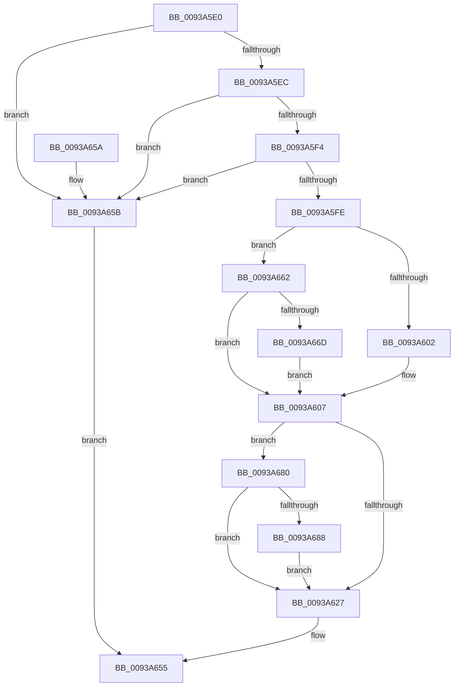

# MmPrefetchVirtualAddresses

- RVA: `0x0093A5E0`–`0x0093A692` (길이 `178` bytes)
- VA: `0x000000014093A5E0`
- 실행 섹션: `PAGE`
- PDB 이름 있음: `예`; PDB Function 태그: `아니요`
- unwind 정보 RVA: `0x0008FD0C`
- 디코드: `54`개 명령, `178/178` bytes 표시
- 미해석 바이트: `0` (있으면 어셈블리에 `.byte`로 보존)

> 이 문서는 커널 이미지의 기계어와 PDB 기호를 분석해 생성했습니다. 4번과 5번은 함수 원형과 자료형을 바이너리 사용 방식에서 추정한 C 해석이며 원본 소스 복구 결과는 아닙니다.

## 1. Dependencies

- 직접 호출 지점: **3**; 고유 호출 대상: **3**
- 직접 호출자로 확인된 함수: **1**
- RIP 상대 이미지 참조: **0**

### Outgoing calls
- `0x0093A630` → [PsGetIoPriorityThread](../../text/34/PsGetIoPriorityThread_function_00343930.md) (function, `0x00343930`)
- `0x0093A650` → [MmPrefetchVirtualMemory](MmPrefetchVirtualMemory_function_0093A698.md) (function, `0x0093A698`)
- `0x0093A676` → [MiGetEffectivePagePriorityThread](../../text/36/MiGetEffectivePagePriorityThread_function_003626E0.md) (function, `0x003626E0`)

### Direct callers
- [VmpPrefetchForVirtualFault](../7A/VmpPrefetchForVirtualFault_function_007ADC3C.md) at `0x007ADCE7`

### Static image references
- 디코드된 RIP-relative 메모리 참조가 없습니다.

## 2. Other-region calls and transfers

- 다른 실행 섹션으로 향하는 call: **2**
  - `0x0093A630` → [PsGetIoPriorityThread](../../text/34/PsGetIoPriorityThread_function_00343930.md) (`PAGE` → `.text`)
  - `0x0093A676` → [MiGetEffectivePagePriorityThread](../../text/36/MiGetEffectivePagePriorityThread_function_003626E0.md) (`PAGE` → `.text`)
- 별도 외부 분기/꼬리 이동을 확인하지 못했습니다.

## 3. Assembly (complete function range)

```asm
0093A5E0  48 83 EC 28                     sub rsp, 0x28
0093A5E4  83 39 01                        cmp dword ptr [rcx], 1
0093A5E7  4C 8B D9                        mov r11, rcx
0093A5EA  75 6F                           jne 0x14093a65b
0093A5EC  8B 51 04                        mov edx, dword ptr [rcx + 4]
0093A5EF  83 FA 08                        cmp edx, 8
0093A5F2  73 67                           jae 0x14093a65b
0093A5F4  8B C2                           mov eax, edx
0093A5F6  B1 06                           mov cl, 6
0093A5F8  22 C1                           and al, cl
0093A5FA  3C 04                           cmp al, 4
0093A5FC  77 5D                           ja 0x14093a65b
0093A5FE  84 D1                           test cl, dl
0093A600  75 60                           jne 0x14093a662
0093A602  B8 05 00 00 00                  mov eax, 5
0093A607  8B C8                           mov ecx, eax
0093A609  83 C9 40                        or ecx, 0x40
0093A60C  83 F8 05                        cmp eax, 5
0093A60F  0F 43 C8                        cmovae ecx, eax
0093A612  8B C1                           mov eax, ecx
0093A614  83 E0 07                        and eax, 7
0093A617  44 8D 14 C5 00 00 00 00         lea r10d, [rax*8]
0093A61F  44 0B D1                        or r10d, ecx
0093A622  83 F8 05                        cmp eax, 5
0093A625  72 59                           jb 0x14093a680
0093A627  65 48 8B 0C 25 88 01 00 00      mov rcx, qword ptr gs:[0x188]
0093A630  E8 FB 92 A0 FF                  call 0x140343930
0093A635  4D 8B 43 18                     mov r8, qword ptr [r11 + 0x18]
0093A639  45 8B CA                        mov r9d, r10d
0093A63C  49 8B 53 10                     mov rdx, qword ptr [r11 + 0x10]
0093A640  41 0F BA E9 0A                  bts r9d, 0xa
0093A645  49 8B 4B 08                     mov rcx, qword ptr [r11 + 8]
0093A649  83 F8 01                        cmp eax, 1
0093A64C  45 0F 4F CA                     cmovg r9d, r10d
0093A650  E8 43 00 00 00                  call 0x14093a698
0093A655  48 83 C4 28                     add rsp, 0x28
0093A659  C3                              ret
0093A65A  CC                              int3
0093A65B  B8 EF 00 00 C0                  mov eax, 0xc00000ef
0093A660  EB F3                           jmp 0x14093a655
0093A662  22 D1                           and dl, cl
0093A664  B8 02 00 00 00                  mov eax, 2
0093A669  3A D0                           cmp dl, al
0093A66B  74 9A                           je 0x14093a607
0093A66D  65 48 8B 0C 25 88 01 00 00      mov rcx, qword ptr gs:[0x188]
0093A676  E8 65 80 A2 FF                  call 0x1403626e0
0093A67B  83 E0 07                        and eax, 7
0093A67E  EB 87                           jmp 0x14093a607
0093A680  41 8B 43 04                     mov eax, dword ptr [r11 + 4]
0093A684  A8 01                           test al, 1
0093A686  75 9F                           jne 0x14093a627
0093A688  41 83 E2 EF                     and r10d, 0xffffffef
0093A68C  41 83 CA 28                     or r10d, 0x28
0093A690  EB 95                           jmp 0x14093a627
```

## 4. C-style interpretation (structured pseudocode)

```c
__int64 __fastcall MmPrefetchVirtualAddresses(__int64 a1)
{
    __int64 result;
    __int64 v_r10;
    __int64 v_rsp;

    v_rsp = (v_rsp) - (40);
    if ((*(unsigned int *)(a1)) != 1) goto loc_0093A65B;
    if (((unsigned int)((unsigned int)(*(unsigned int *)(a1 + 4)))) >= 8) goto loc_0093A65B;
    result = (unsigned __int8)(((unsigned int)((unsigned int)((unsigned int)(*(unsigned int *)(a1 + 4))))) & (6));
    if (((unsigned __int8)(result)) > 4) goto loc_0093A65B;
    if (((6) & ((unsigned __int8)((unsigned int)(*(unsigned int *)(a1 + 4))))) != 0) goto loc_0093A662;
loc_0093A607:
    a1 = (unsigned int)((5) | (64));
    if (5 >= 5) { a1 = 5; }
    result = (unsigned int)(((unsigned int)((unsigned int)(a1))) & (7));
    v_r10 = (unsigned int)((result * 8) | ((unsigned int)(a1)));
    if (((unsigned int)(result)) < 5) goto loc_0093A680;
loc_0093A627:
    result = PsGetIoPriorityThread(*(unsigned __int64 *)(gs_base + (0 + 392)), (unsigned int)(*(unsigned int *)(a1 + 4)), a3, a4);
    a4 = (unsigned int)((unsigned int)(v_r10));
    if (((unsigned int)(result)) > 1) { a4 = (unsigned int)(v_r10); }
    result = MmPrefetchVirtualMemory(*(unsigned __int64 *)(a1 + 8), *(unsigned __int64 *)(a1 + 16), *(unsigned __int64 *)(a1 + 24), a4);
loc_0093A655:
    v_rsp = (v_rsp) + (40);
    return result;
loc_0093A65B:
    goto loc_0093A655;
loc_0093A662:
    a2 = (unsigned __int8)((*(unsigned __int64 *)(a1 + 16)) & ((unsigned __int8)(*(unsigned __int64 *)(a1 + 8))));
    if (((unsigned __int8)(a2)) == 2) goto loc_0093A607;
    result = MiGetEffectivePagePriorityThread(*(unsigned __int64 *)(gs_base + (0 + 392)), a2, *(unsigned __int64 *)(a1 + 24), a4);
    result = (unsigned int)((result) & (7));
    goto loc_0093A607;
loc_0093A680:
    if ((((unsigned __int8)((unsigned int)(*(unsigned int *)(a1 + 4)))) & (1)) != 0) goto loc_0093A627;
    v_r10 = (unsigned int)((v_r10) & (0xFFFFFFEFULL));
    v_r10 = (unsigned int)((v_r10) | (40));
    goto loc_0093A627;
}
```

## 5. (Beta) C Style

```c
int64_t MmPrefetchVirtualAddresses(void *Arg1)
{
    uint8_t *arg1 = (uint8_t *)Arg1;

    int64_t result;
    int64_t local_r10;
    int64_t local_rsp;

    local_rsp = (local_rsp) - (40);
    if ((*(uint32_t *)(arg1)) != 1) goto loc_0093A65B;
    if (((uint32_t)((uint32_t)(*(uint32_t *)(arg1 + 0x4)))) >= 8) goto loc_0093A65B;
    result = (uint8_t)(((uint32_t)((uint32_t)((uint32_t)(*(uint32_t *)(arg1 + 0x4))))) & (6));
    if (((uint8_t)(result)) > 4) goto loc_0093A65B;
    if (((6) & ((uint8_t)((uint32_t)(*(uint32_t *)(arg1 + 0x4))))) != 0) goto loc_0093A662;
loc_0093A607:
    Arg1 = (uint32_t)((5) | (64));
    if (5 >= 5) { Arg1 = 5; }
    result = (uint32_t)(((uint32_t)((uint32_t)(Arg1))) & (7));
    local_r10 = (uint32_t)((result * 8) | ((uint32_t)(Arg1)));
    if (((uint32_t)(result)) < 5) goto loc_0093A680;
loc_0093A627:
    result = PsGetIoPriorityThread(*(uint64_t *)(gs_base + (0 + 0x188)), (uint32_t)(*(uint32_t *)(arg1 + 0x4)), a3, a4);
    a4 = (uint32_t)((uint32_t)(local_r10));
    if (((uint32_t)(result)) > 1) { a4 = (uint32_t)(local_r10); }
    result = MmPrefetchVirtualMemory(*(uint64_t *)(arg1 + 0x8), *(uint64_t *)(arg1 + 0x10), *(uint64_t *)(arg1 + 0x18), a4);
loc_0093A655:
    local_rsp = (local_rsp) + (40);
    return result;
loc_0093A65B:
    goto loc_0093A655;
loc_0093A662:
    a2 = (uint8_t)((*(uint64_t *)(arg1 + 0x10)) & ((uint8_t)(*(uint64_t *)(arg1 + 0x8))));
    if (((uint8_t)(a2)) == 2) goto loc_0093A607;
    result = MiGetEffectivePagePriorityThread(*(uint64_t *)(gs_base + (0 + 0x188)), a2, *(uint64_t *)(arg1 + 0x18), a4);
    result = (uint32_t)((result) & (7));
    goto loc_0093A607;
loc_0093A680:
    if ((((uint8_t)((uint32_t)(*(uint32_t *)(arg1 + 0x4)))) & (1)) != 0) goto loc_0093A627;
    local_r10 = (uint32_t)((local_r10) & (0xFFFFFFEFULL));
    local_r10 = (uint32_t)((local_r10) | (40));
    goto loc_0093A627;
}
```

### 관측된 메모리 오프셋

구조체 형식이 확인되지 않은 접근은 인자 기준의 오프셋으로만 기록했습니다.

| 기준 인자 | 오프셋 표현 | 폭 (bit) | 접근 |
|---|---:|---:|---|
| `Arg1` | `+ 0x0` | `32` | `R` |
| `Arg1` | `+ 0x4` | `32` | `R` |

## 6. Execution-region graph

[열기: 2D/3D 그래프와 함수 탐색 컨트롤 패널](../../../control-panel.html?section=page&rva=0x0093A5E0&view=graph)

- 2D 그래프는 위에서 아래로 흐르고, 3D 그래프는 빈 공간을 드래그해 회전합니다. Shift+드래그는 이동, 휠은 확대·축소, 함수 노드 선택은 대상 보고서 이동입니다.

### Static fallback


