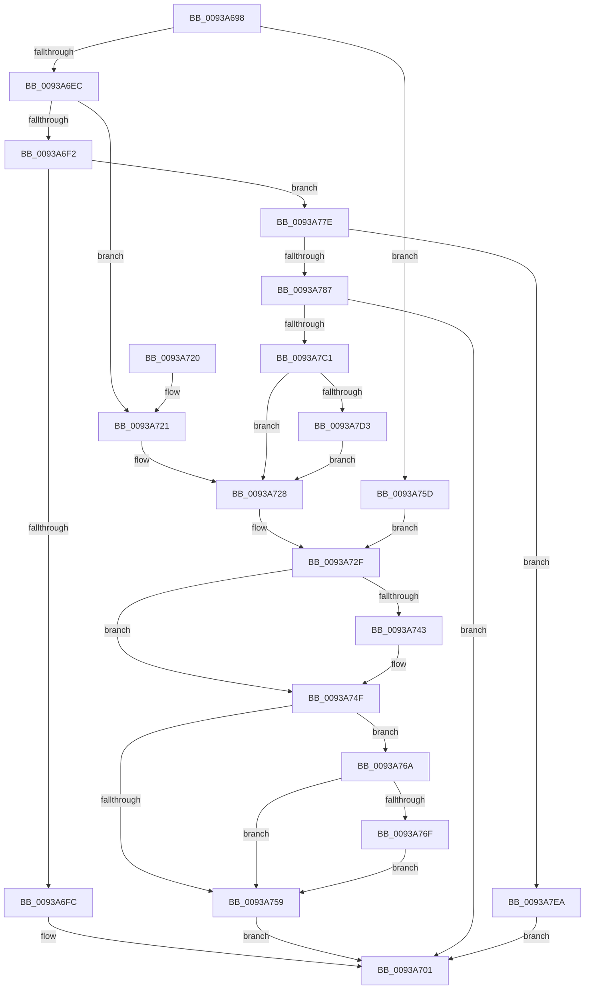

# MmPrefetchVirtualMemory

- RVA: `0x0093A698`–`0x0093A7F4` (길이 `348` bytes)
- VA: `0x000000014093A698`
- 실행 섹션: `PAGE`
- PDB 이름 있음: `예`; PDB Function 태그: `아니요`
- unwind 정보 RVA: `0x0008FD18`
- 디코드: `93`개 명령, `348/348` bytes 표시
- 미해석 바이트: `0` (있으면 어셈블리에 `.byte`로 보존)

> 이 문서는 커널 이미지의 기계어와 PDB 기호를 분석해 생성했습니다. 4번과 5번은 함수 원형과 자료형을 바이너리 사용 방식에서 추정한 C 해석이며 원본 소스 복구 결과는 아닙니다.

## 1. Dependencies

- 직접 호출 지점: **7**; 고유 호출 대상: **7**
- 직접 호출자로 확인된 함수: **4**
- RIP 상대 이미지 참조: **2**

### Outgoing calls
- `0x0093A709` → [_security_check_cookie](../../text/6A/_security_check_cookie_function_006AC640.md) (function, `0x006AC640`)
- `0x0093A738` → [MiPrefetchVirtualMemory](../../text/36/MiPrefetchVirtualMemory_function_0036C560.md) (function, `0x0036C560`)
- `0x0093A74A` → [KiUnstackDetachProcess](../../text/21/KiUnstackDetachProcess_function_00217D30.md) (function, `0x00217D30`)
- `0x0093A777` → [ObfDereferenceObjectWithTag](../../text/2F/ObfDereferenceObjectWithTag_function_002F78E0.md) (function, `0x002F78E0`)
- `0x0093A77E` → [ObIsKernelHandle](../../text/4A/ObIsKernelHandle_function_004A6580.md) (function, `0x004A6580`)
- `0x0093A7B4` → [ObpReferenceObjectByHandleWithTag](../86/ObpReferenceObjectByHandleWithTag_function_00869650.md) (function, `0x00869650`)
- `0x0093A7DB` → [KeStackAttachProcess](../../text/21/KeStackAttachProcess_function_00216800.md) (function, `0x00216800`)

### Direct callers
- [MiProcessWsInSwapRanges](../../text/45/MiProcessWsInSwapRanges_function_0045BA4C.md) at `0x0045BAB9`
- [MmPrefetchVirtualAddresses](MmPrefetchVirtualAddresses_function_0093A5E0.md) at `0x0093A650`
- [PfpPrefetchPrivatePages](PfpPrefetchPrivatePages_function_0093A7FC.md) at `0x0093A9DF`
- [PfpPrefetchPrivatePages](PfpPrefetchPrivatePages_function_0093A7FC.md) at `0x0093AA4B`
- [ExpDebuggerWorker](../../pagekd/B8/ExpDebuggerWorker_function_00B89F70.md) at `0x00B8A09B`

### Static image references
- `0x0093A6AA` → RVA `0x00E0A740` (`.data`; read)
- `0x0093A799` → RVA `0x00FC6A98` (`ALMOSTRO`; read)

## 2. Other-region calls and transfers

- 다른 실행 섹션으로 향하는 call: **6**
  - `0x0093A709` → [_security_check_cookie](../../text/6A/_security_check_cookie_function_006AC640.md) (`PAGE` → `.text`)
  - `0x0093A738` → [MiPrefetchVirtualMemory](../../text/36/MiPrefetchVirtualMemory_function_0036C560.md) (`PAGE` → `.text`)
  - `0x0093A74A` → [KiUnstackDetachProcess](../../text/21/KiUnstackDetachProcess_function_00217D30.md) (`PAGE` → `.text`)
  - `0x0093A777` → [ObfDereferenceObjectWithTag](../../text/2F/ObfDereferenceObjectWithTag_function_002F78E0.md) (`PAGE` → `.text`)
  - `0x0093A77E` → [ObIsKernelHandle](../../text/4A/ObIsKernelHandle_function_004A6580.md) (`PAGE` → `.text`)
  - `0x0093A7DB` → [KeStackAttachProcess](../../text/21/KeStackAttachProcess_function_00216800.md) (`PAGE` → `.text`)
- 별도 외부 분기/꼬리 이동을 확인하지 못했습니다.

## 3. Assembly (complete function range)

```asm
0093A698  40 53                           push rbx
0093A69A  55                              push rbp
0093A69B  56                              push rsi
0093A69C  57                              push rdi
0093A69D  41 54                           push r12
0093A69F  41 56                           push r14
0093A6A1  41 57                           push r15
0093A6A3  48 81 EC 80 00 00 00            sub rsp, 0x80
0093A6AA  48 8B 05 8F 00 4D 00            mov rax, qword ptr [rip + 0x4d008f]
0093A6B1  48 33 C4                        xor rax, rsp
0093A6B4  48 89 44 24 78                  mov qword ptr [rsp + 0x78], rax
0093A6B9  0F 57 C0                        xorps xmm0, xmm0
0093A6BC  33 DB                           xor ebx, ebx
0093A6BE  48 21 5C 24 40                  and qword ptr [rsp + 0x40], rbx
0093A6C3  41 8B F9                        mov edi, r9d
0093A6C6  4D 8B E0                        mov r12, r8
0093A6C9  4C 8B FA                        mov r15, rdx
0093A6CC  48 8B E9                        mov rbp, rcx
0093A6CF  0F 11 44 24 48                  movups xmmword ptr [rsp + 0x48], xmm0
0093A6D4  0F 11 44 24 58                  movups xmmword ptr [rsp + 0x58], xmm0
0093A6D9  0F 11 44 24 68                  movups xmmword ptr [rsp + 0x68], xmm0
0093A6DE  65 4C 8B 34 25 88 01 00 00      mov r14, qword ptr gs:[0x188]
0093A6E7  48 85 C9                        test rcx, rcx
0093A6EA  74 71                           je 0x14093a75d
0093A6EC  48 83 F9 FF                     cmp rcx, -1
0093A6F0  74 2F                           je 0x14093a721
0093A6F2  48 83 F9 FD                     cmp rcx, -3
0093A6F6  0F 85 82 00 00 00               jne 0x14093a77e
0093A6FC  B8 BB 00 00 C0                  mov eax, 0xc00000bb
0093A701  48 8B 4C 24 78                  mov rcx, qword ptr [rsp + 0x78]
0093A706  48 33 CC                        xor rcx, rsp
0093A709  E8 32 1F D7 FF                  call 0x1406ac640
0093A70E  48 81 C4 80 00 00 00            add rsp, 0x80
0093A715  41 5F                           pop r15
0093A717  41 5E                           pop r14
0093A719  41 5C                           pop r12
0093A71B  5F                              pop rdi
0093A71C  5E                              pop rsi
0093A71D  5D                              pop rbp
0093A71E  5B                              pop rbx
0093A71F  C3                              ret
0093A720  CC                              int3
0093A721  49 8B B6 B8 00 00 00            mov rsi, qword ptr [r14 + 0xb8]
0093A728  4C 8D 86 00 04 00 00            lea r8, [rsi + 0x400]
0093A72F  44 8B CF                        mov r9d, edi
0093A732  49 8B D4                        mov rdx, r12
0093A735  49 8B CF                        mov rcx, r15
0093A738  E8 23 1E A3 FF                  call 0x14036c560
0093A73D  8B F8                           mov edi, eax
0093A73F  85 DB                           test ebx, ebx
0093A741  74 0C                           je 0x14093a74f
0093A743  33 D2                           xor edx, edx
0093A745  48 8D 4C 24 48                  lea rcx, [rsp + 0x48]
0093A74A  E8 E1 D5 8D FF                  call 0x140217d30
0093A74F  4C 8D 45 FF                     lea r8, [rbp - 1]
0093A753  49 83 F8 FD                     cmp r8, -3
0093A757  76 11                           jbe 0x14093a76a
0093A759  8B C7                           mov eax, edi
0093A75B  EB A4                           jmp 0x14093a701
0093A75D  48 8B 74 24 40                  mov rsi, qword ptr [rsp + 0x40]
0093A762  41 B8 01 00 00 00               mov r8d, 1
0093A768  EB C5                           jmp 0x14093a72f
0093A76A  48 85 F6                        test rsi, rsi
0093A76D  74 EA                           je 0x14093a759
0093A76F  BA 4D 6D 50 66                  mov edx, 0x66506d4d
0093A774  48 8B CE                        mov rcx, rsi
0093A777  E8 64 D1 9B FF                  call 0x1402f78e0
0093A77C  EB DB                           jmp 0x14093a759
0093A77E  E8 FD BD B6 FF                  call 0x1404a6580
0093A783  84 C0                           test al, al
0093A785  74 63                           je 0x14093a7ea
0093A787  48 21 5C 24 38                  and qword ptr [rsp + 0x38], rbx
0093A78C  48 8D 44 24 40                  lea rax, [rsp + 0x40]
0093A791  48 21 5C 24 30                  and qword ptr [rsp + 0x30], rbx
0093A796  45 33 C9                        xor r9d, r9d
0093A799  4C 8B 05 F8 C2 68 00            mov r8, qword ptr [rip + 0x68c2f8]
0093A7A0  48 8B CD                        mov rcx, rbp
0093A7A3  48 89 44 24 28                  mov qword ptr [rsp + 0x28], rax
0093A7A8  C7 44 24 20 4D 6D 50 66         mov dword ptr [rsp + 0x20], 0x66506d4d
0093A7B0  41 8D 51 08                     lea edx, [r9 + 8]
0093A7B4  E8 97 EE F2 FF                  call 0x140869650
0093A7B9  85 C0                           test eax, eax
0093A7BB  0F 88 40 FF FF FF               js 0x14093a701
0093A7C1  48 8B 74 24 40                  mov rsi, qword ptr [rsp + 0x40]
0093A7C6  49 39 B6 B8 00 00 00            cmp qword ptr [r14 + 0xb8], rsi
0093A7CD  0F 84 55 FF FF FF               je 0x14093a728
0093A7D3  48 8D 54 24 48                  lea rdx, [rsp + 0x48]
0093A7D8  48 8B CE                        mov rcx, rsi
0093A7DB  E8 20 C0 8D FF                  call 0x140216800
0093A7E0  BB 01 00 00 00                  mov ebx, 1
0093A7E5  E9 3E FF FF FF                  jmp 0x14093a728
0093A7EA  B8 EF 00 00 C0                  mov eax, 0xc00000ef
0093A7EF  E9 0D FF FF FF                  jmp 0x14093a701
```

## 4. C-style interpretation (structured pseudocode)

```c
__int64 __fastcall MmPrefetchVirtualMemory(__int64 a1, __int64 a2, __int64 a3, int a4)
{
    __int64 result;
    __int64 v_rbx;
    __int64 v_rsp;
    unsigned __int64 v_stack_m40;
    unsigned __int64 v_stack_m50;
    unsigned __int64 v_stack_m60;
    unsigned __int64 v_stack_m70;
    unsigned __int64 v_stack_m78;
    unsigned int v_stack_p20;
    unsigned __int64 v_stack_p28;
    unsigned __int64 v_stack_p30;
    unsigned __int64 v_stack_p38;
    unsigned __int64 v_stack_p40;
    unsigned __int64 v_stack_p48;

    v_rsp = (v_rsp) - (128);
    result = (*(unsigned __int64 *)(v_rip + 5046415)) ^ (v_rsp);
    v_stack_m40 = result;
    v_rbx = 0;
    v_stack_m70 = v_xmm0;
    v_stack_m60 = v_xmm0;
    v_stack_m50 = v_xmm0;
    if (a1 == 0) goto loc_0093A75D;
    if (a1 == -1) goto loc_0093A721;
    if (a1 != -3) goto loc_0093A77E;
loc_0093A701:
    a1 = (v_stack_m40) ^ (v_rsp);
    result = _security_check_cookie(a1, a2, a3, a4);
    v_rsp = (v_rsp) + (128);
    return result;
loc_0093A721:
loc_0093A728:
loc_0093A72F:
    result = MiPrefetchVirtualMemory(a2, a3, *(unsigned __int64 *)(*(unsigned __int64 *)(gs_base + (0 + 392)) + 184) + 1024, (unsigned int)((unsigned int)((unsigned int)(a4))));
    if (0 != 0) {
        a2 = 0;
        a1 = v_stack_p48;
        result = KiUnstackDetachProcess(a1, a2, *(unsigned __int64 *)(*(unsigned __int64 *)(gs_base + (0 + 392)) + 184) + 1024, (unsigned int)((unsigned int)((unsigned int)(a4))));
    }
    if ((a1 - 1) <= -3) goto loc_0093A76A;
loc_0093A759:
    goto loc_0093A701;
loc_0093A75D:
    goto loc_0093A72F;
loc_0093A76A:
    if (v_stack_p40 == 0) goto loc_0093A759;
    result = ObfDereferenceObjectWithTag(v_stack_p40, (unsigned int)(0x66506D4DULL), 1, (unsigned int)((unsigned int)((unsigned int)(a4))));
    goto loc_0093A759;
loc_0093A77E:
    result = ObIsKernelHandle(v_stack_p40, (unsigned int)(0x66506D4DULL), 1, (unsigned int)((unsigned int)((unsigned int)(a4))));
    if ((unsigned __int8)(result) == 0) goto loc_0093A7EA;
    a4 = 0;
    v_stack_p28 = v_stack_p40;
    v_stack_p20 = 0x66506D4DULL;
    result = ObpReferenceObjectByHandleWithTag(a1, a4 + 8, *(unsigned __int64 *)(v_rip + 6865656), a4);
    if (sign_flag) goto loc_0093A701;
    if ((*(unsigned __int64 *)(*(unsigned __int64 *)(gs_base + (0 + 392)) + 184)) == v_stack_p40) goto loc_0093A728;
    result = KeStackAttachProcess(v_stack_p40, v_stack_p48, *(unsigned __int64 *)(v_rip + 6865656), a4);
    goto loc_0093A728;
loc_0093A7EA:
    goto loc_0093A701;
}
```

## 5. (Beta) C Style

```c
int64_t MmPrefetchVirtualMemory(void *Arg1, int64_t Arg2, int64_t Arg3, int32_t Arg4)
{
    uint8_t *arg1 = (uint8_t *)Arg1;

    int64_t result;
    int64_t local_rbx;
    int64_t local_rsp;
    uint64_t v_stack_m40;
    uint64_t v_stack_m50;
    uint64_t v_stack_m60;
    uint64_t v_stack_m70;
    uint64_t v_stack_m78;
    uint32_t v_stack_p20;
    uint64_t v_stack_p28;
    uint64_t v_stack_p30;
    uint64_t v_stack_p38;
    uint64_t v_stack_p40;
    uint64_t v_stack_p48;

    local_rsp = (local_rsp) - (128);
    result = (*(uint64_t *)(v_rip + 0x4D008F)) ^ (local_rsp);
    v_stack_m40 = result;
    local_rbx = 0;
    v_stack_m70 = v_xmm0;
    v_stack_m60 = v_xmm0;
    v_stack_m50 = v_xmm0;
    if (Arg1 == NULL) goto loc_0093A75D;
    if (Arg1 == -1) goto loc_0093A721;
    if (Arg1 != -3) goto loc_0093A77E;
loc_0093A701:
    Arg1 = (v_stack_m40) ^ (local_rsp);
    result = _security_check_cookie(Arg1, Arg2, Arg3, Arg4);
    local_rsp = (local_rsp) + (128);
    return result;
loc_0093A721:
loc_0093A728:
loc_0093A72F:
    result = MiPrefetchVirtualMemory(Arg2, Arg3, *(uint64_t *)(*(uint64_t *)(gs_base + (0 + 0x188)) + 0xB8) + 1024, (uint32_t)((uint32_t)((uint32_t)(Arg4))));
    if (0 != 0) {
        Arg2 = 0;
        Arg1 = v_stack_p48;
        result = KiUnstackDetachProcess(Arg1, Arg2, *(uint64_t *)(*(uint64_t *)(gs_base + (0 + 0x188)) + 0xB8) + 1024, (uint32_t)((uint32_t)((uint32_t)(Arg4))));
    }
    if ((Arg1 - 1) <= -3) goto loc_0093A76A;
loc_0093A759:
    goto loc_0093A701;
loc_0093A75D:
    goto loc_0093A72F;
loc_0093A76A:
    if (v_stack_p40 == 0) goto loc_0093A759;
    result = ObfDereferenceObjectWithTag(v_stack_p40, (uint32_t)(0x66506D4DULL), 1, (uint32_t)((uint32_t)((uint32_t)(Arg4))));
    goto loc_0093A759;
loc_0093A77E:
    result = ObIsKernelHandle(v_stack_p40, (uint32_t)(0x66506D4DULL), 1, (uint32_t)((uint32_t)((uint32_t)(Arg4))));
    if ((uint8_t)(result) == 0) goto loc_0093A7EA;
    Arg4 = 0;
    v_stack_p28 = v_stack_p40;
    v_stack_p20 = 0x66506D4DULL;
    result = ObpReferenceObjectByHandleWithTag(Arg1, Arg4 + 8, *(uint64_t *)(v_rip + 0x68C2F8), Arg4);
    if (sign_flag) goto loc_0093A701;
    if ((*(uint64_t *)(*(uint64_t *)(gs_base + (0 + 0x188)) + 0xB8)) == v_stack_p40) goto loc_0093A728;
    result = KeStackAttachProcess(v_stack_p40, v_stack_p48, *(uint64_t *)(v_rip + 0x68C2F8), Arg4);
    goto loc_0093A728;
loc_0093A7EA:
    goto loc_0093A701;
}
```

### 관측된 메모리 오프셋

구조체 형식이 확인되지 않은 접근은 인자 기준의 오프셋으로만 기록했습니다.

| 기준 인자 | 오프셋 표현 | 폭 (bit) | 접근 |
|---|---:|---:|---|
| `Arg1` | `- 0x1` | `64` | `R` |

## 6. Execution-region graph

[열기: 2D/3D 그래프와 함수 탐색 컨트롤 패널](../../../control-panel.html?section=page&rva=0x0093A698&view=graph)

- 2D 그래프는 위에서 아래로 흐르고, 3D 그래프는 빈 공간을 드래그해 회전합니다. Shift+드래그는 이동, 휠은 확대·축소, 함수 노드 선택은 대상 보고서 이동입니다.

### Static fallback


