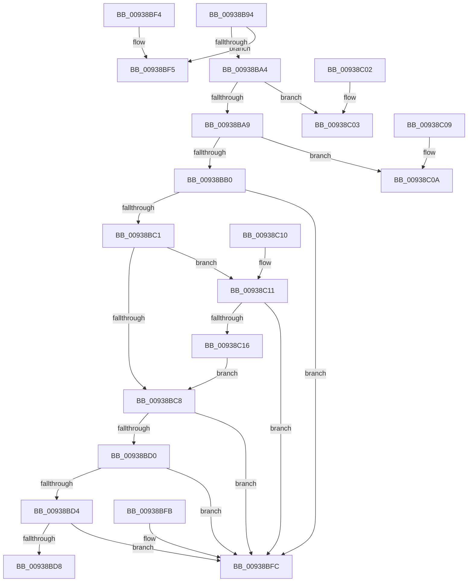

# PfPrefetchRequestVerifyPath

- RVA: `0x00938B94`–`0x00938C18` (길이 `132` bytes)
- VA: `0x0000000140938B94`
- 실행 섹션: `PAGE`
- PDB 이름 있음: `예`; PDB Function 태그: `아니요`
- unwind 정보 RVA: `0x000DB714`
- 디코드: `48`개 명령, `132/132` bytes 표시
- 미해석 바이트: `0` (있으면 어셈블리에 `.byte`로 보존)

> 이 문서는 커널 이미지의 기계어와 PDB 기호를 분석해 생성했습니다. 4번과 5번은 함수 원형과 자료형을 바이너리 사용 방식에서 추정한 C 해석이며 원본 소스 복구 결과는 아닙니다.

## 1. Dependencies

- 직접 호출 지점: **0**; 고유 호출 대상: **0**
- 직접 호출자로 확인된 함수: **1**
- RIP 상대 이미지 참조: **0**

### Outgoing calls
- 직접 디코드된 call 명령이 없습니다.

### Direct callers
- [PfPrefetchRequestVerify](PfPrefetchRequestVerify_function_009387EC.md) at `0x009389E7`

### Static image references
- 디코드된 RIP-relative 메모리 참조가 없습니다.

## 2. Other-region calls and transfers

- 다른 실행 섹션으로 향하는 call: **0**
- 별도 외부 분기/꼬리 이동을 확인하지 못했습니다.

## 3. Assembly (complete function range)

```asm
00938B94  45 8B 48 08                     mov r9d, dword ptr [r8 + 8]
00938B98  4C 8B D9                        mov r11, rcx
00938B9B  41 81 F9 FF 7F 00 00            cmp r9d, 0x7fff
00938BA2  73 51                           jae 0x140938bf5
00938BA4  45 85 C9                        test r9d, r9d
00938BA7  74 5A                           je 0x140938c03
00938BA9  41 8B 00                        mov eax, dword ptr [r8]
00938BAC  85 C0                           test eax, eax
00938BAE  74 5A                           je 0x140938c0a
00938BB0  44 8B 52 30                     mov r10d, dword ptr [rdx + 0x30]
00938BB4  46 8D 0C 4D 02 00 00 00         lea r9d, [r9*2 + 2]
00938BBC  41 3B C2                        cmp eax, r10d
00938BBF  72 3B                           jb 0x140938bfc
00938BC1  8B 4A 34                        mov ecx, dword ptr [rdx + 0x34]
00938BC4  3B C1                           cmp eax, ecx
00938BC6  73 49                           jae 0x140938c11
00938BC8  41 03 C1                        add eax, r9d
00938BCB  41 3B C2                        cmp eax, r10d
00938BCE  72 2C                           jb 0x140938bfc
00938BD0  3B C1                           cmp eax, ecx
00938BD2  77 28                           ja 0x140938bfc
00938BD4  A8 01                           test al, 1
00938BD6  75 24                           jne 0x140938bfc
00938BD8  89 42 30                        mov dword ptr [rdx + 0x30], eax
00938BDB  41 8B 08                        mov ecx, dword ptr [r8]
00938BDE  41 8B 50 08                     mov edx, dword ptr [r8 + 8]
00938BE2  49 03 CB                        add rcx, r11
00938BE5  0F B7 04 51                     movzx eax, word ptr [rcx + rdx*2]
00938BE9  66 F7 D8                        neg ax
00938BEC  1B C0                           sbb eax, eax
00938BEE  25 E0 2E 00 00                  and eax, 0x2ee0
00938BF3  C3                              ret
00938BF4  CC                              int3
00938BF5  B8 10 27 00 00                  mov eax, 0x2710
00938BFA  C3                              ret
00938BFB  CC                              int3
00938BFC  B8 F8 2A 00 00                  mov eax, 0x2af8
00938C01  C3                              ret
00938C02  CC                              int3
00938C03  B8 04 29 00 00                  mov eax, 0x2904
00938C08  C3                              ret
00938C09  CC                              int3
00938C0A  B8 FE 29 00 00                  mov eax, 0x29fe
00938C0F  C3                              ret
00938C10  CC                              int3
00938C11  45 85 C9                        test r9d, r9d
00938C14  75 E6                           jne 0x140938bfc
00938C16  EB B0                           jmp 0x140938bc8
```

## 4. C-style interpretation (structured pseudocode)

```c
__int64 __fastcall PfPrefetchRequestVerifyPath(__int64 a1, __int64 a2, __int64 a3)
{
    __int64 result;

    if (((unsigned int)((unsigned int)(*(unsigned int *)(a3 + 8)))) >= 0x7FFFULL) goto loc_00938BF5;
    if ((unsigned int)((unsigned int)(*(unsigned int *)(a3 + 8))) == 0) goto loc_00938C03;
    if ((unsigned int)((unsigned int)(*(unsigned int *)(a3))) == 0) goto loc_00938C0A;
    if (((unsigned int)((unsigned int)(*(unsigned int *)(a3)))) < ((unsigned int)((unsigned int)(*(unsigned int *)(a2 + 48))))) goto loc_00938BFC;
    if (((unsigned int)((unsigned int)(*(unsigned int *)(a3)))) >= ((unsigned int)((unsigned int)(*(unsigned int *)(a2 + 52))))) goto loc_00938C11;
loc_00938BC8:
    result = (unsigned int)(((unsigned int)(*(unsigned int *)(a3))) + ((unsigned int)((unsigned int)(*(unsigned int *)(a3 + 8)) * 2 + 2)));
    if (((unsigned int)(result)) < ((unsigned int)((unsigned int)(*(unsigned int *)(a2 + 48))))) goto loc_00938BFC;
    if (((unsigned int)(result)) > ((unsigned int)((unsigned int)(*(unsigned int *)(a2 + 52))))) goto loc_00938BFC;
    if ((((unsigned __int8)(result)) & (1)) != 0) goto loc_00938BFC;
    *(unsigned int *)(a2 + 48) = (unsigned int)(result);
    a1 = ((unsigned int)(*(unsigned int *)(a3))) + (a1);
    result = (unsigned __int16)(-(*(unsigned __int16 *)(a1 + (unsigned int)(*(unsigned int *)(a3 + 8)) * 2)));
    result = (unsigned int)((result) & (0x2EE0ULL));
    return result;
loc_00938BF5:
    return (unsigned int)(0x2710ULL);
loc_00938BFC:
    return (unsigned int)(0x2AF8ULL);
loc_00938C03:
    return (unsigned int)(0x2904ULL);
loc_00938C0A:
    return (unsigned int)(0x29FEULL);
loc_00938C11:
    if ((unsigned int)((unsigned int)(*(unsigned int *)(a3 + 8)) * 2 + 2) != 0) goto loc_00938BFC;
    goto loc_00938BC8;
}
```

## 5. (Beta) C Style

```c
int64_t PfPrefetchRequestVerifyPath(int64_t Arg1, void *Arg2, void *Arg3)
{
    uint8_t *arg2 = (uint8_t *)Arg2;
    uint8_t *arg3 = (uint8_t *)Arg3;

    int64_t result;

    if (((uint32_t)((uint32_t)(*(uint32_t *)(arg3 + 0x8)))) >= 0x7FFFULL) goto loc_00938BF5;
    if ((uint32_t)((uint32_t)(*(uint32_t *)(arg3 + 0x8))) == 0) goto loc_00938C03;
    if ((uint32_t)((uint32_t)(*(uint32_t *)(arg3))) == 0) goto loc_00938C0A;
    if (((uint32_t)((uint32_t)(*(uint32_t *)(arg3)))) < ((uint32_t)((uint32_t)(*(uint32_t *)(arg2 + 0x30))))) goto loc_00938BFC;
    if (((uint32_t)((uint32_t)(*(uint32_t *)(arg3)))) >= ((uint32_t)((uint32_t)(*(uint32_t *)(arg2 + 0x34))))) goto loc_00938C11;
loc_00938BC8:
    result = (uint32_t)(((uint32_t)(*(uint32_t *)(arg3))) + ((uint32_t)((uint32_t)(*(uint32_t *)(arg3 + 0x8)) * 2 + 2)));
    if (((uint32_t)(result)) < ((uint32_t)((uint32_t)(*(uint32_t *)(arg2 + 0x30))))) goto loc_00938BFC;
    if (((uint32_t)(result)) > ((uint32_t)((uint32_t)(*(uint32_t *)(arg2 + 0x34))))) goto loc_00938BFC;
    if ((((uint8_t)(result)) & (1)) != 0) goto loc_00938BFC;
    *(uint32_t *)(arg2 + 0x30) = (uint32_t)(result);
    Arg1 = ((uint32_t)(*(uint32_t *)(arg3))) + (Arg1);
    result = (uint16_t)(-(*(uint16_t *)(Arg1 + (uint32_t)(*(uint32_t *)(arg3 + 0x8)) * 2)));
    result = (uint32_t)((result) & (0x2EE0ULL));
    return result;
loc_00938BF5:
    return (uint32_t)(0x2710ULL);
loc_00938BFC:
    return (uint32_t)(0x2AF8ULL);
loc_00938C03:
    return (uint32_t)(0x2904ULL);
loc_00938C0A:
    return (uint32_t)(0x29FEULL);
loc_00938C11:
    if ((uint32_t)((uint32_t)(*(uint32_t *)(arg3 + 0x8)) * 2 + 2) != 0) goto loc_00938BFC;
    goto loc_00938BC8;
}
```

### 관측된 메모리 오프셋

구조체 형식이 확인되지 않은 접근은 인자 기준의 오프셋으로만 기록했습니다.

| 기준 인자 | 오프셋 표현 | 폭 (bit) | 접근 |
|---|---:|---:|---|
| `Arg2` | `+ 0x30` | `32` | `R` |
| `Arg2` | `+ 0x30` | `32` | `W` |
| `Arg2` | `+ 0x34` | `32` | `R` |
| `Arg3` | `+ 0x0` | `32` | `R` |
| `Arg3` | `+ 0x8` | `32` | `R` |

## 6. Execution-region graph

[열기: 2D/3D 그래프와 함수 탐색 컨트롤 패널](../../../control-panel.html?section=page&rva=0x00938B94&view=graph)

- 2D 그래프는 위에서 아래로 흐르고, 3D 그래프는 빈 공간을 드래그해 회전합니다. Shift+드래그는 이동, 휠은 확대·축소, 함수 노드 선택은 대상 보고서 이동입니다.

### Static fallback


