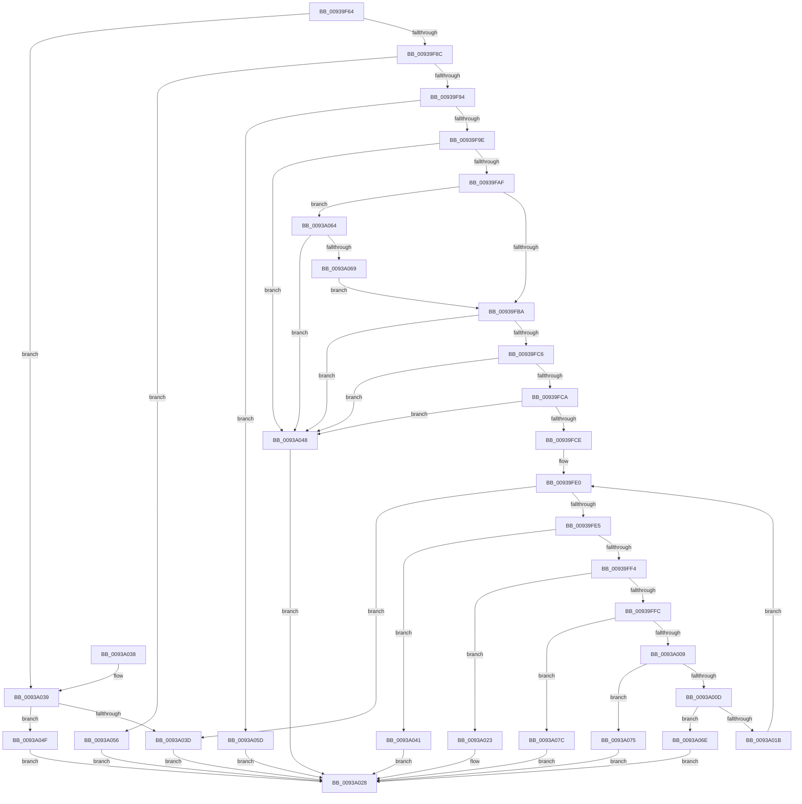

# PfPrefetchRequestVerifyRanges

- RVA: `0x00939F64`–`0x0093A083` (길이 `287` bytes)
- VA: `0x0000000140939F64`
- 실행 섹션: `PAGE`
- PDB 이름 있음: `예`; PDB Function 태그: `아니요`
- unwind 정보 RVA: `0x0008FCCC`
- 디코드: `87`개 명령, `287/287` bytes 표시
- 미해석 바이트: `0` (있으면 어셈블리에 `.byte`로 보존)

> 이 문서는 커널 이미지의 기계어와 PDB 기호를 분석해 생성했습니다. 4번과 5번은 함수 원형과 자료형을 바이너리 사용 방식에서 추정한 C 해석이며 원본 소스 복구 결과는 아닙니다.

## 1. Dependencies

- 직접 호출 지점: **0**; 고유 호출 대상: **0**
- 직접 호출자로 확인된 함수: **1**
- RIP 상대 이미지 참조: **0**

### Outgoing calls
- 직접 디코드된 call 명령이 없습니다.

### Direct callers
- [PfPrefetchRequestVerify](PfPrefetchRequestVerify_function_009387EC.md) at `0x00938A16`
- [PfPrefetchRequestVerify](PfPrefetchRequestVerify_function_009387EC.md) at `0x00938AB8`

### Static image references
- 디코드된 RIP-relative 메모리 참조가 없습니다.

## 2. Other-region calls and transfers

- 다른 실행 섹션으로 향하는 call: **0**
- 별도 외부 분기/꼬리 이동을 확인하지 못했습니다.

## 3. Assembly (complete function range)

```asm
00939F64  48 89 5C 24 08                  mov qword ptr [rsp + 8], rbx
00939F69  48 89 74 24 10                  mov qword ptr [rsp + 0x10], rsi
00939F6E  48 89 7C 24 18                  mov qword ptr [rsp + 0x18], rdi
00939F73  45 8B 10                        mov r10d, dword ptr [r8]
00939F76  41 8B F1                        mov esi, r9d
00939F79  41 8B 40 08                     mov eax, dword ptr [r8 + 8]
00939F7D  4D 8B D8                        mov r11, r8
00939F80  48 8B F9                        mov rdi, rcx
00939F83  45 85 D2                        test r10d, r10d
00939F86  0F 84 AD 00 00 00               je 0x14093a039
00939F8C  85 C0                           test eax, eax
00939F8E  0F 84 C2 00 00 00               je 0x14093a056
00939F94  44 3B 52 20                     cmp r10d, dword ptr [rdx + 0x20]
00939F98  0F 87 BF 00 00 00               ja 0x14093a05d
00939F9E  44 8B 42 18                     mov r8d, dword ptr [rdx + 0x18]
00939FA2  41 C1 E2 04                     shl r10d, 4
00939FA6  41 3B C0                        cmp eax, r8d
00939FA9  0F 82 99 00 00 00               jb 0x14093a048
00939FAF  8B 4A 1C                        mov ecx, dword ptr [rdx + 0x1c]
00939FB2  3B C1                           cmp eax, ecx
00939FB4  0F 83 AA 00 00 00               jae 0x14093a064
00939FBA  41 03 C2                        add eax, r10d
00939FBD  41 3B C0                        cmp eax, r8d
00939FC0  0F 82 82 00 00 00               jb 0x14093a048
00939FC6  3B C1                           cmp eax, ecx
00939FC8  77 7E                           ja 0x14093a048
00939FCA  A8 07                           test al, 7
00939FCC  75 7A                           jne 0x14093a048
00939FCE  41 8B 5B 08                     mov ebx, dword ptr [r11 + 8]
00939FD2  45 33 D2                        xor r10d, r10d
00939FD5  45 8B 1B                        mov r11d, dword ptr [r11]
00939FD8  48 03 DF                        add rbx, rdi
00939FDB  33 C9                           xor ecx, ecx
00939FDD  45 33 C0                        xor r8d, r8d
00939FE0  45 3B C3                        cmp r8d, r11d
00939FE3  73 58                           jae 0x14093a03d
00939FE5  41 8B D0                        mov edx, r8d
00939FE8  48 03 D2                        add rdx, rdx
00939FEB  4C 8B 0C D3                     mov r9, qword ptr [rbx + rdx*8]
00939FEF  4C 3B C9                        cmp r9, rcx
00939FF2  72 4D                           jb 0x14093a041
00939FF4  8D 4E FF                        lea ecx, [rsi - 1]
00939FF7  49 85 C9                        test r9, rcx
00939FFA  75 27                           jne 0x14093a023
00939FFC  8B 44 D3 08                     mov eax, dword ptr [rbx + rdx*8 + 8]
0093A000  49 8D 0C 01                     lea rcx, [r9 + rax]
0093A004  49 3B C9                        cmp rcx, r9
0093A007  72 73                           jb 0x14093a07c
0093A009  85 C0                           test eax, eax
0093A00B  74 68                           je 0x14093a075
0093A00D  C1 E8 0C                        shr eax, 0xc
0093A010  8D 50 02                        lea edx, [rax + 2]
0093A013  41 03 D2                        add edx, r10d
0093A016  41 3B D2                        cmp edx, r10d
0093A019  72 53                           jb 0x14093a06e
0093A01B  44 8B D2                        mov r10d, edx
0093A01E  41 FF C0                        inc r8d
0093A021  EB BD                           jmp 0x140939fe0
0093A023  B8 B4 5F 00 00                  mov eax, 0x5fb4
0093A028  48 8B 5C 24 08                  mov rbx, qword ptr [rsp + 8]
0093A02D  48 8B 74 24 10                  mov rsi, qword ptr [rsp + 0x10]
0093A032  48 8B 7C 24 18                  mov rdi, qword ptr [rsp + 0x18]
0093A037  C3                              ret
0093A038  CC                              int3
0093A039  85 C0                           test eax, eax
0093A03B  75 12                           jne 0x14093a04f
0093A03D  33 C0                           xor eax, eax
0093A03F  EB E7                           jmp 0x14093a028
0093A041  B8 C0 5D 00 00                  mov eax, 0x5dc0
0093A046  EB E0                           jmp 0x14093a028
0093A048  B8 D8 59 00 00                  mov eax, 0x59d8
0093A04D  EB D9                           jmp 0x14093a028
0093A04F  B8 20 4E 00 00                  mov eax, 0x4e20
0093A054  EB D2                           jmp 0x14093a028
0093A056  B8 08 52 00 00                  mov eax, 0x5208
0093A05B  EB CB                           jmp 0x14093a028
0093A05D  B8 F0 55 00 00                  mov eax, 0x55f0
0093A062  EB C4                           jmp 0x14093a028
0093A064  45 85 D2                        test r10d, r10d
0093A067  75 DF                           jne 0x14093a048
0093A069  E9 4C FF FF FF                  jmp 0x140939fba
0093A06E  B8 90 65 00 00                  mov eax, 0x6590
0093A073  EB B3                           jmp 0x14093a028
0093A075  B8 A8 61 00 00                  mov eax, 0x61a8
0093A07A  EB AC                           jmp 0x14093a028
0093A07C  B8 AE 60 00 00                  mov eax, 0x60ae
0093A081  EB A5                           jmp 0x14093a028
```

## 4. C-style interpretation (structured pseudocode)

```c
__int64 __fastcall PfPrefetchRequestVerifyRanges(__int64 a1, __int64 a2, __int64 a3, int a4)
{
    __int64 result;
    __int64 v_r10;
    __int64 v_rbx;
    unsigned __int64 v_stack_p10;
    unsigned __int64 v_stack_p18;
    unsigned __int64 v_stack_p8;

    v_stack_p8 = v_rbx;
    v_stack_p10 = v_rsi;
    v_stack_p18 = v_rdi;
    if ((unsigned int)((unsigned int)(*(unsigned int *)(a3))) == 0) goto loc_0093A039;
    if ((unsigned int)((unsigned int)(*(unsigned int *)(a3 + 8))) == 0) goto loc_0093A056;
    if (((unsigned int)((unsigned int)(*(unsigned int *)(a3)))) > (*(unsigned int *)(a2 + 32))) goto loc_0093A05D;
    v_r10 = (unsigned int)(((unsigned int)(*(unsigned int *)(a3))) << (4));
    if (((unsigned int)((unsigned int)(*(unsigned int *)(a3 + 8)))) < ((unsigned int)((unsigned int)(*(unsigned int *)(a2 + 24))))) goto loc_0093A048;
    if (((unsigned int)((unsigned int)(*(unsigned int *)(a3 + 8)))) >= ((unsigned int)((unsigned int)(*(unsigned int *)(a2 + 28))))) goto loc_0093A064;
loc_00939FBA:
    result = (unsigned int)(((unsigned int)(*(unsigned int *)(a3 + 8))) + ((unsigned int)(v_r10)));
    if (((unsigned int)(result)) < ((unsigned int)((unsigned int)(*(unsigned int *)(a2 + 24))))) goto loc_0093A048;
    if (((unsigned int)(result)) > ((unsigned int)((unsigned int)(*(unsigned int *)(a2 + 28))))) goto loc_0093A048;
    if ((((unsigned __int8)(result)) & (7)) != 0) goto loc_0093A048;
    v_r10 = 0;
    v_rbx = ((unsigned int)(*(unsigned int *)(a3 + 8))) + (a1);
    a1 = 0;
    a3 = 0;
loc_00939FE0:
    if (0 >= ((unsigned int)((unsigned int)(*(unsigned int *)(a3))))) goto loc_0093A03D;
    a2 = (0) + (0);
    if ((*(unsigned __int64 *)(v_rbx + a2 * 8)) < 0) goto loc_0093A041;
    if (((*(unsigned __int64 *)(v_rbx + a2 * 8)) & ((unsigned int)(a4) - 1)) != 0) goto loc_0093A023;
    if ((*(unsigned __int64 *)(v_rbx + a2 * 8) + (unsigned int)(*(unsigned int *)(v_rbx + a2 * 8 + 8)) * 1) < (*(unsigned __int64 *)(v_rbx + a2 * 8))) goto loc_0093A07C;
    if ((unsigned int)((unsigned int)(*(unsigned int *)(v_rbx + a2 * 8 + 8))) == 0) goto loc_0093A075;
    result = (unsigned int)(((unsigned int)(*(unsigned int *)(v_rbx + a2 * 8 + 8))) >> (12));
    a2 = (unsigned int)((result + 2) + (0));
    if (((unsigned int)(a2)) < 0) goto loc_0093A06E;
    a3 = (unsigned int)((a3) + 1);
    goto loc_00939FE0;
loc_0093A023:
loc_0093A028:
    return (unsigned int)(0x5FB4ULL);
loc_0093A039:
    if ((unsigned int)((unsigned int)(0x5FB4ULL)) != 0) goto loc_0093A04F;
loc_0093A03D:
    result = 0;
    goto loc_0093A028;
loc_0093A041:
    goto loc_0093A028;
loc_0093A048:
    goto loc_0093A028;
loc_0093A04F:
    goto loc_0093A028;
loc_0093A056:
    goto loc_0093A028;
loc_0093A05D:
    goto loc_0093A028;
loc_0093A064:
    if ((unsigned int)((unsigned int)((unsigned int)(a2))) != 0) goto loc_0093A048;
    goto loc_00939FBA;
loc_0093A06E:
    goto loc_0093A028;
loc_0093A075:
    goto loc_0093A028;
loc_0093A07C:
    goto loc_0093A028;
}
```

## 5. (Beta) C Style

```c
int64_t PfPrefetchRequestVerifyRanges(int64_t Arg1, void *Arg2, void *Arg3, void *Arg4)
{
    uint8_t *arg2 = (uint8_t *)Arg2;
    uint8_t *arg3 = (uint8_t *)Arg3;
    uint8_t *arg4 = (uint8_t *)Arg4;

    int64_t result;
    int64_t local_r10;
    int64_t local_rbx;
    uint64_t v_stack_p10;
    uint64_t v_stack_p18;
    uint64_t v_stack_p8;

    v_stack_p8 = local_rbx;
    v_stack_p10 = local_rsi;
    v_stack_p18 = local_rdi;
    if ((uint32_t)((uint32_t)(*(uint32_t *)(arg3))) == 0) goto loc_0093A039;
    if ((uint32_t)((uint32_t)(*(uint32_t *)(arg3 + 0x8))) == 0) goto loc_0093A056;
    if (((uint32_t)((uint32_t)(*(uint32_t *)(arg3)))) > (*(uint32_t *)(arg2 + 0x20))) goto loc_0093A05D;
    local_r10 = (uint32_t)(((uint32_t)(*(uint32_t *)(arg3))) << (4));
    if (((uint32_t)((uint32_t)(*(uint32_t *)(arg3 + 0x8)))) < ((uint32_t)((uint32_t)(*(uint32_t *)(arg2 + 0x18))))) goto loc_0093A048;
    if (((uint32_t)((uint32_t)(*(uint32_t *)(arg3 + 0x8)))) >= ((uint32_t)((uint32_t)(*(uint32_t *)(arg2 + 0x1C))))) goto loc_0093A064;
loc_00939FBA:
    result = (uint32_t)(((uint32_t)(*(uint32_t *)(arg3 + 0x8))) + ((uint32_t)(local_r10)));
    if (((uint32_t)(result)) < ((uint32_t)((uint32_t)(*(uint32_t *)(arg2 + 0x18))))) goto loc_0093A048;
    if (((uint32_t)(result)) > ((uint32_t)((uint32_t)(*(uint32_t *)(arg2 + 0x1C))))) goto loc_0093A048;
    if ((((uint8_t)(result)) & (7)) != 0) goto loc_0093A048;
    local_r10 = 0;
    local_rbx = ((uint32_t)(*(uint32_t *)(arg3 + 0x8))) + (Arg1);
    Arg1 = 0;
    Arg3 = 0;
loc_00939FE0:
    if (0 >= ((uint32_t)((uint32_t)(*(uint32_t *)(arg3))))) goto loc_0093A03D;
    Arg2 = (0) + (0);
    if ((*(uint64_t *)(local_rbx + arg2 * 8)) < 0) goto loc_0093A041;
    if (((*(uint64_t *)(local_rbx + arg2 * 8)) & ((uint32_t)(Arg4) - 1)) != 0) goto loc_0093A023;
    if ((*(uint64_t *)(local_rbx + arg2 * 8) + (uint32_t)(*(uint32_t *)(local_rbx + arg2 * 8 + 0x8)) * 1) < (*(uint64_t *)(local_rbx + arg2 * 8))) goto loc_0093A07C;
    if ((uint32_t)((uint32_t)(*(uint32_t *)(local_rbx + arg2 * 8 + 0x8))) == 0) goto loc_0093A075;
    result = (uint32_t)(((uint32_t)(*(uint32_t *)(local_rbx + arg2 * 8 + 0x8))) >> (12));
    Arg2 = (uint32_t)((result + 2) + (0));
    if (((uint32_t)(Arg2)) < 0) goto loc_0093A06E;
    Arg3 = (uint32_t)((Arg3) + 1);
    goto loc_00939FE0;
loc_0093A023:
loc_0093A028:
    return (uint32_t)(0x5FB4ULL);
loc_0093A039:
    if ((uint32_t)((uint32_t)(0x5FB4ULL)) != 0) goto loc_0093A04F;
loc_0093A03D:
    result = 0;
    goto loc_0093A028;
loc_0093A041:
    goto loc_0093A028;
loc_0093A048:
    goto loc_0093A028;
loc_0093A04F:
    goto loc_0093A028;
loc_0093A056:
    goto loc_0093A028;
loc_0093A05D:
    goto loc_0093A028;
loc_0093A064:
    if ((uint32_t)((uint32_t)((uint32_t)(Arg2))) != 0) goto loc_0093A048;
    goto loc_00939FBA;
loc_0093A06E:
    goto loc_0093A028;
loc_0093A075:
    goto loc_0093A028;
loc_0093A07C:
    goto loc_0093A028;
}
```

### 관측된 메모리 오프셋

구조체 형식이 확인되지 않은 접근은 인자 기준의 오프셋으로만 기록했습니다.

| 기준 인자 | 오프셋 표현 | 폭 (bit) | 접근 |
|---|---:|---:|---|
| `Arg2` | `+ 0x18` | `32` | `R` |
| `Arg2` | `+ 0x1C` | `32` | `R` |
| `Arg2` | `+ 0x20` | `32` | `R` |
| `Arg3` | `+ 0x0` | `32` | `R` |
| `Arg3` | `+ 0x8` | `32` | `R` |
| `Arg4` | `- 0x1` | `32` | `R` |

## 6. Execution-region graph

[열기: 2D/3D 그래프와 함수 탐색 컨트롤 패널](../../../control-panel.html?section=page&rva=0x00939F64&view=graph)

- 2D 그래프는 위에서 아래로 흐르고, 3D 그래프는 빈 공간을 드래그해 회전합니다. Shift+드래그는 이동, 휠은 확대·축소, 함수 노드 선택은 대상 보고서 이동입니다.

### Static fallback


