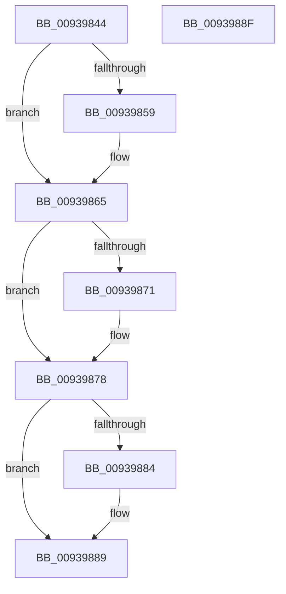

# PfSnAsyncContextCleanup

- RVA: `0x00939844`–`0x00939890` (길이 `76` bytes)
- VA: `0x0000000140939844`
- 실행 섹션: `PAGE`
- PDB 이름 있음: `예`; PDB Function 태그: `아니요`
- unwind 정보 RVA: `0x0005CF00`
- 디코드: `21`개 명령, `76/76` bytes 표시
- 미해석 바이트: `0` (있으면 어셈블리에 `.byte`로 보존)

> 이 문서는 커널 이미지의 기계어와 PDB 기호를 분석해 생성했습니다. 4번과 5번은 함수 원형과 자료형을 바이너리 사용 방식에서 추정한 C 해석이며 원본 소스 복구 결과는 아닙니다.

## 1. Dependencies

- 직접 호출 지점: **3**; 고유 호출 대상: **3**
- 직접 호출자로 확인된 함수: **1**
- RIP 상대 이미지 참조: **0**

### Outgoing calls
- `0x00939860` → [ExReleaseRundownProtection](../../text/34/ExReleaseRundownProtection_function_00349E80.md) (function, `0x00349E80`)
- `0x00939873` → [ExFreePoolWithTag](../../poolcode/B8/ExFreePoolWithTag_function_00B82870.md) (function, `0x00B82870`)
- `0x00939884` → [ObfDereferenceObject](../../text/2F/ObfDereferenceObject_function_002F9350.md) (function, `0x002F9350`)

### Direct callers
- [PfSnAsyncPrefetchWorker](PfSnAsyncPrefetchWorker_function_009394B0.md) at `0x00939704`

### Static image references
- 디코드된 RIP-relative 메모리 참조가 없습니다.

## 2. Other-region calls and transfers

- 다른 실행 섹션으로 향하는 call: **3**
  - `0x00939860` → [ExReleaseRundownProtection](../../text/34/ExReleaseRundownProtection_function_00349E80.md) (`PAGE` → `.text`)
  - `0x00939873` → [ExFreePoolWithTag](../../poolcode/B8/ExFreePoolWithTag_function_00B82870.md) (`PAGE` → `POOLCODE`)
  - `0x00939884` → [ObfDereferenceObject](../../text/2F/ObfDereferenceObject_function_002F9350.md) (`PAGE` → `.text`)
- 별도 외부 분기/꼬리 이동을 확인하지 못했습니다.

## 3. Assembly (complete function range)

```asm
00939844  40 53                           push rbx
00939846  48 83 EC 20                     sub rsp, 0x20
0093984A  48 8B D9                        mov rbx, rcx
0093984D  48 8B 89 E0 00 00 00            mov rcx, qword ptr [rcx + 0xe0]
00939854  48 85 C9                        test rcx, rcx
00939857  74 0C                           je 0x140939865
00939859  48 81 C1 68 01 00 00            add rcx, 0x168
00939860  E8 1B 06 A1 FF                  call 0x140349e80
00939865  48 8B 8B D0 00 00 00            mov rcx, qword ptr [rbx + 0xd0]
0093986C  48 85 C9                        test rcx, rcx
0093986F  74 07                           je 0x140939878
00939871  33 D2                           xor edx, edx
00939873  E8 F8 8F 24 00                  call 0x140b82870
00939878  48 8B 8B D8 00 00 00            mov rcx, qword ptr [rbx + 0xd8]
0093987F  48 85 C9                        test rcx, rcx
00939882  74 05                           je 0x140939889
00939884  E8 C7 FA 9B FF                  call 0x1402f9350
00939889  48 83 C4 20                     add rsp, 0x20
0093988D  5B                              pop rbx
0093988E  C3                              ret
0093988F  CC                              int3
```

## 4. C-style interpretation (structured pseudocode)

```c
__int64 __fastcall PfSnAsyncContextCleanup(__int64 a1, int a2)
{
    __int64 result;
    __int64 v_rsp;

    v_rsp = (v_rsp) - (32);
    if (*(unsigned __int64 *)(a1 + 224) != 0) {
        a1 = (*(unsigned __int64 *)(a1 + 224)) + (360);
        result = ExReleaseRundownProtection(a1, a2, a3, a4);
    }
    if (*(unsigned __int64 *)(a1 + 208) != 0) {
        a2 = 0;
        result = ExFreePoolWithTag(*(unsigned __int64 *)(a1 + 208), a2, a3, a4);
    }
    if (*(unsigned __int64 *)(a1 + 216) != 0) {
        result = ObfDereferenceObject(*(unsigned __int64 *)(a1 + 216), a2, a3, a4);
    }
    v_rsp = (v_rsp) + (32);
    return result;
}
```

## 5. (Beta) C Style

```c
int64_t PfSnAsyncContextCleanup(void *Arg1, int32_t Arg2)
{
    uint8_t *arg1 = (uint8_t *)Arg1;

    int64_t result;
    int64_t local_rsp;

    local_rsp = (local_rsp) - (32);
    if (*(uint64_t *)(arg1 + 0xE0) != 0) {
        Arg1 = (*(uint64_t *)(arg1 + 0xE0)) + (360);
        result = ExReleaseRundownProtection(Arg1, Arg2, a3, a4);
    }
    if (*(uint64_t *)(arg1 + 0xD0) != 0) {
        Arg2 = 0;
        result = ExFreePoolWithTag(*(uint64_t *)(arg1 + 0xD0), Arg2, a3, a4);
    }
    if (*(uint64_t *)(arg1 + 0xD8) != 0) {
        result = ObfDereferenceObject(*(uint64_t *)(arg1 + 0xD8), Arg2, a3, a4);
    }
    local_rsp = (local_rsp) + (32);
    return result;
}
```

### 관측된 메모리 오프셋

구조체 형식이 확인되지 않은 접근은 인자 기준의 오프셋으로만 기록했습니다.

| 기준 인자 | 오프셋 표현 | 폭 (bit) | 접근 |
|---|---:|---:|---|
| `Arg1` | `+ 0xD0` | `64` | `R` |
| `Arg1` | `+ 0xD8` | `64` | `R` |
| `Arg1` | `+ 0xE0` | `64` | `R` |

## 6. Execution-region graph

[열기: 2D/3D 그래프와 함수 탐색 컨트롤 패널](../../../control-panel.html?section=page&rva=0x00939844&view=graph)

- 2D 그래프는 위에서 아래로 흐르고, 3D 그래프는 빈 공간을 드래그해 회전합니다. Shift+드래그는 이동, 휠은 확대·축소, 함수 노드 선택은 대상 보고서 이동입니다.

### Static fallback


